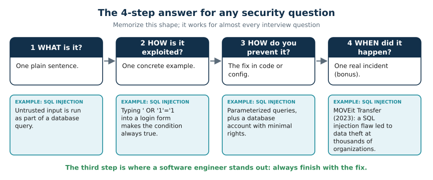
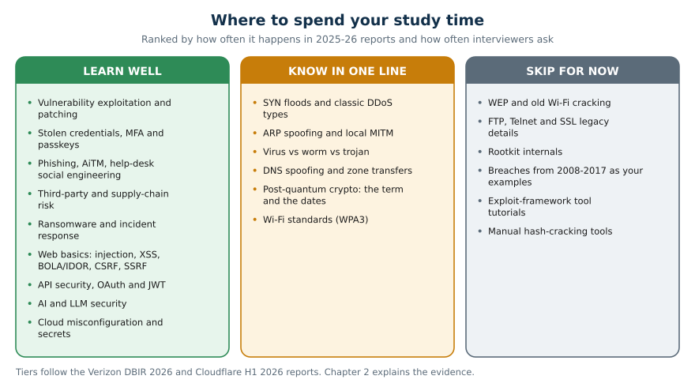

# Start Here

> **Goal.** After four weeks you can talk about security at a broad technical-interview level: the vocabulary, the common attacks and defences, how a breach and its response unfold, and how AI agents change the picture. You do not need to become a security professional.
>
> **Time:** one month at about 10 hours a week (evenings plus weekends). Reading all chapters takes about 12 hours; the rest is labs and speaking practice.

---

## What this book is

This is the **AI-agent-era edition of *Interview Prep: 4-Week Crash Course***. It keeps the original's breadth (basics, crypto, networks, scanning, web attacks, identity, DDoS, ransomware and incident response, supply chain, AI) and compacts it from about 35,000 to about 21,000 words (110 to about 77 pages). Every chapter from 1 to 11 has an **AI-agent era** callout, and Chapter 11 is rebuilt around AI features *and* AI coding agents. Rare and legacy cases were cut.

For the developer-focused deep dive (code, labs, secure code review), use the companion book, *Secure Coding for FE and BE Engineers: AI-Agent-Era Edition*.

## The one idea

> **Security is mostly a small set of ideas applied everywhere: least privilege, validate at trust boundaries, defence in depth, patch fast, prepare to respond.** AI agents add a fast, confident new participant that reads untrusted content and acts with your permissions; the same ideas apply.

## The four-week plan

| Week | Chapters | Practice |
| --- | --- | --- |
| **1: Foundations** (about 12 h) | 2 Basics, 4 Networking and web, 3 Cryptography | Explain aloud: what happens when you open a URL; the CIA triad; TLS in two sentences |
| **2: Core attacks** (about 13 h) | 5 Recon and scanning, 6 Appsec core, 7 Identity and phishing | Juice Shop: find two web bugs; run `nmap` on your own machine; explain MFA and phishing |
| **3: Defence and context** (about 11 h) | 9 Ransomware and incident response, 8 Network attacks and DDoS, 10 Supply chain and cloud, 1 Landscape | Walk through a ransomware timeline and the IR phases aloud; audit one repo's dependencies |
| **4: AI, gaps and recall** (about 14 h) | 11 AI and agent security, 15 CEH gap terms, 16 Working with AI, then 12 Q&A and 14 Glossary | One agent lab (A1-A4); about 25 questions aloud twice; two mock interviews |

That totals about 50 hours. To fit 40, drop Chapter 10 to a single read, skip Chapter 1 beyond its numbers, and do three labs only. Keep Weeks 1 and 2 intact.

**Weekday rhythm (about 90 minutes):** 30 minutes read, 30 lab, 20 saying answers aloud, 10 writing what you got wrong. **Two-week version:** Chapters 2, 4, 5, 7, 9, 11 and 12, plus the glossary.

## Priority path (if your interview is mostly a formality)

**Assume you are not yet comfortable with networking and the web, even as a software engineer.** Start with the foundations, because every later topic (scanning, attacks, DDoS, incident response) builds on them.

| Step | Chapters | Time |
| --- | --- | --- |
| **1. Foundations (first)** | 2 Basics, 4 Networking and web, 3 Crypto (hash vs encrypt vs encode, TLS) | about 12 h |
| **2. Core interview topics** | 5 Recon and scanning, 6 Appsec core (SQL injection, XSS, CSRF, IDOR), 7 Identity and phishing, 9 Incident response | about 18 h |
| **3. Key points** | 1 Landscape, 8 Network attacks and DDoS, 10 Supply chain and cloud, 11 AI and agents, 15 CEH gap terms, 16 Working with AI | about 12 h |
| **4. Practise and recall** | 12 Q&A (pick about 25 questions, say each aloud twice), 14 Glossary (read twice), 13 Labs (do three: Juice Shop, `nmap` on your own machine, one agent lab) | about 10 h |

If a step feels hard, stay on it an extra day: a weak foundation makes the later chapters feel like memorising. Chapters 15 and 16 are new: **15** defines CEH-syllabus topics the other chapters skip, and **16** covers working with AI as a security operator.

## How to answer

Use one shape: **threat, control (with a one-line example), a backup layer, how you would test it.**

## What to study first if time is short

## Rules for practice

Test only systems you own, deliberately vulnerable training apps, training sites that invite attacks, or systems you have written permission to test. Scanning or attacking anything else is illegal in most countries.

## Accuracy

Security facts change quickly. Incident figures are reported estimates, and Verizon figures come from news coverage of the report. The last chapter says what was read and what is only reported. Say "according to" when you quote a number.
