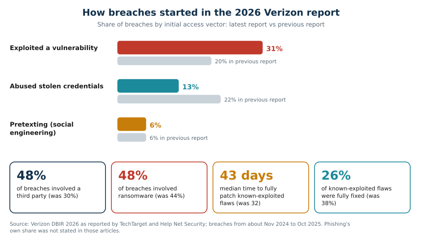
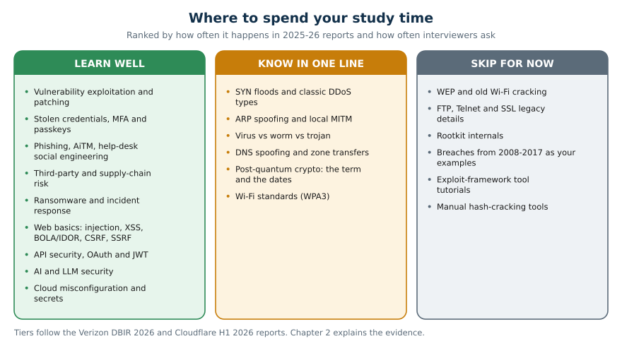

# Chapter 1: The Threat Landscape in the AI-Agent Era

> **Goal.** After this chapter you can: say how breaches start today, with numbers and caveats; name the themes of 2025-26; give three recent cases with one-line lessons; and explain how AI agents change the picture.
>
> **Time:** about 45 minutes.

---

## 1. How breaches actually start

The best single source is the **Verizon Data Breach Investigations Report (DBIR)**. Its 2026 edition (May 2026) changed the headline: exploiting a vulnerability overtook stolen credentials.

As reported by [TechTarget](https://www.techtarget.com/cybersecurity/news/366643420/Verizon-2026-DBIR-6-key-takeaways-for-CISOs) and [Help Net Security](https://www.helpnetsecurity.com/2026/05/20/verizon-2026-dbir-findings/):

- **Exploited vulnerabilities: about 31%** of breach starts (20% the year before).
- **Stolen credentials: about 13%** (from 22%); **pretexting** about 6%.
- **Third parties: about 48%** of breaches (from 30%).
- **Ransomware: about 48%** of breaches; 69% of victims did not pay.
- **Slow patching:** only 26% of known-exploited flaws were fully fixed; median 43 days.

> **Caution.** These figures come from *news coverage* of the report, not the report. Say "according to Verizon's 2026 report", round them, and stress the shape: known flaws, stolen access and vendors dominate. That is good news, because ordinary discipline defends against all three.

> **Remember:** Breaches start through three doors: **exploited vulnerabilities**, **stolen or phished credentials**, and **third parties**. Quote any percentage as "according to the Verizon 2026 report, as reported"; the direction matters more than the exact number.

## 2. The themes of 2025-26

| Theme | What is happening |
| --- | --- |
| **Unpatched and edge-device flaws** | Attackers race to exploit new flaws in VPNs, firewalls and file-transfer tools |
| **Identity is the perimeter** | Infostealer-stolen logins, phishing proxies that defeat ordinary MFA, help-desk attacks |
| **Third parties and supply chain** | A vendor's token or a poisoned package becomes your breach |
| **Ransomware and extortion** | Data is stolen first, then systems are locked |
| **AI on both sides** | Attackers scale with AI; agents and AI apps are a new attack surface |
| **Bigger, shorter DDoS** | Record volumes, but most attacks end within minutes |

> **Remember:** Remember the *direction*: attackers use stolen logins and unpatched flaws more than clever hacking. Skip the exact figures.

## 3. Cases to keep in your pocket

| Case | Lesson | Status |
| --- | --- | --- |
| **MOVEit Transfer (2023)**: SQL injection zero-day, CVE-2023-34362 | Old bug class, huge impact; patch internet-facing tools first | Confirmed |
| **Change Healthcare (2024)**: remote portal without MFA | One missing control plus free movement inside | Confirmed; about 190 million people reported |
| **XZ Utils (2024)**: a backdoor planted by a long-trusted maintainer, CVE-2024-3094 | Trusted maintainers are a risk; found by luck | Confirmed |
| **Salesloft Drift (2025)**: stolen OAuth tokens of an integration | A vendor's token is your data | Confirmed; 700+ organizations potentially affected |
| **Shai-Hulud npm worm (2025)**: self-spreading package that steals tokens | Installs can run code; rotate secrets fast | Confirmed |
| **EchoLeak (2025)**: zero-click prompt injection in Microsoft 365 Copilot, CVE-2025-32711, CVSS 9.3 | Assistants can be steered by content they read | Confirmed; patched |
| **Klue (2026)**: a 2022 pilot credential never retired; about 200 downstream companies | Credential lifecycle plus third parties | Confirmed by Klue |
| **2026 developer-tool wave** and the **Instagram/Meta AI chatbot** takeovers | Developer tools and AI helpers are targets | Reported (TechCrunch roundup; 404 Media and NYT) |

> **Remember:** Remember two or three cases and the **lesson** of each (for example: a poisoned package spreads like a worm; a vendor's breach becomes yours). Skip dates and victim counts.

## 4. What AI agents change

Coding agents (Claude Code, Cursor, Copilot and similar) now write, install and run code for developers. Four shifts follow:

1. **Code is cheap, review is scarce.** Large diffs arrive in minutes; reading them is the bottleneck.
2. **The agent is a new insider.** It reads files and runs commands with your permissions; text that steers it steers *you*.
3. **Attackers use agents too.** Finding and exploiting known flaws gets faster.
4. **The supply chain has a new door.** Agents choose dependencies (sometimes invented names), and malware can call AI tools already on a developer machine.

> **Read the evidence as "reported", not "settled".** Most figures are vendor or press numbers that measure different things.

| Claim | Source and caveat |
| --- | --- |
| AI-generated code often fails security tests: Veracode's 2026 report found an average **56%** pass rate (about 44% failed), "virtually unchanged"; its 2025 report reported about 45% failing | Veracode press release, 28 Jul 2026 (**read**); vendor research on raw models without guardrails or review |
| Models invent package names: at least **5.2%** (commercial) and **21.7%** (open-source) of suggested packages; **205,474** unique made-up names across 576,000 samples | USENIX Security 2025 study, arXiv abstract (**read**) |
| A state-sponsored group used Claude Code for **80-90%** of an espionage campaign against about **30** targets; a small number succeeded; the model sometimes hallucinated results | Anthropic report, 13 Nov 2025 (**read**) |
| Malicious Nx npm releases (Aug 2025) used developers' installed AI command-line tools to hunt for secrets; over 400 users or organizations and 5,500+ repositories affected | InfoQ (**read**); related to, not the same as, Shai-Hulud |
| Prompt-injection and approval-bypass bugs in several coding tools (Copilot, Cursor, Claude Code) in 2025-26 | **Reported** by vendors and press; verify CVE details at NVD |
| Exploitation is getting faster | Vendor figures with different metrics; check originals before quoting |

**What did not change:** the bug classes (injection, broken access control, weak secrets, vulnerable dependencies) and the principles (least privilege, defence in depth, validate at boundaries). Chapters 6 and 11 cover them in the agent era.

> **AI-agent era.** The sentence to remember: *"The agent is fast and confident, not accountable. I own the diff."* Interviews still ask the classics, plus "how do you use AI tools safely?".

> **Remember:** AI agents are a fast new participant that **reads untrusted content and acts with your permissions**. The old principles (least privilege, review, tests) still apply.

## 5. Interview angle

> **"What are the biggest threats right now?"** "Attackers mostly get in through three doors: known vulnerabilities not yet patched, stolen or phished credentials (including phishing that defeats ordinary MFA), and third parties such as a vendor token or a poisoned dependency. Ransomware monetizes that access. AI adds scaled phishing and a new attack surface: agents that read untrusted content and act with your permissions. The common thread is least privilege, fast patching and review."

> **Remember:** Practise the sample answer aloud once, in your own words.

---

## Check yourself

1. What is now the most common way breaches start, and what was it before?
2. What share of breaches involved a third party, and why does it matter to developers?
3. Name three recent cases and the lesson of each.
4. Why is "the agent is a new insider" a useful model?

**Answers** *(cover this until you have tried)*

1. Exploiting a vulnerability (about 31%); before, stolen credentials led (about 13% now).
2. About 48% (up from 30%); dependencies, SaaS integrations and vendors become your breach.
3. For example MOVEit (SQL injection in a widely used product), Change Healthcare (portal without MFA), Shai-Hulud (a package that steals tokens and spreads).
4. It acts with your permissions and reads untrusted content, so anything that steers it acts as you; insider controls (least privilege, approvals, logging) apply.

---

## Summary

- Verizon 2026 (as reported): exploited flaws about 31%, stolen credentials about 13%, third parties about 48%, slow patching (median 43 days).
- Themes: edge flaws, identity, third parties, ransomware, AI, shorter DDoS.
- Agents change review, insider risk, attacker speed and the supply chain; the old bugs and principles still apply.
- Quote evidence as "according to", with its caveat.
