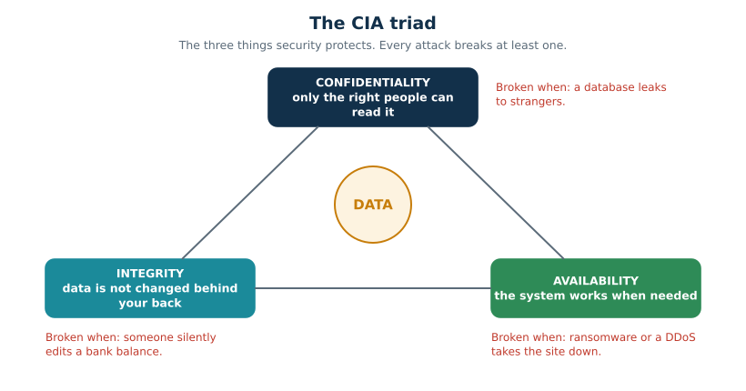
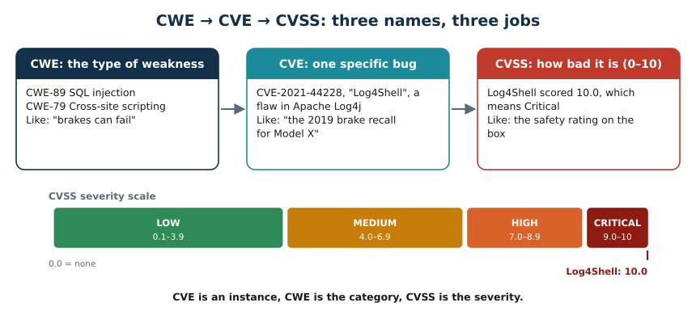
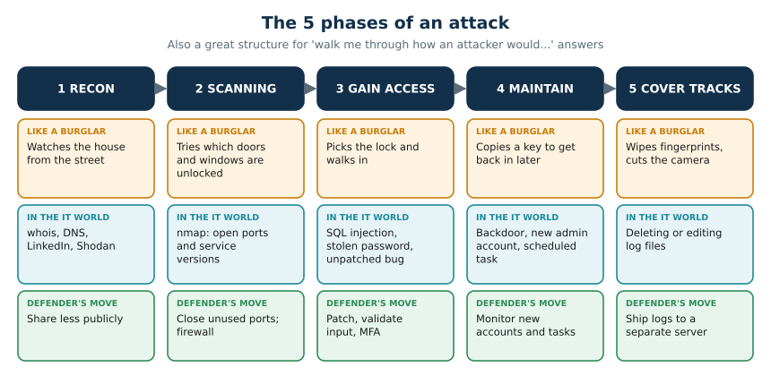
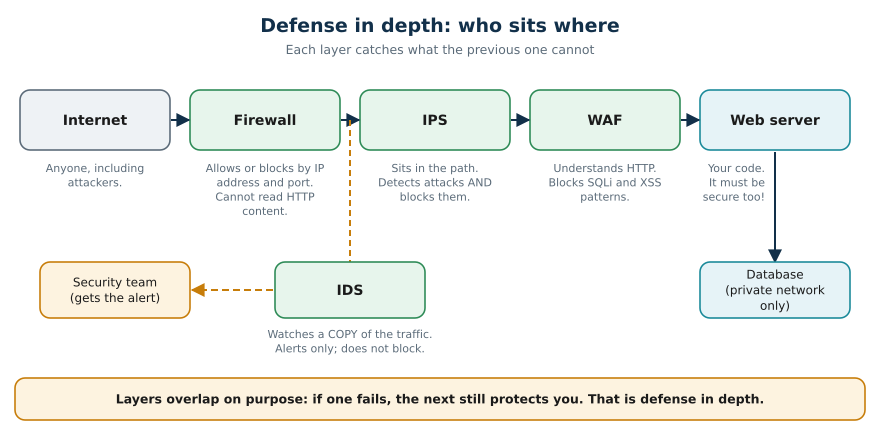

# Chapter 2: Security Basics

> **Goal.** After this chapter you can: explain the CIA triad with an example per letter; define vulnerability, threat, risk and exploit without mixing them up; walk through the five phases of an attack; use the CVE, CWE, CVSS and KEV vocabulary; and give the two design principles interviewers love.
>
> **Time:** about 45 minutes. This is the vocabulary of every interview.

---

## 1. The big picture

Security keeps a system useful and trustworthy **while someone is actively trying to break it**. Two facts shape everything: **the attacker needs one way in, the defender must close all of them** (so we stack controls), and **security is about risk, not perfection** (you decide which risks are worth the cost).

## 2. The CIA triad

When asked about *any* attack, say which of the three it breaks.

| Property | Question | Broken by | Controls |
| --- | --- | --- | --- |
| **Confidentiality** | Only the right people can read it? | A database leak, an exposed bucket | Encryption, access control, MFA |
| **Integrity** | Is the data exactly right? | Silent edit of a payment amount | Hashing, signatures, validation, audit logs |
| **Availability** | Does it work when needed? | Ransomware, DDoS | Redundancy, tested backups, rate limits |

Extra words: **authenticity** (is the sender who they claim?) and **non-repudiation** (the sender cannot deny it; signatures give this). Don't treat security as only "keeping secrets": a hospital locked by ransomware failed at availability.

## 3. Vocabulary

| Term | Meaning | In software |
| --- | --- | --- |
| **Asset** | Worth protecting | Customer data, source code, uptime |
| **Vulnerability** | A weakness | A query built by string concatenation |
| **Threat** | Something that could exploit it | Attacker, malware, careless insider |
| **Exploit** | Technique or code that uses it | A crafted input that triggers the bug |
| **Risk** | How bad and how likely | **Likelihood x impact** |
| **Control** | Reduces risk | Patch, validation, MFA |
| **Attack surface** | All that an attacker can reach | Endpoints, ports, inputs, dependencies, vendors |
| **Zero-day** | A flaw with no fix yet | A bug already being exploited |

A bug that is trivial to reach from the internet and exposes every customer is **high** risk; one that needs physical access to a locked room and reveals nothing is **low**, even though both are "vulnerabilities".

> **Interview angle.** *"Vulnerability vs threat vs risk?"* "A vulnerability is a weakness, a threat is something that could exploit it, risk is the likelihood and impact of that happening. A scary bug that is hard to reach and exposes nothing is lower risk than a boring one that is easy to reach and exposes everything."

## 4. CVE, CWE, CVSS, KEV

| Name | What it is | Example |
| --- | --- | --- |
| **CVE** | An ID for one specific vulnerability in a product | CVE-2025-55182 |
| **CWE** | A category of weakness (the *type* of bug) | CWE-89, SQL injection |
| **CVSS** | A 0-10 severity score (technical severity, not your risk) | 9.8 = critical |
| **KEV** | CISA's catalogue of vulnerabilities **known to be exploited** in the wild | Fix these first |

Prioritize by **exploited in the wild (KEV) and exposure**, then score. A 7.5 on an internet-facing system that is being exploited beats a 9.0 nobody can reach.

## 5. The five phases of an attack

1. **Reconnaissance:** learn about the target without touching it (public records, job posts, leaked data).
2. **Scanning:** probe which hosts, ports and versions exist.
3. **Gaining access:** a weakness: an injection flaw, a stolen password, an unpatched service, a persuasive phone call.
4. **Maintaining access:** a backdoor, a new admin account, a scheduled task.
5. **Covering tracks:** deleting or editing logs.

Each phase has a defender's counter-move; the best defence breaks the chain **early**. Real attacks loop: after one machine, the attacker returns to phases 1 and 2 for the next. Professionals use **MITRE ATT&CK**, a public catalogue of tactics and techniques; your five phases are the simple summary.

## 6. Who is who

| Label | Permission? | Intent |
| --- | --- | --- |
| **White hat** (ethical hacker) | Written permission | Improve security |
| **Black hat** | None | Profit, damage |
| **Grey hat** | None, but meaning well | Often reports a flaw (legally risky) |

**Red team** simulates attackers, **blue team** defends and responds, **purple team** shares findings. Ethical hacking needs **permission, scope and reporting**; lose any one and it is no longer ethical.

**Vulnerability assessment vs penetration test:** an assessment is broad and mostly automated ("what weaknesses exist?"); a pentest is narrow and manual ("what can an attacker actually *do*?").

## 7. Two principles interviewers love

- **Least privilege:** each user and program gets only the access it needs. The web app's database account can `SELECT` and `INSERT` on its tables, not `DROP TABLE`.
- **Defence in depth:** overlapping controls so one failure is not fatal.

Three more one-liners: **never trust input** that crosses a trust boundary (forms, headers, files, other services and, now, **text an AI model reads**); **fail closed**; and **obscurity is not security** (a secret URL is not an access control).

> **Real case: Change Healthcare (2024).** A remote-access portal with no multi-factor authentication, entered with stolen credentials, then about nine days of movement before ransomware; about 190 million people reported affected. *Lessons:* one missing basic (MFA) and too much freedom inside (least privilege, segmentation).

> **AI-agent era.** Treat a coding agent as a user that needs least privilege: its own scoped, short-lived credentials, no production access, approvals for risky actions. The CIA triad still classifies what goes wrong: an agent that leaks a secret breaks confidentiality; one that deletes a database breaks availability and integrity. Agents also paste plausible but insecure code, so apply "never trust input" to model output too.

---

## Check yourself

1. Name the three letters of CIA and one attack that breaks each.
2. What is the difference between a threat and a vulnerability?
3. CVE vs CWE vs CVSS vs KEV in one line each?
4. Put the five phases in order and give an example for phase 3.

**Answers** *(cover this until you have tried)*

1. Confidentiality: a database leak. Integrity: a silent edit of a payment amount. Availability: ransomware or DDoS.
2. A vulnerability is the weakness; a threat is the actor or event that could use it.
3. CVE: an ID for one flaw. CWE: a category of weakness. CVSS: a 0-10 severity score. KEV: CISA's list of flaws known to be exploited.
4. Recon, scanning, gaining access, maintaining access, covering tracks. Phase 3: exploiting an injection flaw, using a stolen password, an unpatched service, or a persuasive phone call.

---

## Summary

- Name the CIA leg any attack breaks.
- Vulnerability = weakness, threat = who could use it, risk = likelihood x impact.
- Prioritize by exploited-in-the-wild (KEV) and exposure, then CVSS.
- Five phases: break the chain early. Least privilege and defence in depth are your default answers.
