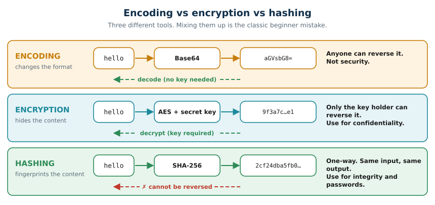
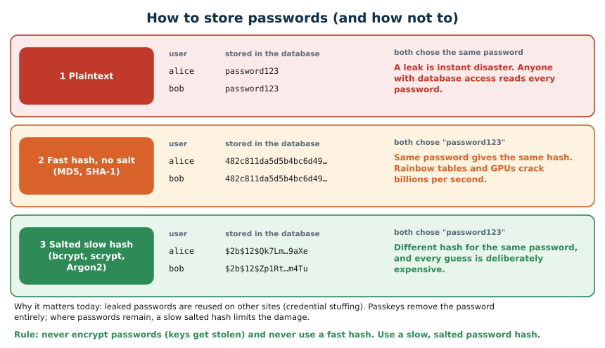
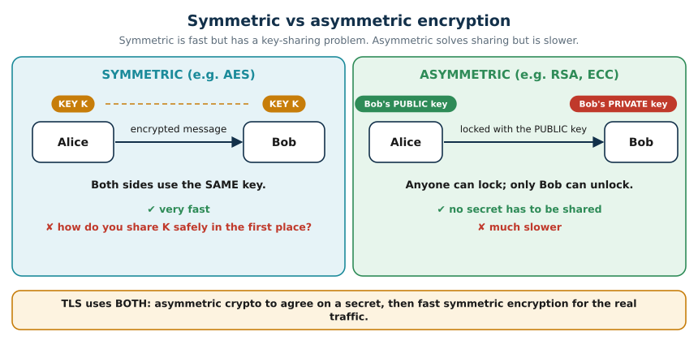
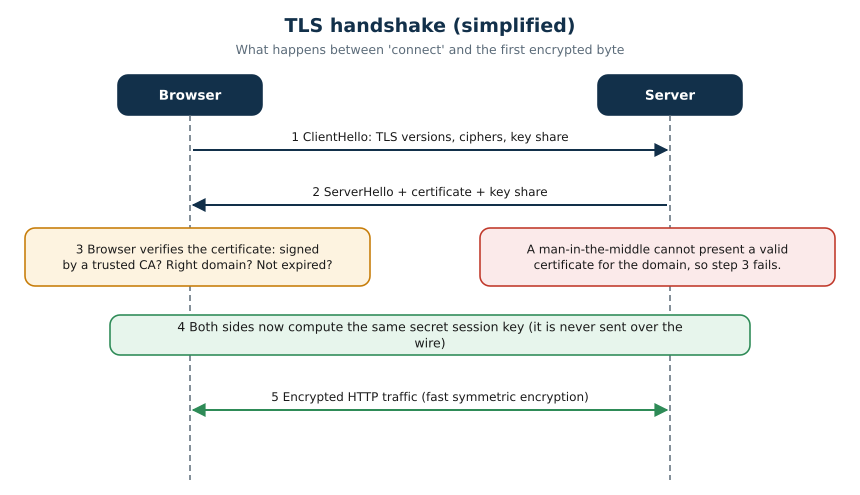
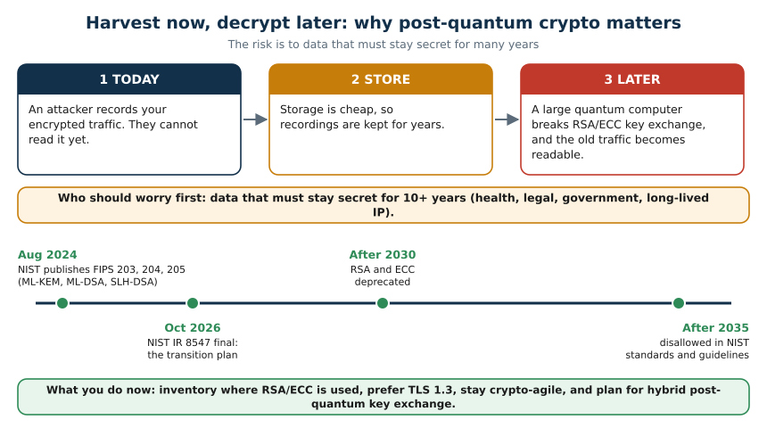

# Chapter 3: Cryptography You Actually Need

> **Goal.** After this chapter you can: pick between encoding, encryption and hashing; explain symmetric vs asymmetric encryption and why TLS uses both; describe certificates and signatures; narrate the TLS handshake; state how passwords are stored; and explain "harvest now, decrypt later" with the NIST dates.
>
> **Time:** about 75 minutes.

---

## 1. Three tools, three jobs

| You need to... | Use | Example |
| --- | --- | --- |
| Make data readable by another system | **Encoding** | Base64, URL-encoding |
| Keep data secret but recover it | **Encryption** | AES for files, TLS for traffic |
| Check data is unchanged, or store a password | **Hashing** | SHA-256 checksum, Argon2id |

Common mistakes: "Base64 is encryption" (anyone can decode it); "we decrypt the hash to verify" (a hash cannot be reversed; hash the attempt and compare); "we encrypt passwords" (passwords are hashed, never encrypted).

> **Remember:** **Hash** = one-way fingerprint (passwords). **Encrypt** = scramble with a key; reversible with the key. **Encode** = format change, no secrecy (Base64). Mixing these up is a classic mistake.

## 2. Hashing

A **hash** turns any input into a fixed-size fingerprint: deterministic, one-way, an avalanche effect (change one character, everything changes), collision resistant. You meet hashes in Git commits, download checksums, signatures (which sign a hash) and **HMAC** (proves a message came from someone with the secret).

| Algorithm | Status | Use for |
| --- | --- | --- |
| MD5, SHA-1 | **Broken** for security | Nothing security-related |
| SHA-256 / SHA-3 | Good | Integrity, signatures |
| **Argon2id**, scrypt, bcrypt | Good and *deliberately slow* | **Passwords** |

Fast hashes are bad for passwords: a GPU tries billions of SHA-256 guesses per second. Password hashes are slow and memory-hungry, so each guess is costly for the attacker.

**Storing passwords:** a slow purpose-built hash plus a **unique random salt** per user (identical passwords hash differently; lookup tables fail). Libraries store the salt inside the output string. A **pepper** is a shared secret kept *outside* the database. Verification: hash the attempt with the stored salt and compare; never decrypt.

Modern risk is mostly passwords stolen from *users* (phishing, infostealers, credential stuffing), so the next step is MFA and passkeys (Chapter 7).

> **Interview angle.** "Passwords are hashed with a slow, salted algorithm such as Argon2id, never encrypted and never a fast hash like MD5. Slowness makes guesses expensive; the per-user salt defeats precomputed tables. Better still, reduce reliance on passwords with passkeys and MFA."

> **Remember:** Store passwords with a **slow, salted password hash** (Argon2id first choice), never plain text, never a fast hash like MD5 or SHA-1, never encryption. Skip the exact parameters; know why.

## 3. Symmetric vs asymmetric

| | Symmetric (AES) | Asymmetric (RSA, ECC) |
| --- | --- | --- |
| Keys | One shared secret | Public/private pair |
| Speed | Very fast | Much slower |
| Problem | Sharing the key safely | Slowness |
| Use | Encrypting the data | Agreeing on a key, signing, identity |

They fix each other's weaknesses, so real systems (TLS) use **both**. **Diffie-Hellman** lets two parties agree on a shared secret over an open channel without sending it.

> **Remember:** **Symmetric:** one shared key, fast, used for the data. **Asymmetric:** public and private key pair, used to exchange keys and sign. Real systems use both.

## 4. Signatures and certificates

**Signature:** sign a hash with the **private** key; anyone verifies with the **public** key. It proves integrity, authenticity and non-repudiation. (Encryption is the reverse: public key locks, private key unlocks. Passkeys use signing: your device signs a challenge.)

**Certificate:** a public key alone proves nothing. A certificate is a signed statement from a trusted **Certificate Authority**: "this key belongs to bank.com." The browser walks the **chain of trust** (site, intermediate, root already trusted) and checks: trusted CA, right domain, valid dates, not revoked.

> **Remember:** A **signature** proves who sent something and that it was not changed. A **certificate** is a CA's signed statement that a public key belongs to a named site.

## 5. The TLS handshake

1. **ClientHello:** versions, cipher suites, the client's key-exchange half.
2. **ServerHello and certificate:** the server's choices, certificate and key-exchange half.
3. **Verification:** the browser checks the certificate.
4. **Session key:** both sides compute the *same* key; it is never sent.
5. **Encrypted traffic** using the fast symmetric key.

A man-in-the-middle fails because the attacker cannot get a CA-signed certificate for bank.com. Follow-ups: **forward secrecy** (temporary session keys; a stolen long-term key cannot decrypt past traffic; required by TLS 1.3); **TLS 1.3** is faster and dropped weak options; the **padlock** means encrypted and the domain is really owned, **not** that the site is trustworthy; **HSTS** tells browsers to always use HTTPS and blocks downgrades.

> **Remember:** In two sentences: the browser checks the server's certificate and they agree on a key using asymmetric crypto; then all data is encrypted with fast symmetric crypto. Skip the message-by-message details.

## 6. Post-quantum cryptography

A large quantum computer could break RSA and elliptic-curve public-key crypto. Such machines do not exist at scale yet, but an attacker can **record traffic today and decrypt it later** ("harvest now, decrypt later"). NIST notes migrations historically take 10 to 20 years.

- **August 2024:** NIST published the first three standards: **FIPS 203 (ML-KEM)** for key establishment, **FIPS 204 (ML-DSA)** and **FIPS 205 (SLH-DSA)** for signatures.
- **October 2026:** NIST finalized **IR 8547**: quantum-vulnerable public-key algorithms (RSA, ECDSA, EdDSA, Diffie-Hellman) are **deprecated after 2030 and disallowed after 2035**, high-risk systems earlier.

For developers: know the words (harvest now decrypt later, ML-KEM, **hybrid** key exchange); symmetric crypto and hashes are much less affected (AES-256, SHA-256); the urgent work is key exchange and signatures; be **crypto-agile** (do not hard-code algorithms, know where you use RSA/ECC: TLS, JWT signing, code signing, SSH); use TLS 1.3 and keep libraries updated. It is a planning topic, not a panic topic.

> **Remember:** Future quantum computers may break today's public-key crypto, so data stolen now could be read later ("harvest now, decrypt later"). NIST published new standards in 2024; the plan is to migrate. Skip the algorithm names and dates.

## 7. Mistakes developers actually make

- Rolling your own crypto (use a vetted library).
- Hard-coded keys in source, committed config or front-end bundles.
- Fast password hashes (MD5, SHA-1, plain SHA-256).
- ECB mode (leaks patterns); prefer **AES-GCM**.
- Predictable randomness: `Math.random()` is not for tokens; use `crypto.randomBytes` (Node) or `secrets` (Python).
- Disabling certificate verification (`verify=False`) to silence an error.

> **AI-agent era.** These are exactly the patterns an agent reproduces from its training data: `Math.random` tokens, MD5 or SHA-1 passwords, `verify=False` "to fix the error", and example keys pasted into code. Add "use `crypto.randomBytes`, Argon2id, never disable TLS verification, no hard-coded secrets" to your prompt rules, grep the diff for them, and keep secrets out of any file or environment the agent can read.

> **Remember:** Never invent your own crypto, hard-code keys, or use a non-secure random generator for tokens. Use well-known libraries.

---

## Check yourself

1. Is Base64 encryption? Why or why not?
2. How do you check a login if a hash cannot be decrypted, and what does a salt do?
3. Why does TLS use both asymmetric and symmetric encryption?
4. What is "harvest now, decrypt later", and which NIST dates should you remember?

**Answers** *(cover this until you have tried)*

1. No. It is encoding, reversible by anyone without a key.
2. Hash the submitted password with the stored salt and compare hashes. A salt is random and per user; it makes identical passwords hash differently and defeats precomputed tables.
3. Asymmetric crypto agrees on a key over an open network but is slow; symmetric is fast for bulk data. TLS uses the first to set up the key and the second to encrypt traffic.
4. An attacker records encrypted traffic now and decrypts it later with a quantum computer. NIST published ML-KEM and two signature standards in August 2024; IR 8547 (final October 2026) deprecates RSA/ECC after 2030 and disallows them after 2035.

---

## Summary

- Encoding = format, encryption = secrecy, hashing = fingerprint.
- Passwords: Argon2id, scrypt or bcrypt, salted; never encrypted, never fast hashes.
- Asymmetric agrees on a key; symmetric encrypts the data; certificates make a man-in-the-middle fail.
- Post-quantum: ML-KEM (FIPS 203); RSA/ECC deprecated after 2030, disallowed after 2035; be crypto-agile.
- Real failures are key management and misuse, and agents repeat the common misuse patterns.
