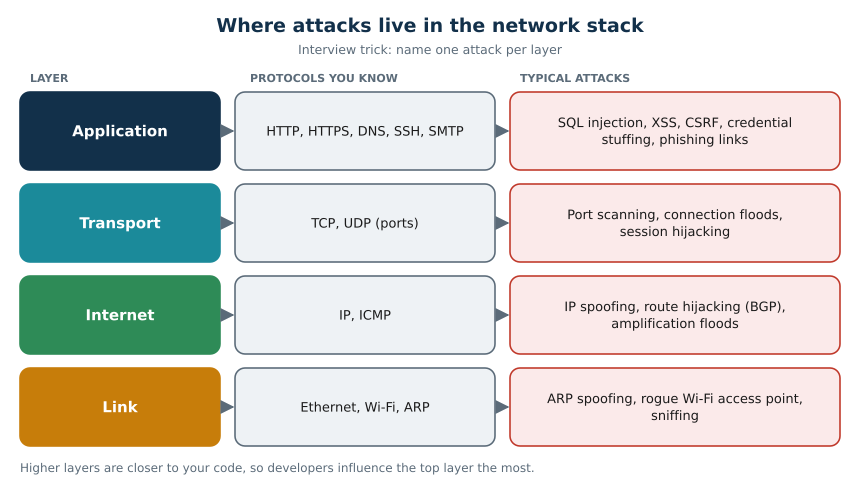
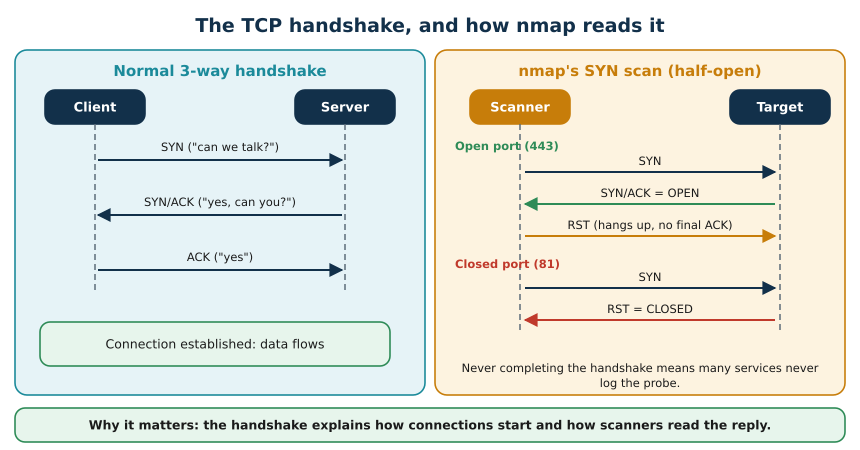
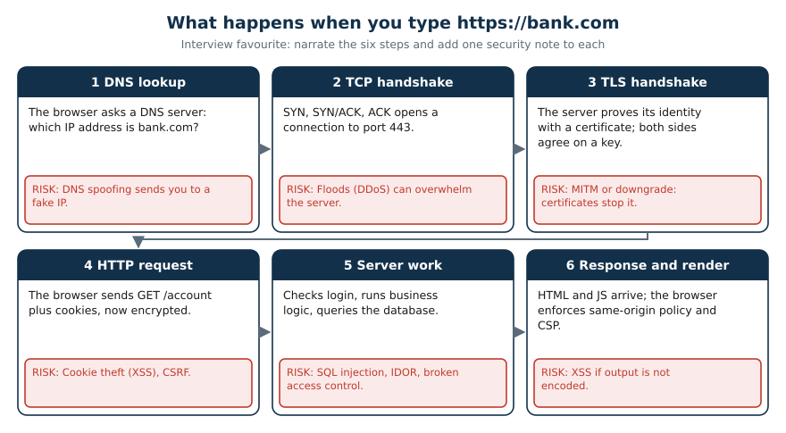

# Chapter 4: Networking and How the Web Works

> **Goal.** After this chapter you can: name one attack per network layer; explain the TCP handshake and DNS; narrate "what happens when you type https://bank.com" with a risk at each step; and explain cookie flags, security headers, the same-origin policy and CORS.
>
> **Time:** about 60 minutes. You already use most of this daily; the work is to re-read it asking "what could go wrong, and for whom?"

---

## 1. Layers, and where attacks live



| Layer | Example attack |
| --- | --- |
| Link | ARP spoofing, rogue Wi-Fi access point |
| Internet | IP spoofing, route hijacking |
| Transport | Port scanning, connection floods |
| **Application** | SQL injection, XSS, CSRF, session theft |

In 2026 the **application layer** is where most real incidents happen, so spend your time there.

**TCP vs UDP:** TCP sets up a connection first and guarantees ordered delivery (web, email, SSH). UDP is connectionless and faster, best effort (DNS, video calls, games). **Ports** are numbered doors (0-65535); a service listens on one, and a scan checks which are open.

## 2. The TCP handshake



**SYN** ("can we talk?"), **SYN/ACK** ("yes, can you?"), **ACK** ("yes"). You need it for two reasons:

- **Scans:** nmap's default scan sends the SYN, reads the reply (SYN/ACK means open, RST means closed) and hangs up (Chapter 5).
- **Floods:** a *SYN flood* abuses the wait for the final ACK. It is real but well mitigated (SYN cookies are built into modern systems), and in Cloudflare's first-half-2026 data other floods dominate (Chapter 8). Know it in one line.

## 3. DNS: the internet's phone book

A device asks a *resolver*, which asks the root, then `.com`, then bank.com's nameserver; the answer is cached.

| Record | Holds | Security note |
| --- | --- | --- |
| **A / AAAA** | IPv4 / IPv6 address | The core answer |
| **CNAME** | Alias to another name | A forgotten CNAME to a deleted service allows **subdomain takeover** |
| **MX** | Mail servers | Reveals mail provider |
| **TXT** | SPF, DKIM, DMARC, domain verification | Email anti-spoofing lives here |

Know in one line: **DNS spoofing / cache poisoning** (a false answer sends users to a fake IP; DNSSEC adds signatures) and **DNS floods** (now the most common DDoS vector).

## 4. The master story: typing https://bank.com



Narrate it in about two minutes, with a risk at each step:

1. **DNS lookup**: resolve the name. *Risk: DNS spoofing.*
2. **TCP handshake** to port 443. *Risk: connection floods (DDoS).*
3. **TLS handshake**: certificate proves identity, both sides derive a session key. *Risk: man-in-the-middle, which certificates prevent.*
4. **HTTP request** with cookies, now encrypted. *Risk: session theft (XSS, malware), CSRF.*
5. **Server work**: authenticate, authorize, logic, database. *Risk: injection, IDOR/BOLA, broken access control.*
6. **Response and render**: the browser enforces its rules. *Risk: XSS if output was not encoded.*

> **Interview angle.** Do not recite; narrate with the risks. Attaching a threat to every step shows you think like a defender.

## 5. HTTP in a nutshell

```
GET /account HTTP/1.1
Cookie: session=a8f3...

HTTP/1.1 200 OK
Set-Cookie: session=a8f3...; HttpOnly; Secure; SameSite=Lax
Content-Security-Policy: default-src 'self'
Strict-Transport-Security: max-age=31536000
```

`GET` reads and must never change state (or a simple link becomes CSRF); `POST` acts; `PUT`/`PATCH` update; `DELETE` removes.

| Code | Meaning | Security note |
| --- | --- | --- |
| **401** | Not authenticated | Login needed |
| **403** | Authenticated, not allowed | Authorization failure |
| **404** | Not found | Sometimes used to avoid revealing a resource exists |
| **429** | Too many requests | Rate limiting |
| **500** | Server error | Verbose traces leak internals |

HTTP is **stateless**; after login the server sends a random **session ID** in a cookie. Whoever holds it *is* that user, so **session theft is account takeover**.

| Cookie flag | What it does | Defeats |
| --- | --- | --- |
| **HttpOnly** | Scripts cannot read it | Cookie theft through XSS |
| **Secure** | HTTPS only | Network sniffing |
| **SameSite** (`Lax`/`Strict`) | Not sent on most cross-site requests | CSRF |

**Headers:** **HSTS** forces HTTPS; **CSP** limits where scripts load from (second line of defence against XSS); **`X-Content-Type-Options: nosniff`** stops type guessing; **`frame-ancestors`** prevents clickjacking.

**Same-origin policy and CORS.** An origin is scheme + host + port. The browser stops a page from one origin *reading* responses from another. **CORS** is how a server *selectively relaxes* that rule.

> **Common mistake.** "Add CORS to make it secure." CORS **removes** a restriction; `Access-Control-Allow-Origin: *` with credentials is a classic misconfiguration. Also: "HTTPS means the site is safe" is wrong (phishing sites have valid certificates), and a traditional firewall cannot see an injection inside allowed port-443 traffic.

> **AI-agent era.** An AI coding agent often copies the permissive defaults it has seen most: `cors({ origin: true })`, missing cookie flags, no CSP. Check the headers of anything an agent scaffolds with `curl -I`, and add a test that asserts the expected headers.

---

## Check yourself

1. Name one attack for each of link, internet, transport and application layers.
2. Describe the three TCP handshake messages; how does nmap's SYN scan use them?
3. What do `HttpOnly`, `Secure` and `SameSite` each protect against?
4. Does CORS make a site more secure?

**Answers** *(cover this until you have tried)*

1. Link: ARP spoofing. Internet: IP spoofing. Transport: port scanning or floods. Application: SQL injection, XSS, CSRF.
2. SYN, SYN/ACK, ACK. nmap sends SYN, reads the reply (SYN/ACK open, RST closed) and hangs up without the final ACK.
3. Cookie theft by scripts; sniffing; CSRF.
4. No. It relaxes the same-origin policy; careless settings reduce security.

---

## Summary

- Layers: name one attack each, then focus on the application layer.
- TCP handshake explains scans; SYN floods are a one-liner now.
- DNS maps names to IPs; narrate the URL journey with a risk per step.
- Protect sessions with `HttpOnly`, `Secure`, `SameSite`, HSTS and CSP; CORS relaxes rules and is not a defence.
- Verify what an agent scaffolds; it copies common insecure defaults.
