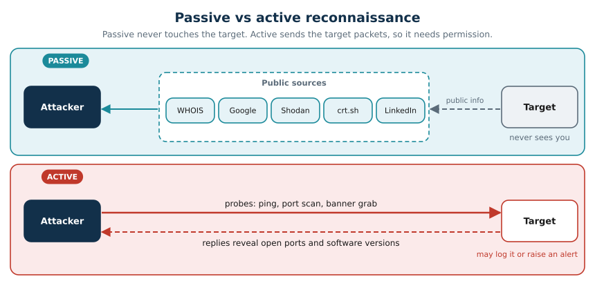
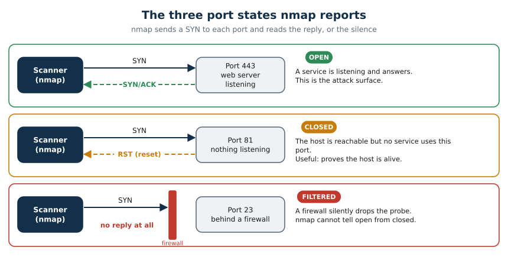
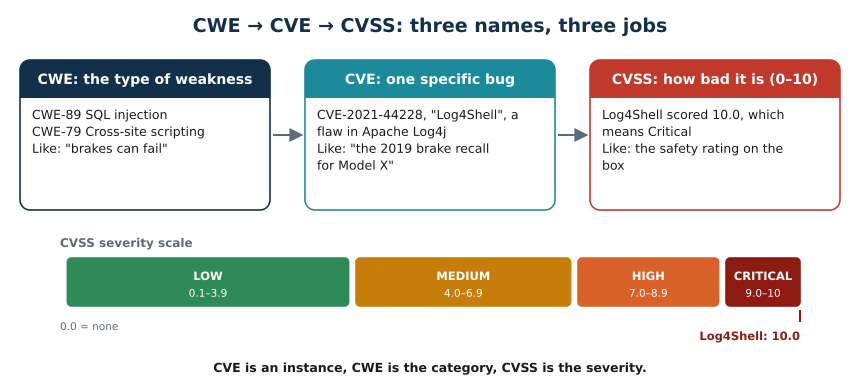

# Chapter 5: Recon, Scanning and Vulnerabilities

> **Goal.** After this chapter you can: explain passive vs active reconnaissance; read nmap port states; explain CWE, CVE, CVSS and KEV; prioritize vulnerabilities by exploitation and exposure; and state the legal boundaries of scanning.
>
> **Time:** about 60 minutes. Exploiting known vulnerabilities is now the number one way breaches start (Chapter 1), so patch speed is a security control.

---

## 1. Legal first

> **Rule zero.** Scanning is ethical only with **permission**. Port scanning systems you do not own can be a crime in many countries, even if you "only looked". Practise on your own machines, practice platforms, and `scanme.nmap.org`, which the nmap project invites you to scan lightly.

In a real engagement permission lives in a signed **scope document** (rules of engagement). Out of scope means do not touch.

> **Remember:** Test only what you **own** or have **written permission** to test. Say this first in any scanning answer.

## 2. Passive vs active recon

| | Passive | Active |
| --- | --- | --- |
| Touches the target? | **No** | **Yes** |
| Target can notice? | No | Possibly (logs, IDS) |
| Examples | WHOIS, Google, Shodan, LinkedIn | Ping sweep, port scan, banner grab |
| Permission? | Public data | **Always** |

**OSINT sources and the defender's lesson:** WHOIS/DNS (remove stale records), **certificate transparency logs such as crt.sh** (internal hostnames leak through certificates), Google dorks (check what search engines index), **Shodan/Censys** (know your own exposure), LinkedIn and job posts (fuel impersonation and phishing), leaked-credential data (enforce MFA).

> **Attack surface management** is the defender's version of recon: continuously finding *your own* internet-facing assets (forgotten servers, test systems, exposed VPNs) before attackers do. Edge devices and file-transfer tools are favourite targets in 2025-26.

> **Remember:** **Passive** never touches the target (public records, search, certificates). **Active** sends traffic to it (scanning) and needs permission.

## 3. What nmap tells you

nmap answers: which machines are alive, which ports are open, and what runs behind them?

| State | What happened | Meaning |
| --- | --- | --- |
| **Open** | Answered with SYN/ACK | A service listens: the **attack surface** |
| **Closed** | Answered with RST | Reachable, nothing listens |
| **Filtered** | No answer | A firewall drops the probe; unknown |

Concepts to know: a **ping sweep** finds live hosts; a **SYN ("half-open") scan** sends the SYN, reads the reply and never completes the handshake; a **connect scan** completes it and is noisier; **version detection (`-sV`)** names the software and version on each open port. The version column is the valuable one, because the next question is "does this version have a known vulnerability?" A SYN scan is "quieter" because the connection is never fully established, but modern intrusion detection still notices it.

**The classic chain:** *scan, version, known vulnerability (CVE), exploit.* Hiding the version banner is obscurity; the real fix is to patch.

**Defender's use:** run scans against your own estate, ask "does this server need all these open?", and close what you do not need.

> **Remember:** nmap finds hosts, open ports and service versions. Port states: **open** (a service answers), **closed** (reachable, nothing listening), **filtered** (a firewall hides it). Skip the command flags; know what it is for.

## 4. CWE, CVE, CVSS, KEV

| Name | Is | Example |
| --- | --- | --- |
| **CWE** | The **type** of weakness | CWE-89 SQL injection; CWE-79 XSS |
| **CVE** | **One specific** flaw in a product | CVE-2021-44228 "Log4Shell" |
| **CVSS** | **0-10 severity** score | Log4Shell scored 10.0 (Critical) |
| **KEV** | CISA's catalogue of flaws **confirmed exploited in the wild** | Updated continuously |

*CVE is an instance, CWE is the category, CVSS is the severity, KEV is "being used right now".*

Read a vector aloud: `AV:N/AC:L/PR:N/UI:N` means "attackable over the network, easy, no login, no user action". **Bands:** 0.1-3.9 Low, 4.0-6.9 Medium, 7.0-8.9 High, 9.0-10.0 Critical. (CVSS v4.0 exists; v3.1 is still most quoted.)

**Severity is not likelihood.** In Verizon's 2026 report (as reported) only **26%** of known-exploited vulnerabilities were fully fixed, with a median of **43 days**. So prioritize: (1) is it on **KEV**? (2) is the system **internet-facing**? (3) then CVSS and business impact.

> **Interview angle.** "How would you prioritize 500 vulnerabilities?" → *"Exploited in the wild first (KEV), then internet-facing assets, then CVSS and what is behind them, and I'd track time-to-fix."*

**Scanners** (Nessus, OpenVAS, cloud scanners) check systems against known-flaw databases. They give breadth but false positives, so a human triages.

> **Real case: MOVEit Transfer (2023).** A SQL injection zero-day (CVE-2023-34362) in a file-transfer product let the Cl0p group steal data from thousands of organizations: an Emsisoft tally reached about **2,800 organizations** and roughly **96 million people** by August 2024. *Lesson:* edge and file-transfer tools are favourite targets, and the window from disclosure to mass exploitation can be days.

> **AI-agent era.** AI tools speed up both sides: attackers use them for reconnaissance, phishing research and exploit adaptation, and vendors report the gap between disclosure and exploitation shrinking (metrics differ, so quote with care). Defenders should automate asset inventory and KEV-first patching. An agent with network or shell access must **never** be pointed at systems you do not own or have written permission to test.

> **Remember:** Same four as before: **CVE** (ID), **CWE** (weakness type), **CVSS** (0-10 severity), **KEV** (exploited now: fix first).

---

## Check yourself

1. Which is active: WHOIS, a Shodan search, or an nmap scan? Why does it matter legally?
2. What does a *filtered* port tell you, and what does it not?
3. What is the difference between a CWE and a CVE, and what is KEV?
4. Why can a Medium flaw outrank a Critical one?

**Answers** *(cover this until you have tried)*

1. The nmap scan; it sends packets to the target, so you need permission.
2. A firewall silently drops the probe; it does not tell you whether a service sits behind it.
3. CWE is a weakness category; CVE is one numbered flaw in one product; KEV is CISA's list of flaws confirmed exploited.
4. CVSS measures potential severity, not likelihood. A Medium that is on KEV and internet-facing is more urgent than an unreachable Critical.

---

## Summary

- Passive recon never touches the target; active recon needs written permission.
- nmap: open, closed, filtered; versions lead to CVEs.
- CWE type, CVE instance, CVSS severity, KEV exploited now.
- Prioritize by KEV, exposure, then CVSS; patch speed is a control.
- AI speeds both attackers and defenders; never aim an agent at systems you do not own.
