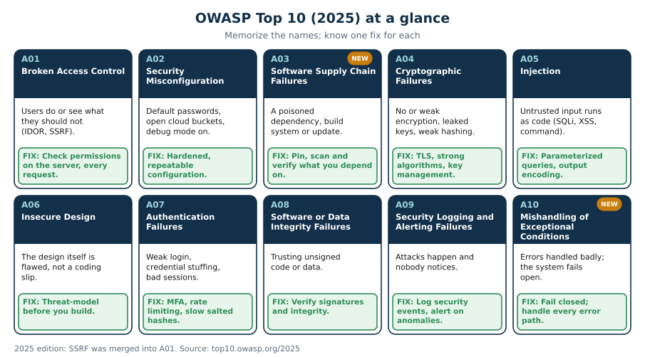
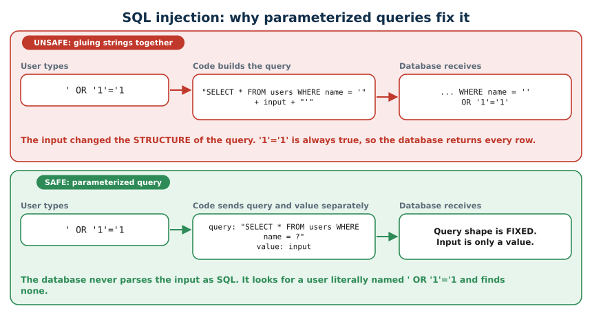
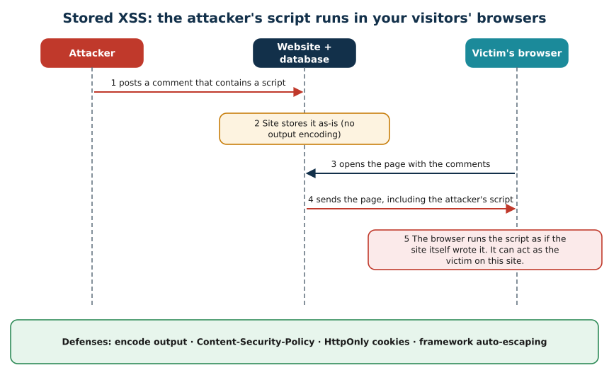
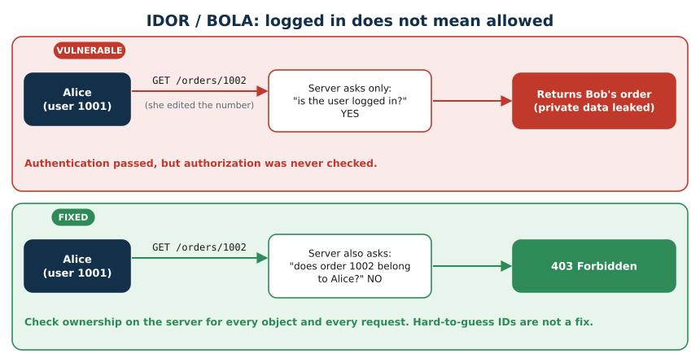
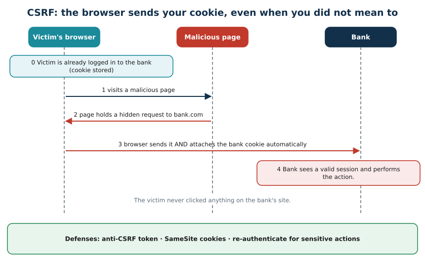
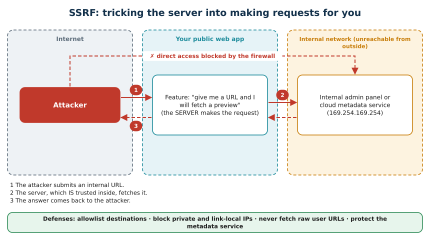

# Chapter 6: Application Security Core: OWASP, Injection, XSS, Access Control, CSRF, SSRF

> **Goal.** After this chapter you can: recite the OWASP Top 10 (2025) in five groups; explain the one idea behind every injection attack and fix SQL injection and XSS; explain BOLA/IDOR, BFLA and mass assignment with the code fix; explain CSRF and SSRF with their defences; and answer "how do you secure a REST API?" with a checklist.
>
> **Time:** about 90 minutes. This is the highest-value chapter for a software-engineering interview.

---

## 1. The map: OWASP Top 10 (2025)



Memorize it in five groups, not ten items:

| Group | Items | Theme |
| --- | --- | --- |
| **Who can do what** | A01 Broken Access Control, A07 Authentication Failures | Identity and permissions |
| **Setup and build** | A02 Security Misconfiguration, A03 Software Supply Chain Failures, A08 Software or Data Integrity Failures | Configuration, dependencies, trust in code |
| **Protecting data** | A04 Cryptographic Failures | Encryption and hashing done badly |
| **Code and design** | A05 Injection, A06 Insecure Design, A10 Mishandling of Exceptional Conditions | Untrusted input, design, error handling |
| **Seeing it happen** | A09 Security Logging and Alerting Failures | Detection |

**What changed in 2025:** two new categories (A03 supply chain, A10 exceptional conditions); **SSRF merged into A01**; Broken Access Control stays #1; Misconfiguration rose from #5 to #2. Say "the 2025 edition" and mention one change. Reciting the 2021 list looks dated.

---

## 2. The one idea behind every injection attack

> **Injection happens when untrusted data is mixed into a command or query and the interpreter cannot tell data from instructions.**

| Attack | Interpreter | Confused input |
| --- | --- | --- |
| SQL injection | Database | Input treated as SQL |
| Command injection | OS shell | Input treated as commands |
| XSS | Browser | Input treated as HTML/JS |
| **Prompt injection** | AI model | Content read treated as instructions (Chapter 11) |

**The universal fix:** keep code and data separate. For SQL that is parameterized queries; for HTML it is output encoding.



```python
# VULNERABLE: string-built query; input like ' OR '1'='1 changes the query's meaning
cursor.execute("SELECT * FROM users WHERE name = '" + username + "'")
# SAFE: shape and value travel separately
cursor.execute("SELECT * FROM users WHERE name = ?", (username,))
```

**SQL injection checklist:** parameterized queries (always); careful with ORM raw-query escape hatches; least-privilege DB account; allowlist table and column names (they cannot be parameterized); a WAF only as an extra layer. "We escape quotes" is brittle: parameterization removes the problem.

| Other flavour | Vulnerable | Fix |
| --- | --- | --- |
| **Command injection** | `os.system("ping " + host)` | `subprocess.run(["ping", host])`, no shell, allowlist |
| **NoSQL injection** | User objects or operators passed into a query | Validate types and shape with a schema |

> **Real case: MOVEit Transfer (2023).** A SQL injection flaw (CVE-2023-34362) in a file-transfer product was exploited as a zero-day by the Cl0p group; an Emsisoft tally reached about 2,800 organizations and roughly 96 million people by August 2024. A decades-old bug class can still cause a mass breach, and it was a third party's product.

---

## 3. Cross-site scripting (XSS)

An attacker gets their script to run in another user's browser, inside your site's trust boundary.



| Type | Script comes from | Who is hit |
| --- | --- | --- |
| **Stored** | Saved by the site (comment, bio) | Every visitor; the most dangerous |
| **Reflected** | The request (URL parameter) bounced back | Anyone tricked into the link |
| **DOM-based** | Client JS writes untrusted data (`innerHTML`) | Users on that page; the server may never see it |

```python
page = "<p>" + comment + "</p>"                  # VULNERABLE
page = "<p>" + html.escape(comment) + "</p>"     # SAFE: output-encoded
```

**Defences:** (1) encode output for its context; React, Vue, Angular and autoescaping templates do it by default; (2) know the escape hatches (`dangerouslySetInnerHTML`, `v-html`, `|safe`, `innerHTML`) and treat each use as a review flag; (3) sanitize rich HTML with DOMPurify; (4) a Content-Security-Policy as defence in depth; (5) `HttpOnly` cookies. "Validate input and XSS is solved" is wrong: the dangerous moment is output, and the right encoding depends on where it lands.

---

## 4. Access control: the number one risk

| | Authentication | Authorization |
| --- | --- | --- |
| Question | Who are you? | What may you do? |
| When | At login | On **every** request |
| Failure | 401 | 403 |



**BOLA / IDOR** (the same bug; BOLA is #1 on the OWASP API Security Top 10 2023): Alice changes `/orders/1001` to `/orders/1002` and the server, which only checked "is someone logged in?", returns Bob's order.

```python
order = db.get(Order, order_id)                                                    # VULNERABLE
order = db.query(Order).filter_by(id=order_id, owner_id=current_user.id).first()   # SAFE: scoped to the caller
if order is None: abort(404)
```

Long random IDs are a bonus, never access control: they leak through logs, referrers and shared links.

| Problem | Example |
| --- | --- |
| **Horizontal escalation** (BOLA) | Alice reads Bob's order |
| **Vertical escalation / BFLA** | A normal user calls an admin endpoint |
| **Mass assignment / BOPLA** | Client sends `{"isAdmin": true}` and the server saves it; fix with a strict schema of changeable fields |
| **Missing function-level check** | The button is hidden, the API is open |

**Rules:** deny by default; enforce on the server; centralize authorization; scope queries to the owner; **write a cross-user test** (log in as A, request B's data, expect 404).

**API Top 10 to know by name:** API1 BOLA, API3 Broken Object Property Level Authorization, API4 Unrestricted Resource Consumption (rate limits), API5 BFLA, API9 Improper Inventory (forgotten old endpoints). Return only the fields the caller needs.

---

## 5. CSRF and SSRF

**CSRF.** Browsers attach cookies automatically, even to requests triggered from another site. A malicious page can make your logged-in browser send a state-changing request. Needs: cookie authentication, a state-changing action, predictable parameters.



Defences: `SameSite=Lax`/`Strict` cookies (set explicitly), anti-CSRF tokens, `Origin` checks, a custom header for JSON APIs, re-authentication for sensitive actions, no state change on `GET`. Trap: **XSS defeats CSRF tokens** (the script reads the token); and CSRF runs no attacker code on your site.

**SSRF.** A feature fetches a user-supplied URL (previews, imports, webhooks); the attacker supplies an internal address, and your server, inside the trusted network, reaches admin panels and the cloud metadata service at `169.254.169.254`.



Defences: allowlist destinations; block private and link-local ranges **after DNS resolution** and re-check on redirects; do not return raw responses; hardened metadata (AWS IMDSv2) and least-privilege cloud roles; network segmentation. The classic case is Capital One (2019, public reporting), an illustration rather than a current trend.

---

## 6. The secure REST API checklist

| Area | Do this |
| --- | --- |
| Transport | HTTPS only, HSTS |
| Authentication | OAuth 2.0/OIDC or sessions; MFA; short-lived tokens |
| Authorization | Per object and per function, deny by default |
| Input | Validate type, length, format server-side; parameterized queries |
| Output | Only needed fields; generic errors, no stack traces |
| Abuse | Rate limits, quotas, request size limits |
| Secrets | Never in code or URLs; a secrets manager |
| CORS | Specific origins; never `*` with credentials |
| Inventory | Know every endpoint and version |
| Logging | Log auth and access-control failures; never log secrets |

> **AI-agent era.** Coding agents reproduce the patterns in their training data, so string-built SQL, `innerHTML`, and "logged in means allowed" endpoints appear in their output, and agents tend to write the happy path and skip per-object authorization. Review every generated route with the question "whose data is this?", and have the agent write negative tests (B cannot read A's order) before the feature. Studies report that a large share of AI-generated code fails security tests (Veracode 2026: about 56% pass rate, vendor research on raw models).

---

## Check yourself

1. State the single idea behind all injection attacks, and the fix for SQL.
2. Name the three types of XSS and the primary defence.
3. What is BOLA, and what is the one-line fix? How does it differ from BFLA?
4. Name two defences against CSRF and two against SSRF.

**Answers** *(cover this until you have tried)*

1. Untrusted data is mixed into a command and treated as instructions. For SQL: parameterized queries plus a least-privilege database account.
2. Stored, reflected, DOM-based. Context-aware output encoding (framework defaults), with CSP and HttpOnly cookies as layers.
3. Changing an object ID to reach someone else's object. Scope the lookup to the current user and deny otherwise. BFLA is calling a function (such as an admin action) you should not be able to call.
4. CSRF: SameSite cookies, anti-CSRF tokens (also Origin checks). SSRF: destination allowlist, block private and link-local IPs after DNS resolution, hardened metadata service, least privilege.

---

## Summary

- OWASP Top 10 2025 in five groups; new A03 and A10; SSRF folded into A01.
- Injection is data mistaken for code; separate them. SQL: parameterize. XSS: encode output.
- Access control is checked per object, per function, on the server; BOLA is the classic; test with two users.
- CSRF abuses automatic cookies; SSRF abuses the server's trusted position.
- Review AI-generated code for missing authorization and unsafe sinks.
