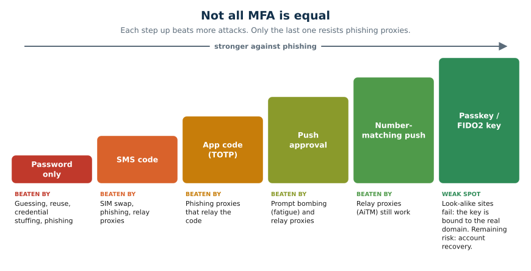
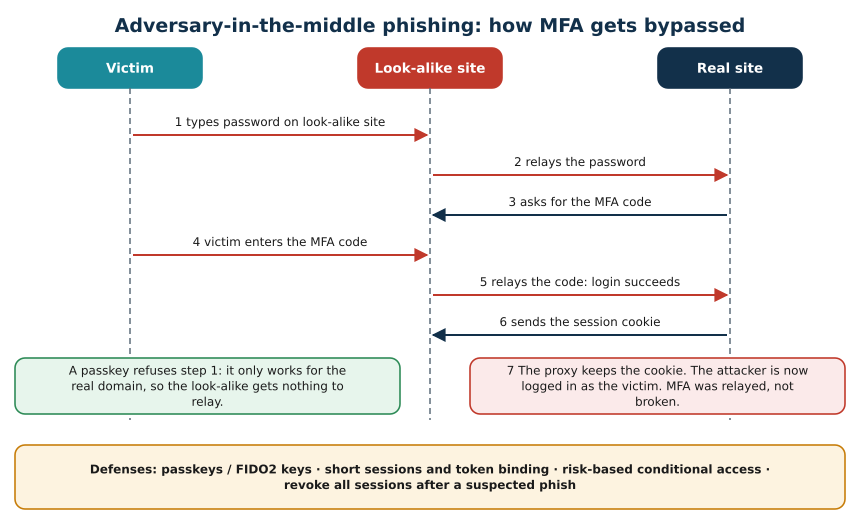
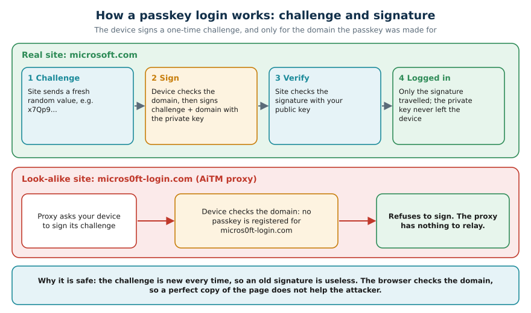
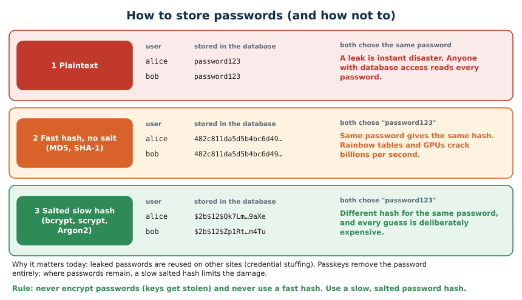

# Chapter 7: Identity, Phishing and Modern Authentication

> **Goal.** After this chapter you can: explain why identity is the main battlefield; list how logins get stolen; rank MFA methods and explain why ordinary MFA fails against adversary-in-the-middle (AiTM) phishing; explain passkeys; handle sessions, JWTs and OAuth correctly; and describe help-desk social engineering.
>
> **Time:** about 60 minutes. This is the most current chapter: stolen access and phishing sit behind most major incidents of 2024-2026.

---

## 1. Identity is the perimeter

Staff, vendors and apps log in from anywhere, so **the login is the perimeter**. In Verizon's 2026 data (as reported), stolen credentials and pretexting were about 13% and 6% of breach starts, and most ransomware stories begin with someone's valid access.

> **Remember:** Attackers increasingly **log in** instead of breaking in, so protecting accounts is protecting the network.

## 2. How logins get stolen

| Method | How | Main defence |
| --- | --- | --- |
| **Credential stuffing** | Replay leaked pairs from other sites | MFA, passkeys, breached-password checks, rate limits |
| **Password spraying** | A few common passwords against many accounts | MFA, monitoring spread-out failures |
| **Infostealer malware** | Copies saved passwords, cookies, tokens from a device | Endpoint protection, short-lived sessions |
| **Phishing** | Fake page or prompt | Phishing-resistant MFA, training |
| **Help-desk calls** | Impersonate an employee to get a reset | Strong verification, call-back |
| **MFA fatigue** | Spam push prompts until "yes" | Number matching, passkeys |

> **Quick way to remember four:** stuffing and spraying are guessing at scale, an infostealer takes from the device, and phishing tricks the user.

> **Real case: Snowflake customers (2024).** Mandiant traced the incidents to compromised customer credentials, mostly from infostealers. The accounts had no MFA, credentials were still valid (some from infections back to 2020) and there was no network allow-list. At least 165 organizations were hit; Snowflake's own platform was not breached. Lessons: enforce MFA, rotate old credentials, restrict login origins.

> **Remember:** Logins are stolen by phishing, reused passwords and infostealer malware. Defences: MFA, unique passwords, breach checks, rate limits.

---

## 3. The MFA ladder

Each rung beats more attacks, but **only passkeys/FIDO2 resist phishing proxies**, and even they have a weak spot in account recovery. "We have MFA, so we're safe" is a common mistake: codes and push approvals can be relayed.

> **Remember:** Order of strength: **password only, SMS code, app code or push, passkey or hardware key.** Passkeys and hardware keys are phishing-resistant.

## 4. AiTM phishing and session theft

The attacker runs a look-alike login page that is a **live proxy** to the real site. The victim enters the password and approves MFA, and the proxy captures the **session cookie** the real site issues. The attacker replays it without breaking MFA.

**Why a backend allow-list of origins (CORS) does not stop this.** CORS is enforced by the *victim's browser* and only limits which sites' JavaScript can read responses. In AiTM the victim's browser only talks to the fake domain (same origin from its point of view). The real site is called by the **attacker's server**, where CORS does not apply and headers like `Origin` and `Host` can be rewritten. The real site sees a normal login: correct password, valid MFA code, then a valid session cookie, which the proxy copies and replays. So the real site can only notice indirect signals (datacenter IP, new device or user-agent), not a "wrong" request.

**Changing the password does not end the access**: the stolen session stays valid until it expires or is revoked. Defences: passkeys (bound to the real domain), shorter sessions and risk-based re-checks, **revoking all sessions** when phishing is suspected, and monitoring for new mailbox rules, devices and impossible travel.

> **Remember:** **AiTM phishing** relays your real login through a fake site and steals the session, even past some MFA. Phishing-resistant MFA (passkeys) defeats it.

## 5. Passkeys

A passkey is public-key login (WebAuthn/FIDO2): at registration the device makes a key pair for the site and gives it the public key; at login it signs the site's random challenge with the private key (after you unlock it), and the signature is tied to the real domain. Benefits: phishing-resistant, nothing reusable on the server, no stuffing or spraying. **Honest limits:** account recovery becomes the weakest link, adoption is partial, and passkeys do not help if malware already runs on the device.

### How the server knows it has the right public key

The server never takes the public key from the login request. It saves the key **once, at registration**, and at every login it **looks up its own stored copy** and checks the signature against that.

| Step | What happens | Why it is safe |
| --- | --- | --- |
| **Register** (once, while you are already authenticated) | Device makes a key pair and sends the **public key** and a **credential ID**. The server stores both against your account. | The site already trusts you at this moment (you just signed up or logged in). |
| **Log in** (every time) | The server finds the stored public key for your credential ID, sends a fresh challenge, and verifies the returned signature with that stored key. | The login request carries only a signature and an ID, never a key to trust. |
| **After a valid signature** | The server creates a normal **session** and sends a cookie. | The passkey proves who you are once; the cookie then proves it on later requests. |

**Why an attacker cannot swap in their own key:** a signature made with the attacker's private key fails against *your* stored public key. To get a fake key accepted they would have to write to the server's database, which means the server is already broken.

**Why the server needs no private key:** a signature is *made* with the private key and *checked* with the public key. The two are mathematically linked one way: it is easy to go from private to public and practically impossible to go back. Only a holder of the private key can produce a signature that passes the check for this exact challenge and domain. (Encryption works the other way round, which is where the "receiver needs a private key" idea comes from.)

**Where the private key lives:** it is a random key held in secure hardware (Secure Enclave, TPM, a hardware key). Your fingerprint, face or PIN does **not** make the key; it only unlocks the hardware so it may sign. The biometric never leaves the device, and the site never sees it.

**Why not do the same challenge with a password?** The secret is still typed by a human, so on a phishing page the attacker captures it before any challenge runs. A password is also a *shared* secret: the server must hold it or something equivalent, so a database leak helps the attacker. A passkey server stores only public keys, which are useless to a thief.

**The real weak point is registration and recovery.** The server trusts a public key because it was added through an authenticated step. If an attacker tricks that step (a help-desk reset, a hijacked recovery email), they can enrol **their own** passkey on your account. Defences: re-authenticate before adding a passkey, send a notification when one is added, let users review and remove passkeys, and verify strongly in help-desk resets.

And after login the **session cookie** becomes the target: malware that steals it gets in without the passkey. Keep cookies `HttpOnly`, `Secure` and `SameSite`, expire them quickly, and be able to revoke sessions.

> **Remember:** The server trusts the public key it stored at registration, not one sent at login. A passkey stops phishing at login; weak recovery and stolen session cookies are what remain.

**Passwords you still store (OWASP minimums):** Argon2id (m=19 MiB, t=2, p=1), scrypt (N=2^17, r=8, p=1), bcrypt (work factor 10+, 72-byte limit) or PBKDF2-HMAC-SHA256 (600,000 iterations). Store parameters with the hash, rehash on login, rate-limit, never use fast hashes or reversible encryption.

> **Remember:** A passkey is a key pair: the private key stays on your device and is bound to the real site, so a fake site gets nothing.

---

## 6. Sessions, JWTs and OAuth

**Sessions:** long random ID from a secure generator; rotate at login (stops fixation); `HttpOnly`, `Secure`, `SameSite`; expire; logout invalidates server-side.

| JWT pitfall | Fix |
| --- | --- |
| Signature or algorithm not verified (`alg: none`, or `decode` used for access) | `verify`, pin the algorithm, check issuer, audience, expiry |
| Weak secret | Long random secret or asymmetric keys |
| Long-lived, no revocation | Short expiry plus refresh rotation |
| Stored in `localStorage` | `HttpOnly` cookie (or a BFF) |
| Secrets in the payload | The payload is encoded, not encrypted |

**OAuth 2.0** lets an app act for you without your password (scopes, access token); **OIDC** adds login. Use the **authorization code flow with PKCE**. Risks: consent phishing and stolen or over-broad tokens.

> **Real case: Salesloft Drift (August 2025).** Attackers obtained OAuth tokens for the Drift integration and used them to pull data from many customers' Salesforce accounts; Google's threat team said it knew of 700+ potentially impacted organizations. Lessons: a vendor's token is your data; least-privilege scopes, an inventory of connected apps, fast revocation.

> **Remember:** **Session** = server remembers you. **JWT** = signed token you present; always *verify* it. **OAuth** = letting an app act for you without sharing your password.

---

## 7. Social engineering today

Verizon's 2026 report (as reported) splits out **pretexting** at about 6%. Attackers moved to **voice calls and chats**.

| Technique | Defence |
| --- | --- |
| **Vishing** (voice phishing) | Call back a known number; never act on inbound calls |
| **Help-desk impersonation** | Strong verification before any reset; manager approval for privileged accounts |
| **Business email compromise** | Two-person approval for payments; verify bank-detail changes by phone |
| **AI-assisted fraud** (better text, cloned voices) | Process checks that do not depend on "it sounded right" |

> **Real case: help-desk attacks (2023, 2025).** Public reporting links MGM Resorts (2023) and Marks & Spencer (2025) to attackers who impersonated employees to the IT help desk (attributed to Scattered Spider; details of the M&S call are reported, not formally confirmed). The help desk is part of your perimeter.

**Mindset:** assume someone will be fooled, and make sure one fooled person cannot do catastrophic damage.

> **AI-agent era.** Agents are "phished" the way users are: hostile text in a web page, issue or tool description can steer them (prompt injection, Chapter 11), and they act with your tokens. Give agents their own scoped, short-lived credentials, never your personal admin session, and never leave long-lived tokens in files or the environment an agent can read: the 2025 Nx "s1ngularity" attack made installed AI tools hunt for secrets on developer machines (over 400 users or organizations affected, as reported by InfoQ).

> **Remember:** Social engineering targets people (help desks, urgent requests). Defence: verify identity with a known channel, never on the caller's say-so.

---

## Check yourself

1. Name four ways a login is stolen.
2. Why does ordinary MFA fail against an AiTM proxy and passkeys do not?
3. Why does changing the password not end access after session theft?
4. List three JWT mistakes and their fixes.

**Answers** *(cover this until you have tried)*

1. Any four of: credential stuffing, password spraying, infostealers, phishing, help-desk impersonation, MFA fatigue.
2. The proxy relays the code or approval and captures the session cookie; a passkey is bound to the real domain, so a look-alike cannot obtain a valid response.
3. The stolen session cookie stays valid until it expires or is revoked; revoke sessions.
4. For example: `decode` instead of `verify` (verify with a pinned algorithm); long-lived tokens (short expiry plus refresh rotation); `localStorage` storage (HttpOnly cookie or BFF).

---

## Summary

- Identity is the perimeter: stuffing, spraying, infostealers, phishing, help-desk calls, prompt bombing.
- Only passkeys/FIDO2 resist AiTM; AiTM steals the session, so revoke sessions and shorten them.
- Verify tokens properly; OAuth tokens are access (Drift, 2025); store passwords with OWASP-minimum hashing.
- The help desk and phone are attack surfaces; verify before you reset.
- Agents need their own scoped credentials, and can be steered by hostile content.
