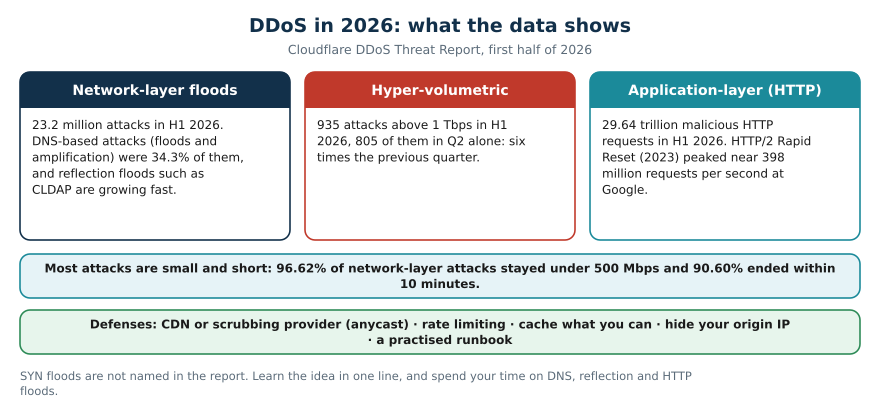
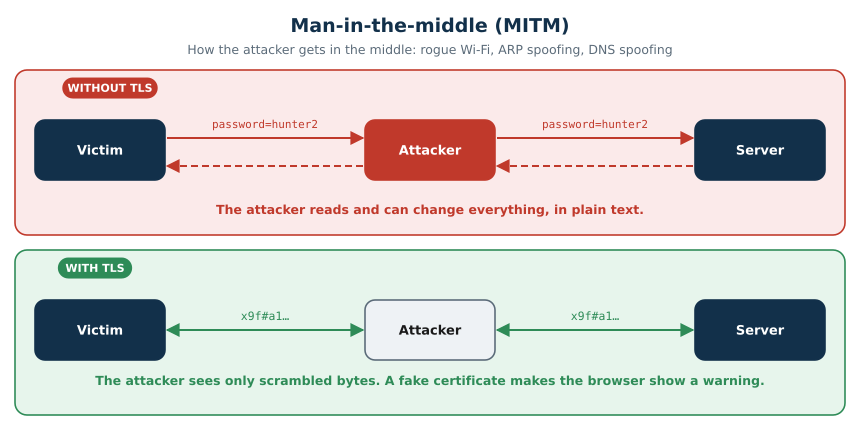
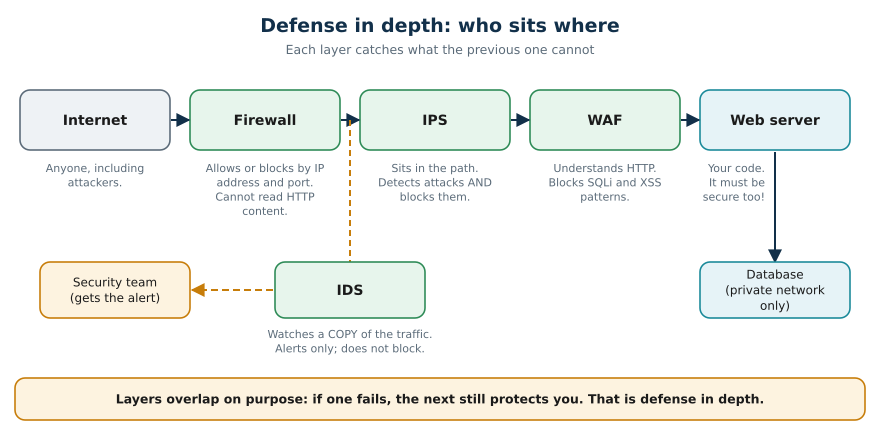

# Chapter 8: Network Attacks, DDoS and Defence Layers

> **Goal.** After this chapter you can: describe what DDoS looks like in 2026 and how it is defended; answer "what is a man-in-the-middle attack?"; place a firewall, IDS, IPS, WAF, EDR and SIEM and say what each can and cannot see; and explain segmentation and zero trust.
>
> **Time:** about 40 minutes (deliberately short). Classic LAN tricks and old Wi-Fi are one-liners now.

---

## 1. DDoS in 2026

A **DoS** attack makes a service unavailable (the "A" in CIA) by exhausting something it needs; a **DDoS** does it from many machines, so blocking one source is useless.

From Cloudflare's DDoS Threat Report for the first half of 2026:

- **23.2 million network-layer attacks** and **29.64 trillion malicious HTTP requests** mitigated in six months.
- **DNS-based attacks were 34.3%** of network-layer attacks; DNS and reflection floods (such as CLDAP) grow fastest.
- **935 attacks exceeded 1 Tbps**, 805 of them in the second quarter.
- **Most are small and short:** 96.62% stayed under 500 Mbps and 90.60% ended within 10 minutes.

| Family | Exhausts | Examples | Defence |
| --- | --- | --- | --- |
| **Volumetric / reflection** | Bandwidth | DNS and UDP floods; reflection and amplification | Upstream scrubbing, anycast CDN |
| **Protocol / state** | Connection tables | SYN floods (one line; well mitigated by SYN cookies) | SYN cookies, hardened firewalls |
| **Application (HTTP)** | CPU, memory, database | Request floods; HTTP/2 Rapid Reset (2023) | Rate limiting, caching, WAF, patching |

> **Common mistake.** "Just buy bigger servers." You need network-scale protection (CDN or scrubbing), cheap or cached expensive endpoints, and a **hidden origin IP** so attackers cannot bypass the CDN.

> **Interview angle.** *"CDN or scrubbing in front to absorb volume; rate-limit per client; cache and make expensive endpoints cheap; hide the origin IP; autoscale as a buffer; a runbook and on-call person. Most attacks are short, so automatic mitigation matters more than manual response."*

> **Remember:** DDoS floods a service so real users cannot use it (availability). Today most are short and small; defence is a CDN or scrubbing service, rate limits and a plan. Skip the exact statistics.

## 2. Man-in-the-middle

An attacker secretly sits between two parties and can **read or change** traffic (rogue Wi-Fi "evil twin", ARP spoofing, DNS spoofing). The defence is **TLS with certificate validation plus HSTS**: interception yields ciphertext and a forged certificate triggers a warning. Near-universal HTTPS made classic eavesdropping less useful; its modern descendant is **AiTM phishing** (Chapter 7). (One line: **WPA3** is the current Wi-Fi standard; WEP is long broken.)

> **Remember:** MITM = an attacker sits between two parties. **TLS** stops it; never ignore certificate warnings or use untrusted Wi-Fi without a VPN.

## 3. Who sits where

| Control | Sees | Cannot |
| --- | --- | --- |
| **Firewall** | IPs, ports, connection state | Read HTTP content; cannot spot an injection on an allowed port |
| **IDS** (detection) | A **copy** of traffic | **Block**; only alerts |
| **IPS** (prevention) | Traffic **in the path** | Be perfect; false positives block real users |
| **WAF** | **HTTP requests** (SQLi, XSS patterns) | Fix the bug in your code; clever bypasses exist |
| **EDR** | Process, file, network behaviour on a device | Help if nobody watches the alerts |
| **SIEM** | Correlates logs from everywhere | Detect what nobody logs |

*Signature-based* detection recognizes known attacks (accurate, misses new ones); *anomaly-based* flags unusual behaviour (catches new ones, more false alarms). A **false positive** is a harmless event flagged; a **false negative** is a real attack missed.

*Firewall: who can talk to whom. IDS: shouts. IPS: shouts and blocks. WAF: understands web requests. EDR: watches the device.*

**Segmentation** splits the network into zones (public servers in a DMZ, databases private) so one break-in does not reach everything; Change Healthcare's attackers moved freely for about nine days (Chapter 9). **Zero trust** means never trust, always verify: nothing is trusted just for being "inside".

> **AI-agent era.** Treat a coding agent like a new service identity on your network: it should live in its own segment or sandbox with an egress allow-list, no route to production, and its commands logged. That is segmentation and zero trust applied to a new insider.

> **Remember:** **Firewall** = address and port. **IDS** = detects and alerts. **IPS** = in the path, blocks. **WAF** = understands web requests. Layers overlap on purpose (defence in depth).

---

## Check yourself

1. What did Cloudflare's H1 2026 data show about the size and duration of most attacks?
2. Name the three DDoS families and one defence each.
3. What is a MITM attack and what defeats it?
4. IDS vs IPS, and why can a firewall not stop SQL injection on port 443?

**Answers** *(cover this until you have tried)*

1. Most are small and short: 96.62% under 500 Mbps, 90.60% over within 10 minutes, though 1+ Tbps attacks are rising.
2. Volumetric (CDN/scrubbing); protocol/state (SYN cookies); application (rate limiting, caching, WAF).
3. An attacker relays or alters traffic between two parties; TLS with certificate validation plus HSTS defeats it.
4. An IDS alerts on a copy of traffic, an IPS blocks inline. A firewall sees IPs and ports; the injection sits in HTTP content on an allowed port.

---

## Summary

- DDoS 2026: DNS and reflection floods lead and 1+ Tbps is surging, but most attacks are small and short. Defend at the edge, rate-limit, cache, hide the origin.
- SYN flood, ARP spoofing and WEP are one-liners. MITM is defeated by TLS and HSTS.
- Firewall, IDS, IPS, WAF, EDR, SIEM each see different things.
- Segmentation and zero trust limit spread; apply them to agents too.
