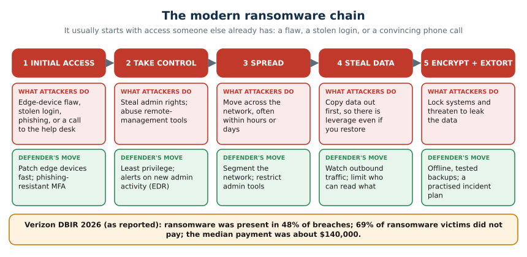
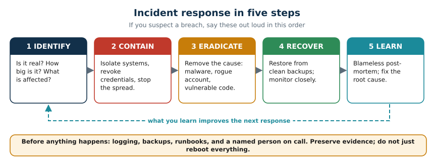

# Chapter 9: Ransomware, Malware and Incident Response

> **Goal.** After this chapter you can: describe the modern ransomware chain and double extortion; give the key 2026 numbers; name the malware types worth knowing; explain what to log; and recite the five incident-response steps with a worked scenario.
>
> **Time:** about 60 minutes. Ransomware was present in about 48% of breaches in Verizon's 2026 report (as reported).

---

## 1. Ransomware is a business

**Ransomware** locks your data and demands payment. Specialist groups sell or buy **access** (a stolen login, a hacked VPN); others run the intrusion, often as ransomware-as-a-service.

1. **Initial access:** edge-device flaws, stolen or bought logins, phishing, or a call to the help desk.
2. **Take control:** steal admin rights; abuse legitimate remote-management tools.
3. **Spread:** industry reporting says some intrusions go from access to encryption in **hours**.
4. **Steal data** first.
5. **Encrypt and extort:** lock systems *and* threaten to publish the data (**double extortion**).

> **Backups alone are not enough.** They answer "can we restore?" but not "what if they publish our customers' data?" You need **tested offline backups** *and* limits on what an intruder can read and copy (least privilege, segmentation, outbound monitoring).

**Numbers (Verizon DBIR 2026, as reported by TechTarget and Help Net Security):** ransomware in **48%** of breaches (up from 44%); **69%** of victims did **not** pay; median payment about **$140,000** (from $150,000).

> **Real case: Change Healthcare (2024).** Attackers entered on 12 February 2024 through a remote-access portal with **no MFA**, using stolen credentials, and spent about nine days inside before deploying ransomware. The company later reported roughly **190 million** people affected. One missing control plus too much internal freedom.

| Area | Do this |
| --- | --- |
| **Keep them out** | Patch edge devices first; phishing-resistant MFA on every remote path |
| **Slow them down** | Least privilege; segmentation; limit admin tools |
| **See them** | EDR; alerts on new admin activity and large outbound transfers |
| **Survive** | Offline or immutable, **tested** backups; documented restore order |
| **Respond** | A practised plan; decide in advance who authorizes what; know notification duties |

> **Common mistake.** Treating payment as a plan. It does not guarantee decryption or deletion and may be illegal in some situations. Plan to not need to pay.

> **Remember:** Chain: **get in (stolen login or exploited flaw), move around, steal data, encrypt, demand payment.** Best defences: MFA, patching, least privilege, segmentation, **tested offline backups**.

## 2. Malware worth knowing

| Type | Does | Key point |
| --- | --- | --- |
| **Virus** | Attaches to files, spreads when run | Needs a host and a user action |
| **Worm** | Spreads **by itself** | The Shai-Hulud package worm (Chapter 10) is modern |
| **Trojan** | Pretends to be legitimate | Relies on the user installing it |
| **Ransomware** | Encrypts and demands payment | Tested backups, MFA, patching |
| **Infostealer** | Copies saved passwords, cookies, tokens | Feeds credential stuffing and session theft |
| **RAT** | Remote control; often a *legitimate* admin tool misused | Allow-lists and monitoring |
| **Wiper** | Destroys data | Backups and segmentation limit damage |
| **Botnet** | Many infected devices, one controller | Powers DDoS |

Malware arrives via phishing, **fake downloads and updates**, **poisoned packages and developer tools**, unpatched internet-facing systems, and stolen logins (no malware needed). Defences: patching, EDR, least privilege, restricting installs, email filtering, offline backups.

> **Remember:** Know one line each: **virus** (needs a host file), **worm** (spreads itself), **trojan** (looks useful), **ransomware** (encrypts for payment), **spyware/keylogger** (watches you), **botnet** (many controlled machines).

## 3. Logging and detection

**Log:** authentication successes and failures, access-control failures, privilege changes, admin actions, unusual data access, each with time, user, source and outcome. **Do not log** passwords, tokens, card numbers or secrets. Send logs to a **central, separate** system so an intruder cannot erase them, **alert** on a few signals (impossible-travel logins, new admin accounts, mass downloads), and practise reading them.

> **Remember:** You cannot respond to what you cannot see: collect logs centrally, protect them, and alert on the important events.

## 4. Incident response: five steps

| Step | Goal | Example |
| --- | --- | --- |
| **1. Identify** | Confirm and scope | Which systems, accounts, since when? |
| **2. Contain** | Stop the spread | Isolate hosts, revoke leaked credentials **and sessions** |
| **3. Eradicate** | Remove the cause | Delete malware, close the hole, remove rogue accounts |
| **4. Recover** | Return safely | Restore from **clean** backups, patch, monitor |
| **5. Learn** | Prevent repeats | **Blameless** post-mortem |

This matches the NIST lifecycle (preparation; detection and analysis; containment, eradication and recovery; post-incident activity).

> **Common mistake.** Wiping the machine immediately destroys the evidence (memory, logs). Contain first (isolate), preserve evidence, then clean.

**Scenario: "A user says someone accessed their account."** Check authentication logs (times, IPs, devices, new mailbox rules or MFA devices); **revoke all sessions and tokens** (a stolen session survives a password change); reset credentials and re-register MFA; look for the same pattern on other accounts; close the cause (missing rate limits, weak MFA); write down what would have caught it sooner.

> **AI-agent era.** Add agents to your incident plan. Log what each agent ran (commands, files, tool calls), give agents scoped short-lived tokens you can revoke, and keep backups **outside** an agent's reach. Reported cases include a coding agent that deleted a production database during a code freeze (Replit, July 2025) and another reported by its founder to have deleted a production volume and its backups in seconds (April 2026, single source). Both are broad-credential failures.

> **Remember:** Phases: **identify, contain, eradicate, recover, lessons learned.** Contain first, so it stops spreading; fix the cause before restoring.

---

## Check yourself

1. What are the five stages of the ransomware chain?
2. Why are backups not a complete answer?
3. Give two 2026 numbers about ransomware.
4. List the five IR steps; why contain before eradicate; why revoke sessions, not just reset a password?

**Answers** *(cover this until you have tried)*

1. Initial access, take control, spread, steal data, encrypt and extort.
2. Attackers steal data first and threaten to publish it; you also need least privilege, segmentation and outbound monitoring.
3. About 48% of breaches; 69% of victims did not pay; median payment about $140,000.
4. Identify, contain, eradicate, recover, learn. Containing first stops the spread and preserves evidence. A stolen session keeps working after a password change until revoked.

---

## Summary

- Ransomware is an industry: access is bought, data is stolen first, then systems are locked. 48% of breaches in 2026; 69% of victims did not pay.
- Defend the whole chain: patch edge devices, phishing-resistant MFA, least privilege, EDR, tested offline backups, a practised plan.
- Know virus, worm, trojan for the quiz; ransomware, infostealer and RATs for the real world.
- IR: identify, contain, eradicate, recover, learn; revoke sessions, preserve evidence, blameless post-mortems.
- Include agents in logging, token scoping and backup isolation.
