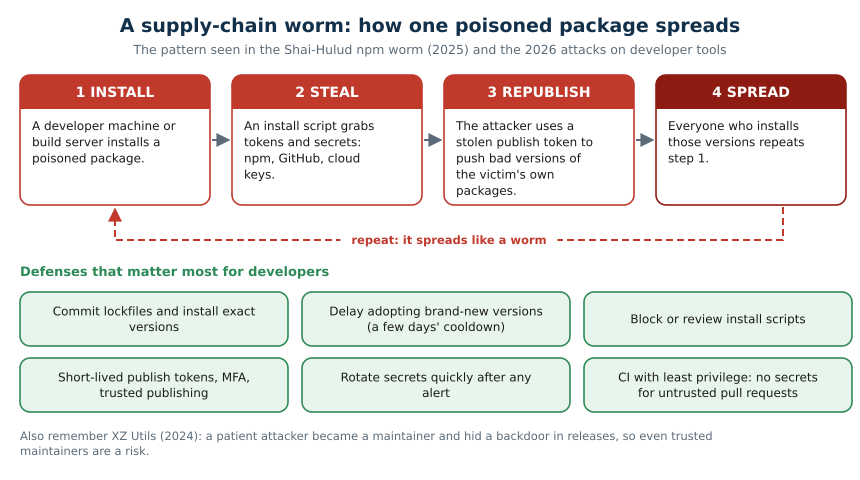
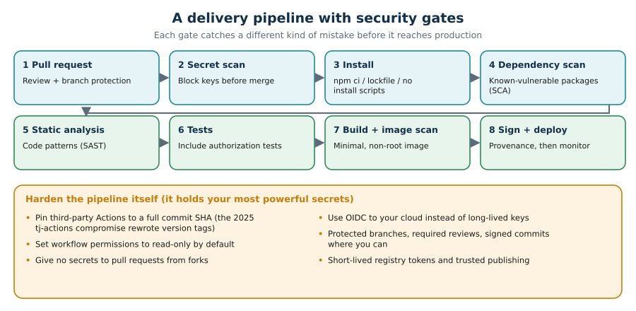

# Chapter 10: Supply Chain, Third Parties, Cloud and DevSecOps

> **Goal.** After this chapter you can: explain third-party and supply-chain risk with recent cases; list the developer defences against poisoned packages; name the common cloud mistakes; use STRIDE for a five-minute threat model; and describe a secure delivery pipeline.
>
> **Time:** about 60 minutes. This is where a software engineer has the most to say: third parties were involved in about 48% of breaches in Verizon's 2026 report (as reported, up from 30%), and OWASP made supply chain its own category (A03).

---

## 1. Third parties: their breach is your breach

| Pattern | Recent example |
| --- | --- |
| **Vendor hosts your data** | Klue (2026, reported): about 200 downstream companies via one stolen credential |
| **Vendor token or connection** | Salesloft Drift (2025): OAuth tokens used against many Salesforce accounts |
| **Vendor product has a flaw** | MOVEit Transfer (2023): SQL injection in a file-transfer product |

As an engineer: inventory vendors and integrations; least privilege on each (narrow scopes, read-only); know where every token lives so you can revoke fast; minimize the data vendors hold; ask for security evidence before onboarding.

> **Remember:** A vendor's breach can be yours. Check who has access to your data and limit it.

---

## 2. The software supply chain

Hundreds or thousands of transitive dependencies mean one compromise runs code on developer machines and build servers, often next to secrets.

| Pattern | What happens |
| --- | --- |
| Compromised maintainer or package | Attacker publishes a bad version |
| Typosquatting | Near-identical package name |
| Dependency confusion | Public package shadows an internal name |
| Compromised build or CI | Pipeline output altered |
| Install-time scripts | Code runs when a package installs |

> **Real case: Shai-Hulud npm worm (Sep and Nov 2025).** Described as the first self-propagating npm worm: at install time it harvested credentials, published them to public GitHub repositories, and used stolen npm tokens to publish infected versions of the victim's other packages. Reports counted 180+ packages in September; the November wave was reported at almost 500 packages and more than 26,000 repositories.

> **Real case: XZ Utils (2024).** The persona "Jia Tan" spent about two years earning co-maintainer trust, then slipped a backdoor (CVE-2024-3094) into releases that interfered with SSH authentication on some Linux systems. A Microsoft engineer, Andres Freund, found it by chance.

> **Real case: developer tools (2026, reported).** TechCrunch's 2026 roundup reports backdoored developer tools (including Trivy, the Bitwarden CLI and Checkmarx) used to steal passwords and tokens in March-April 2026. The compromises were confirmed; wider details are as reported. SolarWinds (2020) is the classic ancestor.

**Developer defences:**
1. Commit lockfiles; install exact versions (`npm ci`); review dependency updates.
2. Delay brand-new versions a few days (cooldown).
3. Block or review install scripts (`--ignore-scripts`).
4. Scan dependencies (`npm audit`, `pip-audit`, Dependabot, Snyk).
5. Keep an **SBOM** so "are we affected?" takes minutes.
6. Short-lived least-privilege tokens; MFA on registry accounts; trusted publishing.
7. Harden CI/CD: no secrets for untrusted PRs, protected branches, reviewed pipeline changes.
8. Minimize dependencies.

> **Remember:** Supply-chain attacks poison something you trust (a package, an update, a build). Defences: lockfiles, review new dependencies, delay brand-new versions, pin CI steps.

---

## 3. Cloud misconfiguration and leaked secrets

Cloud services are secure by design and insecure by *configuration* (A02 rose to #2).

| Mistake | Fix |
| --- | --- |
| Public storage or databases | Private by default; block public access at account level |
| Over-broad roles | Least-privilege IAM, one role per service |
| Long-lived access keys | Short-lived credentials (roles, workload identity) |
| Secrets in code, config, CI logs | Secrets manager, secret scanning, rotate on exposure |
| Forgotten test resources | Inventory, auto-expiry, owner tags |

**Shared responsibility:** the provider secures the platform; you secure your configuration, identities, data and code. Infrastructure as code (Terraform and similar) should be scanned before apply, and reviewed like application code.

> **Real case: exposed document stores (2026, reported).** TechCrunch's roundup reports identity documents exposed through publicly accessible servers (for example a hotel check-in system with about 1 million passports and licences), together more than 2 million people. These were exposures rather than hacks: many "breaches" are something left open.

Treat every key as something that *will* leak: limit its power and its lifetime.

> **Remember:** Most cloud breaches are **misconfiguration or leaked keys**, not clever hacks: public storage, over-broad permissions, secrets in code.

---

## 4. Threat modeling with STRIDE

Ask *before you build*: "What can go wrong?" (This addresses A06 Insecure Design.)

| Letter | Threat | Property | Mitigation |
| --- | --- | --- | --- |
| **S** | Spoofing | Authentication | Strong auth, passkeys, MFA |
| **T** | Tampering | Integrity | Server-side validation, signatures |
| **R** | Repudiation | Non-repudiation | Audit logs |
| **I** | Information disclosure | Confidentiality | Encryption, access control |
| **D** | Denial of service | Availability | Rate limits, scaling |
| **E** | Elevation of privilege | Authorization | Least privilege, per-request checks |

Draw the feature as boxes and arrows (user, browser, API, database, third party), ask the six questions at each, and write one mitigation per realistic threat.

> **Remember:** **STRIDE** = Spoofing, Tampering, Repudiation, Information disclosure, Denial of service, Elevation of privilege. A checklist for "what could go wrong here?".

## 5. A secure delivery pipeline

| Stage | Practice |
| --- | --- |
| Design | Threat model |
| Code | Secure defaults, review with a security checklist |
| Commit | **Secret scanning** (pre-commit and server-side) |
| Build | **SAST**, **SCA** |
| Test | **DAST**, authorization tests |
| Release | Sign artifacts, keep an SBOM |
| Run | Least-privilege runtime, logging and alerts |

**GitHub Actions basics:** pin third-party Actions to a full commit SHA (the 2025 tj-actions/changed-files compromise rewrote version tags), set `permissions: contents: read`, avoid `pull_request_target` with untrusted code, never inline untrusted input in `run:`, use OIDC instead of long-lived cloud keys.

> **Interview angle.** "How do you build security into development?" → "I threat-model new features with STRIDE; use secure defaults (parameterized queries, output encoding, per-object authorization); run secret scanning, SAST and SCA in CI and DAST on staging; pin and review dependencies and keep an SBOM; keep secrets in a manager with short-lived credentials; and use least privilege for services and CI."

> **AI-agent era.** Agents add dependencies freely and may name packages that do not exist; an attacker can register that name. A USENIX Security 2025 study of 16 models found at least 5.2% hallucinated packages for commercial models and 21.7% for open-source models, and installing an unvetted package runs install scripts. Verify every new dependency (does it exist, who publishes it, do we need it), install with a lockfile and `--ignore-scripts`, and keep a human in the approval loop. Malware can also call AI command-line tools already on a developer machine to hunt for secrets, as in the Nx "s1ngularity" attack of August 2025 (over 400 users or organizations affected, per InfoQ): keep secrets out of the environment and files an agent can read.

> **Remember:** Put checks in the pipeline: tests, secret scanning, dependency scanning, code review, least-privilege credentials.

---

## Check yourself

1. What share of breaches involved a third party in Verizon's 2026 report (as reported)?
2. Describe the Shai-Hulud worm in two sentences.
3. Name four developer defences against poisoned dependencies.
4. What do S, T, R, I, D, E stand for?

**Answers** *(cover this until you have tried)*

1. About 48%, up from about 30%.
2. It ran at install time, stole credentials from the developer's machine, and used stolen npm tokens to publish infected versions of the victim's other packages, so it spread by itself. Two waves in 2025 hit hundreds of packages.
3. Any four of: lockfiles and exact versions, cooldown, blocking install scripts, scanning, SBOM, short-lived tokens with MFA and trusted publishing, hardened CI, fewer dependencies.
4. Spoofing, Tampering, Repudiation, Information disclosure, Denial of service, Elevation of privilege.

---

## Summary

- Third parties are in about half of breaches: inventory, least privilege, fast revocation.
- Supply-chain attacks target what developers trust: packages, maintainers, tools. Lockfiles, cooldown, scanning, SBOM, short-lived tokens, hardened CI.
- Cloud incidents are mostly configuration: private by default, least privilege, short-lived keys, secrets in a manager.
- STRIDE is a five-minute habit; the pipeline has gates from design to run.
- Agents add and run dependencies: verify each one and keep secrets out of reach.
