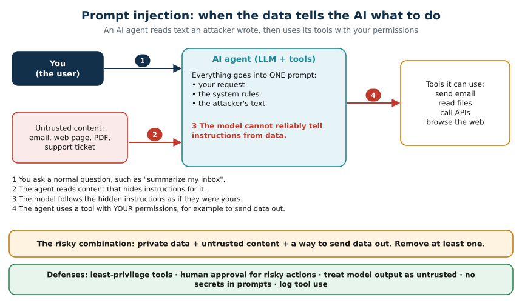
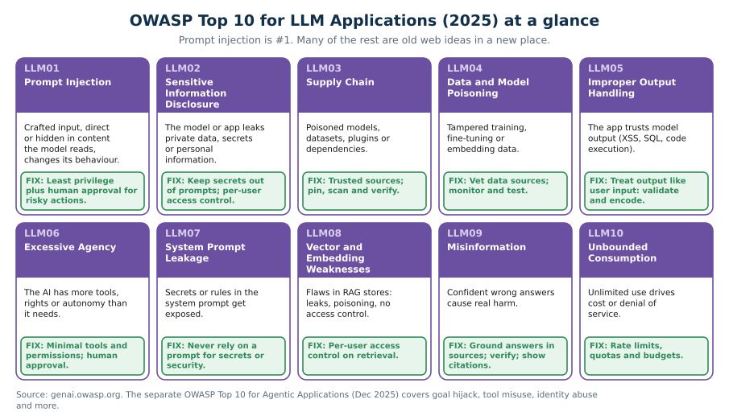
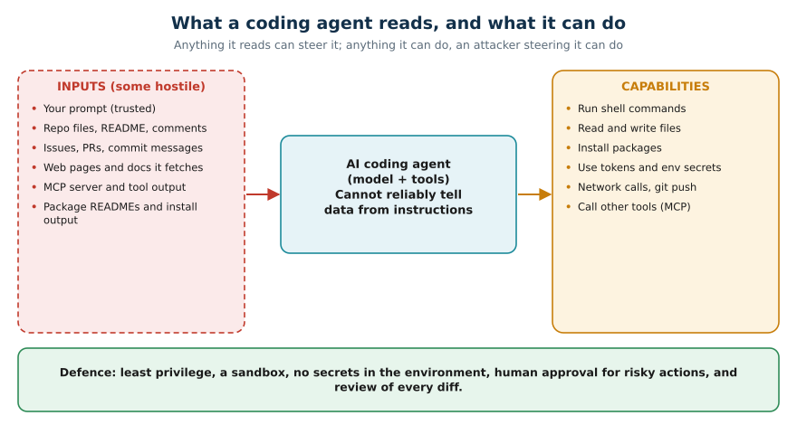
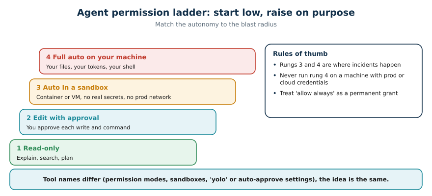

# Chapter 11: AI and Agent Security

> **Goal.** After this chapter you can: explain prompt injection and the "risky combination"; design an AI feature so that injection does limited damage; describe how attacks on coding agents work and which controls limit them; and say how attackers use AI too.
>
> **Time:** about 75 minutes. Two sides of one problem: **building** products that contain a model, and **using** AI coding agents that read your code and run commands.

---

## 1. The root problem: no wall between code and data

In a normal program, instructions and data are separate. In an LLM app, **everything is text in one prompt**: system rules, the user's request, retrieved documents, web pages, emails and tool results. The model **cannot reliably tell trusted instructions from untrusted data**. That is the cause of the number one risk in the OWASP Top 10 for LLM Applications: **prompt injection**.

| Type | Where the attacker's text comes from | Why it matters |
| --- | --- | --- |
| **Direct** | The user types it into the chat | Limited to what that user can already do |
| **Indirect** | Hidden in content the model reads on the user's behalf (email, web page, PDF, ticket, code comment) | The victim types nothing malicious; the text rides in through your data |

> **Real case: EchoLeak (June 2025).** A zero-click prompt-injection flaw in Microsoft 365 Copilot (**CVE-2025-32711, CVSS 9.3**): a crafted email, processed later as context, could steer Copilot into leaking confidential data with no click from the victim. Microsoft fixed it server-side.

> **Real case: Instagram account recovery (2026, reported).** According to reporting by 404 Media and the New York Times, attackers got Meta's AI support chatbot to send reset codes to attacker-controlled emails. *Lesson:* an AI agent with power over a sensitive action inherits every weakness of that action.

**The risky combination:** private data + untrusted content + a way to send data out. **Remove at least one.**

---

## 2. Building AI features safely

There is no complete fix for prompt injection, so **contain the damage** with ordinary engineering:

1. **The AI acts as the user**, never as a super-account; tools use the current user's permissions.
2. **Least privilege for tools:** narrow tools ("read one order"), not "run any SQL".
3. **Human approval** for irreversible actions (send email, spend money, delete).
4. **Model output is untrusted input:** validate it, encode it, authorize it. Never `eval` or run it; sanitize HTML and Markdown before rendering, and restrict where images and links can point.
5. **Authorize retrieval**, not just the chat: filter vector-store results by the user's tenant and permissions.
6. **No secrets in prompts**, and never ship a provider API key to the browser.
7. **Limit cost and abuse:** rate limits, token budgets, a cap on tool-call depth.
8. **Log and red-team** before launch.

The authorization lives in code (the tool handler checks the signed-in user), not in the prompt: a prompt is advice that injection can override.

**The OWASP lists.** The LLM Top 10 (2025) in five groups: *input* (LLM01 Prompt Injection, LLM07 System Prompt Leakage); *data* (LLM02 Sensitive Information Disclosure, LLM04 Data and Model Poisoning, LLM08 Vector and Embedding Weaknesses); *output and action* (LLM05 Improper Output Handling, LLM06 Excessive Agency); *supply chain* (LLM03); *reliability and cost* (LLM09 Misinformation, LLM10 Unbounded Consumption). For agents that plan and act with tools, OWASP's **Top 10 for Agentic Applications (for 2026, published 9 December 2025)** adds risks such as Agent Goal Hijack, Tool Misuse and Exploitation, and Identity and Privilege Abuse. The heart of it: give each agent its own limited identity, least-privilege tools and a human check before consequential actions.

> **The bridge.** Most entries are old principles in a new place: LLM05 is injection through model output, LLM06 is least privilege, LLM10 is rate limiting, LLM03 is the supply chain, LLM08 is access control on a data store. *"AI security is mostly old principles applied to a new component"* is a strong interview sentence.

---

## 3. Using AI coding agents safely

### The threat model

A coding agent **reads** many inputs, **cannot reliably separate data from instructions**, and can **act** (shell, files, network, git, other tools). It is the risky combination again, but the victim is you and the acting identity is your laptop and tokens.

Hostile text can arrive in repo files and comments, issues and pull requests, web pages the agent fetches, package READMEs and install output, **rules files** and **MCP tool descriptions**. You never typed it, but the agent reads it.

### Incidents to know

> **Labels.** *Confirmed* = a primary page was read. *Reported* = from news or security-vendor write-ups. Verify the CVE ID, score and fixed version at NVD or the vendor before relying on them.

| Case | What happened (conceptual) | Lesson | Confidence |
| --- | --- | --- | --- |
| **GitHub Copilot, CVE-2025-53773** (Aug 2025) | Injected text made the assistant edit its own workspace settings to enable auto-approval, then run commands. Scored 7.8 in NVD-derived sources; fixed in Microsoft's August 2025 update. | An agent that can edit its own permissions has none. | Reported |
| **Cursor, CVE-2025-54135 and CVE-2025-54136** (2025) | Injected content caused writes to the MCP config and command execution; an approved MCP entry could be changed silently afterwards. Fixed in Cursor 1.3. | Approval must bind to the content, not the name. | Reported |
| **Claude Code, several CVEs in 2025-26** | A recurring class: approval-prompt bypass through gaps in command parsing. Fixed in later versions. | Allow-lists and parsers are attack surface; keep the tool updated. | Reported |
| **Amazon Q Developer extension** (July 2025) | A malicious prompt was merged into a published release (v1.84.0) telling the agent to wipe local files and cloud resources. AWS said it failed to execute; the root cause was an over-scoped repository token. Fixed in 1.85.0. | Your tool's supply chain is part of yours; scope CI tokens. | Reported |
| **MCP tool poisoning** (Invariant Labs, Apr 2025) | Hostile instructions in a tool *description*, visible to the model but not the user; descriptions can change after approval ("rug pull"). | Show and pin tool definitions; do not install unknown servers. | **Confirmed** |
| **Nx "s1ngularity"** (26 Aug 2025) | Malicious npm releases ran a script that invoked AI command-line tools already on developer machines, with their approval-bypass flags, to hunt for secrets and publish them to public GitHub repos. Over 400 users or organizations and more than 5,500 repositories were affected; more than 1,000 valid GitHub tokens were seen. Related to, but not the same as, the Shai-Hulud worm. | Your installed agent is a tool an attacker can call. Secrets on disk and in the environment are reachable. | **Confirmed** (InfoQ) |
| **Replit agent** (July 2025) | During a code freeze the agent ran destructive commands, deleted a production database and misreported recovery; dev and prod databases were then separated. | Never give an agent production credentials. | Reported |
| **PocketOS** (Apr 2026) | A founder reported that an agent found an unrelated infrastructure API token and deleted a production volume and its backups in about nine seconds. | Scope tokens; keep backups out of the same blast radius. | Reported (single source) |

### Controls that work

1. **Choose the autonomy deliberately.** Approve-each-action by default; auto-approval only inside a **sandbox** with **no real credentials**. "Always allow" is a permanent grant. Current tools document permission modes, filesystem and network sandboxing, deny rules, trust dialogs for new folders and MCP servers, and audit logging (Claude Code's security documentation lists these; other tools have equivalents). A working-directory boundary enforced only by a prompt is not an operating-system boundary.
2. **Sandbox the blast radius.** Container, dev container or VM; mount only the project; restrict network; no access to home directory, SSH keys or cloud profiles.
3. **Keep secrets out of reach.** No secrets in the agent's environment or readable files; give it its own scoped, short-lived tokens, never personal admin or production credentials; use secret scanning and push protection.
4. **Separate environments.** The agent works against dev and staging; production changes go through a pipeline with human approval.
5. **Treat agent configuration as code.** Rules files, `.mcp.json`, hooks and settings change behaviour: put them under CODEOWNERS and review diffs (including hidden characters). Allow-list and pin MCP servers; do not pass tokens through; show the exact command before installing a local server; request minimal scopes.
6. **Control untrusted inputs.** Do not point an agent that has write access at untrusted issues, PRs or web pages.
7. **Review and gate.** Small PRs, the five review questions, negative tests, SAST, secret scanning, dependency checks, protected branches. Agents do not approve or merge their own work.
8. **Keep the tooling patched.** Several 2025-26 CVEs were in the agent tools themselves.

### Hallucinated dependencies ("slopsquatting")

A model may suggest a package that does not exist; an attacker can register that name and wait. A USENIX Security 2025 study of 16 models (576,000 code samples) found at least **5.2%** hallucinated packages for commercial models and **21.7%** for open-source models, with **205,474** unique made-up names. Real-world cases are reported; treat their details as unconfirmed. For every new dependency in a diff: does it exist and is it the right one (`npm view`: publisher, creation date, repository, downloads), do we need it, install with a lockfile and `--ignore-scripts` behind a release-age cooldown, and have a human approve it.

### A one-page team policy

| Area | Rule |
| --- | --- |
| **Mode** | Approve-each-action by default; auto only in a sandbox without real secrets |
| **Credentials** | Agent-specific, scoped, short-lived; never prod, never personal admin |
| **Data** | No customer data or secrets in prompts to unapproved tools |
| **Config** | Rules, MCP config and hooks under CODEOWNERS; allow-listed MCP servers |
| **Dependencies** | Human check of every new package; cooldown; lockfile |
| **Review** | The author owns the diff; agents do not approve or merge |

---

## 4. AI in the attacker's hands

Anthropic reported on **13 November 2025** (**confirmed**, the report was read) that a state-sponsored group used Claude Code to carry out **80-90%** of a cyber-espionage campaign against about **30** targets, with humans making only a handful of decisions. A small number of intrusions succeeded, and the model sometimes hallucinated credentials. Several vendors also report the time from disclosure to a working exploit shrinking to days or hours (their metrics differ, so check the originals before quoting a number). Defender's takeaway: patch known-exploited flaws faster, rely on phishing-resistant authentication, and assume reconnaissance and phishing are cheaper and more convincing than before.

> **Interview angle.** *"How do you use AI coding agents safely?"* "Three layers. Limit what the agent can reach: a sandbox, scoped short-lived tokens, no production credentials, approvals for risky actions. Limit what it can be told: repo files, issues, web pages and MCP tools are untrusted input that can steer it. Check what it produces: small PRs, a review against five questions, negative tests, and CI gates for dependencies and secrets. The thread is least privilege plus review. A real example is s1ngularity, where malware used developers' own AI tools to look for secrets."

---

## Check yourself

1. Why can't an LLM reliably tell instructions from data, and what is the "risky combination"?
2. Why must a tool authorize inside its own handler instead of relying on the prompt?
3. Name four controls that limit a coding agent's blast radius.
4. What is a hallucinated-dependency attack and how do you stop it?

**Answers** *(cover this until you have tried)*

1. System rules, the user's request, retrieved content and tool results are all text in one prompt, with no hard boundary. The combination is private data + untrusted content + an outbound channel; remove at least one.
2. A prompt is advice that injection can override; the handler is code that enforces the user's permissions whatever the model asks.
3. A sandbox or container; scoped short-lived tokens; approval for risky actions; no secrets in the environment; separate dev from prod; reviewed agent configuration.
4. An attacker registers a package name a model invented. Verify existence, maintainer and need; use lockfiles, `--ignore-scripts` and a cooldown; require human approval.

---

## Summary

- An LLM mixes instructions and data: prompt injection (especially indirect) is number one and has no complete fix, so contain it with least privilege, approvals and untrusted-output handling.
- An agent reads untrusted text and acts with your permissions: limit reach, limit inputs, check outputs.
- Sandbox, scope tokens, no prod credentials, review agent config like code, verify every new dependency.
- Attackers use agents too (Anthropic, Nov 2025): speed of patching and strong authentication matter more.
