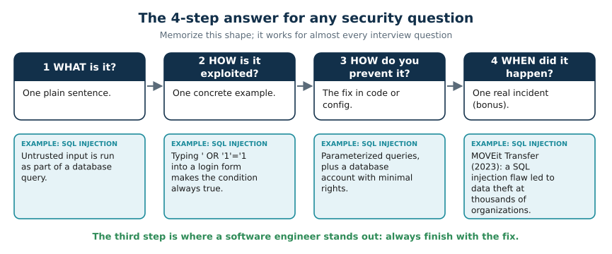

# Chapter 12: Interview Q&A (48 Questions)

> **Goal.** Answer each question out loud in 45-90 seconds, in the shape **threat, control (with an example), a backup layer, how you would test it**, ending with the fix and, where you can, a recent real case.
>
> **Time:** about 3 hours for two rounds. Round 1: cover the answer, speak, compare, mark green, yellow or red. Round 2 (two days later): only yellow and red. Round 3: a random-order mock interview ([Chapter 13](13-labs.md)).

---

## A. Landscape and fundamentals

**1. What are the biggest security threats right now?**
Three doors: exploited known vulnerabilities (especially internet-facing devices), stolen or phished credentials (including phishing that defeats ordinary MFA), and third parties (vendor tokens, poisoned dependencies). Ransomware monetizes that access. AI adds scaled phishing and a new attack surface (prompt injection, agents with tools). Mostly preventable with fast patching, phishing-resistant MFA, least privilege and vendor hygiene.

**2. How do breaches usually start, with numbers?**
In Verizon's 2026 report, exploiting a vulnerability was the top initial access vector (about 31%, up from 20%), stolen credentials about 13%, pretexting about 6%; third parties were involved in about 48% of breaches and ransomware in about 48%. Say "according to Verizon" and round.

**3. What is the CIA triad?**
Confidentiality, integrity, availability. Classify any attack by the leg it breaks: a leak breaks confidentiality, tampering breaks integrity, ransomware or DDoS breaks availability.

**4. Vulnerability vs threat vs risk?**
A vulnerability is a weakness; a threat is something that could exploit it; risk is likelihood times impact. An easy-to-reach bug exposing all customers is high risk; a hard-to-reach bug exposing nothing is low.

**5. Walk me through how an attacker compromises a system.**
Recon, scanning, gaining access, maintaining access, covering tracks, each with an example. Today "gaining access" is usually a known flaw, a stolen login or a phone call. MITRE ATT&CK is the detailed catalogue of tactics and techniques.

**6. What are least privilege and defense in depth?**
Least privilege: each user and service gets only the access it needs, so a compromise is contained. Defense in depth: overlapping controls so one failure is not fatal (parameterized queries, a least-privilege database account, a WAF, logging). Test: try the action with the lowest-privilege account.

**7. What is zero trust?**
Never trust a request because of where it comes from. Authenticate and authorize every request, assume the network may already be hostile, and limit blast radius with segmentation.

---

## B. Cryptography and web basics

**8. Hashing vs encryption vs encoding?**
Hashing is one-way (integrity, passwords). Encryption is reversible with a key (confidentiality). Encoding is reversible with no key, such as Base64: no security at all.

**9. Symmetric vs asymmetric encryption?**
Symmetric (AES) uses one shared key: fast, but the key must be shared safely. Asymmetric (RSA/ECC) uses a public/private pair: solves sharing, but is slow. TLS uses asymmetric crypto to establish a key and symmetric crypto for the traffic.

**10. How does HTTPS work?**
TCP handshake, then TLS: client sends ciphers and a key share, server sends its certificate and key share, the client validates the chain, both derive session keys, traffic is encrypted symmetrically. A man-in-the-middle cannot present a valid certificate for the domain. *Forward secrecy:* session keys are temporary, so stealing the long-term key later cannot decrypt past traffic.

**11. How should passwords be stored?**
Hashed with a slow, salted algorithm (Argon2id, bcrypt, scrypt). Never plaintext, never encrypted, never MD5 or SHA-1. Slowness makes each guess expensive; a per-user salt defeats precomputed tables. Better: move users to passkeys.

**12. What is a passkey and why is it better than a password?**
A public-key credential (WebAuthn/FIDO2). The device keeps the private key; the site stores only the public key and sends a challenge the device signs. It is bound to the real domain, so it resists phishing, cannot be reused or guessed, and a server leak gives attackers nothing to replay. The weak spot is account recovery.

**13. What is "harvest now, decrypt later", and what is the post-quantum timeline?**
Attackers record encrypted traffic today to decrypt once a powerful quantum computer exists, so long-lived secrets are at risk now. NIST published ML-KEM, ML-DSA and SLH-DSA in August 2024; its transition plan (IR 8547, final October 2026) deprecates RSA/ECC after 2030 and disallows them after 2035. Steps: inventory RSA/ECC use, be crypto-agile, prefer TLS 1.3, adopt hybrid post-quantum key exchange as libraries support it.

**14. What happens when you type https://example.com into a browser?**
DNS lookup, TCP handshake, TLS handshake, HTTP request, server processing, response and render. I add one risk per step: DNS spoofing, floods, MITM, session theft/CSRF, injection and broken access control, XSS.

**15. 401 vs 403; what do HttpOnly, Secure and SameSite do?**
401 means not authenticated; 403 means authenticated but not allowed. HttpOnly hides a cookie from JavaScript (limits XSS theft), Secure sends it only over HTTPS, SameSite limits cross-site sending (limits CSRF).

---

## C. Web, API and vulnerability management

**16. What is SQL injection and how do you prevent it?**
Untrusted input is interpreted as part of a SQL query. Prevent with parameterized queries and a least-privilege database account; escaping and WAFs are not the primary fix. The 2023 MOVEit campaign used a SQL injection flaw to steal data from thousands of organizations.

**17. XSS: types and prevention?**
The attacker's script runs in another user's browser under your origin: stored, reflected or DOM-based. Primary fix: context-aware output encoding (frameworks do it by default, so watch escape hatches like `dangerouslySetInnerHTML`). Layers: CSP and HttpOnly cookies.

**18. CSRF, and how is it different from XSS?**
CSRF abuses the browser's automatic cookie sending to make the victim's browser perform an action; no attacker code runs on your site. XSS runs attacker code in your page. Prevent CSRF with SameSite cookies and anti-CSRF tokens; an XSS flaw defeats CSRF tokens.

**19. What are IDOR and BOLA?**
The same flaw: changing an identifier (`/orders/1002`) to reach someone else's object because the server checked "logged in?" but not "allowed to see this object?". BOLA is number one on the OWASP API Security Top 10. Fix: scope every lookup to the current user and deny by default. Test: user A requests user B's object and expects 404.

**20. How would you secure a REST API?**
HTTPS; strong authentication with short-lived tokens; per-object and per-function authorization (BOLA and BFLA); validate input and parameterize queries; return only needed fields; rate limiting; no secrets in code or URLs; restrictive CORS; an inventory of endpoints; log auth failures; scan dependencies.

**21. What is SSRF?**
Making the server fetch an attacker-chosen URL so it reaches internal services such as the cloud metadata service. Fix: allowlist destinations, block private and link-local IPs, use the hardened metadata service (IMDSv2), give the server's cloud role least privilege. OWASP merged it into A01 in 2025.

**22. Same-origin policy and CORS?**
The same-origin policy stops one origin's scripts reading another origin's responses. CORS is the server selectively relaxing that. It adds no security; careless CORS (`*` or a reflected origin with credentials) removes it.

**23. Name the OWASP Top 10 (2025).**
A01 Broken Access Control, A02 Security Misconfiguration, A03 Software Supply Chain Failures (new), A04 Cryptographic Failures, A05 Injection, A06 Insecure Design, A07 Authentication Failures, A08 Software or Data Integrity Failures, A09 Security Logging and Alerting Failures, A10 Mishandling of Exceptional Conditions (new). SSRF folded into A01.

**24. What should you watch for with JWTs?**
Verify the signature and pin the algorithm server-side (never trust `decode`); strong secret; short-lived tokens with a revocation plan; not in `localStorage` (XSS can read it), prefer an HttpOnly cookie; the payload is only encoded, so no secrets inside.

**25. How can OAuth be abused?**
Consent phishing (a malicious app gets broad scopes) and stolen tokens. In the Salesloft Drift incident (2025), stolen OAuth tokens for an integration let attackers pull data from many customers' Salesforce accounts. Defend with least-privilege scopes, an inventory of connected apps, short-lived tokens and fast revocation.

**26. CVE vs CWE vs CVSS vs KEV; how do you prioritize patches?**
CVE is one specific flaw; CWE is the weakness category; CVSS is a 0-10 severity; KEV is CISA's list of flaws exploited in the wild. Patch known-exploited first, then internet-facing assets, then CVSS and business impact. Verizon found only about 26% of known-exploited flaws fully fixed, median 43 days.

---

## D. Identity and people

**27. How can MFA be bypassed?**
Adversary-in-the-middle phishing: a look-alike site proxies the real login, the victim enters password and code, and the proxy steals the session cookie. Also prompt bombing, SIM swapping and help-desk resets. Phishing-resistant MFA (passkeys/FIDO2) defeats the proxy because the credential is bound to the real domain.

**28. How would you reduce account takeover?**
Passkeys where possible; MFA everywhere (number matching or hardware keys over SMS); rate limiting and breached-password checks; short sessions with revocation; monitoring for impossible travel and new devices; hardened recovery and help-desk procedures, since attackers go around strong login through weak recovery.

**29. How do you defend against help-desk social engineering?**
Strong identity verification before any reset or MFA change, call-back to a known number, extra approval for privileged accounts, no resets under time pressure, logging. The help desk is part of the perimeter: MGM (2023) and Marks & Spencer (2025) were linked to this technique in public reporting.

**30. Credential stuffing vs password spraying?**
Stuffing replays leaked username and password pairs from other breaches. Spraying tries a few common passwords across many accounts to avoid lockouts. Both are blunted by MFA, passkeys, rate limiting and monitoring.

**31. What is an infostealer and why does it matter?**
Malware that copies saved passwords, cookies and tokens from a device and sells them, feeding credential stuffing and session theft. In the 2024 Snowflake incidents, credentials stolen by infostealers (some years earlier) still worked on accounts without MFA.

---

## E. Infrastructure and operations

**32. Firewall vs IDS vs IPS vs WAF?**
A firewall filters by IP, port and state. An IDS watches a copy of traffic and alerts. An IPS sits inline and blocks. A WAF understands HTTP and blocks web-attack patterns. EDR watches the endpoint.

**33. How do you defend against DDoS?**
A CDN or scrubbing service so volume is absorbed at the edge, per-client rate limits, caching and cheap expensive endpoints, a hidden origin IP, a runbook. Cloudflare's H1 2026 data showed DNS and reflection floods leading and 1+ Tbps attacks surging, but most attacks under 500 Mbps and over within 10 minutes.

**34. How does ransomware work and how do you defend?**
Initial access (edge-device flaw, stolen login, phishing, help-desk call), taking control, spreading, stealing data, then encrypting and extorting. Defend the chain: patch edge devices, phishing-resistant MFA, least privilege, segmentation, EDR, outbound monitoring, tested offline backups and a practised plan.

**35. What is a software supply-chain attack and how do you defend?**
Compromising something you depend on (a package, maintainer, build system or tool). Recent examples: the Shai-Hulud npm worm (2025), the XZ Utils backdoor (2024), the 2026 developer-tool compromises. Defend with lockfiles, a cooldown on new versions, scanning, an SBOM, short-lived tokens with MFA, hardened CI/CD and fewer dependencies.

**36. How do you manage secrets and avoid cloud misconfiguration?**
Never in code, Git or front-end bundles. Use a secrets manager, inject at runtime, give each service least-privilege short-lived credentials, rotate on any exposure, run secret scanning, keep storage private by default with account-level public-access blocks.

**37. How do you manage third-party risk?**
Inventory vendors and integrations, grant least-privilege scopes, minimize the data they hold, be able to revoke tokens fast, review their security evidence. Third parties were involved in about 48% of breaches in Verizon's 2026 report.

---

## F. Scenarios

**38. You find a critical vulnerability in production. What do you do?**
Do not probe further than needed. Document what I saw, report it immediately through the proper channel, help assess impact, support the fix and deployment, verify, and run a blameless post-mortem. They are testing process and ethics, not heroics.

**39. You suspect a breach. First steps?**
Incident response: identify and scope; contain (isolate systems, revoke credentials **and sessions**); eradicate the cause; recover from clean backups; learn. Preserve evidence; do not just reboot everything, which destroys evidence and may tip off the attacker.

**40. How do you build security into development?**
Threat-model new features (STRIDE); secure defaults (parameterized queries, output encoding, per-object authorization); secret scanning, SAST and dependency scanning in CI plus DAST on staging; pinned dependencies and an SBOM; secrets in a manager; least privilege everywhere; review AI-generated code like a stranger's.

---

## G. AI and coding-agent era

**41. What is prompt injection, and how do you defend against it?**
An LLM cannot reliably separate instructions from data, so text it reads (an email, a web page) can steer it; indirect injection is the dangerous kind. There is no complete fix, so layer defences: least-privilege tools, human approval for sensitive actions, output treated as untrusted, no secrets in prompts, and never combining private data, untrusted content and an outbound channel. EchoLeak (Microsoft 365 Copilot, 2025) was a zero-click example.

**42. How would you secure an AI assistant that has access to customer data?**
It acts with the user's permissions, never a super-account; the backend calls the model and the key never reaches the browser; narrow read-only tools that authorize per user (the same BOLA check as the API); retrieval filtered by tenant and permissions; validated, sanitized output; rate limits, budgets, logging and red-team tests.

**43. How do you use AI coding agents safely?**
Three layers. Limit reach: a sandbox, scoped short-lived tokens, no production credentials, no secrets in the environment, approval for risky actions. Limit inputs: repo files, issues, web pages and MCP tools are untrusted and can steer the agent. Check outputs: small PRs, the five review questions, negative tests, CI gates. Test: a prompt-injection canary in a throwaway repo shows whether the agent obeys text in data.

**44. An agent suggests a package you have never heard of. What do you do?**
Verify it exists and is the real one (publisher, creation date, repository, downloads), ask whether we need it, and install with a lockfile and `--ignore-scripts` behind a cooldown. Models sometimes invent package names an attacker can register (a USENIX 2025 study measured at least 5.2% for commercial models and 21.7% for open-source models). A human approves every new dependency.

**45. What do you check first in AI-generated code?**
Authorization per object and action (agents often add only a login check), then input validation and sinks (SQL, shell, HTML, URLs), secrets and crypto (`Math.random`, hard-coded keys), permissive CORS and CSP, and new dependencies. I ask for the negative tests first, then review the test diff too.

**46. What is MCP and what are its main security risks?**
The Model Context Protocol lets an agent call external tools. Risks: tool poisoning (hostile instructions in a tool description, which can change after approval), malicious or over-privileged servers, token pass-through and confused-deputy flaws, SSRF, and local servers that run commands. Mitigate by allow-listing and pinning servers, reading full tool descriptions, showing the command before installing, minimal scopes and sandboxing.

**47. Should an agent be allowed to edit its own configuration, rules files or tests?**
Those files change what the agent can do, and tests define "correct". Put them under CODEOWNERS and review them as code. A reported Copilot flaw (CVE-2025-53773) let injected text enable auto-approval by editing workspace settings, and an agent that cannot make a test pass may weaken it.

**48. What did the Nx "s1ngularity" attack teach?**
Malicious npm releases ran a script that used AI command-line tools already on developers' machines, with their approval-bypass flags, to search for secrets and publish them. Lessons: install scripts are code execution, secrets on disk and in the environment are reachable, installed agents are tools an attacker can call, and tokens need narrow scope and short lifetime.

---

## Three behavioural questions that always come up

- **"Tell me about a security issue you found or fixed."** Prepare one story: situation, what you did, outcome, what changed.
- **"How do you stay current?"** Name two real sources (OWASP lists, CISA advisories, the Verizon DBIR, PortSwigger labs) and one recent thing you learned.
- **"A teammate says security slows us down."** It is cheaper early than late; automate checks in CI so they cost minutes; start with the highest-risk paths; make the secure way the easy way.
