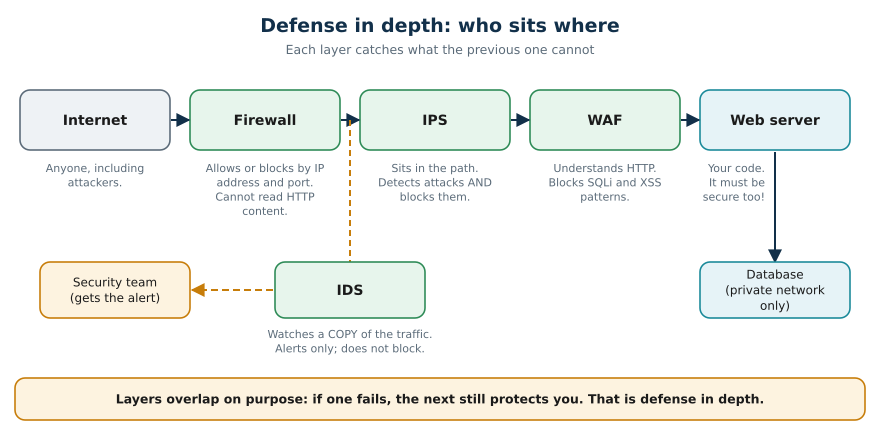

# Chapter 15: CEH Topics the Core Chapters Skip

> **Goal.** After this chapter you can define, in one or two sentences, the topics a cybersecurity interviewer or the CEH syllabus mentions that Chapters 1-14 only touch: enumeration, system hacking, malware types, evasion, wireless, mobile, IoT and OT.
>
> **Time:** about 60 minutes. Concept level only: what it is, why it matters, how defenders stop it. Practise only on systems you own or have written permission to test.

---

## Quick definitions

| Topic | What it is (say this) | How defenders respond |
| --- | --- | --- |
| **Enumeration** | Actively pulling detail from a reachable service after scanning: user names, shares, service versions, DNS records. Typical services: SMB, SNMP, LDAP, DNS, NFS. | Disable unused services, restrict SNMP and zone transfers, require authentication, segment networks |
| **Vulnerability analysis** | Finding and ranking known weaknesses with scanners, then judging which matter (CVSS plus exposure plus KEV status). | Regular scans, patch by risk, track exploited vulnerabilities |
| **System hacking** | Gaining access, raising privileges (**privilege escalation**), staying in (**persistence**), and hiding (**covering tracks**). Password attacks: guessing, spraying, cracking leaked hashes. | Strong unique passwords, MFA, least privilege, patching, logging that cannot be edited by the host |
| **Steganography** | Hiding data inside another file, such as an image. Steganalysis detects it. | Data-loss monitoring, file inspection |
| **Trojan** | Malware disguised as something useful. | Allow-listing, signed software, endpoint protection |
| **Virus / worm** | A virus needs a host file and a user action; a worm spreads itself over networks. | Patching, segmentation, email filtering |
| **Rootkit** | Hides malware at a deep level (OS or firmware). | Secure boot, integrity monitoring, rebuild from clean image |
| **Fileless malware** | Runs in memory using built-in tools (for example PowerShell), leaving few files. | Behaviour-based detection (EDR), restrict scripting, log command lines |
| **APT** | Advanced persistent threat: a well-resourced actor that stays hidden for a long time, often state-linked. | Detection and response, threat hunting, least privilege |
| **Keylogger / spyware / botnet** | Record input / spy / a network of infected machines under remote control. | EDR, MFA (stolen passwords alone fail), egress filtering |
| **Sniffing** | Capturing network traffic (Wireshark). Useful on unencrypted traffic. | Encrypt in transit (TLS, VPN), switch security, avoid public Wi-Fi |
| **Session hijacking** | Taking over a logged-in session by stealing or predicting its token. | HttpOnly and Secure cookies, short sessions, TLS, rotate on login |
| **Evasion** | Techniques to slip past defences: fragmenting packets, encoding, slow scans, using allowed protocols. | Layered controls, normalisation, behaviour analytics |
| **Honeypot** | A decoy system that attracts attackers so you can watch them and raise alerts. | Defensive tool, not a risk |
| **Web server attacks** | Misconfiguration, default pages and credentials, unpatched servers, directory listing. | Hardening baselines, patching, remove defaults |
| **Wireless** | Weak or old Wi-Fi security (WEP, WPA/WPA2 with weak passphrases), rogue access points, evil twins. | WPA3 or WPA2-Enterprise, strong passphrases, wireless intrusion detection |
| **Mobile** | Malicious apps, unpatched OS, jailbreak or root, insecure data storage. | Mobile device management, app-store only, patching, no root |
| **IoT and OT** | Cheap connected devices and industrial control systems (ICS/SCADA) with default passwords, old firmware and long lifetimes. | Separate networks, change defaults, update firmware, monitor |

## Firewall, IDS, IPS, WAF (know this cold)

| Control | Where | Reads | Action |
| --- | --- | --- | --- |
| **Firewall** | Network edge | IP address and port | Allow or block |
| **IDS** | Watches a copy of traffic | Packets and patterns | Alerts only |
| **IPS** | In the traffic path | Packets and patterns | Detects and blocks |
| **WAF** | In front of a web app | HTTP requests | Blocks SQL injection, XSS and similar patterns |

Memory hook: **IDS alerts, IPS blocks.** None replaces secure code or patching.

## PKI in one minute

A **certificate authority (CA)** vouches that a public key belongs to a named site by signing a **certificate**. Browsers trust a set of CAs. **PKI** is the system of CAs, certificates, issuing, revoking and expiry. Failure modes: expired certificate, wrong name, untrusted CA, stolen private key. Fix: automate renewal, protect private keys, monitor certificate transparency logs.

## Check yourself

1. What is the difference between an IDS and an IPS?
2. Virus vs worm?
3. Why is fileless malware hard to detect?
4. What is privilege escalation?

**Answers** *(cover this until you have tried)*

1. An IDS watches a copy of traffic and alerts; an IPS sits in the path and blocks.
2. A virus needs a host file and a user action; a worm spreads itself.
3. It runs in memory using legitimate tools, so there are few files; use behaviour-based detection and command-line logging.
4. Gaining higher rights than you started with, for example from a normal user to administrator; least privilege and patching limit it.

## Summary

- Know one-line definitions and one defence for each topic in the table.
- IDS alerts, IPS blocks, WAF understands HTTP, firewalls filter by address and port.
- Most of these topics have the same defence themes: patch, least privilege, MFA, segmentation, logging.
