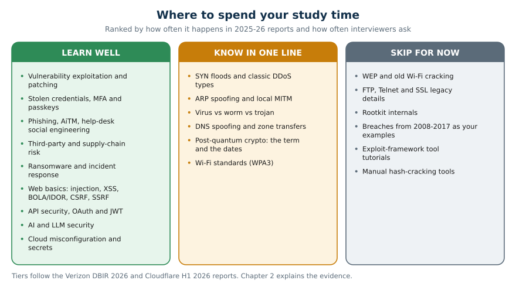
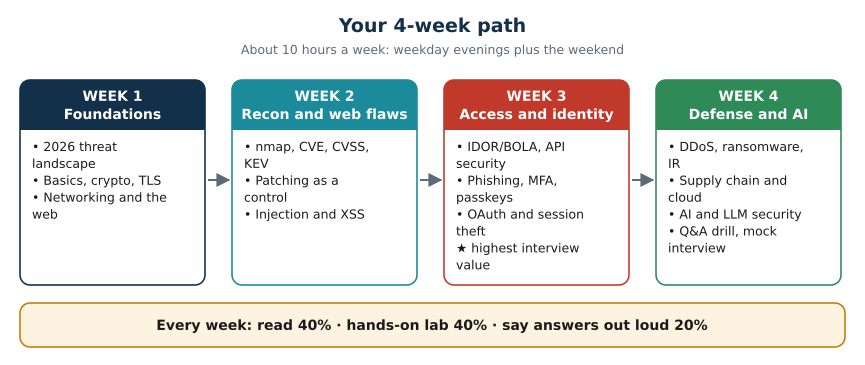
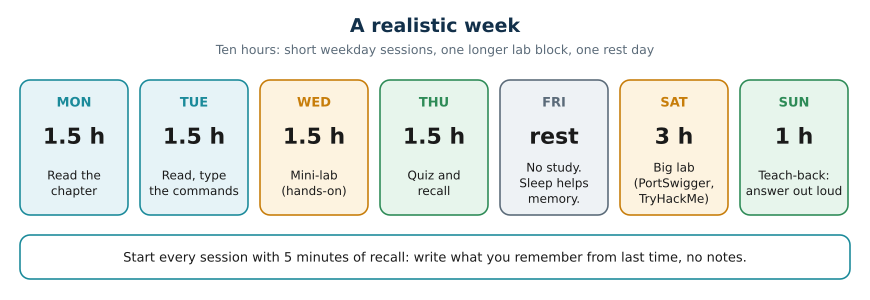
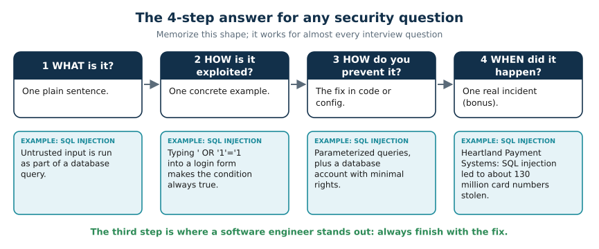

# Security Interview Prep: 4-Week Crash Course

*Illustrated edition, updated 16 November 2026 for the current threat landscape. Written for a working software engineer who has one month, about 10 hours a week, and one goal: pass a security-flavoured technical interview.*

> **Goal.** After four weeks you can (1) explain how breaches really happen today, (2) narrate how HTTPS, hashing, the OWASP Top 10 and modern identity attacks work, (3) answer any "what is X?" question in four steps (what, how it is exploited, how to prevent it, a recent real case), and (4) run basic scans and web labs on legal targets.
>
> **Not a goal.** Becoming a penetration tester or passing the CEH exam. That is why this book skips terminal basics, Python and Bash, which you already know.

---

## What changed in this edition

You asked to focus on what is current and to skip what rarely happens. So this edition:

- **Adds** a threat-landscape chapter built on the 2026 Verizon and Cloudflare reports, plus new chapters on **identity and phishing (passkeys, AiTM)**, **supply chain, cloud and DevSecOps**, and **AI and LLM security**.
- **Replaces** old examples (2008-2017 breaches) with 2023-2026 cases, each marked confirmed or reported.
- **Shrinks** legacy topics (SYN floods, ARP spoofing, Wi-Fi history, malware taxonomy, rare injection types) to one-liners, and tags every chapter with how often the topic matters now.
- **Updates** the OWASP material: Top 10 (2025), API Security Top 10 (2023), LLM Top 10 (2025) and the Agentic Top 10 (December 2025).

---

## 1. How this book teaches

Good courses are built on a few well-tested learning techniques. This book uses all of them, so use them too:

| Technique | Why it works | How you apply it here |
| --- | --- | --- |
| **Dual coding** (picture + words) | You remember a diagram plus a sentence far better than text alone | Every chapter shows the idea as a diagram first. Look at the picture, *then* read. |
| **Chunking** | Working memory holds only a few items | Chapters are split into short sections with one idea each. |
| **Worked examples** | Seeing a full example beats abstract rules | Each attack has one concrete walkthrough and, where relevant, a before/after code fix. |
| **Active recall** | Pulling facts out of memory builds memory; re-reading does not | Close the book at the end of a section and write what you remember. Then do the *Check yourself* quiz. |
| **Spaced repetition** | Reviewing at growing intervals beats cramming | The [daily plan](01-daily-plan.md) starts every session with 5 minutes of recall from the last session. |
| **Teach-back** (Feynman technique) | If you can't explain it simply, you don't know it yet | Every Sunday you explain the week's topics out loud, as if to a junior developer. |
| **Real cases** | A story gives an abstract idea a place to live in your head | Each topic is tied to a recent incident, with its confidence level stated. |
| **Interleaving** | Mixing topics trains you to *pick* the right idea | Week 4's question bank mixes everything on purpose. |

---

## 2. The one answer shape to memorize

Almost every interview question has the same skeleton. Practise it until it is automatic.

1. **What is it?** One plain sentence.
2. **How is it exploited?** One concrete example.
3. **How do you prevent it?** The fix in code or configuration. *This is where an engineer stands out.*
4. **When did it happen?** One real, recent incident (a bonus that signals real knowledge).

> **Interview angle.** If you freeze, say the four steps silently in order. You will always have something sensible to say.

---

## 3. The chapters

| File | Topic | Week | Time | Matching chapters in your Indonesian book |
| --- | --- | --- | --- | --- |
| [01-daily-plan.md](01-daily-plan.md) | Day-by-day schedule for 28 days | all | - | - |
| [02-threat-landscape-2026.md](02-threat-landscape-2026.md) | How breaches start now; the six themes; recent cases | 1 | 1.5 h | - (new) |
| [03-security-basics.md](03-security-basics.md) | CIA, vocabulary, attack phases, who's who | 1 | 1.5 h | Bab 0 |
| [04-cryptography.md](04-cryptography.md) | Hashing, encryption, TLS, passwords, post-quantum | 1 | 2.5 h | Bab 6, Tabel 13.4 |
| [05-networking-and-web.md](05-networking-and-web.md) | Layers, TCP, DNS, HTTP, cookies | 1 | 3 h | Bab 3, 4 |
| [06-recon-and-scanning.md](06-recon-and-scanning.md) | OSINT, nmap, CVE/CVSS/KEV, patching | 2 | 3 h | Bab 7, 8 |
| [07-injection-and-xss.md](07-injection-and-xss.md) | OWASP Top 10, SQL injection, XSS | 2 | 4 h | Bab 11, 12 |
| [08-access-control-and-apis.md](08-access-control-and-apis.md) | IDOR/BOLA, API security, CSRF, SSRF | 3 | 3 h | Bab 11, 12 |
| [09-identity-and-phishing.md](09-identity-and-phishing.md) | Stolen logins, MFA, passkeys, AiTM, OAuth, help-desk attacks | 3 | 3 h | Bab 9, 10 |
| [10-network-attacks-and-ddos.md](10-network-attacks-and-ddos.md) | DDoS today, MITM, defence layers | 4 | 1 h | Bab 10, 11 |
| [11-ransomware-and-incident-response.md](11-ransomware-and-incident-response.md) | Ransomware chain, malware, incident response | 4 | 1.5 h | Bab 9, 10 |
| [12-supply-chain-cloud-devsecops.md](12-supply-chain-cloud-devsecops.md) | Supply chain, third parties, cloud, STRIDE | 4 | 1.5 h | Bab 13 |
| [13-ai-and-llm-security.md](13-ai-and-llm-security.md) | Prompt injection, LLM and agent risks | 4 | 2 h | - (new) |
| [14-qa-bank.md](14-qa-bank.md) | 45 interview questions with model answers | 4 | 4 h | Bab 14, 15 |
| [15-labs.md](15-labs.md) | Step-by-step hands-on labs | 1-4 | - | - |
| [16-cheat-sheets.md](16-cheat-sheets.md) | One-page revision tables | 4 | - | - |
| [17-glossary.md](17-glossary.md) | Terms in one line each | all | - | - |
| [18-sources.md](18-sources.md) | Sources, further reading, accuracy notes | all | - | - |

---

## 4. How every chapter is built

Every chapter has the same anatomy, so you always know where you are:

1. **Goal box** at the top: what you will be able to do afterwards, plus how much it matters now.
2. **Big picture and analogy**, so the idea has a place to sit.
3. **Diagrams** with a one-line caption.
4. **Short sections**, one idea each, with a worked example.
5. **Common mistakes** and **interview angle** boxes.
6. **Check yourself**: a short quiz. The answers sit directly below, so cover them first.
7. **Summary**: five lines for the night before the interview.

Box labels you will see:

> **Analogy.** An everyday comparison to make the idea stick.

> **Real case.** A real incident that shows the idea in the wild.

> **Common mistake.** What beginners (and some interviewers' traps) get wrong.

> **Interview angle.** How to turn this topic into a strong answer.

---

## 5. Ground rules

1. **Legal first.** Test only systems you own, practice platforms (PortSwigger Web Security Academy, TryHackMe) or targets that explicitly invite scanning (scanme.nmap.org). "Just trying" on someone else's site is a crime in most countries, including under Indonesia's UU ITE.
2. **Type, don't paste.** Typing a command builds recall that reading cannot.
3. **Understand, don't memorize.** Interviewers follow up on *why*. A memorized list collapses at the first follow-up; an understood idea does not.
4. **Say "reported" when unsure.** Security news changes quickly. Confirmed facts get stated plainly; unconfirmed claims get a hedge. That habit alone makes you sound credible.
5. **Fall-behind rule.** If you lose a day, skip optional labs first. Never skip the Sunday teach-back or Week 3.

Start with [02-threat-landscape-2026.md](02-threat-landscape-2026.md), or open the [daily plan](01-daily-plan.md) to see exactly what to do tonight.
