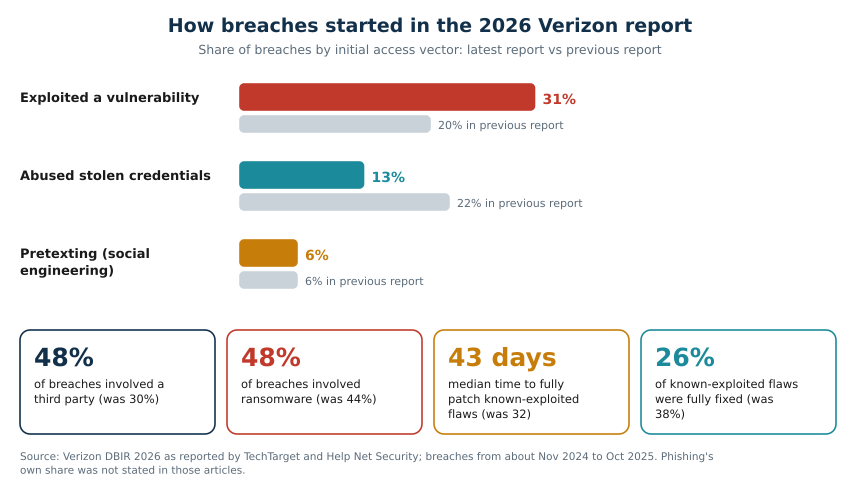
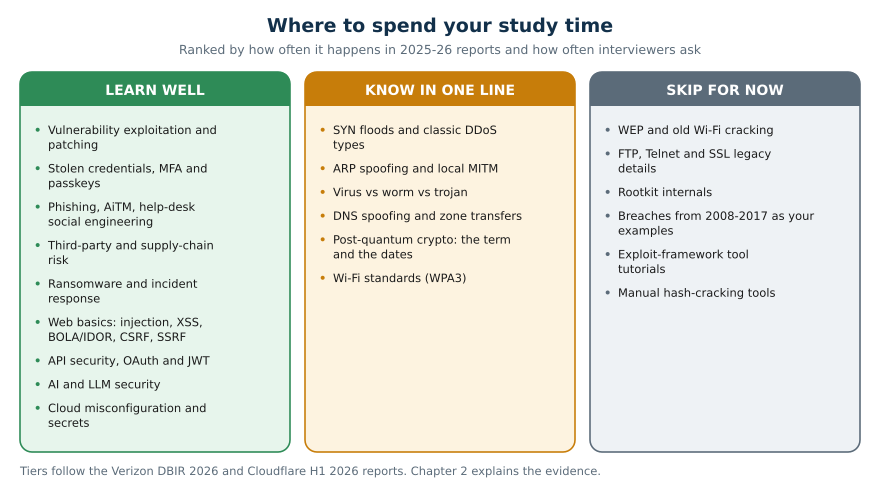

# Chapter 2: The 2026 Threat Landscape

> **Goal.** After this chapter you can: say how breaches really start today, with numbers; name the six themes that dominate 2025-26; give three recent real cases (2023-2026) for any topic; and explain why this book spends its time where it does.
>
> **Time:** about 1.5 hours. **Why first:** good courses start with *what matters*, so every later detail has somewhere to hang. This chapter replaces the old "famous breaches" approach with current data.

---

## 1. How breaches actually start

The best single source for this question is the **Verizon Data Breach Investigations Report (DBIR)**, published every spring from thousands of real incidents. The 2026 edition (released in May 2026) changed the headline for the first time in its history.

What the figures say, as reported by [TechTarget](https://www.techtarget.com/cybersecurity/news/366643420/Verizon-2026-DBIR-6-key-takeaways-for-CISOs) and [Help Net Security](https://www.helpnetsecurity.com/2026/05/20/verizon-2026-dbir-findings/):

- **Exploiting a vulnerability is now the most common way in (31%).** It was 20% the year before, and it overtook stolen credentials for the first time.
- **Stolen credentials fell to 13%** (from 22%), and **pretexting** (talking someone into it) was 6%.
- **Third parties were involved in 48% of breaches**, up from 30%. Your vendors' security is part of your security.
- **Ransomware was present in 48% of breaches**, and 69% of ransomware victims did not pay.
- **Patching is slow.** Only 26% of known-exploited vulnerabilities were fully fixed, and the median time to fix them was 43 days (it was 32).

> **Common mistake.** Picturing "hacking" as a genius finding a brand-new zero-day. The data says the opposite: most breaches use **a flaw that already has a fix, a login that was already stolen, or a convincing request to a human.** That is good news, because those are defensible with ordinary discipline.

> **A caution about numbers.** These figures come from news coverage of the report, not from the 100-page report itself, and the two articles differ slightly on a few details. Quote them as *"according to Verizon's 2026 report"* and round them. Interviewers care that you know the *shape* (exploits and stolen access dominate; third parties are rising), not the decimals.

---

## 2. The six themes of 2025-26

| Theme | What is happening now | Chapter |
| --- | --- | --- |
| **1. Unpatched and edge-device flaws** | Attackers race to exploit freshly disclosed flaws, especially in VPNs, firewalls and file-transfer tools, faster than organizations patch | 6, 7 |
| **2. Identity is the new perimeter** | Stolen logins (from infostealer malware), phishing proxies that defeat ordinary MFA, and attacks on the IT help desk | 9 |
| **3. Third parties and the supply chain** | Breaches arrive through a vendor, a SaaS integration token, or a poisoned open-source package | 12 |
| **4. Ransomware and extortion** | Data is stolen first, then systems are locked: pay or be exposed | 11 |
| **5. AI on both sides** | Attackers use AI to scale phishing and speed up work; AI apps and agents are a brand-new attack surface (prompt injection) | 13 |
| **6. Bigger, shorter DDoS** | Record volumes, but most attacks are small and end within minutes | 10 |

A seventh theme is a *slow-burn* one: **post-quantum cryptography**, because data stolen today may be readable later (Chapter 4).

---

## 3. Recent real cases to keep in your pocket

An interviewer who asks "tell me about a real incident" is far more impressed by a 2024-2026 example than by a 2013 one. Learn these one-liners. The "status" column tells you how firmly each is established.

| Case | When | How it started | Lesson | Status |
| --- | --- | --- | --- | --- |
| **MOVEit Transfer** | 2023 | A **SQL injection** zero-day (CVE-2023-34362) in a file-transfer product | Old bug class, huge impact; patch internet-facing tools first | Confirmed; thousands of organizations (an Emsisoft tally reached about 2,800) |
| **Snowflake customers** | 2024 | Stolen logins from **infostealer** malware, accounts **without MFA** | Enforce MFA; retire old credentials; restrict network access | Confirmed by Mandiant; at least 165 organizations |
| **Change Healthcare** | 2024 | A remote-access portal **without MFA**, stolen credentials | One missing control, nine days of free movement, ransomware | Confirmed; later reported to affect roughly 190 million people |
| **XZ Utils backdoor** | 2024 | An attacker **built trust for about two years** and became a maintainer, then hid a backdoor | Even trusted maintainers are a risk; found by luck | Confirmed; CVE-2024-3094 |
| **Marks & Spencer** | 2025 | Reported **help-desk social engineering** (linked to Scattered Spider) | The help desk is part of your perimeter | Reported |
| **Salesloft Drift** | 2025 | Stolen **OAuth tokens** for a third-party integration used to pull data from many Salesforce accounts | A vendor's token is your data | Confirmed; 700+ organizations potentially affected |
| **Shai-Hulud npm worm** | 2025 | A **self-spreading** package that steals tokens and republishes itself | Package installs can run code; rotate secrets fast | Confirmed; waves in Sep and Nov 2025 |
| **EchoLeak (Microsoft 365 Copilot)** | 2025 | A **zero-click prompt injection** by email (CVE-2025-32711, CVSS 9.3) | AI assistants can be steered by the content they read | Confirmed; patched by Microsoft |
| **Klue** | 2026 | A **stolen credential from 2022** for a limited pilot; about 200 downstream companies affected | Old credentials and third parties bite together | Confirmed by Klue |
| **Developer-tool supply-chain wave** | 2026 | Backdoored tools (Trivy, Bitwarden CLI, Checkmarx, a popular npm package) harvested tokens; OpenAI, Vercel and an EU agency confirmed downstream impact | Developer tooling is a prime target | Compromises confirmed; wider details as reported |
| **Instagram account takeovers via Meta's AI chatbot** | 2026 | Attackers posed as locked-out owners and got the **AI assistant to send reset codes** | AI agents inherit the weaknesses of account recovery | Reported by 404 Media and the New York Times |

*(Sources and caveats are in [Sources](18-sources.md). Exact counts change as investigations continue; say "reported" for anything not yet confirmed.)*

---

## 4. How the five-phase model fits the modern world

The five phases from Chapter 3 are still the right mental model. Professionals usually describe the same thing using **MITRE ATT&CK**, a public catalogue of attacker *tactics* (the goal, such as Initial Access, Persistence, Lateral Movement, Exfiltration) and *techniques* (how). You don't need to memorize it; know that it exists, that it has 14 enterprise tactics, and that your five phases are a simplified version of it. (The DBIR itself maps what attackers do to ATT&CK techniques.)

---

## 5. What this book therefore emphasizes (and cuts)

**Learn well:** the topics in the left column above. They match both the data and what interviewers ask.

**Know in one line:** classic topics that still appear in quizzes but rarely drive modern incidents. For instance, a **SYN flood** is real, but Cloudflare's first-half-2026 report does not even name it as a top vector (DNS floods and reflection floods dominate); **ARP spoofing** matters only on a local network.

**Skip for now:** legacy and low-value details such as WEP cracking, old protocol trivia, rootkit internals, and 2008-2017 breaches as your examples. If you have spare time later, add them back.

---

## 6. Interview angle

> **"What are the biggest security threats right now?"**
> "From recent data, attackers mostly get in through three doors: **known vulnerabilities that haven't been patched**, especially in internet-facing devices; **stolen or phished credentials**, including phishing that defeats ordinary MFA; and **third parties**, such as a vendor's access token or a poisoned dependency. Ransomware is the main way that access is monetized. On top of that, AI adds two things: attackers use it to scale phishing, and AI-powered apps introduce a new class of flaw, prompt injection. The common thread is that most of it is preventable with fast patching, phishing-resistant MFA, least privilege and good vendor hygiene."

---

## Check yourself

1. According to the 2026 Verizon report, what is now the most common way breaches start, and what was it before?
2. Roughly what share of breaches involved a third party, and why does it matter to you as a developer?
3. Name three recent cases (2023-2026) and the one-line lesson from each.
4. Why is "most breaches use known flaws or stolen logins" good news?
5. Why does this book treat SYN floods as "know in one line"?
6. What is MITRE ATT&CK, in one sentence?

**Answers** *(cover this until you have tried)*

1. Exploiting a vulnerability (about 31%). Before, stolen credentials led; now they are about 13%.
2. About 48% (up from 30%). Your dependencies, SaaS integrations and vendors can become your breach, so you must manage them like your own code.
3. For example: MOVEit 2023 (a SQL injection in a widely used product), Change Healthcare 2024 (a portal without MFA), Shai-Hulud 2025 (a package that steals tokens and spreads). Any three from the table work if you can state the lesson.
4. Because those causes are preventable with ordinary discipline: patching, MFA, least privilege and vendor review. No genius defender is required.
5. It is a real but well-mitigated attack, and current reports show attackers concentrating on other methods (DNS and reflection floods, HTTP floods), so time is better spent there.
6. A public catalogue of attacker tactics and techniques that both attackers' behaviour and defenders' detections can be mapped to.

---

## Summary

- Verizon's 2026 report: exploited vulnerabilities (about 31%) overtook stolen credentials (about 13%); third parties in 48% of breaches; ransomware in 48%.
- Patching is slow: a median of 43 days for known-exploited flaws. That gap is where attackers live.
- Six themes: edge-device flaws, identity attacks, third parties and supply chain, ransomware, AI, bigger-but-shorter DDoS.
- Keep 2023-2026 cases ready; flag anything not yet confirmed as "reported".
- Spend time on the "learn well" list; spend one line each on the rest.
