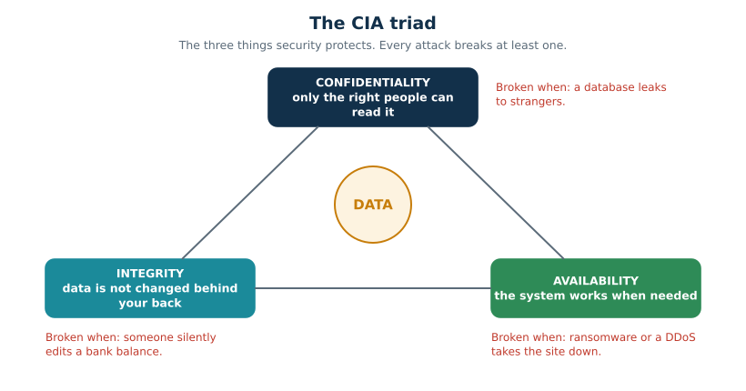
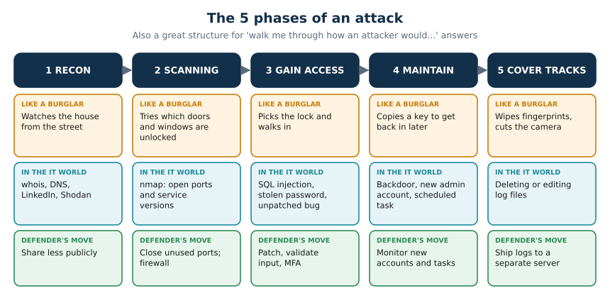

# Chapter 3: Security Basics

> **Goal.** After this chapter you can: explain the CIA triad with an example for each letter; define vulnerability, threat, risk and exploit without mixing them up; walk through the five phases of an attack; tell a white hat from a black hat and a red team from a blue team; explain the difference between a vulnerability assessment and a penetration test; and name the two design principles interviewers love (least privilege and defense in depth).
>
> **Time:** about 1.5 hours. **Still relevant in 2026?** Yes: this is the vocabulary of every interview. **Companion reading:** Bab 0 of your Indonesian book.

---

## 1. The big picture

Security is the discipline of keeping a system useful and trustworthy **while someone is actively trying to break it**. Two facts shape everything else:

- **The attacker only needs one way in. The defender must close all of them.** So we never rely on a single protection; we stack several (*defense in depth*).
- **Security is about risk, not perfection.** You cannot make anything unbreakable; you decide which risks are worth the cost to reduce.

---

## 2. The CIA triad

Every security property fits into one of three buckets. When an interviewer asks about *any* attack, a smart first move is to say which of the three it breaks.

| Property | The question it answers | Broken by (example) | Typical controls |
| --- | --- | --- | --- |
| **Confidentiality** | Can only the right people read this? | A database leak, an exposed cloud bucket | Encryption, access control, MFA |
| **Integrity** | Is this data exactly what it should be? | Someone silently edits a payment amount | Hashing, digital signatures, input validation, audit logs |
| **Availability** | Does the system work when needed? | Ransomware, a DDoS flood | Redundancy, tested backups, rate limiting, DDoS protection |

> **Analogy.** Think of a letter. A *sealed envelope* gives confidentiality. A *tamper-evident seal* gives integrity. A *postbox that is open when you need it* gives availability.

Two extra words you will hear: **authenticity** (is the sender really who they claim?) and **non-repudiation** (the sender cannot later deny they did it; digital signatures provide this).

> **Common mistake.** Treating security as only "keeping secrets". A hospital whose data stays secret but whose systems are locked by ransomware has failed at availability. A bank whose balances can be edited by anyone has failed at integrity.

---

## 3. The vocabulary interviewers use

These words are used loosely in everyday talk but precisely in interviews. Learn them through one running example: **a house with an unlocked window**.

| Term | Meaning | In the house example | In software |
| --- | --- | --- | --- |
| **Asset** | Something worth protecting | The valuables | Customer data, source code, uptime |
| **Vulnerability** | A weakness | The window lock is broken | A query built by string concatenation |
| **Threat** | Something that could exploit the weakness | A burglar | An attacker, malware, a careless insider |
| **Exploit** | The technique or code that uses the weakness | Climbing in through the window | A crafted input that triggers the bug |
| **Payload** | What runs after the exploit works | What the burglar does inside | Malware, a data dump |
| **Risk** | How bad and how likely | Likely in a bad area, high value inside | **Likelihood × impact** |
| **Control** | Something that reduces risk | Fix the lock, add an alarm | Patch, input validation, MFA |
| **Attack surface** | Everything an attacker can reach | Every door and window | Every endpoint, port, input field, dependency, vendor |
| **Zero-day** | A flaw nobody has patched yet (the vendor has had *zero days* to fix it) | A lock flaw nobody knows about | An unreported bug that is already being exploited |

**Risk, in one worked example.** A bug that is trivial to trigger from the internet and exposes every customer's data is **high** risk. A bug that needs physical access to a locked server room and reveals nothing sensitive is **low** risk, even if it is technically "a vulnerability". This is why not every finding is urgent.

> **Interview angle.** "Vulnerability vs threat vs risk?" Model answer: *"A vulnerability is a weakness, a threat is something that could exploit it, and risk is the likelihood and impact of that actually happening. A scary-sounding bug that is hard to reach and exposes nothing is lower risk than a boring bug that is easy to reach and exposes everything."*

---

## 4. The five phases of an attack

Attackers rarely just "hack". They work through a repeatable process. Knowing it gives you a ready-made structure for the interview question *"walk me through how an attacker would compromise X"*.

1. **Reconnaissance.** Learn about the target without touching it: public records, job postings, employee names on LinkedIn, leaked data.
2. **Scanning.** Actively probe: which machines are alive, which ports are open, which software versions run. (Chapter 6 covers this.)
3. **Gaining access.** Use a weakness: an injection flaw, a stolen password, an unpatched service, or a persuasive phone call.
4. **Maintaining access.** Make sure you can come back: a backdoor, a new admin account, a scheduled task.
5. **Covering tracks.** Hide the evidence: delete or edit logs.

**The defender's mirror image:** each phase has a counter-move (see the green row in the diagram). The best defence breaks the chain *early*, because an attacker blocked at phase 2 never reaches phase 3.

> **How the pros say it.** The industry's detailed version of this model is **MITRE ATT&CK**, a public catalogue of attacker tactics and techniques (Chapter 2). Your five phases are the simple summary.

> **Common mistake.** Thinking the phases are always strictly linear. Real attacks loop: after gaining access to one machine, an attacker goes back to phase 1 and 2 to explore the *next* machine inside the network.

---

## 5. Who's who

**Hat colours** (about permission and intent):

| Label | Permission? | Intent | Example |
| --- | --- | --- | --- |
| **White hat** (ethical hacker) | Yes, written | Improve security | A pentester under contract |
| **Black hat** | No | Profit, damage | A criminal running ransomware |
| **Grey hat** | No, but meaning well | Often to report a flaw | Someone who finds a bug without permission and tells the owner (still legally risky) |

**Teams:** **red team** simulates real attackers; **blue team** defends, monitors and responds; **purple team** is both sharing findings so defences improve faster.

**Attackers worth naming today:** financially motivated **ransomware and extortion crews** (the most common), **insiders**, **state-sponsored groups** (patient and well-funded), and loosely organized **youth-led groups** that specialize in social engineering of help desks and employees.

> **What makes hacking "ethical"?** Three things: **permission** (written authorization), **scope** (a clear list of what you may test and what you may not), and **reporting** (findings go to the owner, privately, with enough detail to fix them). Take away any one and it is no longer ethical hacking.

---

## 6. Vulnerability assessment vs penetration test

| | Vulnerability assessment | Penetration test |
| --- | --- | --- |
| **Question answered** | "What weaknesses exist?" | "What can an attacker actually *do* with them?" |
| **Method** | Mostly automated scanning | Mostly manual, creative exploitation |
| **Breadth vs depth** | Broad: many systems, many findings | Narrow and deep: chains weaknesses together |
| **Output** | A ranked list of weaknesses | A story of impact: "we reached the customer database" |
| **Analogy** | A home inspector listing every defect | A professional burglar proving which defect lets them in |

---

## 7. Two principles interviewers love

**Least privilege.** Give every person, process and program only the access it needs, and nothing more. *In code:* the web app's database account should be able to `SELECT` and `INSERT` on its own tables, not `DROP TABLE`. If the app is compromised, the damage is limited.

**Defense in depth.** Never rely on one control. *In code:* validate input, use parameterized queries, run the database with minimal rights, put a WAF in front, and log everything. If one layer fails, the next still protects you.

Three more one-liners worth keeping:

- **Never trust user input.** Anything that crosses a trust boundary (form fields, headers, URLs, uploaded files, data from other services, and now **text an AI model reads**) is hostile until validated.
- **Fail closed.** When something breaks, deny access by default instead of allowing it.
- **Security through obscurity is not security.** Hiding how something works is a bonus layer, never the only one. (A secret URL is not an access control.)

---

## 8. Real cases (both about missing basics)

> **Real case: Change Healthcare (2024).** Attackers entered on 12 February 2024 through a remote-access portal that **had no multi-factor authentication**, using stolen credentials, then spent about nine days moving through the network before deploying ransomware. The company later reported that roughly **190 million** people were affected. *Lessons:* **one missing basic control** (MFA) and **too much freedom once inside** (least privilege and segmentation). (Sources: TechTarget, SecurityWeek; see [Sources](18-sources.md).)

> **Real case: Klue (2026).** Attackers used a **credential issued in 2022 for a limited pilot** that was never retired, and reached data about roughly **200 downstream companies**, including customers' cloud keys. Klue confirmed the incident. *Lessons:* **credential lifecycle** (retire what you no longer need) and **least privilege** for vendors. (Source: TechCrunch's 2026 roundup.)

---

## Check yourself

1. Name the three letters of CIA and give one attack that breaks each.
2. What is the difference between a *threat* and a *vulnerability*?
3. Put the five phases in order and give one example for phase 3.
4. What three things make hacking *ethical*?
5. A vulnerability assessment lists 200 findings. A penetration test lists 3. Why is that not a contradiction?
6. In one sentence each: least privilege and defense in depth.

**Answers** *(cover this until you have tried)*

1. Confidentiality: a database leak. Integrity: someone silently edits a payment amount. Availability: ransomware or a DDoS flood.
2. A vulnerability is the weakness; a threat is the actor or event that could use it. The weakness exists with or without a threat.
3. Recon, scanning, gaining access, maintaining access, covering tracks. Phase 3 example: exploiting an injection flaw, using a stolen password, an unpatched service, or a persuasive phone call.
4. Written permission, a defined scope, and responsible reporting to the owner.
5. An assessment is broad and automated and lists *possible* weaknesses. A pentest is narrow and manual and reports only the ones that led to *proven impact*.
6. Least privilege: each user and program gets only the access it needs. Defense in depth: stack overlapping controls so one failure is not fatal.

---

## Summary

- Name the CIA leg any attack breaks; add authenticity and non-repudiation for extra points.
- Vulnerability = weakness, threat = who could use it, risk = likelihood × impact.
- Five phases: recon, scanning, gaining access, maintaining access, covering tracks. Defenders break the chain early.
- Ethical hacking = permission + scope + reporting. Assessment is broad; pentest is deep.
- Least privilege and defense in depth are your two favourite design answers. Recent breaches (Change Healthcare, Klue) came down to a missing basic and too much access.
