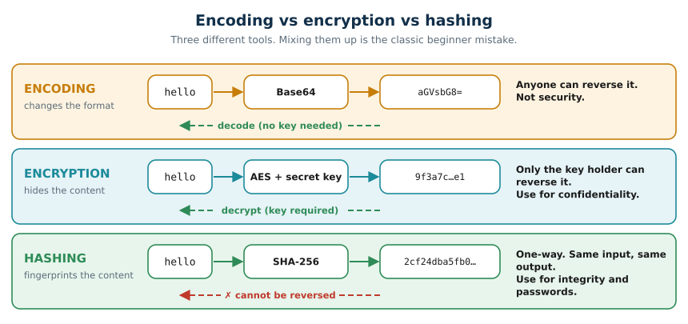
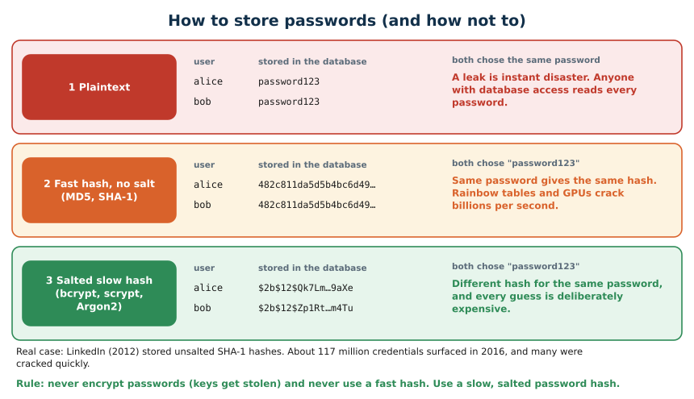
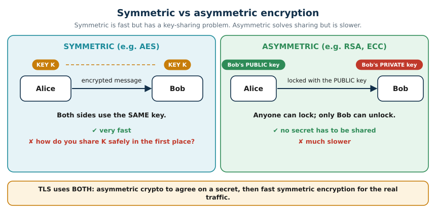
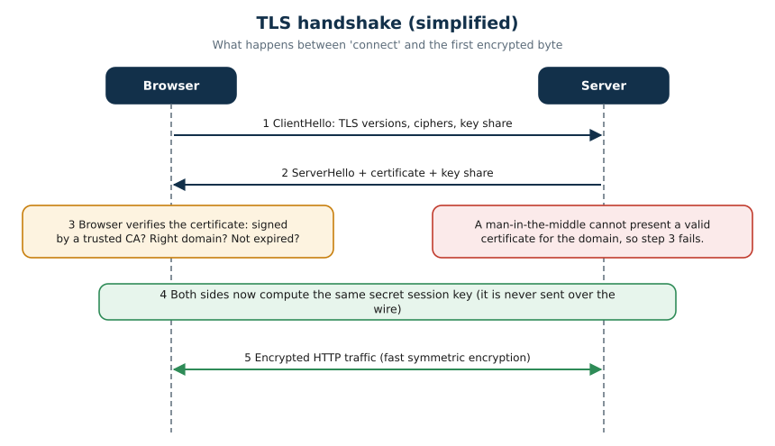
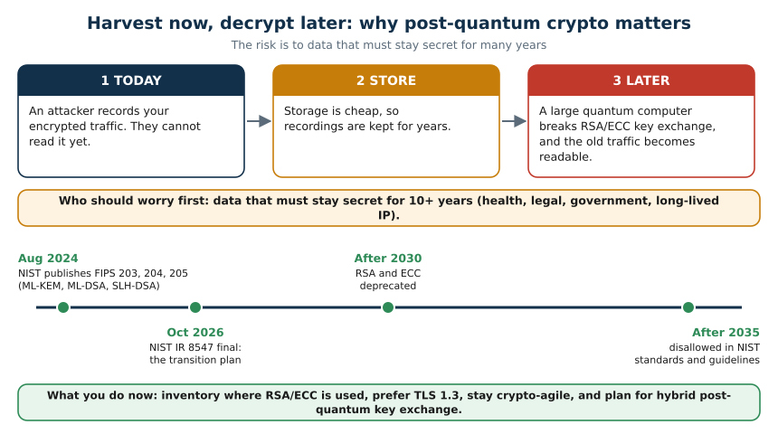

# Chapter 4: Cryptography You Actually Need

> **Goal.** After this chapter you can: explain encoding vs encryption vs hashing and pick the right one; explain symmetric vs asymmetric encryption and why TLS uses both; describe how certificates and digital signatures work; narrate the TLS handshake; say exactly how passwords should be stored and why; and explain "harvest now, decrypt later" and the post-quantum timeline.
>
> **Time:** about 2.5 hours. **Still relevant in 2026?** Yes (core), and post-quantum is the new addition. **Companion reading:** Bab 6 and Tabel 13.4 of your Indonesian book. **Lab:** [Lab 1](15-labs.md#lab-1-encoding-vs-hashing-vs-salted-hashing-in-python).

---

## 1. The big picture: three tools, three jobs

Most beginner confusion in cryptography comes from mixing up three different tools. Fix this first and everything else is easier.

| You need to... | Use | Example |
| --- | --- | --- |
| Put data in a format another system can read | **Encoding** | Base64 for binary in JSON, URL-encoding |
| Keep data secret, but get it back later | **Encryption** | AES for files, TLS for traffic |
| Check data was not changed, or store a password | **Hashing** | SHA-256 checksum, Argon2 password hash |

> **Common mistake #1.** "Base64 is encryption." It is not. Anyone can decode it, no key needed. Seeing a password or token in Base64 is not protection; it is the same as plain text.
>
> **Common mistake #2.** "We *decrypt* the hash to verify the password." A hash cannot be reversed. To verify a password you hash the *attempt* and compare hashes.
>
> **Common mistake #3.** "We encrypt passwords." If you can decrypt them, so can an attacker who steals the key. Passwords should be hashed, never encrypted.

---

## 2. Hashing in depth

A **hash function** turns any input into a fixed-size fingerprint.

Properties to remember:

- **Deterministic:** the same input always gives the same output.
- **Fixed size:** a one-word input and a one-gigabyte file both give, say, 256 bits.
- **One-way:** you cannot compute the input from the output.
- **Avalanche effect:** change one character and the whole output changes.
- **Collision resistant:** it should be practically impossible to find two inputs with the same hash.

Where you already meet hashes as a developer: **Git** names every commit by its hash; **download checksums** prove a file is intact; **digital signatures** sign a hash, not the whole message; **HMACs** prove a message came from someone who knows a secret.

| Algorithm | Status | Use for |
| --- | --- | --- |
| MD5, SHA-1 | **Broken** for security (collisions found) | Nothing security-related. Legacy checksums only. |
| SHA-256 / SHA-3 | Good | Integrity checks, signatures, fingerprints |
| **Argon2id**, scrypt, bcrypt | Good, and *deliberately slow* | **Passwords** |

> **Why "fast" is bad for passwords.** SHA-256 is designed to be fast, so a graphics card can try billions of guesses per second against a stolen database. Password hashes are designed to be slow and memory-hungry, which makes each guess expensive for the attacker while costing a login only a fraction of a second.

---

## 3. Storing passwords correctly

The safe recipe has two ingredients:

1. **A slow, purpose-built password hash** (Argon2id, scrypt, bcrypt). Never MD5, SHA-1 or plain SHA-256.
2. **A unique random salt per user.** A **salt** is random data stored next to the hash and mixed in before hashing. Two consequences: identical passwords produce different hashes, and precomputed lookup tables ("rainbow tables") become useless.

(Good libraries do both for you: the salt is generated and stored inside the output string. Never write this yourself.)

A **pepper** is an extra secret added to all passwords but stored *outside* the database (for example in a secrets manager), so a stolen database alone is not enough. **Salt is per-user and stored beside the hash; pepper is shared and stored elsewhere.**

**Verification flow:** user submits password → look up that user's stored salt and hash → hash the submitted password with the same salt and settings → compare. No decryption anywhere.

> **Where this matters now.** Good hashing limits the damage of a *database* leak. But the bigger modern problem is passwords stolen from *users*: by phishing and by **infostealer malware**, then replayed on other sites (credential stuffing). That is why Chapter 9 moves from "store passwords well" to "get rid of passwords" with passkeys. In the 2024 Snowflake incidents, credentials harvested years earlier were still valid and unprotected by MFA.

> **Interview angle.** "How should passwords be stored?" Model answer: *"Hashed with a slow, salted algorithm such as Argon2id, never encrypted and never a fast hash like MD5. The slowness makes each guess expensive, and the per-user salt means identical passwords get different hashes and precomputed tables don't work. Better still, reduce reliance on passwords with passkeys and MFA."*

---

## 4. Symmetric vs asymmetric encryption

| | Symmetric (AES) | Asymmetric (RSA, ECC) |
| --- | --- | --- |
| Keys | One shared secret key | A public/private key pair |
| Speed | Very fast | Much slower |
| Main problem | How do both sides get the key safely? | Slowness |
| Typical use | Encrypting the actual data | Agreeing on a key, signing, identity |

**The key idea:** the two types fix each other's weaknesses. Asymmetric crypto solves *key distribution* ("how do two strangers agree on a secret over a hostile network?"), and symmetric crypto solves *speed*. Real systems, including TLS, use **both**.

> **Analogy.** Asymmetric is a **padlock you hand out for free**: anyone can snap it shut (encrypt with the public key), but only you hold the key that opens it (the private key). Symmetric is a **shared safe combination**: fast to use, but you must get the combination to your friend without anyone overhearing.

**Diffie-Hellman** (and its elliptic-curve version) is a way for two parties to *agree on a shared secret* over an open channel without ever sending it. Modern TLS uses it to create fresh session keys.

---

## 5. Digital signatures and certificates

**Digital signature:** the sender hashes the message and *signs* the hash with their **private key**. Anyone can *verify* it with the sender's **public key**. If verification succeeds you know two things: the message was not altered (**integrity**) and it came from the key holder (**authenticity**, plus **non-repudiation**).

> Notice the reversal: **encryption uses the public key to lock and the private key to unlock; signing uses the private key to sign and the public key to verify.**

(Passkeys, Chapter 9, are built on exactly this: your device signs a challenge with a private key, and the website verifies it with the public key you registered.)

**Certificate:** a public key on its own proves nothing. Anyone can generate a key pair and claim to be bank.com. A **certificate** is a signed statement from a trusted **Certificate Authority (CA)**: *"this public key belongs to bank.com."*

**Chain of trust:** your operating system and browser ship with a list of trusted **root CAs**. A site's certificate is signed by an *intermediate* CA, which is signed by a *root* CA. The browser walks up the chain until it reaches a root it already trusts.

> **Analogy.** A certificate is a **passport**. You trust it because a government you already trust issued it, not because the person holding it says so.

The browser checks four things: is it signed by a trusted CA? Is it for *this* domain? Is it within its validity dates? Has it been revoked?

---

## 6. The TLS handshake

HTTPS is simply HTTP carried inside TLS. The handshake happens before any HTTP is sent.

1. **ClientHello.** The browser offers the TLS versions and cipher suites it supports and sends its half of a key exchange.
2. **ServerHello + certificate.** The server picks the options, sends its certificate and its half of the key exchange.
3. **Verification.** The browser checks the certificate (chain, domain, dates).
4. **Session key.** Both sides independently compute the *same* secret key from the exchanged values. The key itself is never transmitted.
5. **Encrypted traffic.** Everything from here on is encrypted with the fast symmetric session key.

**Why a man-in-the-middle fails:** to impersonate bank.com, the attacker needs a certificate for bank.com signed by a trusted CA, which they cannot get. A forged certificate makes the browser show a warning.

**Follow-ups you should expect:**

- *What is forward secrecy?* Session keys are temporary. If the server's long-term private key is stolen later, **past** recorded traffic still cannot be decrypted. TLS 1.3 requires it.
- *TLS 1.3 vs 1.2?* 1.3 is faster (fewer round trips) and removed old, weak options.
- *What does the padlock mean?* Only that the connection is encrypted **and** the server really owns that domain. It does **not** mean the site is trustworthy: a phishing site can have a perfectly valid certificate.
- *What is a downgrade attack?* Tricking both sides into using an older, weaker protocol. **HSTS** (an HTTP header) tells browsers to always use HTTPS for a site.

---

## 7. Post-quantum cryptography: the one new idea

**The problem.** A large enough quantum computer could break the public-key algorithms that protect today's key exchange and signatures (RSA and elliptic curves). Such computers do not exist yet at that scale, but an attacker can already **record encrypted traffic today and decrypt it years later** ("harvest now, decrypt later"). NIST describes this attack in its [explainer on post-quantum cryptography](https://www.nist.gov/cybersecurity/what-post-quantum-cryptography), and notes that migrations historically take 10 to 20 years, so waiting is risky.

**The response (verified from NIST):**

- **August 2024:** NIST published the first three post-quantum standards: **FIPS 203 (ML-KEM)** for key establishment, **FIPS 204 (ML-DSA)** and **FIPS 205 (SLH-DSA)** for digital signatures. NIST says they "can and should be put into use now". More algorithms (including HQC and Falcon) are still being standardized.
- **October 2026:** NIST finalized **IR 8547**, its transition plan: quantum-vulnerable public-key algorithms (RSA, ECDSA, EdDSA, Diffie-Hellman) are to be **deprecated after 2030 and disallowed after 2035**, with high-risk systems moving earlier.

**What it means for you as a developer:**

1. **Know the three words:** harvest now decrypt later, ML-KEM, hybrid key exchange (classical and post-quantum combined, so you are safe if either holds).
2. **Symmetric crypto and hashes are much less affected** (AES-256, SHA-256). The urgent work is **key exchange and signatures**.
3. **Be crypto-agile:** don't hard-code algorithms; make them configurable and know where you use RSA/ECC (TLS, JWT signing, code signing, SSH).
4. **Use current TLS (1.3)** and keep libraries updated; most of the migration will arrive through them.

> **Common mistake.** Panicking, or dismissing it. It is a *planning* topic, not a today-incident topic. The right answer is "inventory, stay crypto-agile, and adopt hybrid post-quantum key exchange as it lands in libraries."

---

## 8. Crypto mistakes developers actually make

- **Rolling your own crypto.** Always use a vetted library.
- **Hard-coded keys and secrets** in source code, config files committed to Git, or front-end bundles.
- **Weak or fast password hashing** (MD5, SHA-1, plain SHA-256).
- **ECB mode** for block ciphers (it leaks patterns). Prefer an authenticated mode such as **AES-GCM**.
- **Predictable "random" values.** `Math.random()` is not for tokens. Use a cryptographically secure generator (`secrets` in Python, `crypto.randomBytes` in Node).
- **Turning off certificate verification** (`verify=False`) to make an error go away. This quietly removes the protection TLS gives.

---

## Check yourself

1. Is Base64 encryption? Why or why not?
2. Why can't you "decrypt" a password hash, and how do you check a login instead?
3. What does a salt do, and how is it different from a pepper?
4. Why does TLS use both asymmetric and symmetric encryption?
5. A signature uses which key to *sign* and which to *verify*?
6. What is "harvest now, decrypt later", and which NIST dates should you remember?

**Answers** *(cover this until you have tried)*

1. No. It is encoding: reversible by anyone with no key, so it provides no secrecy.
2. Hashing is one-way. To check a login, hash the submitted password with the stored salt and compare the two hashes.
3. A salt is random, per user and stored beside the hash; it makes identical passwords hash differently and defeats precomputed tables. A pepper is a shared secret kept *outside* the database so a stolen database alone is not enough.
4. Asymmetric crypto lets two parties agree on a secret over an open network but is slow; symmetric crypto is fast for bulk data. TLS uses the first to set up a key and the second to encrypt the traffic.
5. Sign with the **private** key; verify with the **public** key.
6. An attacker records encrypted traffic now and decrypts it later with a quantum computer. NIST published ML-KEM and two signature standards in August 2024, and its transition plan (IR 8547, final October 2026) deprecates RSA/ECC after 2030 and disallows them after 2035.

---

## Summary

- Encoding = format, encryption = secrecy (reversible with a key), hashing = fingerprint (one-way).
- Passwords: Argon2id/bcrypt, salted, never encrypted, never fast hashes; and move toward passkeys.
- Asymmetric agrees on a key; symmetric encrypts the data. TLS uses both; certificates make a man-in-the-middle fail.
- Post-quantum: harvest now decrypt later; ML-KEM (FIPS 203); RSA/ECC deprecated after 2030, disallowed after 2035; be crypto-agile.
- The usual real-world failure is key management and misuse, not the algorithm.
