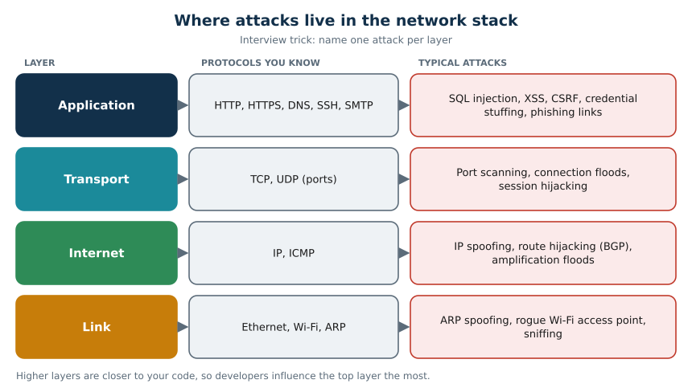
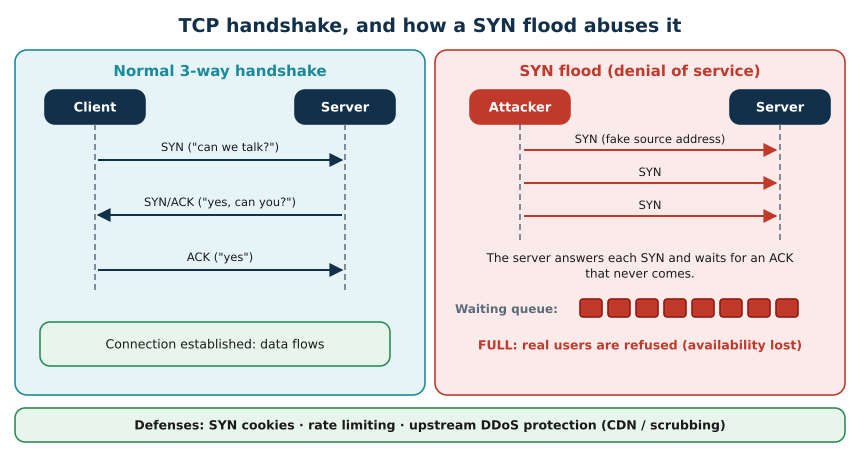
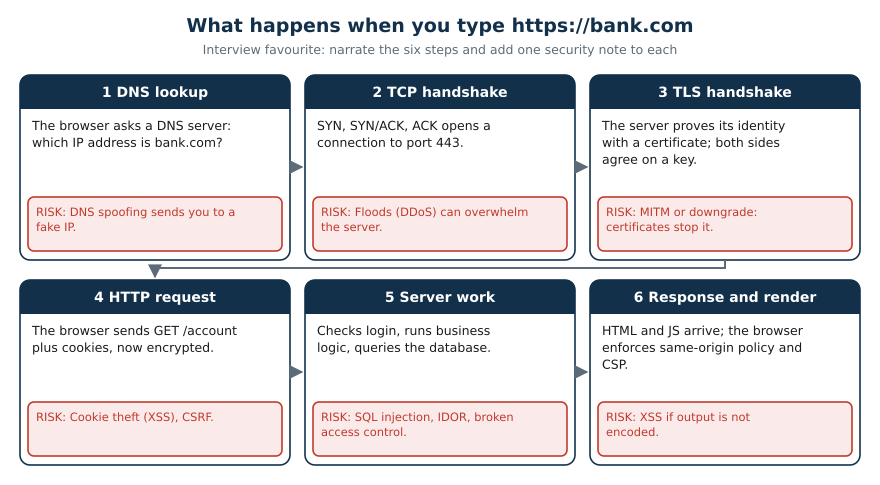

# Chapter 4: Networking and How the Web Works

> **Goal.** After this chapter you can: sketch the TCP/IP layers and name one attack per layer; explain the TCP three-way handshake and how a SYN flood abuses it; explain DNS and its common record types; narrate "what happens when you type https://bank.com" with a security note at each step; and explain cookies, their security flags, security headers, the same-origin policy and CORS.
>
> **Time:** about 4 hours. **Companion reading:** Bab 3 and Bab 4 of your Indonesian book. **Labs:** [Lab 2](11-labs.md#lab-2-watch-a-tcp-handshake-and-a-tls-hello-in-wireshark) and [Lab 3](11-labs.md#lab-3-read-the-security-headers-of-a-website).

You already use most of this daily as a developer. The work here is to **re-read it with an attacker's eyes**: at every step, ask "what could go wrong, and for whom?"

---

## 1. The layers, and where attacks live

Networking is organized in layers; each layer only talks to the one above and below it.



> **Analogy.** Sending a parcel: you write the **letter** (application), put it in an **envelope with an address and a tracking number** (transport), the **postal system routes it between cities** (internet), and **a van drives it down the local street** (link). A fraud can happen at any stage: a fake letter, a swapped tracking number, a forged address, a hijacked van.

**Interview trick:** name one attack per layer. It turns "recite the layers" into an impressive answer.

**TCP vs UDP** (both live at the transport layer):

| | TCP | UDP |
| --- | --- | --- |
| Connection | Yes (handshake first) | No |
| Delivery | Guaranteed, in order | Best effort |
| Speed | Slower | Faster |
| Used by | Web, email, SSH | DNS, video calls, games |

**Ports** are numbered doors on a machine (0-65535). A service *listens* on a port; a scan checks which are open. The ports to memorize are in the [cheat sheets](12-cheat-sheets.md).

---

## 2. The TCP handshake, and the SYN flood



Before any data flows, TCP sets up a connection in three steps: **SYN** ("can we talk?"), **SYN/ACK** ("yes, can you?"), **ACK** ("yes").

**The attack.** After a SYN arrives, the server reserves memory and waits for the final ACK. An attacker sends a flood of SYNs (often with forged source addresses), never sends the ACKs, and fills the server's queue of half-open connections. Real users are then refused: **availability** is lost.

**Defences:** SYN cookies (the server avoids reserving memory until the ACK arrives), rate limiting, and upstream DDoS protection.

This one diagram answers three interview questions: how TCP connects, what a SYN flood is, and (in Week 2) why nmap's "SYN scan" is quieter than a full connection.

---

## 3. DNS: the internet's phone book

**What it does:** turns a name (`bank.com`) into an IP address.

**How a lookup works, simplified:** your device asks a *resolver* (usually your ISP's or a public one) → the resolver asks the root, then the `.com` servers, then bank.com's own nameserver → the answer comes back and is **cached** for a while.

| Record | Holds | Why it matters in security |
| --- | --- | --- |
| **A / AAAA** | IPv4 / IPv6 address | The core answer |
| **CNAME** | An alias to another name | Dangling CNAMEs can enable subdomain takeover |
| **MX** | Mail servers | Reveals mail provider |
| **NS** | Authoritative nameservers | Targeted in DNS attacks |
| **TXT** | Free text (SPF, DKIM, domain verification) | Email anti-spoofing lives here |

**Attacks to name:** **DNS spoofing / cache poisoning** (feeding a resolver a false answer so users land on a fake IP), **zone transfer** (a misconfigured server hands out its entire list of records to anyone who asks), and **DNS tunnelling** (smuggling data inside DNS queries). **DNSSEC** adds signatures so answers can be verified.

---

## 4. The master story: what happens when you type https://bank.com

If you remember only one diagram from this book, make it this one. It is the most common interview question for developers, and each step is a hook for a security topic.



How to narrate it in about two minutes:

1. **DNS lookup:** "The browser resolves bank.com to an IP. *Risk: DNS spoofing.*"
2. **TCP handshake:** "It opens a connection to port 443. *Risk: SYN flood.*"
3. **TLS handshake:** "The server proves its identity with a certificate and both sides derive a session key. *Risk: man-in-the-middle, which certificates prevent.*"
4. **HTTP request:** "The browser sends `GET /account` with its cookies, now encrypted. *Risk: cookie theft via XSS, CSRF.*"
5. **Server work:** "The server authenticates, authorizes, runs logic, queries the database. *Risk: SQL injection, IDOR, broken access control.*"
6. **Response and render:** "HTML and JavaScript come back and the browser enforces its security rules. *Risk: XSS if output wasn't encoded.*"

> **Interview angle.** Don't recite; narrate with the risks. An interviewer who sees you attach a threat to every step knows you think like a defender.

---

## 5. HTTP in a nutshell

**A request and a response**, in plain text:

```
GET /account HTTP/1.1
Host: bank.com
Cookie: session=a8f3...

HTTP/1.1 200 OK
Set-Cookie: session=a8f3...; HttpOnly; Secure; SameSite=Lax
Content-Security-Policy: default-src 'self'
Strict-Transport-Security: max-age=31536000
```

**Methods:** `GET` reads (must never change state), `POST` creates or acts, `PUT`/`PATCH` update, `DELETE` removes. Treating `GET` as safe matters later: it is why state-changing actions must never be reachable by a simple link (CSRF).

**Status code families:** 2xx success, 3xx redirect, 4xx *your* mistake, 5xx *server's* mistake.

| Code | Meaning | Security note |
| --- | --- | --- |
| **401** | Not authenticated: "who are you?" | Login needed |
| **403** | Authenticated but not allowed: "I know you, still no" | Authorization failure |
| **404** | Not found | Sometimes used instead of 403 to avoid revealing that a resource exists |
| **429** | Too many requests | Rate limiting |
| **500** | Server error | Verbose stack traces leak internals |

### Cookies and the three flags

HTTP is **stateless**: each request is independent. Servers add memory using a **session**: after login the server sends a random session ID in a cookie, and the browser attaches it to every later request. Whoever holds that cookie *is* that user as far as the server is concerned, so protecting it is critical.

| Flag | What it does | Defeats |
| --- | --- | --- |
| **HttpOnly** | JavaScript cannot read the cookie | Cookie theft through XSS |
| **Secure** | Sent only over HTTPS | Sniffing on the network |
| **SameSite** (`Lax`/`Strict`) | Not sent on most cross-site requests | CSRF |

### Security headers worth knowing

| Header | Purpose |
| --- | --- |
| **Strict-Transport-Security (HSTS)** | Browser must use HTTPS for this site |
| **Content-Security-Policy (CSP)** | Whitelists where scripts and other content may load from; a second line of defence against XSS |
| **X-Content-Type-Options: nosniff** | Stops the browser guessing file types |
| **frame-ancestors** (in CSP) or **X-Frame-Options** | Prevents your page being embedded in someone else's frame (clickjacking) |

### Same-origin policy and CORS

An **origin** is scheme + host + port (`https://bank.com:443`). The **same-origin policy** is the browser rule that a page from one origin cannot *read* responses from another origin. It is why a random website cannot read your webmail in another tab.

**CORS** (Cross-Origin Resource Sharing) is how a server *selectively relaxes* that rule by sending headers like `Access-Control-Allow-Origin`.

> **Common mistake.** "We should add CORS to make the app secure." CORS does not add security; it **removes** a restriction. Setting `Access-Control-Allow-Origin: *` together with credentials or on sensitive data is a classic misconfiguration.

---

## 6. Misconceptions to avoid

> **Common mistake: "HTTPS means the site is safe."** HTTPS only means the connection is encrypted and the server controls that domain. Phishing sites routinely have valid certificates.

> **Common mistake: "A firewall protects my web app."** A traditional firewall filters by IP and port. It cannot see that the HTTP payload on port 443 contains a SQL injection. That is the job of your code (and optionally a WAF).

---

## Check yourself

1. Name one attack for each layer: link, internet, transport, application.
2. Describe the three TCP handshake messages. Why does a SYN flood hurt the *server*?
3. What is the difference between a DNS `A` record and an `MX` record?
4. Narrate the six steps from typing a URL to rendering the page.
5. What do `HttpOnly`, `Secure` and `SameSite` each protect against?
6. Does CORS make a site more secure? Explain.

**Answers** *(cover this until you have tried)*

1. Link: ARP spoofing or a rogue Wi-Fi access point. Internet: IP spoofing or a ping flood. Transport: SYN flood or port scanning. Application: SQL injection, XSS or CSRF.
2. SYN, SYN/ACK, ACK. The server reserves resources after each SYN and waits for an ACK that never comes, so its queue fills and legitimate users are refused.
3. An `A` record maps a name to an IP address; an `MX` record names the mail servers for the domain.
4. DNS lookup, TCP handshake, TLS handshake, HTTP request, server work, response and render, each with one risk (see section 4).
5. `HttpOnly`: cookie theft by scripts (XSS). `Secure`: sniffing, since it is sent only over HTTPS. `SameSite`: CSRF, since it is not sent on most cross-site requests.
6. No. CORS *relaxes* the same-origin policy for chosen origins; careless settings reduce security.

---

## Summary

- Layers: link, internet, transport, application. Name one attack per layer.
- TCP handshake: SYN, SYN/ACK, ACK. A SYN flood fills the half-open queue.
- DNS maps names to IPs; spoofing, cache poisoning and open zone transfers are the attacks.
- Narrate the URL journey with a risk at every step.
- Protect sessions with `HttpOnly`, `Secure`, `SameSite`, HSTS and CSP. CORS relaxes the rules; it is not a defence.
