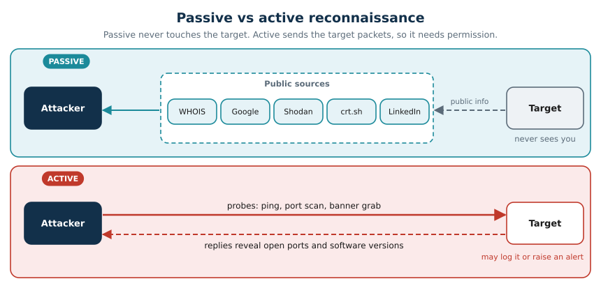
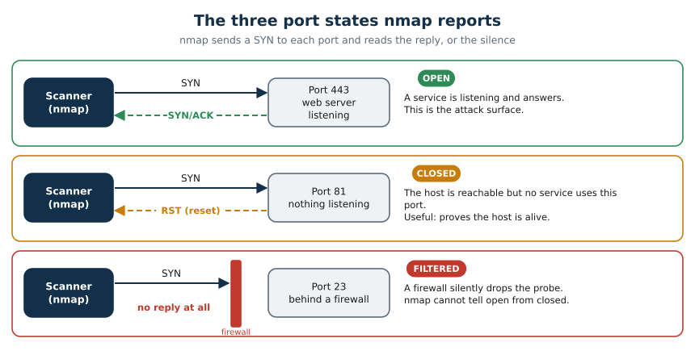
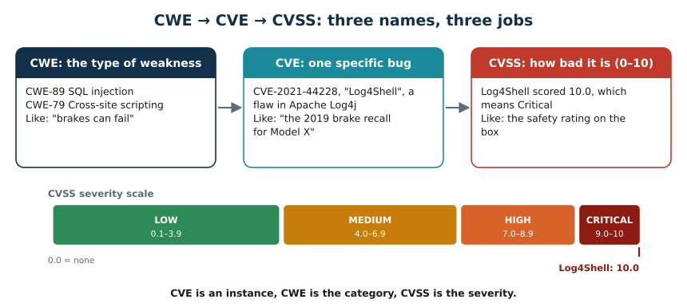

# Chapter 5: Recon, Scanning and Vulnerabilities

> **Goal.** After this chapter you can: explain passive vs active reconnaissance and name OSINT sources; run and read an nmap scan; explain open, closed and filtered ports; describe enumeration and the "version → known vulnerability" path; explain CWE vs CVE vs CVSS and read a CVSS vector; and describe the legal boundaries of scanning.
>
> **Time:** about 10 hours including labs (this is the hands-on week). **Companion reading:** Bab 7 and Bab 8. **Labs:** [Lab 4](11-labs.md#lab-4-scan-the-one-server-that-invites-you-to-scanmenmaporg) and [Lab 5](11-labs.md#lab-5-read-a-real-cve-and-its-cvss-vector).

---

## 1. Legal first

> **Rule zero.** Scanning is only ethical with **permission**. Port scanning someone else's systems without authorization can be a crime in many countries, including under Indonesia's UU ITE, even if you "only looked". Practice on your own machines, your home network, practice platforms, and `scanme.nmap.org`, a server the nmap project explicitly invites you to scan lightly.

In a real engagement the permission lives in a signed **scope document** (the *rules of engagement*) listing exactly which systems and techniques are allowed. Out-of-scope means do not touch.

---

## 2. Passive vs active reconnaissance



| | Passive | Active |
| --- | --- | --- |
| Touches the target? | **No** | **Yes** |
| Can the target notice? | No | Possibly (logs, IDS alerts) |
| Examples | WHOIS, Google, Shodan, LinkedIn | Ping sweep, port scan, banner grab |
| Permission needed? | Public data, generally no | **Yes, always** |

**OSINT (Open-Source Intelligence)** means gathering information from public sources. Know these by name and purpose:

| Source | What it reveals | Defender's lesson |
| --- | --- | --- |
| **WHOIS** | Who registered a domain, contacts, dates | Use privacy protection; don't use personal contact details |
| **DNS records** (`dig`, `nslookup`) | Subdomains, mail servers | Remove stale records |
| **crt.sh** (certificate transparency logs) | Every subdomain that ever got a certificate | Internal hostnames leak through certificates |
| **Google dorks** (`site:`, `filetype:`, `inurl:`) | Indexed files, login pages, exposed documents | Check what your site exposes to search engines |
| **Shodan** | Internet-facing devices, open ports, banners | Know your own internet exposure before others do |
| **LinkedIn / job posts** | Org structure, technologies in use | Feeds social engineering and technology guesses |
| **Breach data** (e.g. Have I Been Pwned) | Leaked credentials for known emails | Fuels credential stuffing; enforce MFA |

> **Analogy.** Passive recon is **looking at a house on Google Street View and reading the neighbours' gossip**. Active recon is **walking up and rattling the door handles**; the owner might see you.

---

## 3. Active scanning with nmap

**nmap** answers: *which machines are alive, which doors (ports) are open, and what is behind them?* It is the one tool you must be able to discuss fluently.

### The port states



| State | What happened | Meaning |
| --- | --- | --- |
| **Open** | The port answered with SYN/ACK | A service is listening: this is the **attack surface** |
| **Closed** | The port answered with RST | The host is reachable, but nothing listens there |
| **Filtered** | No answer at all | A firewall is dropping the probe; nmap cannot tell |

### Common scans

| Command | What it does |
| --- | --- |
| `nmap -sn 192.168.1.0/24` | Ping sweep: which hosts are alive (no port scan) |
| `nmap target` | Scan the 1,000 most common ports |
| `nmap -sS target` | **SYN ("half-open") scan**: sends SYN, reads the reply, never completes the handshake. Default when run as root. |
| `nmap -sT target` | **Connect scan**: completes the full handshake. Works without root, but is noisier. |
| `nmap -sV target` | Detect the **service and version** on each open port |
| `nmap -O target` | Guess the operating system |
| `nmap -p- target` | Scan all 65,535 ports |
| `nmap -A target` | "Aggressive": version + OS + default scripts + traceroute |

> **Why is a SYN scan "stealthier"?** (A favourite follow-up.) It never sends the final ACK, so the connection is never fully established and many applications never log it. Remember the three-way handshake from the last chapter; this is exactly where it pays off. Modern intrusion detection systems still notice it, so "quieter", not "invisible".

### Reading real output

A typical scan of `scanme.nmap.org` with `nmap -sV` looks like this (yours may differ slightly):

```
PORT      STATE SERVICE    VERSION
22/tcp    open  ssh        OpenSSH 6.6.1p1 Ubuntu
80/tcp    open  http       Apache httpd 2.4.7
9929/tcp  open  nping-echo Nping echo
31337/tcp open  tcpwrapped
```

How to read it like a professional:

1. **PORT / STATE:** four open ports. Each one is something an attacker can talk to.
2. **SERVICE / VERSION:** the exact software and version. *This is the valuable column.*
3. **Next question:** "Does this version have known vulnerabilities?" Search the version in the NVD (see section 5). An old version with a published flaw is the classic path from scanning to access.
4. **Defender's view:** does this server *need* all of these open? Every unnecessary open port is unnecessary risk. Close what you do not need.

---

## 4. Enumeration: from "a door exists" to "who is behind it"

Scanning finds doors; **enumeration** reads the nameplates. It extracts more detail from each open service:

- **Banner grabbing:** many services announce their name and version when you connect.
- **Service-specific listing:** shared folders on a file server (SMB), device information (SNMP), user names, mail servers.
- **Directory and technology discovery** on web servers.

**The classic chain:** *scan → version → known vulnerability (CVE) → exploit.* Saying this one sentence in an interview signals you understand how real attacks proceed.

> **Common mistake.** "Hide the version banner and we are safe." Hiding the banner is *obscurity*, a small speed bump. The real fix is to **patch** so that the version has no known flaws.

---

## 5. Naming and scoring weaknesses: CWE, CVE, CVSS



Three names that beginners mix up:

| Name | Stands for | What it is | Example |
| --- | --- | --- | --- |
| **CWE** | Common Weakness Enumeration | The **type** of weakness | CWE-89 SQL injection; CWE-79 cross-site scripting |
| **CVE** | Common Vulnerabilities and Exposures | **One specific** flaw in a specific product | CVE-2021-44228, "Log4Shell", in Apache Log4j |
| **CVSS** | Common Vulnerability Scoring System | A **0-10 severity score** | Log4Shell scored 10.0 (Critical) |

> **Remember.** *CVE is an instance, CWE is the category, CVSS is the severity.*

### Reading a CVSS vector

Log4Shell's vector is `CVSS:3.1/AV:N/AC:L/PR:N/UI:N/S:C/C:H/I:H/A:H`. In plain English:

| Part | Meaning | Value here |
| --- | --- | --- |
| **AV** Attack Vector | How far away can the attacker be? | **N**etwork: over the internet |
| **AC** Attack Complexity | How hard is it? | **L**ow: no special conditions |
| **PR** Privileges Required | Must the attacker be logged in? | **N**one |
| **UI** User Interaction | Must a victim click something? | **N**one |
| **S** Scope | Can it affect beyond the vulnerable component? | **C**hanged: yes |
| **C / I / A** | Impact on confidentiality, integrity, availability | **H**igh on all three |

Read it aloud: *"Exploitable over the network, easily, with no login and no user action, and it breaks everything."* That is why it scored the maximum.

**Severity bands:** 0.1-3.9 Low, 4.0-6.9 Medium, 7.0-8.9 High, 9.0-10.0 Critical.

> **An insight that impresses interviewers.** CVSS says how bad a flaw *could* be, not how *likely* it is to be exploited. Teams prioritize better by also checking whether a flaw is **being exploited right now** (for example, CISA's *Known Exploited Vulnerabilities* catalog). A "Medium" that attackers are using today can outrank a "Critical" nobody is exploiting.

### Scanners

**Nessus** and **OpenVAS** automate vulnerability scanning: they check systems against huge databases of known flaws and produce a ranked report. They find *breadth* but produce false positives, so a human must triage the results.

---

## 6. Real cases: why patching is a security control

> **Real case: Equifax (2017).** A critical Apache Struts flaw (CVE-2017-5638) was fixed by the project in March 2017. An internet-facing Equifax system stayed unpatched, and data on roughly **147 million** people was exposed. The scanners that should have found the unpatched system missed it. *Lesson:* an asset inventory and a working patch process are security controls, not housekeeping.

> **Real case: WannaCry (2017).** Microsoft released the patch for the Windows SMB flaw (bulletin MS17-010) on **14 March 2017**. The WannaCry ransomware worm spread on **12 May 2017**, about two months later, through machines that had not applied it. *Lesson:* the window between "patch exists" and "attackers use it" can be short, and unpatched, exposed services are the first thing a scan finds.

---

## 7. Putting it together: how you would answer in an interview

*"How would an attacker find a way into a company?"*

> "First passive recon: public records, certificate-transparency logs, job posts, leaked credentials. Then active scanning with something like nmap to find live hosts, open ports and service versions. Then enumeration to pull more detail from each service. The attacker looks up those versions for known CVEs and picks the easiest path: an unpatched service, a weak or reused password, or a web flaw. As a defender I would shrink the exposed surface, patch quickly, and monitor for scans."

---

## Check yourself

1. Which is *active*: WHOIS, a Shodan search, or an nmap scan? Why does it matter legally?
2. What does a *filtered* port tell you, and what does it *not* tell you?
3. Why is `nmap -sS` called a "half-open" scan?
4. What is the difference between a CWE and a CVE?
5. Translate `AV:N/AC:L/PR:N/UI:N` into one sentence.
6. Why can a Medium-scored flaw sometimes be a higher priority than a Critical one?

**Answers** *(cover this until you have tried)*

1. The nmap scan. It sends packets to the target, so you need permission. WHOIS and Shodan read public data and do not touch the target.
2. A firewall is silently dropping the probe. It does *not* tell you whether a service is behind it (open or closed).
3. It sends SYN, reads the reply, and never sends the final ACK, so the handshake is never completed.
4. A CWE is a category of weakness (such as SQL injection). A CVE is one specific, numbered flaw in a specific product.
5. "It can be attacked over the network, is easy to do, needs no login, and needs no user action."
6. CVSS measures potential severity, not likelihood. A Medium flaw that is being actively exploited and reachable from the internet is more urgent than a Critical one nobody can reach or exploit.

---

## Summary

- Passive recon never touches the target; active recon does and needs written permission.
- nmap reports open (listening), closed (reachable, nothing there) and filtered (firewall dropped it). `-sV` finds versions, and versions lead to CVEs.
- CWE = weakness type, CVE = one specific bug, CVSS = 0-10 severity.
- CVSS is potential severity; exploitation data decides real priority.
- Patching is a security control: Equifax and WannaCry were both unpatched-known-flaw stories.
