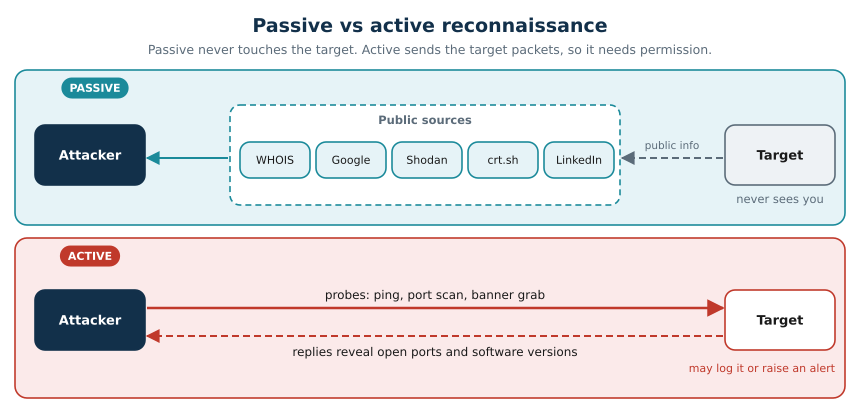
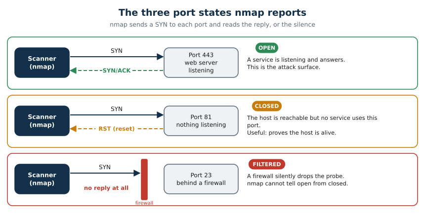
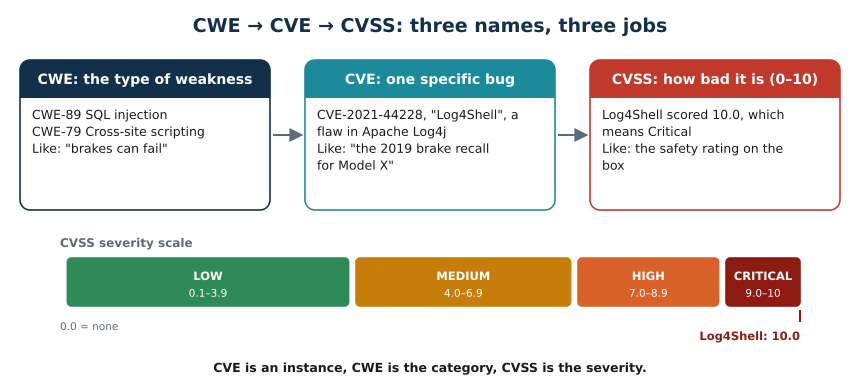

# Chapter 6: Recon, Scanning and Vulnerabilities

> **Goal.** After this chapter you can: explain passive vs active reconnaissance and name OSINT sources; run and read an nmap scan; explain open, closed and filtered ports; explain CWE vs CVE vs CVSS and read a CVSS vector; explain why **known-exploited vulnerabilities** and **patch speed** now drive breaches; and describe the legal boundaries of scanning.
>
> **Time:** about 3 hours. **Still relevant in 2026?** Yes, and increasingly: exploitation of vulnerabilities is now the **#1** way breaches start (Chapter 2). **Companion reading:** Bab 7 and Bab 8. **Labs:** [Lab 4](15-labs.md#lab-4-scan-the-one-server-that-invites-you-to-scanmenmaporg) and [Lab 5](15-labs.md#lab-5-read-a-real-cve-and-its-cvss-vector).

---

## 1. Legal first

> **Rule zero.** Scanning is only ethical with **permission**. Port scanning someone else's systems without authorization can be a crime in many countries, including under Indonesia's UU ITE, even if you "only looked". Practice on your own machines, your home network, practice platforms, and `scanme.nmap.org`, a server the nmap project explicitly invites you to scan lightly.

In a real engagement the permission lives in a signed **scope document** (the *rules of engagement*) listing exactly which systems and techniques are allowed. Out-of-scope means do not touch.

---

## 2. Passive vs active reconnaissance



| | Passive | Active |
| --- | --- | --- |
| Touches the target? | **No** | **Yes** |
| Can the target notice? | No | Possibly (logs, IDS alerts) |
| Examples | WHOIS, Google, Shodan, LinkedIn | Ping sweep, port scan, banner grab |
| Permission needed? | Public data, generally no | **Yes, always** |

**OSINT (Open-Source Intelligence)** means gathering information from public sources. Know these by name and purpose:

| Source | What it reveals | Defender's lesson |
| --- | --- | --- |
| **WHOIS / DNS records** | Registrant, subdomains, mail servers | Remove stale records; don't use personal contact details |
| **crt.sh** (certificate transparency logs) | Every subdomain that ever got a certificate | Internal hostnames leak through certificates |
| **Google dorks** (`site:`, `filetype:`) | Indexed files, login pages, exposed documents | Check what your site exposes to search engines |
| **Shodan / Censys** | Internet-facing devices, open ports, banners | Know your own internet exposure before attackers do |
| **LinkedIn / job posts** | Org structure, technologies in use | Fuels help-desk impersonation and phishing |
| **Leaked-credential data** | Which of your staff's logins are already circulating | Fuels credential stuffing; enforce MFA |

> **The modern name for the defender's version of recon** is **attack surface management**: continuously finding *your own* internet-facing assets (forgotten servers, test systems, exposed VPNs) before attackers do. It matters because attackers' favourite targets in 2025-26 are **internet-facing edge devices and file-transfer tools**.

---

## 3. Active scanning with nmap

**nmap** answers: *which machines are alive, which doors (ports) are open, and what is behind them?* It is the one tool you must be able to discuss fluently.

### The port states



| State | What happened | Meaning |
| --- | --- | --- |
| **Open** | The port answered with SYN/ACK | A service is listening: this is the **attack surface** |
| **Closed** | The port answered with RST | The host is reachable, but nothing listens there |
| **Filtered** | No answer at all | A firewall is dropping the probe; nmap cannot tell |

### Common scans

| Command | What it does |
| --- | --- |
| `nmap -sn 192.168.1.0/24` | Ping sweep: which hosts are alive (no port scan) |
| `nmap target` | Scan the 1,000 most common ports |
| `nmap -sS target` | **SYN ("half-open") scan**: sends SYN, reads the reply, never completes the handshake. Default as root. |
| `nmap -sT target` | **Connect scan**: completes the full handshake. Works without root, but noisier. |
| `nmap -sV target` | Detect the **service and version** on each open port |
| `nmap -O target` | Guess the operating system |
| `nmap -p- target` | Scan all 65,535 ports |

> **Why is a SYN scan "quieter"?** (A favourite follow-up.) It never sends the final ACK, so the connection is never fully established and many applications never log it. Modern intrusion detection still notices it, so "quieter", not "invisible".

### Reading real output

A typical scan of `scanme.nmap.org` with `nmap -sV` looks like this (yours may differ slightly):

```
PORT      STATE SERVICE    VERSION
22/tcp    open  ssh        OpenSSH 6.6.1p1 Ubuntu
80/tcp    open  http       Apache httpd 2.4.7
9929/tcp  open  nping-echo Nping echo
31337/tcp open  tcpwrapped
```

How to read it like a professional:

1. **PORT / STATE:** four open ports. Each one is something an attacker can talk to.
2. **SERVICE / VERSION:** the exact software and version. *This is the valuable column.*
3. **Next question:** "Does this version have known vulnerabilities?" Look it up (section 5). An old version with a published flaw is the classic path from scanning to access.
4. **Defender's view:** does this server *need* all of these open? Close what you do not need.

---

## 4. Enumeration: from "a door exists" to "who is behind it"

Scanning finds doors; **enumeration** reads the nameplates: banner grabbing (many services announce their name and version), listing shared folders, identifying technologies on web servers.

**The classic chain:** *scan → version → known vulnerability (CVE) → exploit.* Saying this one sentence in an interview signals you understand how real attacks proceed.

> **Common mistake.** "Hide the version banner and we are safe." Hiding the banner is *obscurity*, a small speed bump. The real fix is to **patch** so that the version has no known flaws.

---

## 5. Naming and scoring weaknesses: CWE, CVE, CVSS, KEV



| Name | Stands for | What it is | Example |
| --- | --- | --- | --- |
| **CWE** | Common Weakness Enumeration | The **type** of weakness | CWE-89 SQL injection; CWE-79 cross-site scripting |
| **CVE** | Common Vulnerabilities and Exposures | **One specific** flaw in a specific product | CVE-2021-44228, "Log4Shell", in Apache Log4j |
| **CVSS** | Common Vulnerability Scoring System | A **0-10 severity score** | Log4Shell scored 10.0 (Critical) |
| **KEV** | Known Exploited Vulnerabilities (CISA's catalogue) | A list of flaws **confirmed to be exploited in the wild** | Updated continuously by CISA |

> **Remember.** *CVE is an instance, CWE is the category, CVSS is the severity, KEV is "being used right now".*

### Reading a CVSS vector

Log4Shell's vector is `CVSS:3.1/AV:N/AC:L/PR:N/UI:N/S:C/C:H/I:H/A:H`. In plain English:

| Part | Meaning | Value here |
| --- | --- | --- |
| **AV** Attack Vector | How far away can the attacker be? | **N**etwork: over the internet |
| **AC** Attack Complexity | How hard is it? | **L**ow: no special conditions |
| **PR** Privileges Required | Must the attacker be logged in? | **N**one |
| **UI** User Interaction | Must a victim click something? | **N**one |
| **S** Scope | Can it affect beyond the vulnerable component? | **C**hanged: yes |
| **C / I / A** | Impact on confidentiality, integrity, availability | **H**igh on all three |

Read it aloud: *"Exploitable over the network, easily, with no login and no user action, and it breaks everything."* That is why it scored the maximum.

**Severity bands:** 0.1-3.9 Low, 4.0-6.9 Medium, 7.0-8.9 High, 9.0-10.0 Critical. (There is also a newer **CVSS v4.0**; the ideas are the same, and v3.1 is still what you will most often see quoted.)

### Prioritizing: severity is not likelihood

CVSS says how bad a flaw *could* be, not how *likely* it is to be exploited. This is exactly the gap attackers use. The 2026 Verizon report found that only **26%** of known-exploited vulnerabilities were fully fixed and the median time to fix them was **43 days** (Chapter 2). So good teams prioritize with exploitation data:

1. **Is it on CISA's KEV list?** If yes, fix first.
2. **Is the affected system internet-facing?** Edge devices (VPNs, firewalls, file-transfer tools) first.
3. **Then** use the CVSS score and business impact.

> **Interview angle.** "How would you prioritize 500 vulnerabilities?" → *"Exploited-in-the-wild first (CISA KEV), then internet-facing assets, then by CVSS and the value of what is behind them, and I'd track time-to-fix as a metric."*

### Scanners

**Nessus**, **OpenVAS** and cloud scanners automate vulnerability scanning: they check systems against huge databases of known flaws and produce a ranked report. They find *breadth* but produce false positives, so a human must triage the results.

---

## 6. Real cases: patch speed is the whole game

> **Real case: MOVEit Transfer (2023).** A SQL injection zero-day (CVE-2023-34362) in a widely used file-transfer product let the Cl0p group steal data from thousands of organizations; an Emsisoft tally reached about **2,800 organizations** and roughly **96 million people** by August 2024. *Lesson:* internet-facing file-transfer and remote-access tools are attackers' favourite targets, and the window between "flaw announced" and "mass exploitation" can be days.

> **Real case: ransomware through VPNs and edge devices (2025-26).** Industry reporting through 2026 describes ransomware groups industrializing exploit chains against freshly disclosed flaws in VPNs and firewalls, and buying stolen VPN and remote-desktop logins from "initial access brokers". *Lesson:* the perimeter devices that protect you are themselves the entry point. Inventory them, patch them first, and put MFA on every remote-access path.

---

## 7. Putting it together: how you would answer in an interview

*"How would an attacker find a way into a company, and how would you stop them?"*

> "First passive recon: public records, certificate-transparency logs, job posts, leaked credentials. Then active scanning with something like nmap to find live hosts, open ports and service versions. The attacker looks those versions up for known CVEs and picks the easiest path: an unpatched internet-facing device, a stolen login, or a convincing phone call. As a defender I'd keep an inventory of everything internet-facing, patch known-exploited flaws first, require phishing-resistant MFA on remote access, and monitor for scans."

---

## Check yourself

1. Which is *active*: WHOIS, a Shodan search, or an nmap scan? Why does it matter legally?
2. What does a *filtered* port tell you, and what does it *not* tell you?
3. Why is `nmap -sS` called a "half-open" scan?
4. What is the difference between a CWE and a CVE, and what is the KEV catalogue?
5. Translate `AV:N/AC:L/PR:N/UI:N` into one sentence.
6. Why can a Medium-scored flaw be a higher priority than a Critical one?

**Answers** *(cover this until you have tried)*

1. The nmap scan. It sends packets to the target, so you need permission. WHOIS and Shodan read public data and do not touch the target.
2. A firewall is silently dropping the probe. It does *not* tell you whether a service is behind it (open or closed).
3. It sends SYN, reads the reply, and never sends the final ACK, so the handshake is never completed.
4. A CWE is a category of weakness (such as SQL injection). A CVE is one specific, numbered flaw in a specific product. KEV is CISA's list of flaws confirmed to be exploited in the wild.
5. "It can be attacked over the network, is easy to do, needs no login, and needs no user action."
6. CVSS measures potential severity, not likelihood. A Medium flaw that is on the KEV list and reachable from the internet is more urgent than a Critical one nobody can reach or exploit.

---

## Summary

- Passive recon never touches the target; active recon does and needs written permission.
- nmap reports open (listening), closed (reachable, nothing there) and filtered (firewall dropped it). `-sV` finds versions, and versions lead to CVEs.
- CWE = weakness type, CVE = one bug, CVSS = 0-10 severity, KEV = known to be exploited now.
- Prioritize by exploitation (KEV), exposure (internet-facing edge devices), then CVSS.
- Exploiting known flaws is the #1 breach start in 2026; patch speed is a security control.
