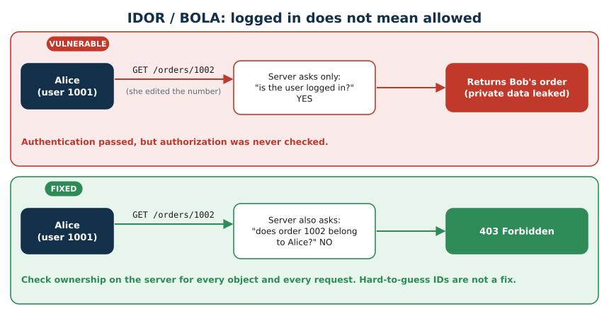
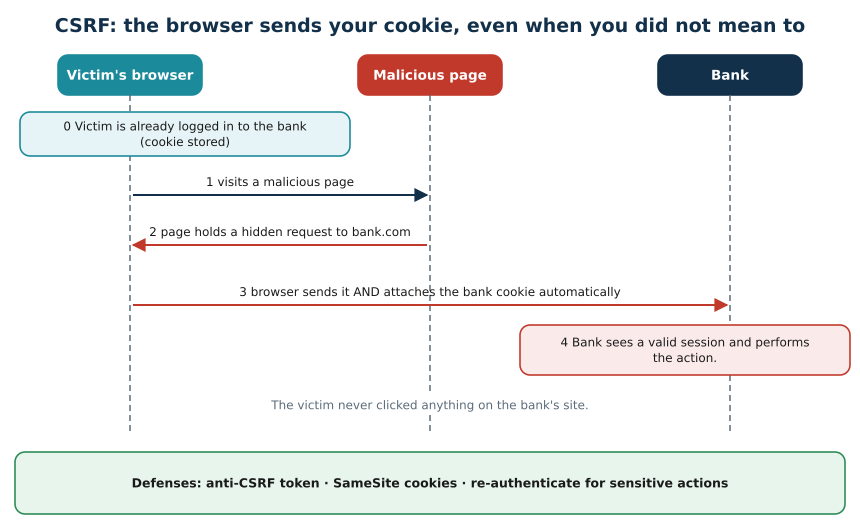
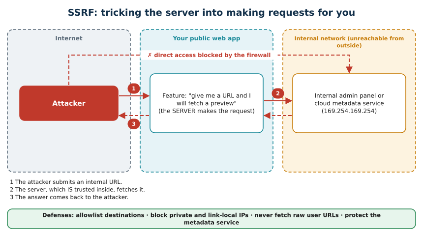

# Chapter 7: Access Control, Authentication, CSRF and SSRF

> **Goal.** After this chapter you can: explain authentication vs authorization; explain why Broken Access Control (IDOR) is the #1 web risk and how to fix it in code; list authentication and session attacks and their defences; explain CSRF and SSRF with their fixes; and recite a checklist for securing a REST API.
>
> **Time:** about 5 hours. **Companion reading:** Bab 11 and Bab 12. **Lab:** [Lab 9](11-labs.md#lab-9-portswigger-web-security-academy).

---

## 1. Authentication vs authorization

The two words are the most commonly confused pair in security interviews.

| | Authentication (AuthN) | Authorization (AuthZ) |
| --- | --- | --- |
| Question | **Who are you?** | **What are you allowed to do?** |
| Happens | First: at login | After: on *every* request |
| Failure code | **401** Unauthorized | **403** Forbidden |
| Examples | Password, MFA, passkey | Roles, ownership checks, permissions |

> **Analogy.** The security desk checks your **ID badge** at the building entrance (authentication). Your **keycard** then opens only some floors (authorization). Getting past the desk does not mean every door should open.

---

## 2. Broken Access Control (OWASP A01): the #1 risk

Broken access control means a user can do or see things beyond what they should. It tops the list because it is easy to get wrong: authorization must be checked **in every place**, and one forgotten check is a hole.

### IDOR (Insecure Direct Object Reference)



Alice (user 1001) views her order at `/orders/1001`. She changes the number in the URL to `1002`. If the server only checks *"is someone logged in?"* it returns **Bob's** order. Authentication passed; **authorization was never checked.**

**The fix, in code.** Check ownership on the server, for every object, every request:

```python
# VULNERABLE: any logged-in user can fetch any order
order = db.get(Order, order_id)

# SAFE: the query itself is scoped to the current user
order = db.query(Order).filter_by(id=order_id, owner_id=current_user.id).first()
if order is None:
    abort(404)   # or 403
```

> **Common mistake.** "Our IDs are long random UUIDs, so nobody can guess them." Unguessable IDs are a *bonus layer*, never access control. IDs leak through logs, referrer headers, shared links and screenshots.

### The wider family

| Problem | What it is | Example |
| --- | --- | --- |
| **Horizontal privilege escalation** | Reaching another *user's* data at the same level | Alice reads Bob's order (IDOR) |
| **Vertical privilege escalation** | Gaining a *higher* role | A normal user calls an admin-only endpoint |
| **Forced browsing** | Visiting URLs that are hidden but not protected | `/admin` works if you type it |
| **Missing function-level checks** | UI hides a button; the API behind it is open | The "Delete user" button is gone, but the API still works |

**Design rules that prevent the whole family:**

1. **Deny by default.** Access is refused unless a rule explicitly allows it.
2. **Enforce on the server.** Hiding a button is a convenience, never a control.
3. **Centralize authorization** in one place (middleware, policy layer) instead of scattering checks.
4. **Scope queries to the owner** (`WHERE owner_id = ?`) so forgetting a check returns nothing, not everything.
5. **Write tests** that log in as user A and try to reach user B's data.

---

## 3. Authentication failures and sessions (OWASP A07)

### Attacks on login

| Attack | Idea | Main defences |
| --- | --- | --- |
| **Brute force** | Try many passwords against one account | Rate limiting, lockout or delays, MFA |
| **Credential stuffing** | Try leaked email/password pairs from *other* breaches, because people reuse passwords | MFA, breached-password checks, rate limiting |
| **Password spraying** | Try *one or two common passwords* across *many* accounts to avoid lockouts | MFA, monitoring for many failures across accounts |
| **Account enumeration** | Learn which usernames exist from different error messages | Same generic message: "Invalid username or password" |
| **Weak reset flows** | Guessable reset tokens, or reset links that never expire | Random, single-use, short-lived tokens |

**Defence summary:** **MFA** (best single control; phishing-resistant options such as passkeys/FIDO2 are strongest), **rate limiting**, **slow salted password hashes** (Chapter 3), and monitoring.

### Sessions

After login the server issues a **session ID** (or token). Whoever holds it *is* that user, so:

- Make it **long and random** (from a secure generator).
- **Rotate** it at login (prevents *session fixation*, where an attacker plants a known ID before you log in).
- Set `HttpOnly`, `Secure` and `SameSite` cookie flags.
- **Expire** sessions, and make **logout actually invalidate** them on the server.

### JWT pitfalls

A **JSON Web Token** is a signed token carrying claims (user ID, roles). It is popular, and commonly misused:

| Pitfall | Why it hurts | Fix |
| --- | --- | --- |
| Not verifying the signature or the algorithm | Forged tokens are accepted (the historical "alg: none" bug) | Verify signature; **pin the allowed algorithm** on the server |
| Weak signing secret | Attackers guess it offline and forge tokens | Long random secret or asymmetric keys |
| Long-lived tokens, no revocation | A stolen token works for days | Short expiry plus refresh tokens; a revocation strategy |
| Storing in `localStorage` | Any XSS can read it | Prefer an `HttpOnly` cookie |
| Putting secrets in the payload | Payload is only **encoded**, not encrypted (Chapter 3!) | Never put secrets in a JWT |

---

## 4. CSRF: Cross-Site Request Forgery



**The idea.** Browsers **automatically attach cookies** to requests for a site, even when the request was triggered from a *different* site. If you are logged in to your bank and visit a malicious page, that page can make your browser send a request to the bank, and the cookie rides along. The bank sees a valid session and performs the action. The victim never clicked anything on the bank's site.

**Conditions needed:** the site authenticates with **cookies**, there is a **state-changing action**, and an attacker can predict all the request parameters.

**Defences, strongest first:**

1. **SameSite cookies.** `SameSite=Lax` or `Strict` stops the browser sending the cookie on most cross-site requests. Chrome and Edge default to Lax, but **set it explicitly**; don't rely on defaults.
2. **Anti-CSRF tokens.** A random, per-session value the real form includes and the server checks. A forged request from another site cannot know it.
3. **Check the `Origin` / `Referer` header** on state-changing requests.
4. **Custom request header** for APIs (browsers will not add custom headers cross-site without permission).
5. **Re-authenticate** for sensitive actions (change password, move money).
6. **Never change state on `GET`.**

> **CSRF vs XSS (a favourite trap).** **XSS** runs the *attacker's code* inside your page. **CSRF** doesn't run any attacker code on your site; it tricks the victim's *browser* into sending a request the victim didn't intend. Also: **an XSS flaw defeats CSRF tokens**, since attacker script on your page can read the token.

---

## 5. SSRF: Server-Side Request Forgery



**The idea.** Your application has a feature that fetches a URL on behalf of the user (link previews, image import, webhooks, PDF generators). An attacker supplies an **internal** address instead of a public one. The request comes from *your server*, which sits inside the trusted network, so it can reach things the attacker could never reach directly: internal admin panels, databases, and in the cloud, the **instance metadata service** at `169.254.169.254`, which can hand out temporary credentials.

**Defences:**

1. **Allowlist** the destinations the feature may contact; do not accept arbitrary URLs.
2. **Block private and link-local ranges** (`10.x`, `172.16-31.x`, `192.168.x`, `127.x`, `169.254.x`) *after* DNS resolution, and re-check on redirects.
3. **Don't return raw responses** to the user.
4. In the cloud, **use the hardened metadata service** (AWS IMDSv2 requires a session token) and give the server's role **minimum permissions**.
5. **Network segmentation** so the web tier cannot reach what it doesn't need.

> **Real case: Capital One (2019).** According to public reporting and court filings, an attacker exploited a **misconfigured web application firewall** to make the server request the **cloud metadata service**, obtained temporary credentials, and used them to read data from storage buckets. One of the largest breaches in banking. *Lessons:* SSRF is dangerous mostly because of **cloud credentials within reach**, so the defences are the allowlist, the hardened metadata service, and **least privilege** on the server's cloud role. (Details of the exact path are partly reconstructed from filings; treat the sequence as "reported".) SSRF is now part of A01 in the 2025 OWASP list.

---

## 6. The secure REST API checklist

When asked *"How would you secure a REST API?"*, answer with a structured checklist. This is the table to memorize:

| Area | Do this |
| --- | --- |
| **Transport** | HTTPS only; HSTS |
| **Authentication** | Strong auth (OAuth 2.0/OIDC, or sessions); MFA for users; short-lived tokens |
| **Authorization** | Check permissions **per object** on every request (prevents IDOR); deny by default |
| **Input** | Validate type, length, format on the server; parameterized queries |
| **Output** | Return only needed fields; consistent errors with no stack traces |
| **Abuse protection** | Rate limiting and quotas; request size limits |
| **Secrets** | Never in code or URLs; use a secrets manager; rotate |
| **CORS** | Allow only specific origins; never `*` with credentials |
| **Logging** | Log authentication and access-control failures; never log passwords or tokens |
| **Dependencies** | Scan and update regularly |

---

## Check yourself

1. Authentication vs authorization: which returns 401 and which 403?
2. What is an IDOR and what is the one-line code fix?
3. How does credential stuffing differ from password spraying?
4. Why is a CSRF attack possible even though the attacker never sees the victim's cookie?
5. Name two defences against CSRF and one defence against SSRF.
6. Why does a JWT in `localStorage` worry security people?

**Answers** *(cover this until you have tried)*

1. Failing authentication (not logged in) returns 401. Failing authorization (logged in, not allowed) returns 403.
2. Changing an object identifier in a request to reach someone else's object because ownership isn't checked. Fix: scope the lookup to the current user (`WHERE id = ? AND owner_id = ?`) and deny otherwise.
3. Stuffing replays leaked username+password pairs from other breaches. Spraying tries a few very common passwords across many accounts to stay under lockout limits.
4. The browser attaches the cookie automatically to any request to that site, even one triggered from another site. The attacker never needs to read it.
5. CSRF: SameSite cookies and anti-CSRF tokens (also Origin checks, re-authentication). SSRF: an allowlist of destinations, blocking private and link-local IPs, or the hardened metadata service.
6. Any XSS flaw on the site can read `localStorage`, so the token is stolen. An `HttpOnly` cookie cannot be read by script.

---

## Summary

- AuthN = who you are (401). AuthZ = what you may do (403), checked on every request.
- IDOR is the textbook A01 flaw. Fix: scope every lookup to the owner and deny by default; unguessable IDs are not access control.
- Login attacks: brute force, stuffing, spraying. Best defence: MFA, plus rate limiting and slow salted hashes.
- CSRF abuses automatic cookies (fix: SameSite, tokens). SSRF abuses a server's trusted position (fix: allowlist, block private IPs, hardened metadata, least privilege).
- Secure-API answers should be a structured checklist, not a ramble.
