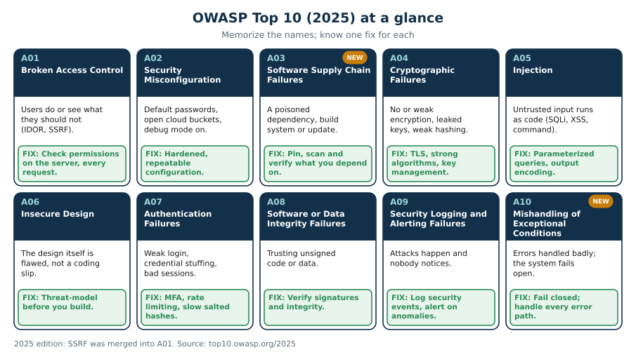
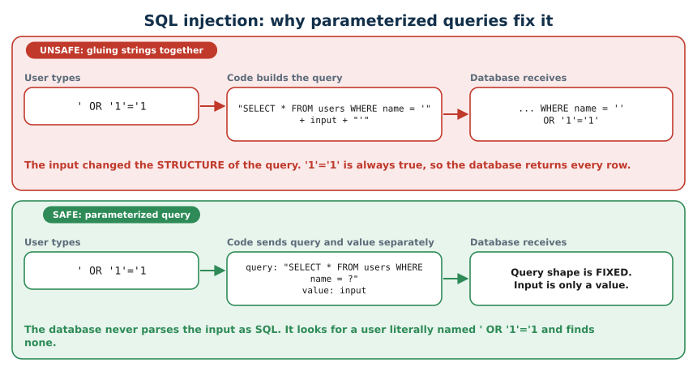
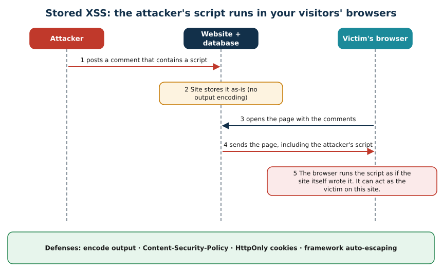

# Chapter 7: The OWASP Top 10, Injection and XSS

> **Goal.** After this chapter you can: recite the OWASP Top 10 (2025) in five memorable groups; explain the one idea behind every injection attack; explain SQL injection and its fix with a before/after code example; explain the three kinds of XSS and how to prevent each; and connect all of it to prompt injection.
>
> **Time:** about 4 hours. **Still relevant in 2026?** Yes. Injection is OWASP A05, and SQL injection was behind one of the largest breach campaigns of recent years (MOVEit, 2023). **Companion reading:** Bab 11 and Bab 12. **Labs:** [Lab 7](15-labs.md#lab-7-sql-injection-and-its-fix-on-your-own-toy-database), [Lab 8](15-labs.md#lab-8-xss-and-its-fix-in-a-local-html-file), [Lab 9](15-labs.md#lab-9-portswigger-web-security-academy).

---

## 1. The map: OWASP Top 10 (2025)

The **OWASP Top 10** is the industry's standard list of the most critical web application security risks, published by the Open Worldwide Application Security Project. Interviewers use it as shared vocabulary. This is the 2025 edition, from the [official OWASP site](https://top10.owasp.org/2025).



**Memorize it in five groups**, not as ten separate items:

| Group | Items | The theme |
| --- | --- | --- |
| **Who can do what** | A01 Broken Access Control, A07 Authentication Failures | Identity and permissions (Chapters 8 and 9) |
| **How it's set up and built** | A02 Security Misconfiguration, A03 Software Supply Chain Failures, A08 Software or Data Integrity Failures | Configuration, dependencies, trust in code and data (Chapter 12) |
| **Protecting data** | A04 Cryptographic Failures | Encryption and hashing done badly (Chapter 4) |
| **Flaws in the code and design** | A05 Injection, A06 Insecure Design, A10 Mishandling of Exceptional Conditions | Untrusted input, design mistakes, bad error handling (this chapter) |
| **Seeing it happen** | A09 Security Logging and Alerting Failures | Detection (Chapter 11) |

**What changed in 2025 (a common follow-up):** two new categories, **A03 Software Supply Chain Failures** (a broader take on vulnerable and outdated components) and **A10 Mishandling of Exceptional Conditions**; **SSRF was merged into A01 Broken Access Control**; and Broken Access Control stays at #1. Security Misconfiguration climbed from #5 to #2.

> **Common mistake.** Reciting the 2021 list. Say "the 2025 edition" and mention one change. It shows you are current.

Two sibling lists are worth knowing by name: the **OWASP API Security Top 10 (2023)** (Chapter 8) and the **OWASP Top 10 for LLM Applications (2025)** (Chapter 13).

---

## 2. The one idea behind every injection attack

> **Injection happens when untrusted data is mixed into a command or query, and the interpreter cannot tell the data from the instructions.**

That is the whole concept. SQL injection, command injection and even XSS are the *same mistake* in different interpreters:

| Attack | The interpreter | What gets confused |
| --- | --- | --- |
| SQL injection | The database | User input treated as SQL |
| Command injection | The operating system shell | User input treated as shell commands |
| XSS | The browser | User input treated as HTML/JavaScript |
| **Prompt injection** *(new, Chapter 13)* | **The AI model** | Content the model reads treated as instructions |

> **Analogy.** You hand a waiter an order form with a box labelled "Your name". A malicious customer writes in the box: *"Sam. Also, give me everything in the cash register."* If the kitchen reads the *whole form* as instructions, the customer just gave an order. The fix is a form where the name box is **always read as a name**, never as instructions. That is exactly what a parameterized query does.

**The universal fix:** keep **code and data separate** so the data can never be executed. For SQL that is parameterized queries; for HTML it is output encoding. (Prompt injection is harder because an AI model has no hard boundary between the two, which is why it is a top 2026 concern.)

---

## 3. SQL injection (SQLi)

### How it works

A login form sends a username to this code:

```python
# VULNERABLE: the query is built by gluing strings together
query = "SELECT * FROM users WHERE name = '" + username + "'"
cursor.execute(query)
```

For a normal user `alice` the database receives `... WHERE name = 'alice'`. But if the "username" typed is the textbook example `' OR '1'='1`, the database receives:

```sql
SELECT * FROM users WHERE name = '' OR '1'='1'
```

`'1'='1'` is always true, so the condition matches **every row**. The attacker's input did not stay data; it **changed the structure of the query**.



### The fix

```python
# SAFE: the query shape is fixed; the input is only ever a value
cursor.execute("SELECT * FROM users WHERE name = ?", (username,))
```

With a **parameterized query** (also called a *prepared statement*), the database receives the query shape and the value **separately**. Whatever the user types is treated purely as a value to look for, never as SQL.

**Your defence checklist, in order of importance:**

1. **Parameterized queries / prepared statements.** Always. This is *the* answer.
2. **Use an ORM carefully.** ORMs parameterize by default; danger returns with *raw query* escape hatches that concatenate strings.
3. **Least privilege on the database account.** The app should not be able to `DROP TABLE` or read other apps' tables.
4. **Allowlist validation** where parameters cannot be used. (Table and column names cannot be parameterized, so map user choices to a fixed list of allowed names.)
5. **A WAF** as an extra layer, never as the primary fix.

> **Common mistake.** "We escape special characters, so we are safe." Hand-written escaping is brittle and easy to get wrong in some context. Parameterization removes the problem instead of patching around it.

> **Real case: MOVEit Transfer (2023).** A SQL injection flaw (CVE-2023-34362) in a popular file-transfer product was exploited as a zero-day by the Cl0p group to steal data from thousands of organizations (an Emsisoft tally reached about **2,800 organizations** and roughly **96 million people** by August 2024). *Lesson:* SQL injection is a decades-old bug class, and it is still capable of a mass breach. It also shows the third-party angle from Chapter 2: *your* data was exposed because *a vendor's product* had the flaw.

---

## 4. Other injection flavours (one line each)

| Type | The vulnerable pattern | The fix |
| --- | --- | --- |
| **Command injection** | `os.system("ping " + host)` passes user input to a shell | Avoid the shell; pass arguments as a list: `subprocess.run(["ping", host])`; validate against an allowlist |
| **NoSQL injection** | User-controlled objects or operators in a query | Validate types and shape; reject unexpected operators |
| **Prompt injection** | Text the AI reads is obeyed as instructions | Chapter 13 |

The same sentence answers all of them: *"Don't let user input become code; separate data from commands."* (LDAP and template injection exist; know the names, skip the detail.)

---

## 5. Cross-site scripting (XSS)

### How it works

In **XSS**, an attacker gets *their own script* to run in *another user's browser*, inside your website's trust boundary. The browser cannot tell the difference between your scripts and the attacker's, so the injected code can read what the page can read and act as the victim on that site.



**The three kinds:**

| Type | Where the script comes from | Who is hit |
| --- | --- | --- |
| **Stored** | Saved by the site (a comment, profile bio) and served to everyone who views it | *Every visitor* to that page: the most dangerous |
| **Reflected** | Part of the request (a URL parameter) bounced straight back in the response | Anyone tricked into clicking a crafted link |
| **DOM-based** | Client-side JavaScript writes untrusted data into the page (`innerHTML`) | Users on that page; the server may never see the payload |

To prove an XSS flaw exists, testers use something harmless like a pop-up alert; real attackers would act as the victim on that site.

### The fix

The fix mirrors SQL injection: **keep data as data**. Data displayed in HTML must be **encoded for output** so the browser shows it instead of running it.

```python
# VULNERABLE: user text placed straight into HTML
page = "<p>" + comment + "</p>"

# SAFE: special characters become harmless text (&lt; &gt; ...)
import html
page = "<p>" + html.escape(comment) + "</p>"
```

**Your defence checklist:**

1. **Encode output for its context** (HTML body, attribute, JavaScript, URL each need different encoding). Modern frameworks (React, Vue, Angular, Jinja2 with autoescape) do this **by default**.
2. **Know the escape hatches** that disable it: `dangerouslySetInnerHTML` (React), `v-html` (Vue), `|safe` (Jinja2/Django), raw `innerHTML`. Treat every use as a code-review red flag.
3. **Sanitize rich HTML** (when users must post formatting) with a vetted library such as DOMPurify, never a hand-written filter.
4. **Content-Security-Policy** as defence in depth: it limits where scripts may run from.
5. **`HttpOnly` cookies**, so even if a script runs, it cannot read the session cookie.

> **Common mistake.** "Validate input and XSS is solved." Input validation helps, but the primary defence is **output encoding**, because the dangerous moment is when data is placed into a page, and the right encoding depends on *where* it lands.

> **Why XSS still matters in 2026.** Session theft is now the favoured way to take over accounts (Chapter 9). XSS is one route to a stolen session, and AI-generated front-end code often reaches for `innerHTML`. Review it.

---

## 6. Interview angle

> **"What is SQL injection and how do you prevent it?"**
> "Untrusted input ends up interpreted as part of a SQL query, so an attacker can change the query's meaning, for example making a login condition always true. The fix is parameterized queries, which keep the query structure and the data separate, plus a least-privilege database account. It's an old bug class but still dangerous: the 2023 MOVEit campaign used a SQL injection flaw to steal data from thousands of organizations."

> **"What is XSS and how do you prevent it?"**
> "It lets an attacker run their script in another user's browser under my site's origin. There are stored, reflected and DOM-based forms. The primary fix is context-aware output encoding, which modern frameworks do by default, so I watch for escape hatches like `dangerouslySetInnerHTML`. As layers I add a Content-Security-Policy and HttpOnly cookies."

---

## Check yourself

1. State the single idea behind all injection attacks.
2. Why does a parameterized query stop SQL injection?
3. Name the three types of XSS. Which is usually the most dangerous, and why?
4. Why is "escape the quotes" a weak SQL injection defence?
5. Name two XSS escape hatches in frameworks that otherwise protect you.
6. Group the OWASP Top 10 (2025) into five themes and name the two new categories.

**Answers** *(cover this until you have tried)*

1. Untrusted data is mixed into a command or query, and the interpreter treats it as instructions.
2. The database receives the query shape and the values separately, so input is only ever treated as a value and can never change the query's structure.
3. Stored, reflected, DOM-based. Stored is usually the worst because the script is saved on the server and runs for *every* visitor, not just a tricked individual.
4. Escaping is brittle: it must be correct for every context and encoding, and one gap re-opens the hole. Parameterization avoids the problem instead of working around it.
5. `dangerouslySetInnerHTML` (React), `v-html` (Vue), the `|safe` filter (Jinja2/Django), or raw `innerHTML`.
6. Who can do what (A01, A07); setup and build (A02, A03, A08); protecting data (A04); flaws in code and design (A05, A06, A10); seeing it happen (A09). New in 2025: A03 Software Supply Chain Failures and A10 Mishandling of Exceptional Conditions.

---

## Summary

- Injection = data mistaken for code. Universal fix: separate them. Prompt injection is the same mistake in AI.
- SQLi fix: parameterized queries (+ least-privilege DB account). Escaping and WAFs are not the primary defence. MOVEit (2023) proves it still hurts.
- XSS fix: context-aware output encoding (framework defaults), plus CSP and HttpOnly cookies as layers. Watch the escape hatches.
- OWASP Top 10 (2025): five groups; new A03 and A10; SSRF merged into A01.
- Always finish the answer with the real fix and, if you can, a recent real case.
