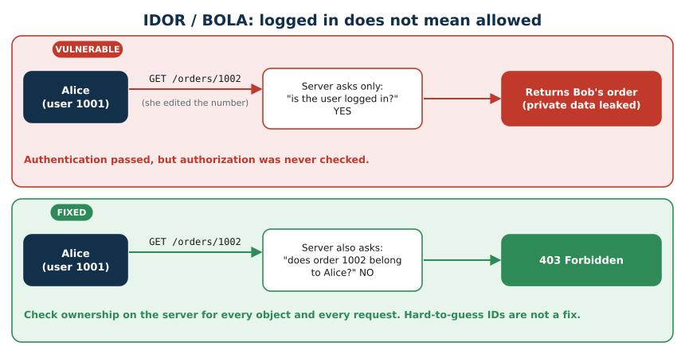
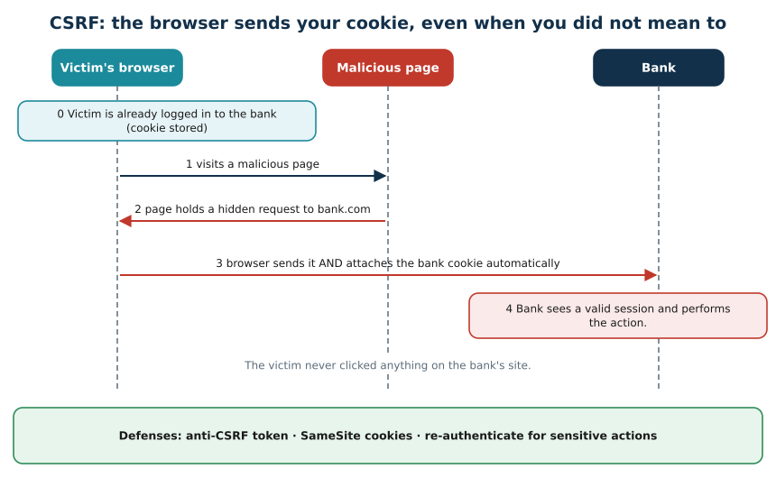
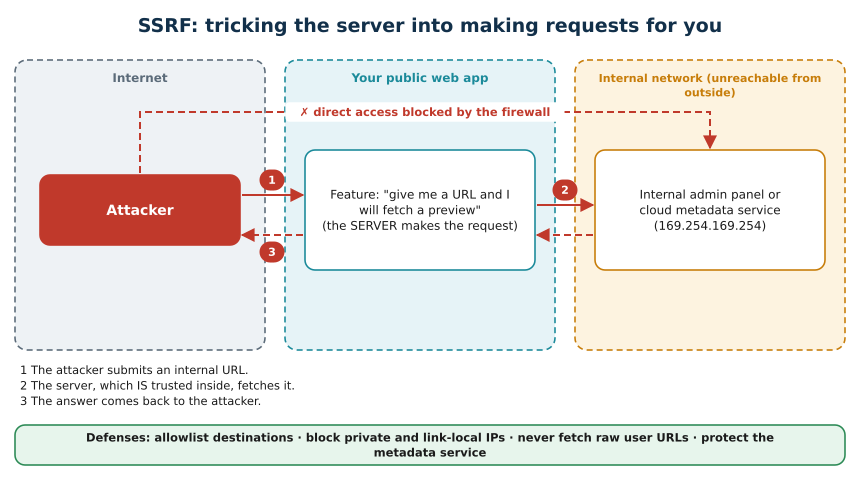

# Chapter 8: Access Control, APIs, CSRF and SSRF

> **Goal.** After this chapter you can: explain authentication vs authorization; explain why Broken Access Control (IDOR / BOLA) is the #1 web and API risk and fix it in code; name the OWASP API Security Top 10 items that matter; explain CSRF and SSRF with their fixes; and recite a checklist for securing a REST API.
>
> **Time:** about 3 hours. **Still relevant in 2026?** Very: A01 is #1 on the OWASP list, most modern apps are API-first, and AI-generated code often forgets authorization checks. **Companion reading:** Bab 11 and Bab 12. **Lab:** [Lab 9](15-labs.md#lab-9-portswigger-web-security-academy).

---

## 1. Authentication vs authorization

The two words are the most commonly confused pair in security interviews.

| | Authentication (AuthN) | Authorization (AuthZ) |
| --- | --- | --- |
| Question | **Who are you?** | **What are you allowed to do?** |
| Happens | First: at login | After: on *every* request |
| Failure code | **401** Unauthorized | **403** Forbidden |
| Examples | Password, MFA, passkey | Roles, ownership checks, permissions |

> **Analogy.** The security desk checks your **ID badge** at the building entrance (authentication). Your **keycard** then opens only some floors (authorization). Getting past the desk does not mean every door should open.

---

## 2. Broken Access Control (OWASP A01): the #1 risk

Broken access control means a user can do or see things beyond what they should. It tops the list because it is easy to get wrong: authorization must be checked **in every place**, and one forgotten check is a hole.

### IDOR / BOLA (the same bug, two names)



**IDOR** (Insecure Direct Object Reference) is the classic web name; **BOLA** (Broken Object Level Authorization) is the API name for the same flaw, and it is **#1 on the OWASP API Security Top 10**.

Alice (user 1001) views her order at `/orders/1001`. She changes the number to `1002`. If the server only checks *"is someone logged in?"* it returns **Bob's** order. Authentication passed; **authorization was never checked.**

**The fix, in code.** Check ownership on the server, for every object, every request:

```python
# VULNERABLE: any logged-in user can fetch any order
order = db.get(Order, order_id)

# SAFE: the query itself is scoped to the current user
order = db.query(Order).filter_by(id=order_id, owner_id=current_user.id).first()
if order is None:
    abort(404)   # or 403
```

> **Common mistake.** "Our IDs are long random UUIDs, so nobody can guess them." Unguessable IDs are a *bonus layer*, never access control. IDs leak through logs, referrer headers, shared links and screenshots.

### The wider family

| Problem | What it is | Example |
| --- | --- | --- |
| **Horizontal privilege escalation** | Reaching another *user's* data at the same level | Alice reads Bob's order (IDOR/BOLA) |
| **Vertical privilege escalation** | Gaining a *higher* role | A normal user calls an admin-only endpoint |
| **Forced browsing** | Visiting URLs that are hidden but not protected | `/admin` works if you type it |
| **Missing function-level checks** | UI hides a button; the API behind it is open | The "Delete user" button is gone, but the API still works |

**Design rules that prevent the whole family:**

1. **Deny by default.** Access is refused unless a rule explicitly allows it.
2. **Enforce on the server.** Hiding a button is a convenience, never a control.
3. **Centralize authorization** in one place (middleware, policy layer) instead of scattering checks.
4. **Scope queries to the owner** (`WHERE owner_id = ?`) so forgetting a check returns nothing, not everything.
5. **Write tests** that log in as user A and try to reach user B's data.

---

## 3. API security: the OWASP API Security Top 10 (2023)

Most of today's attack surface is APIs, and they have their own list. You don't need all ten by heart; know the ones in bold and say that the rest exist.

| ID | Name | Plain English |
| --- | --- | --- |
| **API1** | **Broken Object Level Authorization (BOLA)** | Change an ID, get someone else's object |
| API2 | Broken Authentication | Weak login, tokens or session handling |
| **API3** | **Broken Object Property Level Authorization** | You may see an object, but not every *field* of it; also *mass assignment* (setting fields like `isAdmin` that you shouldn't) |
| **API4** | **Unrestricted Resource Consumption** | No rate limits or quotas: abuse, cost and denial of service |
| **API5** | **Broken Function Level Authorization (BFLA)** | A normal user can call an admin function |
| API6 | Unrestricted Access to Sensitive Business Flows | Automated abuse of legitimate features (ticket scalping, bulk sign-ups) |
| API7 | Server Side Request Forgery | The API fetches attacker-chosen URLs (section 5) |
| API8 | Security Misconfiguration | Defaults, verbose errors, open CORS |
| API9 | Improper Inventory Management | Forgotten old or test API versions still exposed |
| API10 | Unsafe Consumption of APIs | Blindly trusting data from third-party APIs |

**Two API habits worth stating in an interview:** return only the fields the caller needs (stops data leaks and BOPLA), and keep an **inventory** of every API and version you expose (API9: the forgotten endpoint is the one that gets attacked).

---

## 4. CSRF: Cross-Site Request Forgery



**The idea.** Browsers **automatically attach cookies** to requests for a site, even when the request was triggered from a *different* site. If you are logged in to your bank and visit a malicious page, that page can make your browser send a request to the bank, and the cookie rides along. The bank sees a valid session and performs the action. The victim never clicked anything on the bank's site.

**Conditions needed:** the site authenticates with **cookies**, there is a **state-changing action**, and an attacker can predict all the request parameters.

**Defences, strongest first:**

1. **SameSite cookies.** `SameSite=Lax` or `Strict` stops the browser sending the cookie on most cross-site requests. Chrome and Edge default to Lax, but **set it explicitly**.
2. **Anti-CSRF tokens.** A random, per-session value the real form includes and the server checks. A forged request cannot know it.
3. **Check the `Origin` / `Referer` header** on state-changing requests.
4. **Custom request header** for APIs (browsers won't add custom headers cross-site without permission).
5. **Re-authenticate** for sensitive actions.
6. **Never change state on `GET`.**

> **Why it matters less than it used to.** `SameSite=Lax` by default in modern browsers removed much classic CSRF. It is still a common interview question and still bites apps that use `SameSite=None`, old browsers, or token-less APIs. Know it, don't over-invest.

> **CSRF vs XSS (a favourite trap).** **XSS** runs the *attacker's code* inside your page. **CSRF** doesn't run any attacker code on your site; it tricks the victim's *browser* into sending a request. Also: **an XSS flaw defeats CSRF tokens**, since attacker script on your page can read the token.

---

## 5. SSRF: Server-Side Request Forgery



**The idea.** Your application has a feature that fetches a URL on behalf of the user (link previews, image import, webhooks, PDF generators). An attacker supplies an **internal** address instead of a public one. The request comes from *your server*, which sits inside the trusted network, so it can reach things the attacker could never reach directly: internal admin panels, databases, and in the cloud, the **instance metadata service** at `169.254.169.254`, which can hand out temporary credentials.

**Defences:**

1. **Allowlist** the destinations the feature may contact; do not accept arbitrary URLs.
2. **Block private and link-local ranges** (`10.x`, `172.16-31.x`, `192.168.x`, `127.x`, `169.254.x`) *after* DNS resolution, and re-check on redirects.
3. **Don't return raw responses** to the user.
4. In the cloud, **use the hardened metadata service** (AWS IMDSv2 requires a session token) and give the server's role **minimum permissions**.
5. **Network segmentation** so the web tier cannot reach what it doesn't need.

> **The textbook case: Capital One (2019).** According to public reporting and court filings, an attacker used a flaw in a misconfigured web application firewall to make the server request the cloud metadata service and obtained temporary credentials. It is a 2019 case, so treat it as the *classic illustration* rather than a current trend. What is current is the lesson: SSRF matters because of **cloud credentials within reach**, so least privilege on the server's cloud role is as important as the allowlist. (OWASP merged SSRF into A01 in 2025.)

---

## 6. The secure REST API checklist

When asked *"How would you secure a REST API?"*, answer with a structured checklist. This is the table to memorize:

| Area | Do this |
| --- | --- |
| **Transport** | HTTPS only; HSTS |
| **Authentication** | Strong auth (OAuth 2.0 / OIDC or sessions); MFA for users; short-lived tokens (Chapter 9) |
| **Authorization** | Check permissions **per object and per function** on every request; deny by default |
| **Input** | Validate type, length, format on the server; parameterized queries |
| **Output** | Return only needed fields; consistent errors with no stack traces |
| **Abuse protection** | Rate limiting and quotas; request size limits |
| **Secrets** | Never in code or URLs; use a secrets manager; rotate |
| **CORS** | Allow only specific origins; never `*` with credentials |
| **Inventory** | Know every endpoint and version; retire the old ones |
| **Logging** | Log authentication and access-control failures; never log passwords or tokens |
| **Dependencies** | Scan and update regularly (Chapter 12) |

---

## Check yourself

1. Authentication vs authorization: which returns 401 and which 403?
2. What is BOLA/IDOR and what is the one-line code fix?
3. What is the difference between BOLA and BFLA?
4. Why is CSRF possible even though the attacker never sees the victim's cookie?
5. Name two defences against CSRF and one defence against SSRF.
6. What does an API inventory protect against?

**Answers** *(cover this until you have tried)*

1. Failing authentication (not logged in) returns 401. Failing authorization (logged in, not allowed) returns 403.
2. Changing an object identifier in a request to reach someone else's object because ownership isn't checked. Fix: scope the lookup to the current user (`WHERE id = ? AND owner_id = ?`) and deny otherwise.
3. BOLA is reaching another user's *object*; BFLA is calling a *function* (such as an admin action) you shouldn't be able to call.
4. The browser attaches the cookie automatically to any request to that site, even one triggered from another site. The attacker never needs to read it.
5. CSRF: SameSite cookies and anti-CSRF tokens (also Origin checks, re-authentication). SSRF: an allowlist of destinations, blocking private and link-local IPs, or the hardened metadata service.
6. Forgotten, old or test endpoints that are still exposed and unpatched (OWASP API9).

---

## Summary

- AuthN = who you are (401). AuthZ = what you may do (403), checked on every request.
- BOLA/IDOR is the textbook A01 flaw and #1 on the API list. Fix: scope every lookup to the owner and deny by default; unguessable IDs are not access control.
- Know API1, API3, API4, API5; return only needed fields; keep an API inventory.
- CSRF abuses automatic cookies (fix: SameSite, tokens). SSRF abuses a server's trusted position (fix: allowlist, block private IPs, hardened metadata, least privilege).
- Secure-API answers should be a structured checklist, not a ramble.
