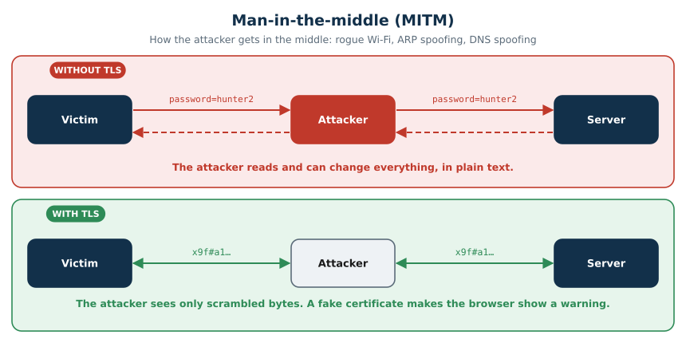
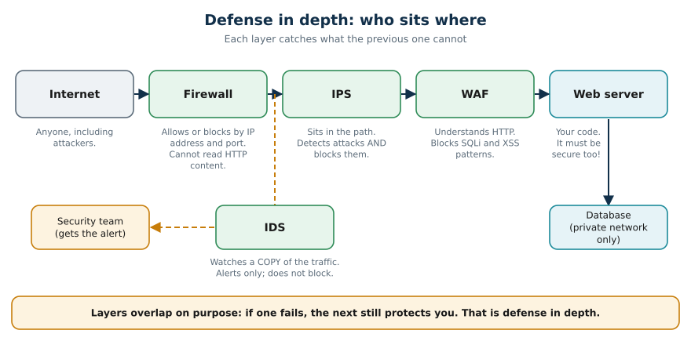

# Chapter 8: Network Attacks and Defenses

> **Goal.** After this chapter you can: explain man-in-the-middle, sniffing and session hijacking and the defence for each; classify DoS and DDoS attacks; place a firewall, IDS, IPS and WAF on a diagram and say what each can and cannot see; and explain defense in depth, segmentation and the basics of Wi-Fi security.
>
> **Time:** about 3 hours. **Companion reading:** Bab 10 and Bab 11 of your Indonesian book.

This chapter ties earlier ones together: it is the attacker's view of Chapter 4 (networking) and the defender's answer using Chapter 3 (TLS).

---

## 1. Man-in-the-middle (MITM)

**The idea.** The attacker secretly positions themselves between two parties, relays their traffic, and can **read** or **change** it. Both sides believe they are talking directly to each other.

**How the attacker gets "in the middle":**

| Method | How it works |
| --- | --- |
| **Rogue Wi-Fi / "evil twin"** | A fake access point with a familiar name (`Free_Airport_WiFi`); everything flows through the attacker's device |
| **ARP spoofing** | ARP maps IP addresses to hardware (MAC) addresses on a local network, and it has **no authentication**. A forged reply makes victims send traffic to the attacker. |
| **DNS spoofing** | A false DNS answer points the victim at the attacker's server |

**Defences.** The real fix is **TLS with certificate validation** (Chapter 3): even if the attacker relays the traffic, they see only scrambled bytes, and a forged certificate triggers a browser warning. Add **HSTS** (browsers refuse to downgrade to HTTP), avoid ignoring certificate warnings, and treat every network as hostile (**zero trust**).

> **Common mistake.** Dismissing a certificate warning ("just click Continue"). That click is exactly what a man-in-the-middle is hoping for.

> **Interview angle.** "What is a MITM attack and how do you defend against it?" → *"An attacker relays and possibly alters traffic between two parties, for example via a rogue Wi-Fi point or ARP spoofing. The defence is TLS with proper certificate validation plus HSTS, so even a successful interception gives the attacker only ciphertext and a forged certificate gets rejected."*

---

## 2. Sniffing

**Sniffing** is capturing network traffic with a tool such as Wireshark (which you will use in Lab 2).

| Type | Description |
| --- | --- |
| **Passive** | Just listen. Easy on open Wi-Fi or a shared hub, where everyone's packets are visible. |
| **Active** | Manipulate the network first (for example ARP spoofing) so traffic is redirected to you, since switches normally send traffic only to its intended destination. |

**Defence:** encrypt everything (TLS, VPN, WPA2/WPA3 on Wi-Fi). If sniffed traffic is encrypted, the attacker learns almost nothing.

---

## 3. Session hijacking

**The goal:** steal or predict the **session ID** so you *become* the logged-in user without knowing the password.

| Technique | Defence |
| --- | --- |
| Steal the cookie with XSS | `HttpOnly` cookies; fix the XSS |
| Sniff it on the network | `Secure` flag, HTTPS, HSTS |
| **Session fixation**: plant a known session ID before the victim logs in | **Rotate the session ID on login** |
| Predict weak session IDs | Long, random IDs from a secure generator |

(See Chapter 7 for the full session checklist.)

---

## 4. Denial of Service (DoS) and DDoS

A **DoS** attack makes a service unavailable (the "A" in CIA) by exhausting something it needs. A **DDoS** does it from **many** machines at once, usually a **botnet** of infected devices, so blocking one source is useless.

| Category | What is exhausted | Example | Defence |
| --- | --- | --- | --- |
| **Volumetric** | Bandwidth | Huge floods of junk traffic | Upstream scrubbing, CDN, extra capacity |
| **Protocol / state exhaustion** | Connection tables, firewall state | **SYN flood** (Chapter 4) | SYN cookies, rate limiting, hardened firewalls |
| **Application layer** | CPU, memory, database | Many expensive searches or logins | Rate limiting, caching, CAPTCHAs, WAF rules |

> **Real case: Mirai (2016).** The Mirai botnet recruited huge numbers of poorly secured internet cameras and home routers (many with default passwords) and used them to flood the DNS provider Dyn, knocking many popular websites offline for hours. *Lesson:* insecure IoT devices become weapons, and **default credentials** are a real-world vulnerability.

**Typical defence answer:** *"Absorb it upstream with a CDN or scrubbing service, rate-limit per client, make the expensive paths cheap or cached, and design for graceful degradation."*

---

## 5. The defence toolbox: who sits where

| Control | Where it sits | What it sees | What it **cannot** do |
| --- | --- | --- | --- |
| **Firewall** | At the network edge (and between zones) | IP addresses, ports, connection state | Read HTTP content; can't tell a normal request from an injection attack on an allowed port |
| **IDS** (Intrusion *Detection* System) | Watches a **copy** of traffic | Patterns that look malicious | **Block** anything; it only alerts |
| **IPS** (Intrusion *Prevention* System) | **In the path** of traffic | The same patterns | Be perfect: false positives can block real users |
| **WAF** (Web Application Firewall) | In front of the web server | **HTTP requests and responses**; attack patterns like SQLi, XSS | Fix the bug in your code; a clever bypass can slip through |
| **SIEM** | Collects logs from everywhere | Correlates events across systems | Detect what nobody logs |
| **VPN** | Between a user and a network | Encrypts the tunnel | Protect an already-compromised device |

**Two terms to know:** *Signature-based* detection recognizes known attack patterns (accurate, misses new attacks). *Anomaly-based* detection flags behaviour that is unusual (catches new attacks, more false alarms). A **false positive** is a harmless event flagged as an attack; a **false negative** is a real attack missed.

> **The memorable summary.** *Firewall: who can talk to whom. IDS: shouts when it sees something. IPS: shouts and blocks. WAF: understands web requests.*

### Segmentation and zero trust

- **Network segmentation** splits the network into zones (public web servers in a **DMZ**, databases in a private zone) so a break-in at one point does not give access to everything (the lesson of the Target breach).
- **Zero trust** means *never trust, always verify*: no request is trusted just because it comes from "inside" the network.

> **Analogy.** A castle has a **moat and gate** (firewall), **guards at the gate checking baggage** (IPS/WAF), a **watchtower that rings a bell** (IDS), a **ledger of everyone who came and went** (logging/SIEM), and **locked rooms inside** (segmentation). If an intruder gets past the moat, the inner layers still protect the treasure.

---

## 6. Wi-Fi in one table

| Standard | Status |
| --- | --- |
| **WEP** | Broken; can be cracked in minutes. Never use. |
| **WPA / WPA2** | WPA2 with a strong passphrase (AES) was the long-time standard; weak passphrases can be guessed offline |
| **WPA3** | Current standard; stronger protection against offline guessing |

**Evil twin** (a fake access point) is defeated by TLS, as above. On public Wi-Fi, assume the network is hostile and rely on HTTPS or a VPN.

---

## Check yourself

1. How can an attacker end up "in the middle" on a local network, and why does TLS still protect you?
2. What is session fixation and what stops it?
3. Name the three categories of DoS attacks and one defence for each.
4. IDS vs IPS: what is the difference?
5. Why can a firewall not stop a SQL injection against your website on port 443?
6. What is network segmentation, and which breach is the classic example of its absence?

**Answers** *(cover this until you have tried)*

1. Via a rogue Wi-Fi access point, ARP spoofing or DNS spoofing. TLS still protects you because the attacker sees only encrypted bytes and cannot present a valid certificate for the site, so a forged one triggers a warning.
2. The attacker plants a known session ID before the victim logs in, then uses it afterward. Rotating the session ID at login stops it.
3. Volumetric (CDN or scrubbing), protocol or state exhaustion (SYN cookies, rate limiting), application layer (rate limiting, caching, WAF rules).
4. An IDS watches a copy of the traffic and alerts. An IPS sits inline and can also block.
5. A traditional firewall sees IPs and ports, and port 443 is allowed. It does not read the HTTP content where the injection sits.
6. Splitting the network into zones so one compromise does not reach everything. The Target breach, where a vendor foothold reached payment systems, is the classic example.

---

## Summary

- MITM = relaying and altering traffic; the fix is TLS with certificate validation plus HSTS.
- Session hijacking = steal, predict or fix the session ID; cookie flags, HTTPS and ID rotation stop it.
- DoS exhausts bandwidth, connection state, or application resources; DDoS does it from a botnet.
- Firewall = who can talk; IDS = alert; IPS = alert and block; WAF = understands HTTP.
- Segmentation, zero trust and layered controls mean one failure is not total failure.
