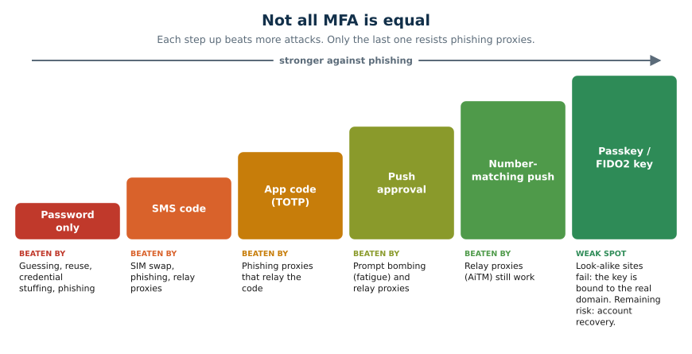
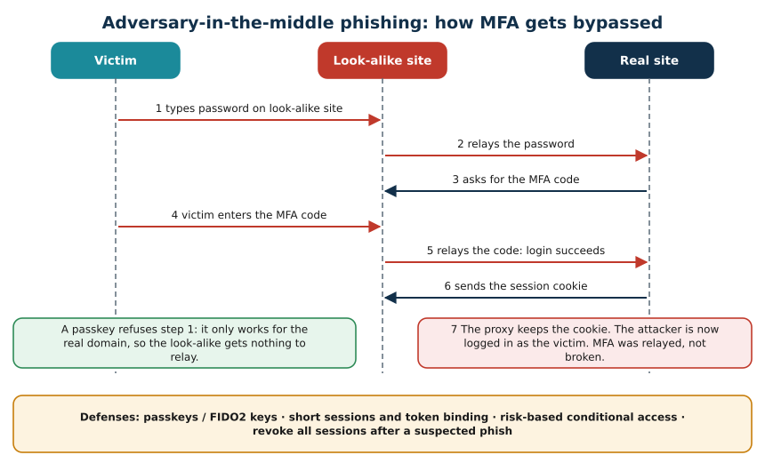

# Chapter 9: Identity, Phishing and Modern Authentication

> **Goal.** After this chapter you can: explain why identity is the main battlefield now; list how logins get stolen (stuffing, infostealers, phishing, help-desk calls); rank MFA methods and explain why ordinary MFA fails against adversary-in-the-middle phishing; explain how passkeys work and why they resist it; explain session and token theft; and describe OAuth token abuse and help-desk social engineering with recent cases.
>
> **Time:** about 3 hours. **Still relevant in 2026?** This is the most current chapter: stolen access, phishing and help-desk attacks sit behind most major incidents of 2024-2026. **Companion reading:** Bab 9 and Bab 10 (older, partial). **Lab:** [Lab 6](15-labs.md#lab-6-check-your-own-accounts-and-try-a-passkey).

---

## 1. Why identity is the new perimeter

Twenty years ago the "perimeter" was the office network. Today your staff, vendors and apps log in from anywhere, so **the login is the perimeter**. That is why, in Verizon's 2026 data, stolen credentials and pretexting together still account for roughly one breach in five (about 13% and 6%), and why almost every ransomware story begins with someone else's valid access (Chapter 11).

> **Analogy.** Imagine a bank that stopped caring about the building's walls and only checks the staff badge at the door. Whoever steals or talks their way into a badge walks straight through. Modern attackers go after the *badge*.

---

## 2. How logins get stolen

| Method | How it works | Main defence |
| --- | --- | --- |
| **Credential stuffing** | Replay username and password pairs leaked from *other* sites, since people reuse passwords | MFA, passkeys, breached-password checks, rate limiting |
| **Password spraying** | Try one or two very common passwords against *many* accounts to avoid lockouts | MFA, monitoring for failures spread across accounts |
| **Infostealer malware** | Malware on a user's device copies saved passwords, cookies and tokens, then sells them | Endpoint protection, short-lived sessions, don't save logins in browsers on shared or unmanaged devices |
| **Phishing** | A fake page or message tricks the user into entering credentials or approving a prompt | Phishing-resistant MFA (passkeys), training, email authentication |
| **Help-desk and phone attacks** | An attacker impersonates an employee and asks IT to reset a password or MFA | Strong identity verification and call-back procedures |
| **MFA fatigue ("prompt bombing")** | Spam the victim with approval prompts until they tap "yes" | Number matching, passkeys, limits on prompts |

> **Real case: Snowflake customers (2024).** Mandiant found that every incident in this campaign traced back to **compromised customer credentials**, mostly harvested by infostealer malware from infected devices. The affected accounts **had no MFA**, the credentials were **still valid** (some from infections as far back as 2020), and the instances had **no network allow-list**. At least **165 organizations** were hit. Snowflake's own platform was not breached. *Lessons:* enforce MFA, expire and rotate old credentials, and restrict where logins may come from.

> **Real case: Klue (2026).** A credential issued in **2022** for a limited pilot was still working in 2026 and led attackers to data about roughly **200 downstream companies**. Klue confirmed it. *Lesson:* the same idea, again: dormant credentials are live ammunition.

---

## 3. The MFA ladder: not all MFA is equal

**Multi-factor authentication (MFA)** means proving identity with more than one kind of evidence (something you know, have, or are). It stops most credential-stuffing and spraying. But attackers have adapted, so the *type* of MFA now matters more than its mere presence.

Read the ladder left to right: each rung beats more attacks, but **only the last one resists phishing proxies**, and even it has a weak spot in account recovery.

> **Common mistake.** "We have MFA, so we're safe." MFA that can be *relayed* (codes, push approvals) is better than nothing but is exactly what modern phishing kits defeat. The Change Healthcare breach (2024) had *no* MFA on one portal; many other incidents had MFA that was bypassed.

---

## 4. Adversary-in-the-middle (AiTM) phishing and session theft

**The idea.** The attacker runs a **look-alike login page that is really a live proxy** to the real site. The victim types their password and approves MFA on what looks like the genuine page. The proxy relays everything and receives the **session cookie** the real site issues after a successful login. The attacker then replays that cookie and is "logged in" as the victim, **without ever breaking MFA**.

Why this matters:

- Security vendors describe AiTM kits as sold as a commodity service, so it is not a nation-state technique any more.
- **Changing the password does not end the attacker's access**: the stolen session stays valid until it expires or is revoked.
- The same effect happens through **infostealer malware** that steals browser cookies directly.

**Defences, in order:**

1. **Passkeys / FIDO2 keys** (next section): they are bound to the real domain, so a look-alike gets nothing to relay.
2. **Shorter sessions, token binding and risk-based re-checks** (conditional access) so a stolen cookie loses value quickly or fails from a new device.
3. **Revoke all sessions**, not just the password, when phishing is suspected.
4. **Monitor** for new mailbox rules, new devices and impossible-travel logins.

---

## 5. Passkeys: the passwordless answer

A **passkey** is a login based on public-key cryptography (Chapter 4's signatures), standardized as **WebAuthn / FIDO2**.

**How it works, simply:**

1. **Registration:** your device creates a key pair *for that site*. The **public key** goes to the site; the **private key** stays on your device (protected by your fingerprint, face or PIN).
2. **Login:** the site sends a random **challenge**. Your device **signs** it with the private key (after you unlock it), and the site verifies the signature with the stored public key.
3. The signature is **tied to the website's real domain**, so a look-alike site simply cannot get a valid response.

| Benefit | Why |
| --- | --- |
| **Phishing-resistant** | The credential only works for the real domain |
| **Nothing to steal from the server** | The site stores only public keys, so a database leak gives attackers nothing to replay |
| **Nothing to reuse or guess** | No password; no stuffing or spraying |
| **Easier for users** | Unlock your device and you're in |

**Honest limits (say these in an interview):** **account recovery** becomes the weakest link (attackers go around the strong login via a weak reset or help-desk call); old devices and sync accounts need care; and adoption is partial, so passwords and MFA fallbacks remain for years. Passkeys don't help against malware already running on the user's device.

> **Interview angle.** "How would you reduce account takeover?" → *"Move users to passkeys, which are phishing-resistant; enforce MFA everywhere in the meantime and prefer number matching or hardware keys over SMS; rate-limit and monitor logins; shorten sessions; and harden account recovery and the help desk, because attackers go around strong login through weak recovery."*

---

## 6. Sessions, JWTs and OAuth

### Sessions

After login the server issues a **session ID** (or token). Whoever holds it *is* that user, so:

- Make it **long and random** (from a secure generator).
- **Rotate** it at login (prevents *session fixation*, where an attacker plants a known ID first).
- Set `HttpOnly`, `Secure` and `SameSite` cookie flags (Chapter 5).
- **Expire** sessions, and make **logout invalidate** them on the server.

### JWT pitfalls

A **JSON Web Token** is a signed token carrying claims (user ID, roles). It is popular, and commonly misused:

| Pitfall | Why it hurts | Fix |
| --- | --- | --- |
| Not verifying the signature or the algorithm | Forged tokens are accepted (the historical "alg: none" bug) | Verify the signature; **pin the allowed algorithm** on the server |
| Weak signing secret | Attackers guess it offline and forge tokens | Long random secret, or asymmetric keys |
| Long-lived tokens, no revocation | A stolen token works for days | Short expiry plus refresh tokens; a revocation strategy |
| Storing in `localStorage` | Any XSS can read it | Prefer an `HttpOnly` cookie |
| Secrets in the payload | The payload is only **encoded**, not encrypted (Chapter 4) | Never put secrets in a JWT |

### OAuth in two minutes

**OAuth 2.0** lets an app act on your behalf **without your password**: you approve a **scope** ("read my calendar") and the app gets an **access token**. **OpenID Connect (OIDC)** adds login ("sign in with Google") on top. The modern, safe flow is the **authorization code flow with PKCE**.

What can go wrong (and has):

- **Consent phishing:** a malicious app tricks you into granting broad scopes; no password is ever stolen.
- **Token theft and over-broad scopes:** a stolen token works from anywhere until revoked.

> **Real case: Salesloft Drift (August 2025).** Attackers obtained **OAuth tokens** for the Drift integration and used them to pull data out of many customers' Salesforce accounts; Google's threat team said it knew of **700+ potentially impacted organizations**. The attackers then searched the stolen data for further secrets such as cloud keys. The tokens were revoked on 20 August. *Lessons:* a vendor's token is *your* data; give integrations **least-privilege scopes**, keep an inventory of connected apps, and be able to **revoke everything fast**.

---

## 7. Social engineering today: phone calls, help desks and AI

Verizon's 2026 report splits out **pretexting** (talking someone into acting) as its own initial-access category at about **6%**, and notes it is increasingly used in ransomware and extortion. Attackers have moved from bad-spelling emails to **voice calls and chats**: TechTarget's summary of the same report says mobile voice and text scams had about 40% higher click-through than email in phishing simulations (a single-source figure, so hedge it).

| Technique | What it is | Defence |
| --- | --- | --- |
| **Vishing (voice phishing)** | A call impersonating IT, a vendor or an executive | Call-back to a known number; never act on an inbound call |
| **Help-desk impersonation** | Posing as an employee to get a password or MFA reset | Strong identity verification before any reset; manager approval for privileged accounts |
| **Business email compromise** | Impersonating a boss or supplier to redirect a payment | Two-person approval for payments; verify bank-detail changes by phone |
| **Smishing** | Phishing by SMS | Don't tap links; use official apps |
| **AI-assisted fraud** | Better-written messages, cloned voices, fake profiles at scale | Process-based checks that don't depend on "it sounded right" |

> **Real case: help-desk attacks (2023 and 2025).** Public reporting links MGM Resorts (2023) and Marks & Spencer (2025) to attackers who **impersonated employees to the IT help desk** to get access reset, in incidents attributed to the Scattered Spider group. The details of the M&S call are reported rather than formally confirmed. *Lesson:* **the help desk is part of your security perimeter**, and a fast "I'm locked out" request is exactly the pressure attackers use.

> **Real case: ShinyHunters (2026).** A 2026 roundup attributes a string of large data thefts to this group, which is known for voice-phishing employees: for example Charter Communications (about 40 million records; Charter confirmed the incident), with other victims claimed or reported. The attribution and the exact entry method for each victim are not all confirmed. *Lesson:* the "attack" may be a **phone conversation**, so training plus verification procedures matter as much as software.

**The defence mindset:** assume someone will eventually be fooled, and make sure one fooled person cannot do catastrophic damage. That means phishing-resistant MFA, least privilege, verification steps for resets, and monitoring.

---

## Check yourself

1. Name four ways a login gets stolen.
2. Why does ordinary MFA (a code or a push) fail against an AiTM phishing proxy, and why do passkeys not?
3. Why doesn't changing the password end an attacker's access after session-token theft?
4. Describe passkey login in three sentences.
5. What went wrong in the Snowflake customer incidents (2024), in three points?
6. Why is account recovery the weak spot of strong authentication?

**Answers** *(cover this until you have tried)*

1. Credential stuffing, password spraying, infostealer malware, phishing, help-desk impersonation, MFA fatigue (any four).
2. The proxy relays the code or approval and then captures the session cookie the real site issues. A passkey is bound to the real domain, so a look-alike site cannot obtain a valid response to relay.
3. The stolen session cookie remains valid until it expires or is revoked; it doesn't depend on the password. You must revoke sessions.
4. At registration your device makes a key pair for the site and gives it the public key. At login the site sends a challenge, your device signs it with the private key after you unlock it, and the site verifies the signature. The signature is tied to the real domain, so it can't be phished.
5. Credentials stolen by infostealers were still valid, the accounts had no MFA, and there were no network restrictions on where logins could come from.
6. Attackers go around the strong login by abusing a weaker route to regain access: password reset flows or a persuaded help desk.

---

## Summary

- Identity is the perimeter: stolen access and pretexting sit behind most major incidents.
- Logins are stolen by stuffing, spraying, infostealers, phishing, help-desk calls and prompt bombing.
- MFA ladder: SMS < app code < push < number matching < **passkey/FIDO2**. Only passkeys resist AiTM relay phishing.
- AiTM steals the session, not the password: revoke sessions, shorten them, bind them.
- OAuth tokens are access too (Salesloft Drift, 2025). Least-privilege scopes, an app inventory, fast revocation.
- The help desk and the phone are attack surfaces. Verify before you reset.
