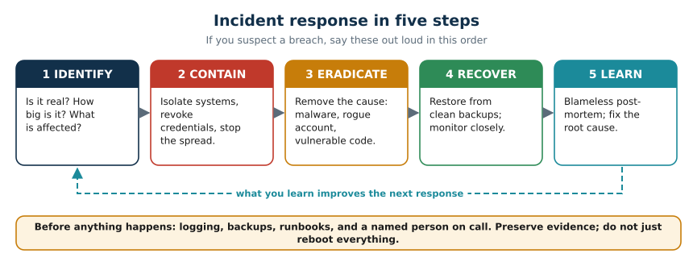

# Chapter 9: People, Malware, Supply Chain and Incident Response

> **Goal.** After this chapter you can: explain why social engineering works and name its forms and defences; classify malware types; explain software supply-chain attacks and the developer-level defences; describe the five steps of incident response; and apply the STRIDE threat-modeling checklist to a feature.
>
> **Time:** about 3 hours. **Companion reading:** Bab 9 and Bab 10 of your Indonesian book. **Lab:** [Lab 11](11-labs.md#lab-11-threat-model-a-feature-you-built-with-stride).

---

## 1. Social engineering: attacking people

**The idea.** Why break a strong lock when someone will hold the door open? **Social engineering** manipulates people, not systems, into handing over access or information. It remains one of the most common ways breaches begin.

**Why it works.** Attackers exploit normal human reflexes: **urgency** ("your account will be closed in 1 hour"), **authority** ("this is the CEO"), **fear**, **curiosity**, **helpfulness**, and **trust in a familiar look**.

| Type | What it is | Example |
| --- | --- | --- |
| **Phishing** | Mass fraudulent emails or messages | "Your parcel is held. Confirm your details" |
| **Spear phishing** | Phishing aimed at one specific person, using real details about them | An email to the finance lead that mentions a real supplier |
| **Whaling** | Spear phishing aimed at executives | A fake legal notice to the CEO |
| **Vishing / Smishing** | Phishing by voice call / SMS | A "bank" calling to "verify" a one-time code |
| **Pretexting** | An invented scenario to extract information | "I'm from IT; I need your password to fix your laptop" |
| **Baiting** | Leaving something tempting | A USB drive labelled "Salaries" in the car park |
| **Tailgating** | Following someone through a secure door | "Could you hold the door? I forgot my badge" |
| **Business email compromise** | Impersonating a boss or vendor to redirect payments | An "updated bank account" email from a supplier |

**Red flags to teach (and to remember):** unexpected urgency, a request to bypass normal process, a slightly-off sender address, links whose real destination differs from the text, and any request for credentials or codes.

**Defences, in layers:**

| Layer | Defence |
| --- | --- |
| **Technical** | **MFA** (phishing-resistant passkeys/FIDO2 are strongest), email authentication (**SPF, DKIM, DMARC**), link scanning, endpoint protection |
| **Process** | Call-back verification for payment or credential changes; two-person approval for money moves |
| **People** | Regular realistic training, simulated phishing, and a culture where reporting a mistake is rewarded, never punished |

> **Common mistake.** "Our staff are trained, so phishing isn't a problem." Training reduces risk but never reaches zero. That is why *technical* backstops (MFA, least privilege, monitoring) matter: assume somebody will eventually click.

---

## 2. Malware: the zoo, in one table

**Malware** is software built to harm or abuse a system. The words below describe *behaviour*, and they often overlap.

| Type | What it does | Analogy | Key point |
| --- | --- | --- | --- |
| **Virus** | Attaches itself to files or programs; spreads when they are run or shared | A cold passed by touching | Needs a host program |
| **Worm** | Spreads **by itself** across networks, with no user action | A fire jumping between houses | WannaCry was a worm |
| **Trojan** | Pretends to be legitimate software | The Trojan horse | Relies on the user installing it |
| **Ransomware** | Encrypts your data and demands payment | A kidnapper holding files hostage | Defence: offline, tested backups |
| **Spyware / keylogger** | Secretly records activity or keystrokes | A hidden bug in the room | Steals credentials |
| **Rootkit** | Hides itself deep in the system with high privileges | A burglar who also rewrites the security-camera footage | Very hard to detect and remove |
| **Botnet / bot** | A network of infected machines under remote control | A zombie army | Powers DDoS and spam (Mirai) |
| **RAT** (Remote Access Trojan) | Gives an attacker remote control | A hidden remote control for your computer | Often used for persistence |

**How malware arrives:** phishing attachments and links, malicious downloads, **unpatched vulnerabilities** (WannaCry), infected USB drives, and compromised software updates.

**Defences:** keep systems **patched**, use endpoint protection (EDR/antivirus), run with **least privilege**, restrict what users can install, filter email, and keep **offline or immutable backups** you have actually tested restoring.

> **Interview angle.** "Virus vs worm?" → *"A virus needs a host file and a user action to spread; a worm spreads by itself across the network. WannaCry was a worm: it exploited an unpatched Windows SMB flaw to jump between machines."*

---

## 3. Software supply-chain attacks (OWASP A03, new in 2025)

**The idea.** Modern software is mostly *other people's code*: open-source packages, build tools, container images, update channels. If an attacker compromises something you **depend on**, they compromise you, without ever touching your own code. This is why OWASP added **Software Supply Chain Failures** as its own category in 2025.

> **Real case: SolarWinds (2020).** Attackers compromised the build process of SolarWinds' Orion network-management software and slipped malicious code into legitimate updates released between March and June 2020. SolarWinds estimated fewer than **18,000 customers** could have installed an affected version, including government agencies and large companies. The updates were **properly signed and came from the real vendor**, so customers trusted them. *Lesson:* trust in a supplier is itself an attack surface.

**Supply-chain attack patterns (concepts):**

| Pattern | What happens |
| --- | --- |
| **Compromised dependency** | A maintainer's account or a package is hijacked and a malicious version is published |
| **Typosquatting** | A malicious package with a near-identical name (`reqeusts`) |
| **Dependency confusion** | A public package shadows the name of an internal one |
| **Compromised build / CI** | Attackers alter what the build pipeline produces (SolarWinds) |
| **Poisoned update channel** | Malicious code delivered via the vendor's own update system |

**Developer-level defences (this is where you shine):**

1. **Pin versions with a lockfile** and review dependency updates instead of auto-accepting them.
2. **Scan dependencies** for known vulnerabilities (software composition analysis: `npm audit`, `pip-audit`, Dependabot, Snyk).
3. **Keep a Software Bill of Materials (SBOM)**: a list of exactly what is in your software, so when a flaw like Log4Shell appears you can answer "are we affected?" in minutes.
4. **Verify integrity:** signatures and checksums; reproducible builds where possible.
5. **Harden CI/CD:** least-privilege build credentials, protected branches, reviewed pipeline changes.
6. **Minimize dependencies.** Every package is attack surface.

---

## 4. Logging and detection (OWASP A09)

You cannot respond to what you cannot see. Breaches often go unnoticed for months because nothing was logging, or nobody was looking.

**Log:** authentication successes and failures, access-control failures, input-validation failures, privilege changes, and administrative actions, each with time, user, source and outcome.

**Don't log:** passwords, tokens, full card numbers, or secrets (logs are often less protected than databases).

**Make it useful:** send logs to a **central, separate** system (so an intruder can't erase them: "cover tracks" from Chapter 2), **alert** on anomalies such as many failed logins or logins from impossible locations, and **practice** reading them. A **SIEM** collects and correlates logs across systems.

---

## 5. Incident response: five steps

When you suspect a breach, panic is the enemy. A calm, ordered process beats improvisation.

| Step | Goal | Example actions |
| --- | --- | --- |
| **1. Identify** | Confirm it is real; scope it | Review alerts and logs; which systems, which accounts, since when? |
| **2. Contain** | Stop the spread | Isolate affected hosts, revoke leaked credentials, block attacker access. Do this before cleaning up. |
| **3. Eradicate** | Remove the cause | Delete malware, close the vulnerability, remove rogue accounts |
| **4. Recover** | Return to normal safely | Restore from **clean** backups, patch, monitor closely |
| **5. Learn** | Stop it happening again | A **blameless** post-mortem: timeline, root cause, fixes |

This matches the widely used NIST incident-response lifecycle (preparation; detection and analysis; containment, eradication and recovery; post-incident activity).

> **Common mistake.** Rebooting or wiping the machine immediately. You destroy the **evidence** (memory, logs) you need to learn how the attacker got in, and you may tip them off. Contain first; preserve evidence; then clean.

**Worked scenario: "A user says someone accessed their account."**

1. *Identify:* check authentication logs for that account: times, IP addresses, devices, anything unusual.
2. *Contain:* terminate active sessions, force a password reset, require MFA.
3. *Scope:* is it one account, or a pattern across accounts (credential stuffing)? Look for similar failed-then-successful logins.
4. *Eradicate and recover:* close the cause (for example, rate limiting was missing), notify the affected user, monitor.
5. *Learn:* write down what would have caught this sooner.

---

## 6. Threat modeling with STRIDE (a developer's superpower)

**Threat modeling** means asking, *before you build*: "What can go wrong?" It addresses **A06 Insecure Design**, flaws that no amount of later patching can fully fix. **STRIDE** is a simple checklist of six threat types (from Microsoft); each is the opposite of a security property.

| Letter | Threat | Property violated | Example | Typical mitigation |
| --- | --- | --- | --- | --- |
| **S** | **Spoofing** | Authentication | Logging in as someone else | Strong authentication, MFA |
| **T** | **Tampering** | Integrity | Editing a price in a request | Validation, signatures, access control |
| **R** | **Repudiation** | Non-repudiation | "I never made that transfer" | Audit logs, signatures |
| **I** | **Information disclosure** | Confidentiality | A leaked database | Encryption, access control |
| **D** | **Denial of service** | Availability | Flooding the API | Rate limiting, scaling |
| **E** | **Elevation of privilege** | Authorization | A normal user becoming admin | Least privilege, checks on every request |

**How to use it in 5 minutes:** draw the feature as boxes and arrows (user, browser, API, database, third party). For each arrow and box, ask the six STRIDE questions and write one mitigation per realistic threat. That is a threat model, and you can describe doing it in an interview.

> **Interview angle.** "How do you build security into your development process?" → *"I threat-model new features early with STRIDE; review code for the common OWASP issues; run SAST and dependency scanning in CI plus DAST on staging; keep secrets in a secrets manager; and use least privilege everywhere."* (SAST = static analysis of source code; DAST = testing a running application from the outside; SCA = scanning dependencies.)

---

## Check yourself

1. Why does social engineering work, and what is the technical backstop when someone is fooled anyway?
2. Virus vs worm vs trojan in one sentence each.
3. Why was the SolarWinds attack so hard to spot?
4. Give three developer-level defences against supply-chain attacks.
5. List the five incident-response steps. Why contain *before* eradicate?
6. What does each letter of STRIDE stand for?

**Answers** *(cover this until you have tried)*

1. It exploits normal human reflexes: urgency, authority, trust, helpfulness. Backstops: MFA (ideally phishing-resistant), least privilege, and monitoring, so one click is not total compromise.
2. A virus attaches to a host file and needs a user action to spread; a worm spreads by itself across the network; a trojan disguises itself as legitimate software and relies on the user installing it.
3. The malicious code arrived inside genuine, correctly signed updates from the real vendor, so customers had good reason to trust it.
4. Any three of: lockfiles and pinned versions, dependency scanning, an SBOM, signature/integrity verification, hardened CI/CD, minimizing dependencies.
5. Identify, contain, eradicate, recover, learn. Containing first stops the spread; cleaning up first can destroy evidence and let the attacker keep moving.
6. Spoofing, Tampering, Repudiation, Information disclosure, Denial of service, Elevation of privilege.

---

## Summary

- Social engineering targets people; layer MFA, process checks and training, and assume someone will click.
- Malware types are about behaviour: virus (needs host), worm (self-spreading), trojan (disguised), ransomware (encrypts), rootkit (hides), botnet (zombie network).
- Supply-chain risk is trust in what you depend on: pin, scan, SBOM, verify, harden CI.
- Incident response: identify, contain, eradicate, recover, learn; preserve evidence and keep post-mortems blameless.
- STRIDE is a six-question checklist that turns "build it secure" into a five-minute habit.
