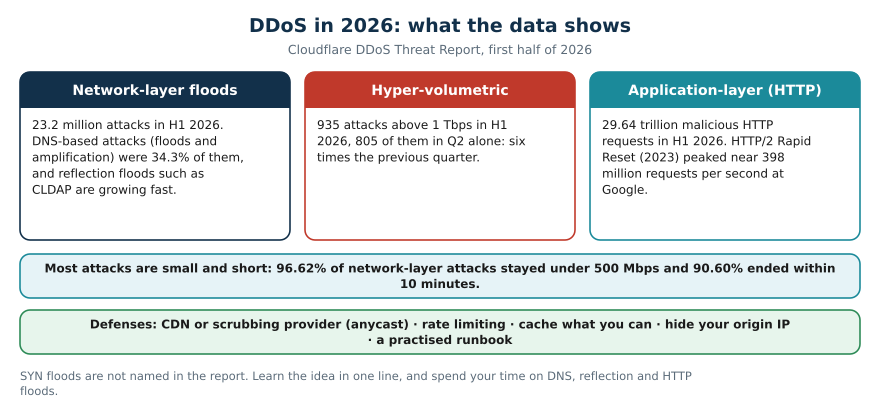
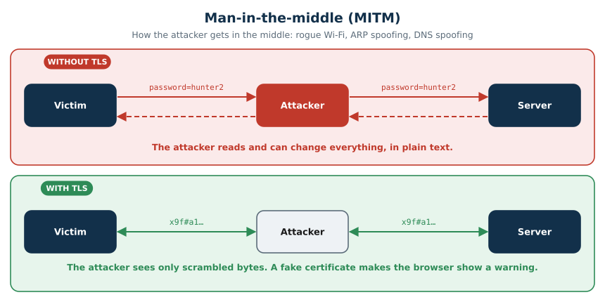
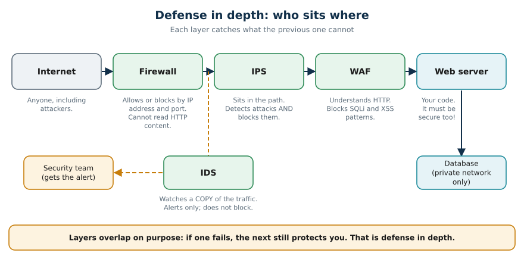

# Chapter 10: Network Attacks, DDoS and Defence Layers

> **Goal.** After this chapter you can: describe what DDoS really looks like in 2026 and how it is defended; explain man-in-the-middle in one answer; place a firewall, IDS, IPS and WAF on a diagram and say what each can and cannot see; and explain defense in depth, segmentation and zero trust.
>
> **Time:** about 1 hour (deliberately short). **Still relevant in 2026?** DDoS: yes, and bigger. Classic LAN tricks and old Wi-Fi: rarely, so they are one-liners. **Companion reading:** Bab 10 and Bab 11 of your Indonesian book.

---

## 1. DDoS in 2026: what the data shows

A **DoS** attack makes a service unavailable (the "A" in CIA) by exhausting something it needs. A **DDoS** does it from **many** machines at once, so blocking one source is useless.

From Cloudflare's [DDoS Threat Report for the first half of 2026](https://blog.cloudflare.com/ddos-threat-report-2026-h1/):

- **23.2 million network-layer attacks** and **29.64 trillion malicious HTTP requests** were mitigated in six months.
- **DNS-based attacks were 34.3%** of network-layer attacks; DNS floods and reflection floods such as CLDAP are growing fastest.
- **935 attacks exceeded 1 Tbps** in the half-year, 805 of them in the second quarter alone (more than six times the previous quarter).
- **Most attacks are small and short:** 96.62% of network-layer attacks stayed under 500 Mbps, and 90.60% ended within 10 minutes.

**The three families, with one defence each:**

| Family | What is exhausted | Examples | Defence |
| --- | --- | --- | --- |
| **Volumetric / reflection** | Bandwidth | DNS and UDP floods; reflection and amplification (attacker spoofs the victim's address so third-party servers send big replies to the victim) | Upstream scrubbing, anycast CDN |
| **Protocol / state exhaustion** | Connection tables | SYN floods (know it in one line; well mitigated by SYN cookies) | SYN cookies, hardened firewalls |
| **Application layer (HTTP)** | CPU, memory, database | Floods of requests; **HTTP/2 Rapid Reset** (2023) reached hundreds of millions of requests per second at Google's peak | Rate limiting, caching, WAF rules, patching the web server |

> **Common mistake.** Treating DDoS as "just buy bigger servers". Absorbing it needs **network-scale** protection (a CDN or scrubbing provider with anycast), plus making expensive endpoints cheap or cached, and **hiding your origin server's real IP** so attackers can't bypass the CDN.

> **Interview angle.** "How would you defend against DDoS?" → *"Put a CDN or scrubbing service in front so volume is absorbed at the edge; rate-limit per client; cache what I can and make expensive endpoints cheap; hide the origin IP; autoscale as a buffer; and have a runbook and on-call person ready. Most attacks are short, so detection and automatic mitigation matter more than manual response."*

---

## 2. Man-in-the-middle (MITM): one answer is enough

**The idea.** An attacker secretly positions themselves between two parties, relays their traffic, and can **read** or **change** it. Typical ways in: a **rogue Wi-Fi access point ("evil twin")**, ARP spoofing on a local network, or DNS spoofing.

**The defence is the one you already know: TLS with certificate validation** (Chapter 4), plus **HSTS** so browsers refuse to downgrade to HTTP. Even if the attacker relays the traffic, they see only ciphertext, and a forged certificate triggers a browser warning.

> **Why it's a one-liner now.** Near-universal HTTPS has made classic eavesdropping far less useful. The modern descendant is **AiTM phishing** (Chapter 9), where the "middle" is a convincing look-alike site rather than a network trick.

> **Interview angle.** "What is a MITM attack and how do you defend against it?" → *"An attacker relays and possibly alters traffic between two parties, for example via a rogue Wi-Fi point. TLS with proper certificate validation plus HSTS means interception yields only ciphertext and a forged certificate gets rejected."*

(Know in one line: **ARP spoofing** forges local-network address replies; **WPA3** is the current Wi-Fi standard and WEP is long broken. Don't spend more time than that.)

---

## 3. The defence toolbox: who sits where

| Control | Where it sits | What it sees | What it **cannot** do |
| --- | --- | --- | --- |
| **Firewall** | At the network edge and between zones | IP addresses, ports, connection state | Read HTTP content; can't tell a normal request from an injection on an allowed port |
| **IDS** (Intrusion *Detection*) | Watches a **copy** of traffic | Patterns that look malicious | **Block** anything; it only alerts |
| **IPS** (Intrusion *Prevention*) | **In the path** of traffic | The same patterns | Be perfect: false positives can block real users |
| **WAF** (Web Application Firewall) | In front of the web server | **HTTP requests**; attack patterns like SQLi and XSS | Fix the bug in your code; a clever bypass can slip through |
| **EDR** (Endpoint Detection and Response) | On laptops and servers | Process, file and network behaviour on the device | Help if nobody watches the alerts |
| **SIEM** | Collects logs from everywhere | Correlates events across systems | Detect what nobody logs |

**Two terms:** *signature-based* detection recognizes known attacks (accurate, misses new ones); *anomaly-based* flags unusual behaviour (catches new ones, more false alarms). A **false positive** is a harmless event flagged as an attack; a **false negative** is a real attack missed.

> **The memorable summary.** *Firewall: who can talk to whom. IDS: shouts. IPS: shouts and blocks. WAF: understands web requests. EDR: watches the device.*

### Segmentation and zero trust

- **Network segmentation** splits the network into zones (public web servers in a **DMZ**, databases in a private zone) so one break-in does not give access to everything. It is a recurring lesson of large incidents, such as the nine days attackers moved freely through Change Healthcare's network (Chapter 3).
- **Zero trust** means *never trust, always verify*: no request is trusted just because it comes from "inside" the network. In practice that means strong identity (Chapter 9), least privilege, and checking every access.

> **Analogy.** A castle has a **moat and gate** (firewall), **guards checking baggage** (IPS/WAF), a **watchtower that rings a bell** (IDS), a **ledger of everyone who came and went** (SIEM), and **locked rooms inside** (segmentation). If an intruder gets past the moat, the inner layers still protect the treasure.

---

## Check yourself

1. What did Cloudflare's H1 2026 data show about the *size and duration* of most DDoS attacks?
2. Name the three DDoS families and one defence for each.
3. Why is a SYN flood "know in one line" today?
4. What is a MITM attack, and what defeats it?
5. IDS vs IPS: what is the difference?
6. Why can a firewall not stop a SQL injection on port 443?

**Answers** *(cover this until you have tried)*

1. Most are small and short: 96.62% of network-layer attacks were under 500 Mbps and 90.60% ended within 10 minutes, even though 1+ Tbps attacks are rising sharply.
2. Volumetric/reflection (CDN or scrubbing), protocol/state exhaustion (SYN cookies, hardened firewalls), application layer (rate limiting, caching, WAF).
3. It is well mitigated by SYN cookies, and current reports show attackers concentrating on DNS, reflection and HTTP floods instead.
4. An attacker relays and possibly alters traffic between two parties. TLS with certificate validation (plus HSTS) defeats it.
5. An IDS watches a copy of the traffic and alerts. An IPS sits inline and can also block.
6. A traditional firewall sees IPs and ports, and port 443 is allowed. It does not read the HTTP content where the injection sits.

---

## Summary

- DDoS in 2026: DNS and reflection floods lead, 1+ Tbps attacks are surging, but most attacks are small and end in minutes. Defend at the edge (CDN or scrubbing), rate-limit, cache, hide the origin.
- SYN flood, ARP spoofing and WEP are one-liners now. MITM is defeated by TLS plus HSTS.
- Firewall = who talks; IDS = alert; IPS = alert and block; WAF = understands HTTP; EDR = watches the device; SIEM = correlates logs.
- Segmentation and zero trust limit how far one break-in spreads.
