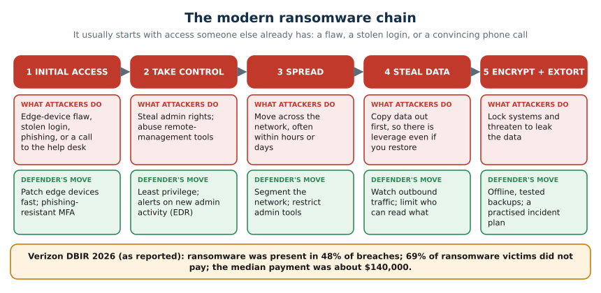
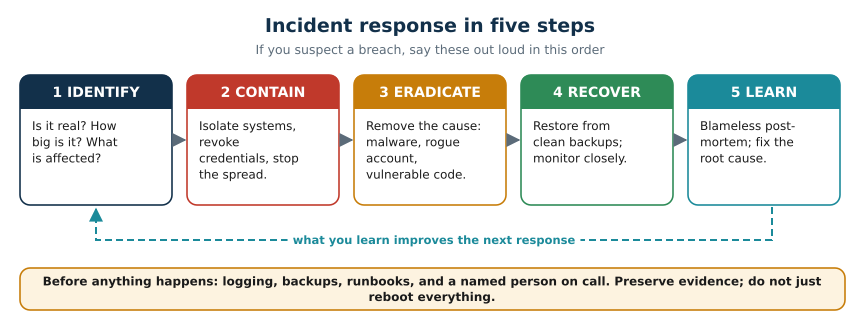

# Chapter 11: Ransomware, Malware and Incident Response

> **Goal.** After this chapter you can: describe the modern ransomware chain and its double-extortion model; give the key numbers; name the malware types worth knowing; explain what to log and why detection speed matters; and recite the five incident-response steps with a worked scenario.
>
> **Time:** about 1.5 hours. **Still relevant in 2026?** Very: ransomware was present in about 48% of breaches in Verizon's 2026 report. The old malware zoo (rootkits, viruses) is trimmed to what interviews actually ask. **Companion reading:** Bab 9 and Bab 10 of your Indonesian book.

---

## 1. Ransomware today: it is mostly a business, not a virus

**Ransomware** is malware that locks your data and demands payment. The modern form is run like an industry: specialist groups sell or buy **access** (a stolen login, a hacked VPN), others run the intrusion, and many operate "ransomware-as-a-service".

**The five stages**, and where defenders win:

1. **Initial access.** Edge-device flaws (VPNs, firewalls, file-transfer tools), stolen or bought logins, phishing, or a call to the help desk (Chapters 6 and 9).
2. **Take control.** Steal admin rights; abuse legitimate remote-management tools so activity looks normal.
3. **Spread.** Move across the network; industry reporting says some intrusions go from first access to encryption in **hours**.
4. **Steal data.** Copy data out first.
5. **Encrypt and extort.** Lock systems *and* threaten to publish the stolen data: **double extortion**.

> **Why backups alone are not enough.** Good backups answer *"can we restore?"* but not *"what if they publish our customers' data?"* That is why attackers steal first. You need both: **tested offline backups** *and* **limits on what an intruder can read and copy** (least privilege, segmentation, outbound monitoring).

**The numbers (Verizon DBIR 2026, as reported by TechTarget and Help Net Security):**

- Ransomware was present in **48%** of breaches (up from 44%).
- **69%** of ransomware victims did **not** pay; the median payment fell to about **$140,000** (from $150,000).

> **Real case: Change Healthcare (2024).** The attackers entered on 12 February 2024 through a remote-access portal with **no MFA**, using stolen credentials, then spent about nine days inside before deploying ransomware. The company later reported that roughly **190 million** people were affected. It shows every stage above, and that a single missing control (MFA) plus too much internal freedom produced one of the largest healthcare breaches ever reported.

**A ransomware-readiness checklist** (a good structure for an interview answer):

| Area | Do this |
| --- | --- |
| **Keep them out** | Patch edge devices first; phishing-resistant MFA on every remote path; retire old accounts |
| **Slow them down** | Least privilege; segmentation; limit admin tools |
| **See them** | EDR on endpoints; alerts on new admin activity and large outbound transfers |
| **Survive it** | Offline or immutable, **tested** backups; documented restore order |
| **Respond** | A practised incident plan; decide *in advance* who can authorize what; know your legal and notification duties |

> **Common mistake.** Treating payment as a plan. Paying doesn't guarantee decryption or deletion, may be illegal in some situations, and marks you as a payer. Plan to **not need to pay**.

---

## 2. Malware: what interviews actually ask

**Malware** is software built to harm or abuse a system. The words below describe *behaviour*, and they overlap. The first three are the classic quiz; the rest are what you will actually read about now.

| Type | What it does | Key point |
| --- | --- | --- |
| **Virus** | Attaches itself to files; spreads when they are run or shared | Needs a host program |
| **Worm** | Spreads **by itself** across networks, no user action | The Shai-Hulud package worm (Chapter 12) is a modern example |
| **Trojan** | Pretends to be legitimate software | Relies on the user installing it |
| **Ransomware** | Encrypts data and demands payment | Defence: tested backups, MFA, patching |
| **Infostealer** | Quietly copies saved passwords, cookies and tokens from a device | Feeds credential stuffing and session theft (Chapter 9) |
| **Remote-access tool / RAT** | Gives an attacker remote control; often a *legitimate* admin tool misused | Why "allowed software" lists and monitoring matter |
| **Wiper** | Destroys data or devices rather than ransoming them | Often political; backups and segmentation limit damage |
| **Botnet** | Many infected devices under one controller | Powers DDoS (Chapter 10) |

(Rootkits, boot-sector viruses and similar are "know the name": software that hides itself, rarely a first-order interview topic now.)

**How malware arrives today:** phishing links and attachments, **fake software downloads and updates**, **poisoned packages and developer tools** (Chapter 12), unpatched internet-facing systems, and stolen logins (no malware needed at all).

**Defences:** patching, endpoint protection (EDR), least privilege, restricting what can be installed, email filtering, and **offline backups**.

> **Interview angle.** "Virus vs worm?" → *"A virus needs a host file and a user action; a worm spreads by itself across the network."* Then show you're current: *"The more relevant modern threats are infostealers, which feed credential theft, and ransomware crews that buy that access."*

---

## 3. Logging and detection (OWASP A09)

You cannot respond to what you cannot see. Breaches go unnoticed when nothing is logging, or nobody is looking.

**Log:** authentication successes and failures, access-control failures, privilege changes, administrative actions, and unusual data access, each with time, user, source and outcome.

**Don't log:** passwords, tokens, full card numbers, or secrets (logs are often less protected than databases).

**Make it useful:** send logs to a **central, separate** system so an intruder can't erase them, **alert** on the few signals that matter (impossible-travel logins, new admin accounts, mass downloads), and **practise** reading them. A **SIEM** collects and correlates; **EDR** watches the devices. Detection speed matters because modern intrusions can move from access to encryption within hours.

---

## 4. Incident response: five steps

When you suspect a breach, panic is the enemy. A calm, ordered process beats improvisation.

| Step | Goal | Example actions |
| --- | --- | --- |
| **1. Identify** | Confirm it is real; scope it | Review alerts and logs; which systems, which accounts, since when? |
| **2. Contain** | Stop the spread | Isolate affected hosts, revoke leaked credentials **and sessions**, block attacker access. Do this before cleaning up. |
| **3. Eradicate** | Remove the cause | Delete malware, close the vulnerability, remove rogue accounts |
| **4. Recover** | Return to normal safely | Restore from **clean** backups, patch, monitor closely |
| **5. Learn** | Stop it happening again | A **blameless** post-mortem: timeline, root cause, fixes |

This matches the widely used NIST incident-response lifecycle (preparation; detection and analysis; containment, eradication and recovery; post-incident activity).

> **Common mistake.** Rebooting or wiping the machine immediately. You destroy the **evidence** (memory, logs) you need to learn how the attacker got in, and you may tip them off. Contain first (isolate from the network), preserve evidence, then clean.

**Worked scenario: "A user says someone accessed their account."**

1. *Identify:* check authentication logs for that account: times, IP addresses, devices, new mailbox rules or MFA devices.
2. *Contain:* **revoke all active sessions and tokens** (not only the password: stolen sessions survive a password change), reset credentials, re-register MFA.
3. *Scope:* is it one account or a pattern (credential stuffing, an AiTM campaign)? Look for similar logins across other accounts.
4. *Eradicate and recover:* close the cause (for example, missing rate limiting or non-phishing-resistant MFA), notify the affected user, monitor.
5. *Learn:* write down what would have caught this sooner.

---

## Check yourself

1. What are the five stages of the modern ransomware chain?
2. Why aren't backups a complete answer to ransomware?
3. Give two numbers from Verizon's 2026 report about ransomware.
4. Virus vs worm in one sentence. Name one modern malware type that feeds credential theft.
5. List the five incident-response steps. Why contain *before* eradicate?
6. In the "account accessed" scenario, why must you revoke sessions and not just reset the password?

**Answers** *(cover this until you have tried)*

1. Initial access, take control, spread, steal data, encrypt and extort.
2. Backups let you restore, but attackers steal the data first (double extortion) and threaten to publish it. You also need least privilege, segmentation and outbound monitoring.
3. Ransomware was present in about 48% of breaches; 69% of victims did not pay; the median payment was about $140,000.
4. A virus needs a host file and a user action; a worm spreads by itself. The infostealer (it copies saved passwords, cookies and tokens).
5. Identify, contain, eradicate, recover, learn. Containing first stops the spread; cleaning up first can destroy evidence and let the attacker keep moving.
6. A stolen session cookie keeps working after a password change until it expires or is revoked.

---

## Summary

- Ransomware is an industry: access is bought, data is stolen first, then systems are locked (double extortion). 48% of breaches in 2026; 69% of victims didn't pay.
- Defend the whole chain: patch edge devices, phishing-resistant MFA, least privilege, EDR, outbound monitoring, tested offline backups, a practised plan.
- Malware to know: virus/worm/trojan for the quiz; ransomware, infostealer and remote-access tools for the real world.
- Log the right events centrally and alert on few, important signals.
- Incident response: identify, contain, eradicate, recover, learn; revoke sessions, preserve evidence, keep post-mortems blameless.
