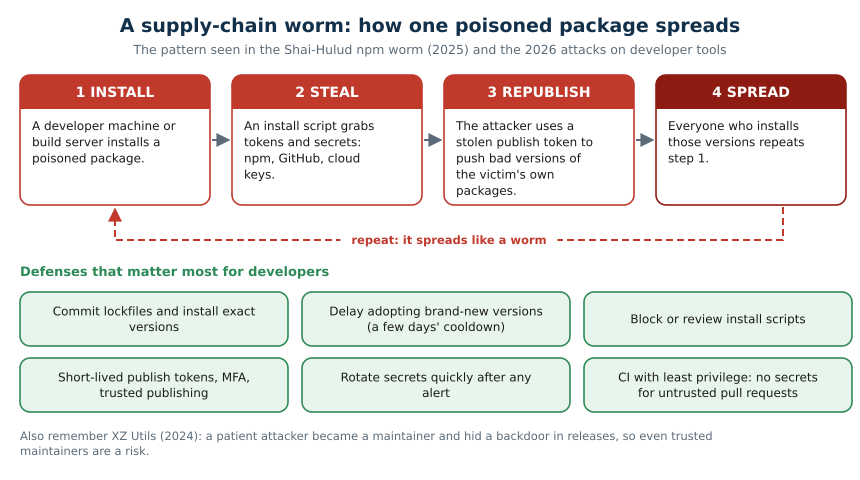

# Chapter 12: Supply Chain, Third Parties, Cloud and Secure Development

> **Goal.** After this chapter you can: explain third-party and software supply-chain risk with recent cases; list the developer defences against poisoned packages; explain the most common cloud mistakes and how secrets leak; use STRIDE to threat-model a feature; and describe a secure development pipeline (SAST, DAST, SCA, secret scanning).
>
> **Time:** about 1.5 hours. **Still relevant in 2026?** Very: third parties were involved in about 48% of breaches in Verizon's 2026 report (up from 30%), and OWASP added Software Supply Chain Failures as its own category (A03). **This chapter is where a software engineer has the most to say.**

---

## 1. Third-party risk: your vendor's breach is your breach

Modern products are built from other people's services: SaaS tools, APIs, integrations, hosting. Each one that holds your data or has a connection into your systems is part of your attack surface.

| Pattern | What happens | Recent example |
| --- | --- | --- |
| **Vendor hosts your data** | The vendor is breached; your data is stolen | Klue (2026): about 200 downstream companies affected via one stolen credential |
| **Vendor connection or token** | A stolen integration token reads your data | Salesloft Drift (2025): OAuth tokens used against many Salesforce accounts |
| **Vendor's product has a flaw** | You run it, so you are exposed | MOVEit Transfer (2023): a SQL injection flaw in a file-transfer product |

**What to do about it (as an engineer):**

1. **Inventory** every vendor and integration that touches your data or systems.
2. **Least privilege** on every integration (narrow scopes, read-only where possible).
3. **Be able to revoke fast:** know where every token and key lives.
4. **Assume a vendor will be breached** and limit what they hold (minimize data, encrypt, tokenize).
5. **Ask for evidence** (security reports, breach-notification terms) before onboarding.

---

## 2. The software supply chain: your dependencies are code you didn't write

A typical project has hundreds or thousands of transitive dependencies. If an attacker compromises one, they run code on your developers' machines and build servers, often with access to secrets.

| Pattern | What happens |
| --- | --- |
| **Compromised package or maintainer** | An attacker takes over a maintainer's account (or becomes one) and publishes a bad version |
| **Typosquatting** | A malicious package with a near-identical name |
| **Dependency confusion** | A public package shadows the name of an internal one |
| **Compromised build or CI** | Attackers alter what the pipeline produces |
| **Install-time scripts** | Code that runs automatically when a package is installed |

> **Real case: Shai-Hulud npm worm (September and November 2025).** The first wave was described as the first self-propagating npm worm: at install time it **harvested credentials** from the developer's machine, published them to public GitHub repositories, and used stolen npm tokens to **publish infected versions of the victim's other packages**. Reports counted **180+ packages** in September and, for the second wave in November, almost **500 packages and more than 26,000 GitHub repositories**. *Lesson:* installing a dependency can *run code with your credentials*, and one stolen token can turn a developer into the next distributor.

> **Real case: XZ Utils (2024).** An attacker using the persona "Jia Tan" spent about **two years building trust** as a co-maintainer of the widely used XZ compression library, then slipped a backdoor (CVE-2024-3094) into releases that interfered with SSH authentication on some Linux systems. It was discovered **by chance** by a Microsoft engineer, Andres Freund, who noticed odd behaviour. *Lesson:* even trusted open-source maintainers are a risk, and many projects are run by a few overstretched volunteers.

> **Real case: developer tools (2026).** TechCrunch's 2026 roundup reports that backdoored developer tools, including Trivy, the Bitwarden CLI, Checkmarx and a popular npm package, were used to steal passwords and tokens in March-April 2026, with OpenAI, Vercel and an EU cyber agency among those who confirmed downstream impact. (The compromises were confirmed; wider details are as reported.) *Lesson:* attackers now target the **tools developers trust most**. SolarWinds (2020), where a compromised build system shipped malicious updates, is the classic ancestor.

### Developer defences (the list to memorize)

1. **Commit lockfiles and install exact versions**; review dependency updates instead of auto-merging.
2. **Delay adopting brand-new versions** for a few days (a "cooldown"), since malicious versions are usually caught quickly.
3. **Block or review install scripts** where your package manager allows.
4. **Scan dependencies** for known vulnerabilities (SCA: `npm audit`, `pip-audit`, Dependabot, Snyk).
5. **Keep an SBOM** (Software Bill of Materials): a list of what is in your software, so when the next Log4Shell lands you can answer "are we affected?" in minutes.
6. **Short-lived, least-privilege tokens**; MFA on registry accounts; use **trusted publishing** where supported.
7. **Harden CI/CD:** no secrets for untrusted pull requests, protected branches, reviewed pipeline changes.
8. **Minimize dependencies.** Every package is attack surface.

---

## 3. Cloud misconfiguration and leaked secrets

Cloud services are secure by design but insecure by *configuration*. **A02 Security Misconfiguration** rose to #2 in the 2025 OWASP list for a reason.

**The usual mistakes:**

| Mistake | Why it hurts | Fix |
| --- | --- | --- |
| **Public storage or databases** | Data readable by anyone | Private by default; block public access at the account level |
| **Over-broad cloud roles** | One stolen key reaches everything | Least-privilege IAM; separate roles per service |
| **Long-lived access keys** | A leaked key works for years | Short-lived credentials (roles, workload identity) |
| **Secrets in code, config or CI logs** | Anyone with repo or log access has the keys | Secrets manager; secret scanning; rotate on exposure |
| **Forgotten test and "temporary" resources** | Nobody patches or watches them | Inventory; auto-expiry; tag owners |

> **Real case: exposed document stores (2026).** TechCrunch's 2026 roundup reports several incidents where identity documents were exposed through **publicly accessible servers or security lapses** (a hotel check-in system with about 1 million passports and driver's licences; a money-transfer app; a prison-payphone provider with data on 300,000+ callers; a UK visa portal), together more than 2 million people's documents. These were reported exposures rather than hacks. *Lesson:* many "breaches" are just something left open, and the fix is configuration discipline and monitoring for public exposure.

**Cloud keys are crown jewels.** In 2026 an EU cyber agency confirmed a major data theft after attackers got its **cloud keys** (the same roundup lists it alongside the developer-tool wave above). Treat any key as something that *will* leak and design so a leaked key has limited power and a short life.

---

## 4. Build security in: threat modeling with STRIDE

**Threat modeling** means asking, *before you build*: "What can go wrong?" It addresses **A06 Insecure Design**: flaws that no later patching fully fixes. **STRIDE** is a six-question checklist (from Microsoft); each letter is the opposite of a security property.

| Letter | Threat | Property violated | Example | Typical mitigation |
| --- | --- | --- | --- | --- |
| **S** | **Spoofing** | Authentication | Logging in as someone else | Strong auth, passkeys, MFA |
| **T** | **Tampering** | Integrity | Editing a price in a request | Server-side validation, signatures |
| **R** | **Repudiation** | Non-repudiation | "I never made that transfer" | Audit logs |
| **I** | **Information disclosure** | Confidentiality | A leaked database | Encryption, access control |
| **D** | **Denial of service** | Availability | Flooding the API | Rate limiting, scaling |
| **E** | **Elevation of privilege** | Authorization | A normal user becoming admin | Least privilege, checks on every request |

**How to use it in 5 minutes:** draw the feature as boxes and arrows (user, browser, API, database, third party). For each arrow and box ask the six STRIDE questions and write one mitigation per realistic threat. That is a threat model, and you can describe doing it in an interview. (Lab 12 practises it.)

---

## 5. A secure delivery pipeline (the interview answer)

| Stage | Practice | Tool type |
| --- | --- | --- |
| **Design** | Threat model; define who may do what | STRIDE, data-flow diagram |
| **Code** | Secure defaults; peer review with a security checklist | Linters, review checklists |
| **Commit** | Block secrets before they land | **Secret scanning** (pre-commit and server-side) |
| **Build (CI)** | Analyze source; check dependencies | **SAST** (static analysis), **SCA** (dependency scan) |
| **Test** | Probe the running app | **DAST** (dynamic testing), API tests for authorization |
| **Release** | Sign artifacts; keep an SBOM | Provenance and signing |
| **Run** | Least-privilege runtime; logging and alerts | WAF, monitoring, EDR |

> **Treat AI-generated code like code from a stranger.** AI assistants are fast and often omit authorization checks, use unsafe escape hatches (`innerHTML`), or suggest outdated or even non-existent packages. Review it the way you would review an unfamiliar contributor's pull request, and make sure the same scanners run on it. (More in Chapter 13.)

> **Interview angle.** "How do you build security into development?" → *"I threat-model new features early with STRIDE; follow secure defaults like parameterized queries, output encoding and per-object authorization; run secret scanning, SAST and dependency scanning in CI plus DAST on staging; pin and review dependencies and keep an SBOM; keep secrets in a manager with short-lived credentials; and use least privilege for services and CI."*

---

## Check yourself

1. What share of breaches involved a third party in Verizon's 2026 report?
2. Describe the Shai-Hulud worm in two sentences.
3. Name four developer-level defences against poisoned dependencies.
4. Why was the XZ Utils attack so alarming?
5. Name three common cloud misconfigurations and the fix for each.
6. What do the letters S, T, R, I, D, E stand for?

**Answers** *(cover this until you have tried)*

1. About 48%, up from about 30% the year before.
2. It ran at install time, stole credentials from the developer's machine, and used stolen npm tokens to publish infected versions of the victim's other packages, so it spread by itself. Two waves in 2025 hit hundreds of packages.
3. Any four of: lockfiles and exact versions, a cooldown on new versions, blocking install scripts, dependency scanning, an SBOM, short-lived tokens with MFA and trusted publishing, hardened CI, fewer dependencies.
4. A patient attacker earned maintainer trust over about two years, hid the backdoor in release tarballs, and it was caught only by chance.
5. For example: public storage (private by default), over-broad roles (least-privilege IAM), long-lived keys (short-lived credentials), secrets in code (secrets manager and scanning), forgotten resources (inventory).
6. Spoofing, Tampering, Repudiation, Information disclosure, Denial of service, Elevation of privilege.

---

## Summary

- Third parties are in about half of breaches: inventory vendors, give integrations least privilege, be able to revoke fast.
- Supply-chain attacks target what developers trust: packages (Shai-Hulud), maintainers (XZ), tools (2026). Lockfiles, cooldowns, scanning, SBOM, short-lived tokens, hardened CI.
- Cloud incidents are mostly configuration: private by default, least-privilege roles, short-lived keys, secrets in a manager.
- STRIDE turns "build it secure" into a five-minute habit.
- A secure pipeline: threat model, secret scanning, SAST, SCA, DAST, signing, monitoring. Review AI-generated code like a stranger's.
