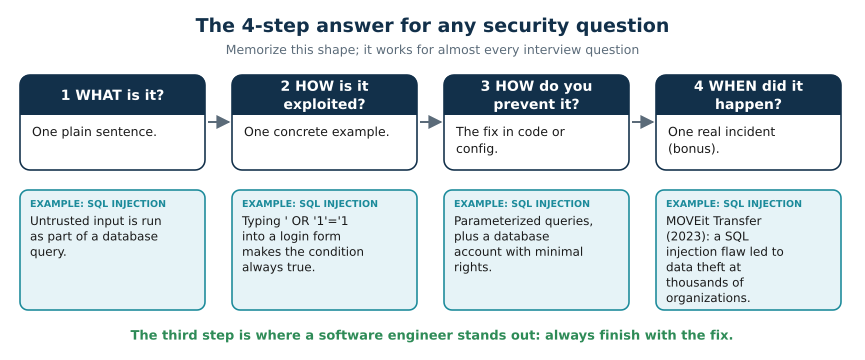

# Start Here

> **Goal.** After this book you can answer the security questions a frontend, backend or full-stack interview asks, review AI-written code for the bugs that matter, and say how you use coding agents without handing an attacker your laptop, your tokens or your pipeline.
>
> **Time:** one month at about 10 hours a week (evenings plus weekends). Reading all chapters takes about 10-12 hours; the rest is labs and drills.

---

## What this book is

This is the **AI-agent-era edition of *Secure Coding for Frontend and Backend Engineers***. It keeps the original's developer focus (the bugs you create or prevent in a pull request) and compacts it from about 30,000 to about 16,000 words. Every chapter has an **AI-agent era** callout: what changes when an agent writes, installs or runs this code. Two chapters are new: **Chapter 1** (what changed) and **Chapter 6** (using coding agents safely).

It is for you if you are a working engineer with a security-flavoured interview ahead. It is not a pentester or SOC-analyst course; for broad security vocabulary (networking, scanning, ransomware, incident response) use the companion book, *Interview Prep: AI-Agent-Era Edition*.

## The one idea

> **Agents write code faster than you can read it, so your value moves from typing to judging.** Know what is wrong and why, control what the agent can read and do, and rely on tests and gates that catch the mistakes both of you make.

## Pick your track

| | **Frontend track** | **Backend track** |
| --- | --- | --- |
| Go deep on | Ch 2 (XSS sinks, CSP, cookies, CORS, Next.js and React Server Components), Ch 3 (token storage, BFF, OAuth with PKCE, passkeys) | Ch 3 (sessions vs JWT, authorization, BOLA, multi-tenancy), Ch 4 (injection, SSRF, uploads, webhooks, secrets) |
| Skim | Ch 4 | Ch 2 |
| Labs | 2 (XSS and CSP), 3 (JWT) | 1 (BOLA), 4 (webhook), 6 (rate limit), 7 (SSRF) |
| Everyone | Ch 1, 5 (supply chain and CI), 6 (agents), 7 (AI features), 8 (code review), 9 (Q&A) | same |

## The four-week plan

| Week | Read | Do |
| --- | --- | --- |
| **1** | Ch 1, Ch 2, Ch 3 | Labs 1 and 3; start Juice Shop (Ch 11) |
| **2** | Ch 4, Ch 5 | Labs 2, 4, 5; run `npm audit` and a secret scan on your own repo |
| **3** | Ch 6, Ch 7, then your track in depth | Agent labs A1-A4; Labs 6 and 7 |
| **4** | Ch 8 (code-review drill), Ch 9 (Q&A), Ch 10 (cheat sheets) | The timed 15-snippet drill and a mock interview |

**Weekday rhythm (about 90 minutes):** 30 minutes read, 30 lab, 20 saying answers aloud, 10 writing what you got wrong. **Two-week version:** Chapters 2, 3, 6, 8 and 9, plus Labs 1, 3 and A1.

## How to answer

Use one shape: **threat, control (with a one-line example), a backup layer, how you would test it.**

## Rules for practice

Test only systems you own, deliberately vulnerable training apps, training sites that invite attacks, or systems you have written permission to test. Bind lab apps to `127.0.0.1`.

## Accuracy

Security facts change quickly. Incident figures are reported estimates, and Verizon figures come from news coverage of the report. The last chapter says what was read and what is only reported. Say "according to" when you quote a number.
