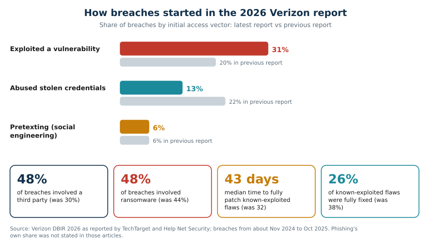

# Chapter 1: What Changed in the AI-Agent Era

> **Goal.** After this chapter you can: explain in three minutes how AI agents change software security, quote a few facts with their sources and caveats, and say which parts of the old advice still hold.
>
> **Time:** about 30 minutes.

---

## 1. Four shifts

| Shift | What it means for you |
| --- | --- |
| **1. Code is cheap, review is scarce** | Agents produce large diffs in minutes. The bottleneck, and the risk, moves to reading and testing. |
| **2. The agent is a new insider** | It reads files, runs commands and uses your tokens. Anything that steers it (a poisoned file, issue or web page) steers a process with *your* permissions. |
| **3. Attackers use agents too** | Finding and exploiting known bugs is faster, so slow patching hurts more. |
| **4. The supply chain got a new entry point** | Agents choose and install dependencies, sometimes names that do not exist, and malware can now call the AI tools already on a developer's machine. |

## 2. What the evidence says (with caveats)

> **Read this table as "reported", not "settled".** Most figures come from vendors or news coverage and measure different things. Say "according to" in an interview.

| Claim | Source and caveat |
| --- | --- |
| **AI-generated code often fails security tests.** Veracode's 2026 report found an average pass rate of **56%** (about 44% failed), "virtually unchanged" from the year before; its 2025 report reported about 45% of samples failing. | Veracode press release, 28 Jul 2026 (read). Vendor research on raw models, without agents, guardrails or human review. |
| **Models invent package names.** A USENIX Security 2025 study (16 models, 576,000 code samples) found at least **5.2%** hallucinated packages for commercial models and **21.7%** for open-source models, with **205,474** unique made-up names. | arXiv abstract (read). Newer models may do better; reported follow-ups are not peer reviewed. |
| **Agents can be turned against their users.** In 2025-26 researchers reported prompt-injection and command-approval-bypass bugs in several coding tools (GitHub Copilot, Cursor, Claude Code, MCP tooling), and a malicious prompt reached a published Amazon Q Developer extension release. | Chapter 6 lists them with their confidence level. |
| **Attackers automate with AI.** Anthropic reported (13 Nov 2025) that a state-sponsored group used Claude Code to run **80-90%** of a cyber-espionage campaign against about **30** targets; a small number succeeded, and the model sometimes hallucinated results. | Anthropic's report (read). |
| **Exploitation is getting faster.** Several vendors report that the time from disclosure to a working exploit has shrunk to days or hours. | Vendor figures with different metrics; check the originals before quoting a number. |
| **Known-exploited flaws are fixed slowly.** Per news coverage of the Verizon 2026 DBIR: exploitation was about 31% of breach starts, third parties were involved in about 48% of breaches, and only 26% of known-exploited flaws were fully fixed (median 43 days). | TechTarget and Help Net Security (not the report itself). |

## 3. What did *not* change

- **The bugs are the same.** BOLA, injection, XSS, broken authentication, weak secrets and dependency compromise are still the top causes. An agent reproduces them from its training data.
- **The principles are the same.** Least privilege, defence in depth, validate at trust boundaries, fail closed, test your assumptions.
- **Interviews still ask the classics.** Expect the chapters 2-5 questions, plus "how do you use AI tools safely?".

## 4. What you must add

1. **A review habit** for code you did not type (Chapter 8).
2. **Control of the agent's reach**: permissions, sandbox, secrets, tokens (Chapter 6).
3. **Gates that do not trust anyone**, human or agent: tests, scanners, dependency checks, protected branches (Chapter 5).
4. **Security requirements in the prompt and in the tests.** An interview study (SOUPS 2026, 15 engineers, reported) found none of them specified security requirements in their prompts; a one-line constraint list costs nothing.

> **AI-agent era.** The sentence to remember: *"The agent is fast and confident, not accountable. I own the diff."*

---

## Check yourself

1. Name the four shifts.
2. Why is "the agent is a new insider" a useful model?
3. Which statistic would you quote on AI code quality, and with what caveat?
4. Name two things that did not change.

**Answers** *(cover this until you have tried)*

1. Review is the bottleneck; the agent is a new insider; attackers use agents; the supply chain has a new entry point.
2. It acts with your permissions and reads untrusted content, so anything that steers it acts as you; the usual insider controls (least privilege, approval, logging) apply.
3. Veracode 2026: about 56% pass rate; vendor research on raw models, so it shows a tendency, not your agent's exact behaviour.
4. The classic bug classes and the principles (least privilege, defence in depth, validate at boundaries).

---

## Summary

- Review is the bottleneck, and the agent is a new insider with your permissions.
- Evidence is mostly vendor or press: use "according to".
- The old bugs and principles still apply; add review, agent control, gates and security in your prompts and tests.
