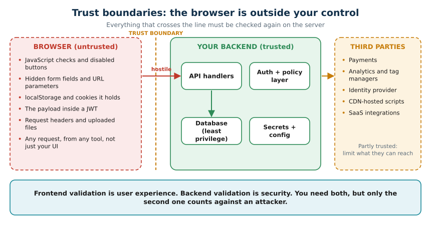
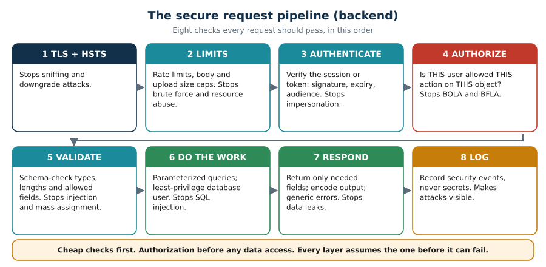
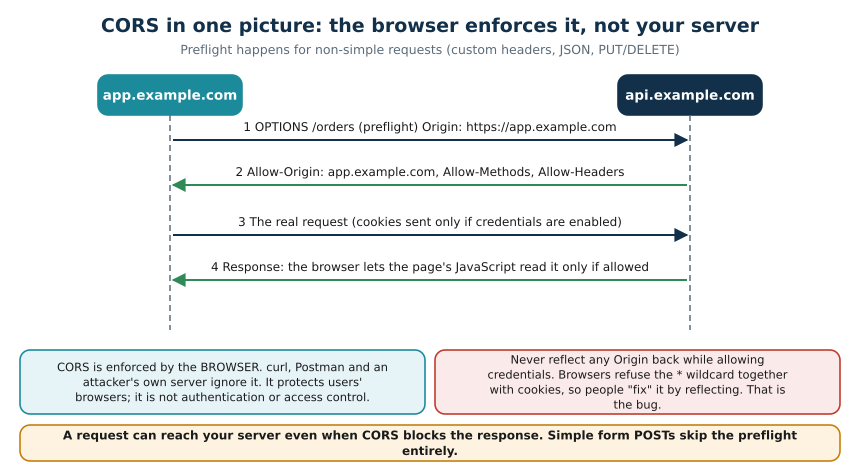
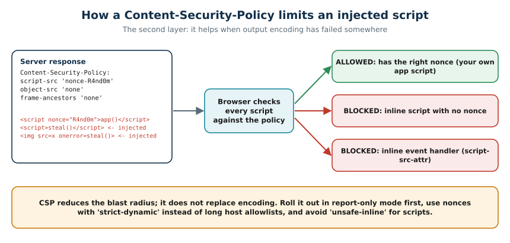
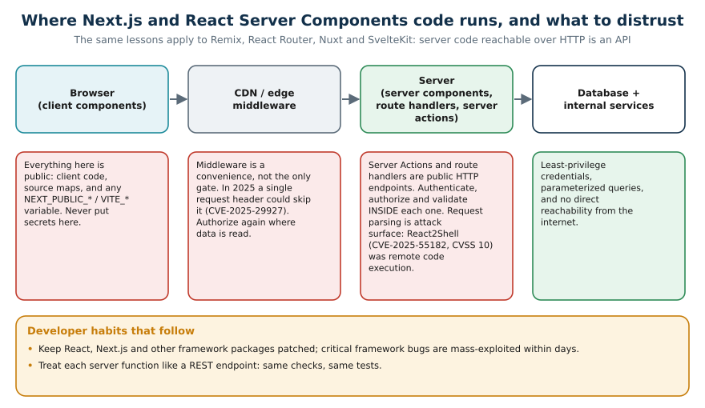

# Chapter 2: Web Foundations

> **Goal.** After this chapter you can: draw the trust boundary of a web app and recite the eight-step secure request pipeline; explain the same-origin policy, cookie flags, CSRF and CORS (and what CORS is *not*); set security headers and a nonce-based CSP; name the XSS sinks in React and the DOM; and describe what React2Shell and the Next.js middleware bypass teach.
>
> **Time:** about 75 minutes.

---

## 1. Trust boundaries



**Everything in the browser is controlled by the user (or an attacker):** JavaScript checks, hidden fields, cookies, headers, URLs. **Everything on your server is controlled by you.** The line between them is the **trust boundary**.

1. **Validate on the server.** Frontend validation is UX; backend validation is security.
2. **Authorize on the server, every request.** A React route guard is a convenience.
3. **Treat third parties as partly trusted.** A tag-manager script runs with your page's powers.

> **AI-agent era.** An agent writes whatever makes the feature *work*, and "works" rarely includes "is checked on the server". Generated code often validates in the form component and trusts the request in the handler. In review, ask for every input: *where is this checked on the server?*

## 2. The secure request pipeline



| # | Step | Stops |
| --- | --- | --- |
| 1 | **TLS + HSTS** | Sniffing, downgrade |
| 2 | **Limits** (rate, size) | Brute force, resource abuse |
| 3 | **Authenticate** | Impersonation |
| 4 | **Authorize** (per object) | BOLA, BFLA |
| 5 | **Validate** (schema) | Injection, mass assignment |
| 6 | **Do the work** (parameterized, least privilege) | SQL injection |
| 7 | **Respond** (minimal fields, encoded, generic errors) | Data leaks, XSS |
| 8 | **Log** (no secrets) | Invisible attacks |

Use it as a review checklist: a generated endpoint that skips steps 2, 4 or 5 is the usual finding.

## 3. Same-origin policy and cookies

An **origin** is scheme + host + port. The **same-origin policy** stops a page from one origin *reading* data from another. It does **not** stop *sending*: a malicious page can make your browser send a request to your bank, and the browser attaches your cookie. That is CSRF.

| Cookie attribute | Defends against |
| --- | --- |
| **HttpOnly** (scripts can't read it) | Cookie theft via XSS |
| **Secure** (HTTPS only) | Sniffing |
| **SameSite=Lax/Strict** | CSRF (set it explicitly; defaults vary by browser) |
| **`__Host-` prefix** (forces Secure, `Path=/`, no `Domain`) | Subdomain cookie overwriting |
| **Short Max-Age** | Long-lived stolen sessions |

```ts
res.cookie("__Host-sid", sessionId, { httpOnly: true, secure: true, sameSite: "lax", path: "/", maxAge: 8 * 3600 * 1000 });
```

## 4. CSRF

The browser sends your cookie on a request you never intended. **Defences:** `SameSite` cookies; a CSRF token or an `Origin` check on state-changing requests; a custom header for JSON APIs; never change state on `GET`; re-authenticate for sensitive actions. A bearer token in an `Authorization` header is not sent automatically, so classic CSRF doesn't apply, but once the token sits in a cookie it does.

## 5. CORS



**CORS** lets a server tell the *browser* which other origins may **read** its responses. It is **not** authentication, authorization or CSRF protection: curl and an attacker's server ignore it.

```ts
app.use(cors({ origin: true, credentials: true }));      // VULNERABLE: reflects ANY origin and allows credentials
const ALLOWED = new Set(["https://app.example.com"]);     // FIXED: exact allowlist
app.use(cors({ origin: (o, cb) => cb(null, !o || ALLOWED.has(o)), credentials: true }));
```

Also avoid allowing `null`, and anchor any regex (`/example\.com$/` matches `evilexample.com`).

> **AI-agent era.** When a frontend can't reach the API, the fastest "fix" an agent offers is `cors({ origin: true, credentials: true })` or `*`. It makes the error vanish and opens the API to every site. Treat any CORS change in a diff as a security change.

## 6. Security headers and CSP

| Header | Value (starting point) |
| --- | --- |
| `Strict-Transport-Security` | `max-age=63072000; includeSubDomains` |
| `X-Content-Type-Options` | `nosniff` |
| `Referrer-Policy` | `strict-origin-when-cross-origin` |
| `Permissions-Policy` | `camera=(), microphone=(), geolocation=()` |
| `Cache-Control` (sensitive) | `no-store` |
| `Content-Security-Policy` | nonce-based, see below |

In Express, `app.use(helmet())` is a good baseline; review its defaults against your app.



```
default-src 'self';
script-src 'self' 'nonce-{RANDOM_PER_RESPONSE}' 'strict-dynamic';
object-src 'none'; base-uri 'self'; frame-ancestors 'none'; form-action 'self'
```

Roll it out as `Content-Security-Policy-Report-Only` first, then enforce. Avoid `'unsafe-inline'` and `'unsafe-eval'` for scripts. **CSP reduces the blast radius of XSS; it does not replace output encoding.**

## 7. XSS today: a developer switching protection off

React and Vue escape output by default. XSS now comes from the **sinks**:

```tsx
<div dangerouslySetInnerHTML={{ __html: comment }} />            // VULNERABLE with user content
<p>{comment}</p>                                                  // SAFE: text
<a href={profile.website}>site</a>                                // VULNERABLE: javascript: URL
// FIX: allowlist schemes http:, https:, mailto: via new URL(); otherwise use "#"
el.innerHTML = location.hash.slice(1);                            // VULNERABLE: DOM XSS
el.textContent = location.hash.slice(1);                          // SAFE
```

Other sinks: `eval`, `setTimeout("string")`, `document.write`, and `postMessage` handlers that don't check `event.origin`. If HTML is truly needed, sanitize with DOMPurify. Run [lab2_dom.html](labs/lab2_dom.html) to see the difference in a browser.

> **AI-agent era.** Generated frontend code reaches for `innerHTML` and `dangerouslySetInnerHTML` whenever a task says "render this HTML/Markdown". Add a lint rule or a `grep` check to CI so these sinks need an explicit human sign-off.

## 8. Next.js and React Server Components

**Server Actions and route handlers are public HTTP endpoints.** Authenticate, authorize and validate *inside each one*.

- **React2Shell (CVE-2025-55182, CVSS 10.0, December 2025):** unauthenticated remote code execution from a crafted request to Server Function endpoints, in `react-server-dom-*` 19.0 to 19.2.0 and the frameworks bundling them. Added to CISA's Known Exploited Vulnerabilities list on 5 December 2025. *Lesson:* framework patching is a security control with a deadline.
- **Next.js middleware bypass (CVE-2025-29927, CVSS 9.1, March 2025):** a request with the internal `x-middleware-subrequest` header could make Next.js skip middleware, defeating authorization that lived only there. Fixed in 12.3.5, 13.5.9, 14.2.25 and 15.2.3; the affected range varies by source, so check the advisory. *Lesson:* authorize where the data is read, not only in middleware.



## 9. TLS and HSTS in two lines

TLS encrypts and authenticates the connection; renew certificates automatically and never disable certificate verification (`rejectUnauthorized: false`, `verify=False`). HSTS tells browsers to use HTTPS only, which blocks downgrade attacks.

---

## Check yourself

1. Two URLs differ only in subdomain. Are they same-origin, and does the same-origin policy stop a malicious page from *sending* a request to your bank?
2. What do `HttpOnly`, `Secure`, `SameSite` and the `__Host-` prefix each do?
3. Why is `cors({ origin: true, credentials: true })` dangerous, and why isn't CORS access control?
4. What did CVE-2025-29927 teach about where to check authorization?

**Answers** *(cover this until you have tried)*

1. No: scheme, host and port must all match. And no: the policy stops *reading* the response, not sending; the browser still attaches cookies, which is what CSRF abuses.
2. HttpOnly: scripts can't read it. Secure: HTTPS only. SameSite: limits cross-site sending. `__Host-`: forces Secure, `Path=/` and no `Domain`.
3. It reflects any origin and allows credentials, so any website can read authenticated responses. CORS only governs what a *browser page* may read; curl and attacker servers ignore it.
4. A header could make Next.js skip middleware, so checks that lived only there were bypassed. Authorize in the route handler or data layer, and patch quickly.

---

## Summary

- The browser is outside your trust boundary: validate and authorize on the server through the eight-step pipeline.
- SOP blocks reading, not sending; cookies ride along, so use `HttpOnly`, `Secure`, explicit `SameSite`, plus CSRF defences.
- CORS is an allowlist of readers, never access control. Treat any CORS diff as a security change.
- Send HSTS, `nosniff`, a Referrer-Policy and a nonce-based CSP (report-only first); fix XSS at the sink.
- Server Actions are public APIs; middleware is not the only gate; patch React2Shell-class flaws fast.
