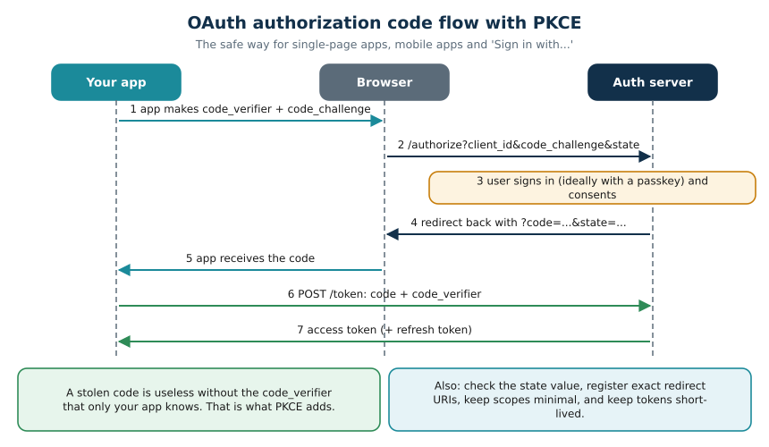
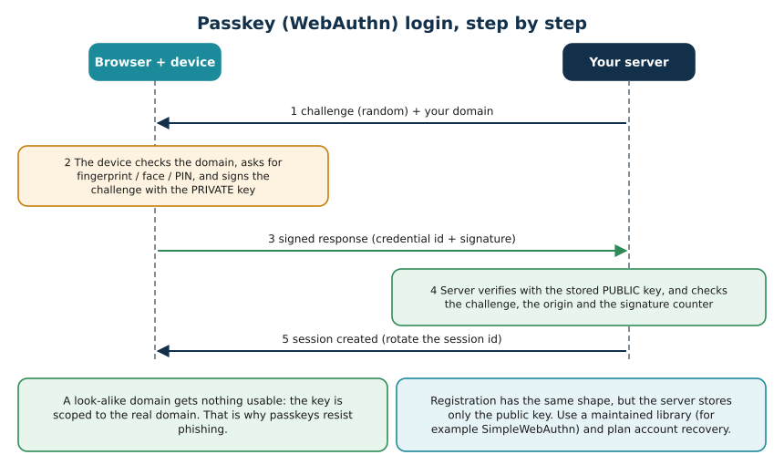
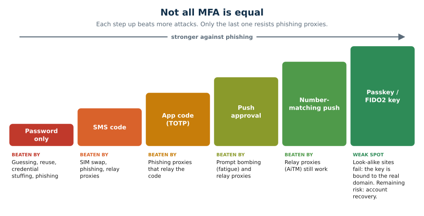
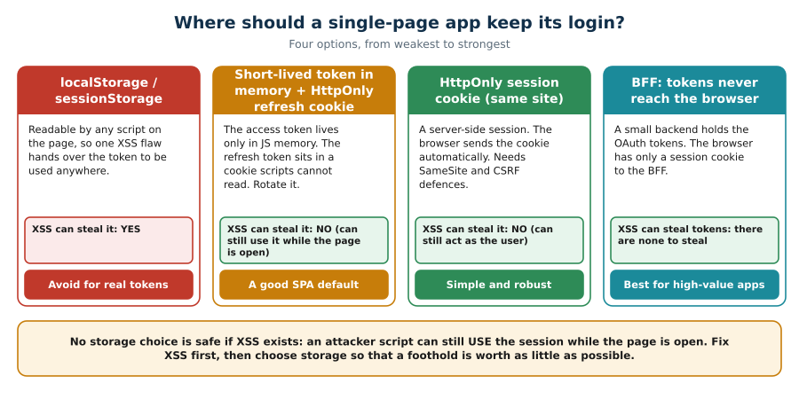
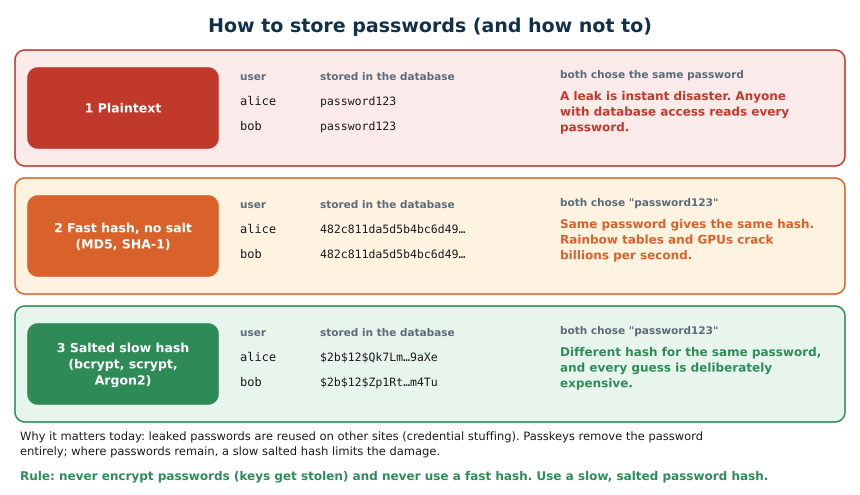
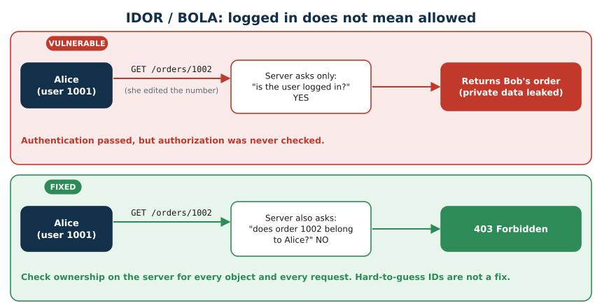

# Chapter 3: Identity and Access

> **Goal.** After this chapter you can: choose between sessions, JWTs, OAuth/OIDC and passkeys and justify it; verify a JWT correctly; explain PKCE; keep a single-page app's login out of `localStorage`; store passwords to OWASP's current minimums; and fix BOLA, BFLA, BOPLA and mass assignment, with the cross-user test that proves it.
>
> **Time:** about 90 minutes.

---

## 1. The decision map

| Need | Reach for |
| --- | --- |
| A normal web app with its own backend | **Server-side session in an HttpOnly cookie** |
| "Sign in with Google / company SSO" | **OAuth 2.0 + OIDC, authorization code with PKCE** |
| Service-to-service, mobile APIs | **Short-lived access tokens** (often JWTs), verified properly |
| Highest assurance for consumers | **Passkeys (WebAuthn)**, with a recovery plan |
| A SPA that needs OAuth tokens | **BFF** (a small server holds the tokens) |

Use your identity provider or a maintained library. Almost every authentication bug is a developer re-implementing something that already exists.

> **AI-agent era.** "Add login" is a prompt that invites a hand-rolled flow: a JWT in `localStorage`, a home-made hash, a custom reset link. Tell the agent which library or provider to use, and review authentication code more strictly than anything else it writes.

## 2. Sessions vs JWTs

A **session** stores data server-side and gives the browser a random ID in a cookie. It is simple and **revocable** (change a password, kill all sessions). Regenerate the ID on login (stops session fixation), set idle and absolute timeouts, and make logout destroy the server-side session.

A **JWT** is a signed, **not encrypted** bundle of claims; anyone can read the payload. Use it for stateless verification across services, and keep it short-lived.

```ts
const claims = jwt.decode(token);                 // VULNERABLE: does NOT check the signature
const { payload } = await jwtVerify(token, JWKS, {   // FIXED
  issuer: "https://idp.example.com/", audience: "api://orders", algorithms: ["RS256"],
});
```

**Verify the signature, pin the algorithm, and check `iss`, `aud` and `exp`.** Other mistakes: a weak HMAC secret, long-lived tokens with no revocation, secrets in the payload. Run [lab3_jwt.mjs](labs/lab3_jwt.mjs) to watch `decode` accept a forged role.

## 3. OAuth 2.0, OIDC and PKCE



**OAuth** lets an app act for a user without their password; **OIDC** adds login on top. Use the **authorization code flow with PKCE**: the app sends a hash of a random `code_verifier` first and must present the original to redeem the code, so **a stolen code is useless**. Register **exact redirect URIs**, validate `state`, request minimal scopes, rotate refresh tokens.

> **Real case: Salesloft Drift (August 2025).** Attackers obtained OAuth tokens for the Drift integration and pulled data from many customers' Salesforce accounts; Google's threat team said it knew of 700+ potentially impacted organizations. *Lesson:* an integration's token is your data. Give integrations least privilege and be able to revoke fast. ([The Hacker News](https://thehackernews.com/2025/08/salesloft-oauth-breach-via-drift-ai.html))

## 4. Passkeys, MFA and phishing



A **passkey** (WebAuthn / FIDO2) is public-key login **scoped to your real domain**: a phishing site gets nothing usable, and your database holds only public keys. Not all MFA is equal:



SMS < app code < push < number matching < **passkey**. **Adversary-in-the-middle (AiTM) phishing** relays a victim's login through a proxy and steals the *session*; codes and pushes can be relayed, passkeys can't. The weak spot is **account recovery** (and the help desk): the 2023 MGM and 2025 Marks & Spencer incidents were linked in public reporting to help-desk resets. Offer recovery codes, a second passkey, short sessions and one-click "revoke all sessions".

## 5. Where a SPA keeps its login



| Option | Stolen by XSS? | Verdict |
| --- | --- | --- |
| `localStorage` / `sessionStorage` | **Yes** | Avoid for real tokens |
| Access token in memory + HttpOnly refresh cookie | Long-lived token safe | Good SPA default |
| HttpOnly session cookie, same site | Can't be read | Simple and robust (needs CSRF defences) |
| **BFF** holding the tokens | Nothing in the browser | Best for high-value apps |

HttpOnly doesn't make XSS harmless: injected script can still *use* the session while the page is open. Fix XSS **and** pick storage that limits the damage.

> **AI-agent era.** Agents default to `localStorage.setItem("token", ...)` because most tutorials do. Add it to your review `grep` list and push for cookie or BFF designs.

## 6. Passwords (while you still have them)



| Algorithm | Minimum (OWASP Password Storage Cheat Sheet) |
| --- | --- |
| **Argon2id** (first choice) | `m=19456 KiB (19 MiB), t=2, p=1` |
| scrypt | `N=2^17, r=8, p=1` |
| bcrypt (legacy) | work factor 10+; **72-byte** input limit |
| PBKDF2-HMAC-SHA256 | 600,000 iterations |

Store the algorithm and parameters **with the hash** and rehash on login ([lab5_passwords.mjs](labs/lab5_passwords.mjs)). Allow long passphrases, check breached-password lists, skip composition rules, give the same error for "unknown user" and "wrong password", and **rate-limit per account and per IP**. Reset tokens: `crypto.randomBytes(32)` (never `Math.random()`), stored hashed, single-use, expiring in minutes; invalidate sessions after a reset.

## 7. Authorization: the #1 bug

**Authentication** asks *who are you?* (401). **Authorization** asks *what may you do?* and must run **on every request for every object**. Broken Access Control is #1 on the OWASP Top 10 (2025) and **BOLA is API1** on the OWASP API Security Top 10 (2023).



```ts
// VULNERABLE: any logged-in user can read any order
db.order.findUnique({ where: { id: req.params.id } });
// FIXED: the query is scoped to the caller; 404 hides existence
db.order.findFirst({ where: { id: req.params.id, ownerId: req.user.id } });
```

Scoped queries are safest: forget a separate `if` and you get *nothing*, not *everything*. Random UUIDs are not access control; IDs leak.

| Level | Question | Fix |
| --- | --- | --- |
| **Object** (BOLA, API1) | May this user touch *this object*? | Scope every lookup to owner or tenant |
| **Function** (BFLA, API5) | May this user call *this action*? | Role middleware, deny by default |
| **Property** (BOPLA, API3) | May this user see or set *this field*? | Allowlist input fields; shape responses |

**Mass assignment:** `db.user.update({ data: req.body })` lets a client send `isAdmin: true`. Validate with a strict schema (for example `z.object({...}).strict()`) and return DTOs, not raw database rows ([lab1_bola.mjs](labs/lab1_bola.mjs)).

**Multi-tenant apps:** take the tenant ID from the session, scope every query through one data layer, add database row-level security as a second layer, and test with two tenants. Also remember business logic: recompute prices on the server, enforce step order, and use atomic updates (`UPDATE ... WHERE balance >= $1`) against race conditions.

**Design rules:** deny by default; identity comes from the session, never from the request; centralize policy; and **write a cross-user test for every route**.

```ts
it("returns 404 for another user's order", async () => {
  const res = await api.get(`/orders/${bobOrder.id}`).set("Cookie", aliceSession);
  expect(res.status).toBe(404);
});
```

> **AI-agent era.** This is where agents fail most. They generate `findUnique({ where: { id } })` and "update with the body" because the request only asked for a CRUD endpoint, and they have no idea who owns what. Your job: insist on the cross-user test, ask the agent to write it, and **fail the pull request if it's missing**.

---

## Check yourself

1. When do you choose a server-side session over a JWT, and what four things must you check when verifying a JWT?
2. What does PKCE protect against, and why do passkeys resist AiTM phishing while SMS codes don't?
3. Give OWASP's minimum Argon2id settings and bcrypt's input limit.
4. State the one-line fix for BOLA, the difference between BOLA, BFLA and BOPLA, and the test that proves the fix.

**Answers** *(cover this until you have tried)*

1. For a normal web app: sessions are revocable and give scripts nothing to steal. For a JWT check the signature, the pinned algorithm, expiry, and issuer and audience.
2. Interception of the authorization code: it's useless without the `code_verifier`. Passkeys are bound to the real domain, so a proxy can't obtain a valid signature; a code or push can be relayed.
3. 19 MiB memory, 2 iterations, 1 parallelism; bcrypt takes at most 72 bytes.
4. Scope the lookup to the caller (`WHERE id = ? AND owner_id = ?`) and return 404. BOLA: another user's object. BFLA: a function you shouldn't call. BOPLA: a field you shouldn't see or set. Test: log in as A, request B's resource, expect 404.

---

## Summary

- Sessions for classic apps, OIDC with PKCE for sign-in, passkeys where possible, JWTs short-lived and always verified.
- SPA tokens do not belong in `localStorage`; prefer HttpOnly cookies or a BFF.
- Passwords: Argon2id minimums, parameters stored with the hash, rate limits; secure recovery too.
- Authorization on every request and object: scope queries, deny by default, strict schemas, DTOs.
- Agents omit per-object checks; require the cross-user test on every route.
