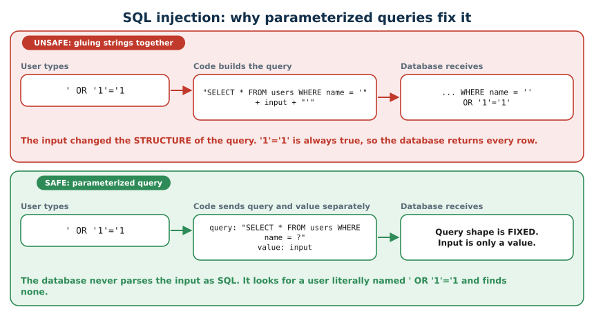
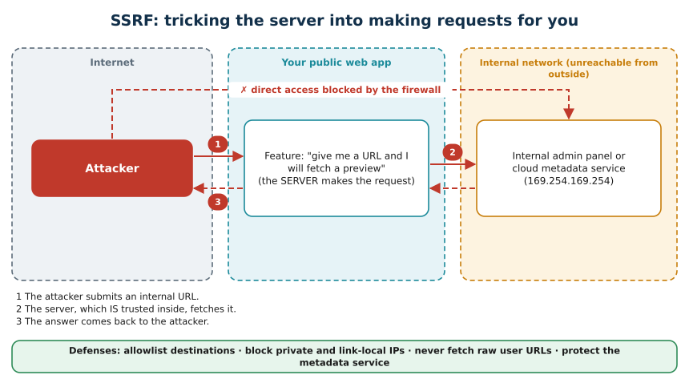
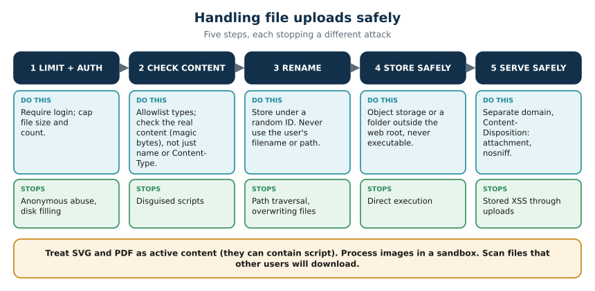
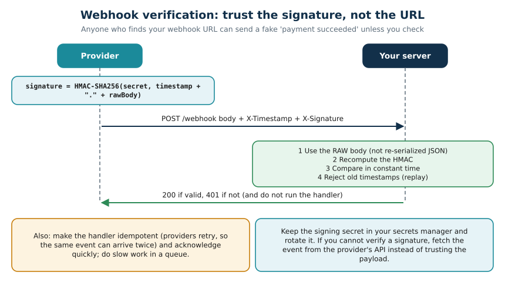
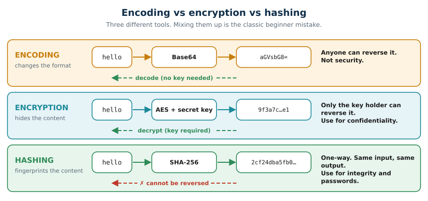
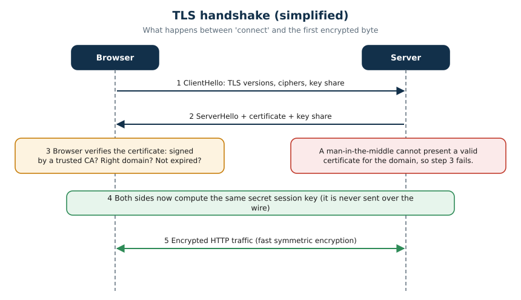

# Chapter 4: Injection, Input Handling and Crypto Essentials

> **Goal.** After this chapter you can: explain the one idea behind every injection bug and fix SQL, NoSQL, command and path flaws; write an SSRF-safe fetcher; handle uploads, webhooks and secrets safely; fail closed; and answer the crypto basics interviewers ask, including the post-quantum timeline.
>
> **Time:** about 90 minutes.

---

## 1. The one rule: data must never become code

> **Injection happens when untrusted data is mixed into a command, query or document, and the interpreter cannot tell data from instructions.**

The interpreter changes (database, shell, browser, XML parser, AI model). The mistake and the fix stay the same: **keep code and data separate.**

| Tool | Job |
| --- | --- |
| **Validate** (strict schema, allowlist) | Reject unexpected input early. A first filter, not the fix. |
| **Parameterize** | Keep data out of the code of a query or command |
| **Encode** | Keep data out of the code of output (HTML, URL, JSON) |

Never rely on "stripping bad characters". Blocklists always miss something.

> **AI-agent era.** Coding agents learned from a lot of old tutorial code, so they often write string-built SQL, `exec` with a shell string and `Math.random()` tokens. They can also paste a real key into a file to "make it work". The code usually runs, so nothing looks wrong. You review it with the checks below and add a test that fails if the bug returns.

---

## 2. SQL and NoSQL injection



ORMs parameterize by default. The danger is the **raw-query escape hatch**.

```ts
// VULNERABLE: input becomes part of the SQL
db.$queryRawUnsafe(`SELECT * FROM users WHERE email = '${email}'`);
// SAFE: Prisma's tagged template binds ${email} as a parameter
db.$queryRaw`SELECT * FROM users WHERE email = ${email}`;
```

Review every `Unsafe`, `raw`, `.extra()` or f-string query. Parameters cannot stand for table names, column names or `ORDER BY` direction, so **map user choices to an allowlist** (`{ created: "created_at" }[sort] ?? "created_at"`). Give the app's database user **least privilege** (no `DROP`, no other schemas).

**NoSQL operator injection.** Express can parse `{"password": {"$ne": null}}` into an object that matches any password:

```ts
// VULNERABLE: req.body.password may be an object
users.findOne({ username: req.body.username, password: req.body.password });
// SAFE: z.string() rejects objects; compare a password HASH with a verify function
```

Validate request shape with a strict schema (zod, pydantic) and use only the parsed result.

---

## 3. Command injection, path traversal, deserialization

```ts
exec(`convert ${filename} out.png`);          // VULNERABLE: a shell parses the string
execFile("convert", [filename, "out.png"]);   // SAFE: arguments are an array, no shell
```

Python: `subprocess.run([...], shell=False)`. Better still, use a library instead of shelling out.

**Path traversal** (`../../etc/passwd`): resolve the path and check the prefix, or avoid user filenames entirely.

```ts
const full = path.resolve(BASE, userName);
if (!full.startsWith(BASE + path.sep)) throw new Error("invalid path");
```

**Deserialization** is high risk when the format can describe code or arbitrary objects: Python `pickle.loads` and `yaml.load` on untrusted data, Java `ObjectInputStream`, `eval` / `new Function`. Use JSON plus a schema and `yaml.safe_load`. React2Shell (CVE-2025-55182, CVSS 10, December 2025) was a flaw in how React Server Components decoded request payloads, so **request parsing is attack surface**: patch frameworks fast.

JavaScript traps: **prototype pollution** (merging JSON with `__proto__` changes every object; use strict schemas and `Map`) and **ReDoS** (cap input length before matching; avoid nested quantifiers).

---

## 4. SSRF, uploads and webhooks



**SSRF** happens when your server fetches a URL the user supplies (link previews, image import, PDF generators). The attacker supplies an internal address and your server fetches it for them, including the cloud metadata service at `169.254.169.254`. The defence:

1. **Allowlist hosts** when the feature allows it.
2. **Validate the resolved IP** (not the hostname string) against private, loopback and link-local ranges; allow only `http`/`https`.
3. **Connect to the address you validated** (defeats DNS rebinding) and re-check every redirect or disable redirects.
4. Timeouts, size caps, no raw responses back to the user; IMDSv2 and least-privilege cloud roles; egress rules.

Capital One (2019) is the textbook case. OWASP merged SSRF into A01 in 2025.



**Uploads:** limit size; check the **real content** (not the filename or `Content-Type`); save under a **random server-generated name** (the user's `originalname` can be `../../x.js`); store outside the web root or in object storage; serve from a **separate domain** with `nosniff`. Treat SVG and PDF as active content.



**Webhooks:** anyone who finds the URL can post a fake "payment succeeded". Verify an **HMAC over the raw body plus a timestamp**, compare in **constant time** (`crypto.timingSafeEqual`), reject timestamps older than about 5 minutes, and make the handler **idempotent**. Parsing the JSON first changes the bytes and breaks the signature.

---

## 5. Secrets, errors and containers

- **Secrets:** never in source, Git history, images, front-end bundles or logs. Use a secrets manager, separate secrets per environment and service, prefer short-lived credentials (roles, OIDC), scan in CI and pre-commit. **If one leaks: revoke, rotate, check what it touched.** Deleting the commit is not enough.
- **Fail closed (OWASP A10, new in 2025):** if a check throws, the answer is "no".

```ts
let allowed = false;                       // default deny
try { allowed = await policy.check(user, action, resource); } catch (e) { log.error({ e }); }
if (!allowed) return res.sendStatus(403);
```

  Client errors are generic ("request failed" plus a correlation ID), never stack traces or SQL. Log security events (logins, denials, admin actions), never passwords or tokens.
- **Containers in three lines:** multi-stage build with `npm ci --ignore-scripts`; minimal runtime image running as a **non-root** user; **no secrets in the image** (layers are readable by anyone who can pull it).

---

## 6. Crypto essentials for interviews



| | Reversible? | Needs a key? | Use it for |
| --- | --- | --- | --- |
| **Encoding** (Base64, URL) | Yes | No | Moving data safely. **Not security.** |
| **Encryption** | Yes, with the key | Yes | Confidentiality |
| **Hashing** | No | No (salt, yes) | Integrity, password storage |

- **Symmetric** (AES-GCM): one shared key, fast, used for bulk data. **Asymmetric** (RSA, ECC): public/private pair, slower, used for key exchange and signatures. **TLS uses both**: asymmetric to agree on a key, then symmetric for the traffic.
- **Passwords** need a slow, salted hash (Argon2id, scrypt, bcrypt). The numbers and the rehash-on-login pattern are in Chapter 3.
- **Never invent your own crypto**, and use a cryptographically secure random source (`crypto.randomBytes`), not `Math.random`.



**TLS handshake in four lines:** the client says hello and lists what it supports; the server returns its certificate; the client checks that a trusted authority signed it and that the name matches; both derive a shared session key, and all traffic is encrypted with it. HSTS tells the browser to use HTTPS only.

**Post-quantum in five lines.** A large quantum computer could break RSA and elliptic curves. Attackers can **record encrypted traffic now and decrypt it later** ("harvest now, decrypt later"). In **August 2024** NIST published **FIPS 203 (ML-KEM)** for key establishment and **FIPS 204 (ML-DSA)** and **FIPS 205 (SLH-DSA)** for signatures. NIST's transition plan **IR 8547** (final October 2026) deprecates RSA, ECDSA, EdDSA and Diffie-Hellman **after 2030** and disallows them **after 2035**. The interview answer: inventory your crypto, stay crypto-agile, adopt hybrid key exchange as libraries ship it. It is a planning topic, not a today-incident.

---

## Check yourself

1. State the single idea behind all injection bugs.
2. Why can a parameterized query not protect an `ORDER BY` column, and what do you do instead?
3. Name four defences for an SSRF-safe fetcher.
4. Encoding, encryption, hashing: which is reversible without a key, and which is for passwords?

**Answers** *(cover this until you have tried)*

1. Untrusted data is interpreted as instructions. Keep code and data separate (parameterize, encode, validate).
2. Parameters only stand for values, not identifiers. Map the user's choice to an allowlist of known column names and directions.
3. Any four of: allowlist hosts; validate the resolved IP against private and link-local ranges; connect to the validated address; re-check redirects; timeouts and size caps; don't return raw responses; IMDSv2 and least-privilege roles.
4. Encoding is reversible by anyone (no key) and is not security. Hashing (slow and salted: Argon2id, scrypt, bcrypt) is for passwords.

---

## Summary

- Injection is data treated as code: validate with strict schemas, parameterize, encode; allowlist identifiers; review every raw query.
- `execFile` over `exec`, resolve-and-check paths, JSON over `pickle`, and patch frameworks fast.
- SSRF: validate the resolved IP and connect to it; uploads: random names and real content checks; webhooks: HMAC on the raw body with a timestamp.
- Secrets live in a manager; errors fail closed; containers run non-root with no baked-in secrets.
- Crypto: encoding is not security, TLS uses both key types, and for post-quantum remember ML-KEM, "harvest now decrypt later", and 2030 / 2035.
