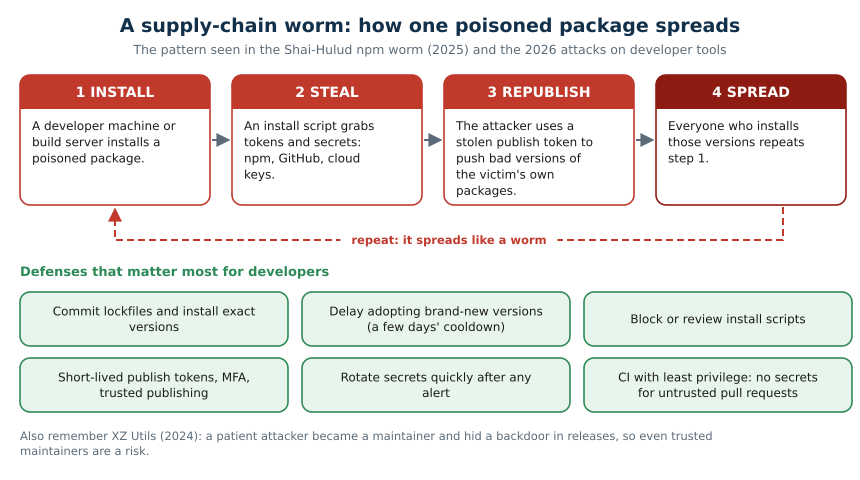
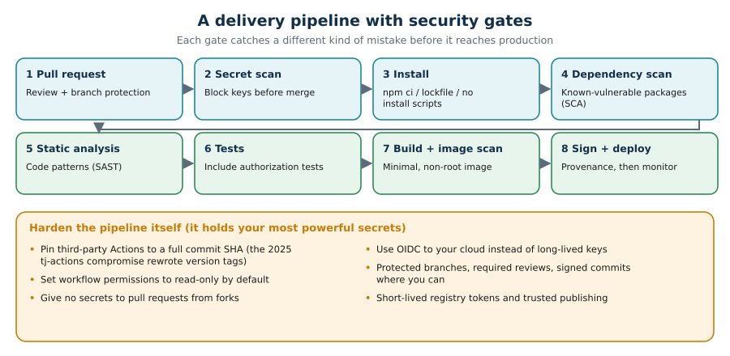

# Chapter 5: Supply Chain, CI/CD and Cloud Basics

> **Goal.** After this chapter you can: describe the recent supply-chain incidents in one sentence each; protect a project from poisoned packages; harden a GitHub Actions pipeline; use trusted publishing; and name the basic cloud and DevOps controls interviewers expect.
>
> **Time:** about 60 minutes.

---

## 1. Why it matters

Your app is mostly **other people's code**, and your build runs **with your secrets**. Verizon's 2026 report (as reported by news coverage) puts third parties in about **48%** of breaches, up from about 30%. OWASP made **A03 Software Supply Chain Failures** a category in 2025.



| Incident | When | What happened | Lesson |
| --- | --- | --- | --- |
| **chalk / debug** | 8 Sep 2025 | A maintainer was phished by a fake "npm support" site; malicious versions of widely used packages were published (reported: about 18 packages, 2 billion+ weekly downloads), live for hours | Short windows still reach millions of installs |
| **Shai-Hulud npm worm** | Sep and Nov 2025 | Stole credentials at install time and used stolen npm tokens to infect the victim's other packages (reported: 180+ packages, then about 500 packages and 26,000+ GitHub repos) | Install scripts run with your credentials |
| **tj-actions/changed-files** | Mar 2025 | A popular GitHub Action was compromised and its **version tags were rewritten**, dumping CI secrets into logs (reported: 23,000+ repos at risk) | Pin Actions to a SHA; tags are mutable |
| **XZ Utils** | 2024 | An attacker became co-maintainer over about two years and hid a backdoor (CVE-2024-3094); found by chance | Trusted maintainers can be the threat |

Counts vary by source: say "reported". A 2026 roundup also reports backdoored developer tools (Trivy and others): attackers target what developers trust most.

> **AI-agent era.** Coding agents add dependencies freely and run `npm install` for you, install scripts included. They can also suggest packages that **do not exist**, and attackers have been reported to register such made-up names (Chapter 6 has the researched details). So **review every new dependency in the diff**, pin versions, use a cooldown and keep install scripts off by default.

---

## 2. Dependency hygiene

```bash
npm ci --ignore-scripts      # exact lockfile versions, no install-time scripts
npm audit signatures         # verify registry signatures and provenance
osv-scanner --lockfile package-lock.json     # or pip-audit for Python
```

- **Commit the lockfile** and review its diffs. Pin exact versions for critical packages; avoid `@latest` and unpinned CDN scripts.
- **Cooldown:** wait a few days before adopting a new release, since malicious versions are usually caught within hours or days (Dependabot `cooldown`, Renovate and pnpm `minimumReleaseAge`).
- **Check new packages:** maintainers, recent changes, install scripts, transitive count. Watch for **typosquatting** (`reqeusts`) and **dependency confusion** (a public package shadowing an internal name; avoid `--extra-index-url`).
- **SBOM** (CycloneDX or SPDX, `npm sbom`): so when the next Log4Shell lands you can answer "are we affected?" in minutes. Triage vulnerabilities by **exploited in the wild** (CISA KEV) and internet-facing first.
- **Keep upgrades cheap:** small, frequent updates with good tests beat rare scary ones.

---

## 3. If you publish packages

Reported by GitHub after the 2025 attacks: **trusted publishing (OIDC)** became generally available on **31 July 2025** (your pipeline proves its identity and gets a short-lived token, so no stored secret to steal); **classic npm tokens were revoked on 9 December 2025**; new **granular** write tokens have a **90-day** maximum and 2FA by default. Use **phishing-resistant 2FA** (passkey or security key) on registry accounts: chalk/debug began with a phished maintainer.

---

## 4. Hardening CI/CD (GitHub Actions)



Your pipeline holds your most powerful secrets. Treat it like production.

```yaml
permissions: { contents: read }                       # least-privilege token; widen per job
steps:
  - uses: actions/checkout@<FULL-40-CHAR-COMMIT-SHA>  # pin by SHA, not a movable tag
  # VULNERABLE: a PR title becomes part of the shell script
  #   run: echo "${{ github.event.pull_request.title }}"
  - env: { TITLE: "${{ github.event.pull_request.title }}" }   # SAFE: data, not code
    run: echo "$TITLE"
```

1. **Pin third-party Actions to a full commit SHA** and let Dependabot or Renovate propose bumps.
2. **Read-only token by default.**
3. **Never put untrusted input inline in `run:`** (titles, branch names, issue text).
4. **`pull_request_target` runs with secrets and write access:** never check out and run the PR's code in it.
5. **No secrets for forks**; protected branches, required reviews, CODEOWNERS on `.github/`.
6. **OIDC to your cloud** instead of long-lived keys stored as secrets.

---

## 5. Cloud and DevSecOps basics

| Mistake | Fix |
| --- | --- |
| Public storage or databases | Private by default; block public access at the account level |
| Over-broad roles (`*` permissions) | **Least-privilege IAM**, one role per service |
| Long-lived access keys | Short-lived credentials (roles, workload identity, OIDC) |
| Secrets in code, config or CI logs | Secrets manager, secret scanning, rotate on exposure |
| Forgotten test resources | Inventory, owner tags, auto-expiry |

Scan **infrastructure-as-code** in pull requests with the same care as app code. A secure pipeline: threat model (STRIDE) → secret scanning on commit → **SAST** and **SCA** in CI → **DAST** on staging → signed artifacts and an SBOM → logging and alerts in production. Remember that scanners are supply-chain components too: pin and verify them.

**If a secret leaks:** revoke or rotate immediately, find what it could reach, check provider logs, replace it with something narrower, and write down the missing control. **If a dependency is compromised:** check lockfiles and SBOM, pin or roll back, rotate every credential reachable from machines or builds that installed it, look for persistence (new repos, workflows, tokens).

---

## Check yourself

1. What did the tj-actions compromise exploit, and what is the defence?
2. What does a dependency cooldown protect against?
3. What is trusted publishing and why is it safer than a stored token?
4. A package you use is reported compromised. What are your first three steps?

**Answers** *(cover this until you have tried)*

1. Attackers rewrote existing version tags, so workflows using a tag ran malicious code that exposed secrets. Pin Actions to a full commit SHA and use least-privilege tokens.
2. Newly published malicious versions, which are usually detected within hours or days.
3. CI proves its identity to the registry via OIDC and receives a short-lived token, so there is no long-lived secret to steal; provenance is generated too.
4. Check whether you are affected (lockfiles, SBOM); pin or roll back; rotate every credential reachable from machines or builds that installed it.

---

## Summary

- Developers and their tools are targets: chalk/debug and Shai-Hulud (2025), tj-actions (2025), XZ (2024), the 2026 developer-tool wave. Use "reported" for counts.
- Lockfiles, `npm ci --ignore-scripts`, cooldown, review of every new dependency, SBOM.
- Publishing: trusted publishing (OIDC) and passkey 2FA; classic npm tokens are gone.
- CI: pin Actions to SHAs, read-only tokens, no untrusted input in `run:`, careful with `pull_request_target`, OIDC to the cloud.
- Cloud: private by default, least-privilege roles, short-lived keys, secrets in a manager, IaC reviewed like code.
