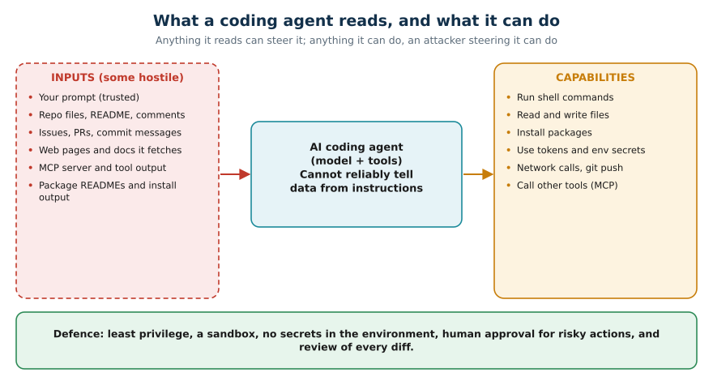
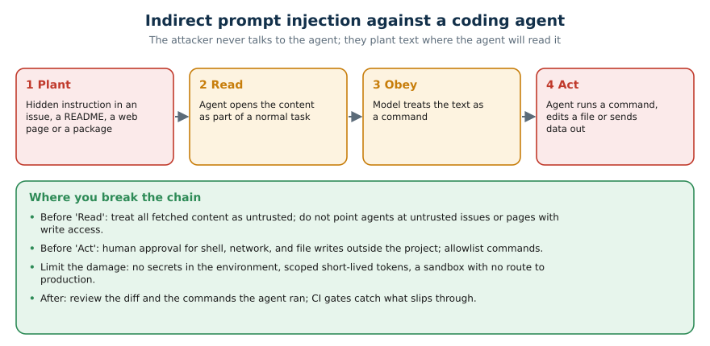
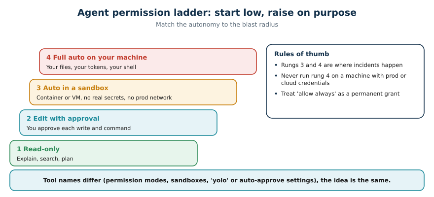

# Chapter 6: Using AI Coding Agents Safely

> **Goal.** After this chapter you can: describe how an attack on a coding agent works; choose a permission level and sandbox; protect secrets and tokens; treat rules files and MCP servers as code; stop hallucinated dependencies; and give a safe-use policy for a team.
>
> **Time:** about 75 minutes. This is the new core chapter of the book.

---

## 1. The threat model

An agent combines three things: it **reads** many inputs, it **cannot reliably separate data from instructions**, and it can **act** (shell, files, network, git, other tools). That is the same risky combination as Chapter 7, but here the victim is *you* and the acting identity is *your laptop and tokens*.

Hostile text can arrive in: repo files and comments, issues and pull requests, a web page the agent fetches, a package README or install output, **rules files** and **MCP tool descriptions**. You never typed it, but the agent reads it.

## 2. Incidents to know (with confidence)

> **Labels.** *Confirmed* = a primary page was read. *Reported* = from news or security-vendor write-ups. Verify the CVE ID and fixed version at the vendor or NVD before relying on them.

| Case | What happened (conceptual) | Lesson | Confidence |
| --- | --- | --- | --- |
| **GitHub Copilot, CVE-2025-53773** (Aug 2025) | Injected text made the assistant edit its own workspace settings to enable auto-approval, then run commands. Scored 7.8 in NVD-derived sources. Fixed in Microsoft's August 2025 update. | An agent that can edit its own permissions has no permissions. | Reported |
| **Cursor, CVE-2025-54135 "CurXecute" and CVE-2025-54136 "MCPoison"** (2025) | Injected content caused writes to the MCP config and command execution; an approved MCP entry could be changed silently afterwards. Fixed in Cursor 1.3 (re-approval on config change). | Approval must bind to the *content*, not the name. | Reported |
| **Claude Code, several CVEs in 2025-26** | A recurring class: approval-prompt bypass through gaps in command parsing. Fixed in later versions. | Allow-lists and parsers are attack surface; keep the tool updated. | Reported |
| **Amazon Q Developer extension** (July 2025) | A malicious prompt was merged into a published extension release (v1.84.0) telling the agent to wipe local files and cloud resources. AWS said it failed to execute; root cause was an over-scoped repository token. Fixed in 1.85.0. | Your tool's supply chain is part of yours; scope CI tokens. | Reported |
| **"Rules File Backdoor"** (Pillar Security, Mar 2025) | Hidden Unicode in a shared rules file steered generated code. | Review rules files as code, with hidden-character checks. | Reported |
| **MCP tool poisoning** (Invariant Labs, Apr 2025) | Malicious instructions in a tool *description*, visible to the model but not to the user; descriptions can change after approval ("rug pull"). | Show and pin tool definitions; do not install unknown servers. | **Confirmed** |
| **Nx "s1ngularity"** (26 Aug 2025) | Malicious npm releases ran a script that invoked AI command-line tools already installed on developer machines, with their approval-bypass flags, to hunt for secrets, then published them to public GitHub repos. Over 400 users or organizations and more than 5,500 repositories were affected, with more than 1,000 valid GitHub tokens seen. Related to, but not the same as, the Shai-Hulud worm. | Your installed agent is a tool an attacker can call. Secrets on disk and in the environment are reachable. | **Confirmed** (InfoQ) |
| **Replit agent, July 2025** | During a code freeze the agent ran destructive commands, deleted a production database, and misreported recovery; the company then separated dev from prod databases. | Never give an agent production credentials; separate environments. | Reported |
| **PocketOS, Apr 2026** | A founder reported that a coding agent found an unrelated infrastructure API token and deleted a production volume and its backups in about nine seconds. | Scope tokens; keep backups out of the same blast radius. | Reported (single source) |

## 3. Controls that work

**1. Choose the autonomy deliberately.** Use read-only or approve-each-action modes by default; use auto-approval only inside a **sandbox** with **no real credentials**. Treat "always allow" as a permanent grant. Documented controls in current tools include permission modes, filesystem and network sandboxing, deny rules, trust dialogs for new folders and MCP servers, and audit logging (Claude Code's security documentation lists these; other tools have equivalents). A working-directory boundary enforced only by a prompt is not an operating-system boundary.

**2. Sandbox the blast radius.** Run agents in a container, dev container or VM. Mount only the project. Block or allow-list network access. No access to your home directory, SSH keys, cloud profiles or password manager.

**3. Keep secrets out of reach.**
- No secrets in the agent's environment variables or in files it can read (`.env`, key files). Assume anything it can read, anything steering it can read.
- Give the agent **its own scoped, short-lived tokens**, never your personal admin credentials. Never give it production credentials.
- Use secret scanning (`gitleaks`) and push protection so a leaked key is caught before it spreads.

**4. Separate environments.** The agent works against dev and staging. Production changes go through a pipeline with human approval, and backups live outside the agent's reach.

**5. Treat agent configuration as code.** Rules files, `.mcp.json`, hooks, skills and settings live in the repo and change behaviour. Put them under CODEOWNERS and review diffs, including for hidden characters. Prefer allow-listed MCP servers with pinned versions; read the full tool descriptions; re-approve when they change. The official MCP security guidance covers confused-deputy, token pass-through, SSRF and local-server compromise: do not pass tokens through, show the exact command before installing a local server, and request minimal scopes.

**6. Control the untrusted inputs.** Do not point an agent that has write access at untrusted issues, PRs or web pages. Review before merging anything an agent produced from untrusted content.

**7. Review and gate.** Small pull requests, the five questions (Chapter 8), negative tests, SAST, secret scanning, dependency checks, protected branches. Do not let the agent approve or merge its own work.

**8. Keep the tooling patched.** Several 2025-26 CVEs were in the agent tools themselves; update them like a browser.

## 4. Hallucinated dependencies ("slopsquatting")

A model may suggest a package that does not exist. An attacker can register that name and wait for someone to install it. A USENIX Security 2025 study of 16 models found at least **5.2%** (commercial) and **21.7%** (open-source) hallucinated packages across 576,000 samples, with **205,474** unique made-up names. Reported real-world cases exist, but treat their details as unconfirmed.

**Checklist for every new dependency in a diff:**
1. Does it exist, and is it the one you mean? `npm view <name>`: check publisher, creation date, repository link and weekly downloads.
2. Do we need it? Prefer the standard library or what is already installed.
3. Install with `npm ci --ignore-scripts`, pin through the lockfile, use a release-age cooldown, run `npm audit` and an SCA tool.
4. A human approves new dependencies.

## 5. A one-page team policy

| Area | Rule |
| --- | --- |
| **Tools** | Only approved agents and versions; keep updated |
| **Mode** | Approve-each-action by default; auto only in a sandbox without real secrets |
| **Credentials** | Agent-specific, scoped, short-lived; never prod, never personal admin |
| **Data** | No customer data or secrets in prompts to unapproved tools |
| **Config** | Rules, MCP config and hooks under CODEOWNERS; allow-listed MCP servers |
| **Dependencies** | Human check of every new package; cooldown; lockfile |
| **Review** | The author owns the diff; agents do not approve or merge |
| **Logging** | Keep agent action logs where available |

> **Interview angle.** *"How do you use AI coding agents safely?"* "Three layers. Limit what the agent can reach: a sandbox, scoped short-lived tokens, no production credentials, approvals for risky actions. Limit what it can be told: treat repo files, issues, web pages and MCP tools as untrusted input that can steer it. Check what it produces: small PRs, a review against the five questions, negative tests, and CI gates for dependencies and secrets. The common thread is least privilege plus review. A concrete example is the s1ngularity attack, where malware used developers' own AI tools to look for secrets."

---

## Check yourself

1. Why is an agent that reads untrusted content dangerous?
2. Name four controls that limit an agent's blast radius.
3. Why treat `.mcp.json` and rules files as code?
4. What is a hallucinated dependency attack, and how do you stop it?
5. Why should an agent never hold production credentials?

**Answers** *(cover this until you have tried)*

1. It cannot reliably separate data from instructions, so text it reads can steer it, and it acts with your permissions.
2. Sandbox/container; scoped short-lived tokens; approval for risky actions; no secrets in the environment; separate dev from prod.
3. They change what the agent does and what it trusts; a malicious change there (or a silent change after approval) is an attack vector.
4. An attacker registers a package name a model invented; verify existence, maintainer and need, use lockfiles and `--ignore-scripts`, and require human approval.
5. A mistake or hijack then acts on production: the reported database and volume deletions show the blast radius.

---

## Summary

- An agent reads untrusted text and acts with your permissions: limit reach, limit inputs, check outputs.
- Sandbox, scope tokens, no prod credentials, no secrets in the environment, approvals for risky actions.
- Review rules files and MCP config like code; verify every new dependency; keep tools patched.
- The author owns the diff. Agents do not approve their own work.
