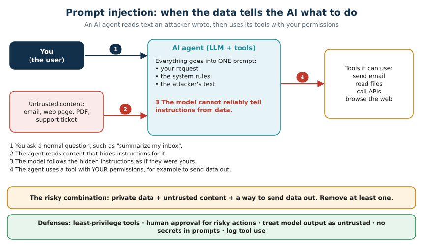
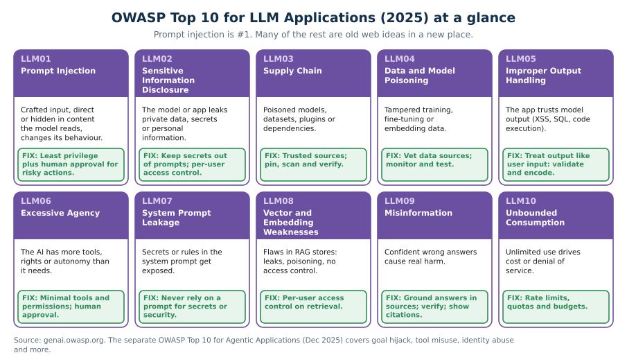

# Chapter 7: Building AI Features Safely

> **Goal.** After this chapter you can: explain prompt injection and why an LLM cannot separate instructions from data; apply least privilege to AI tools; validate and safely render model output; keep keys and private data out of prompts and browsers; and use the OWASP LLM and Agentic lists as checklists.
>
> **Time:** about 60 minutes. Chapter 6 covers *using* coding agents; this chapter covers *building* products that contain a model.

---

## 1. The root problem: no wall between code and data

In a normal program, instructions and data are separate. In an LLM app, **everything is text in one prompt**: your system instructions, the user's request, retrieved documents, web pages, emails and tool results. The model **cannot reliably tell trusted instructions from untrusted data**. That is the cause of the number one risk in the OWASP Top 10 for LLM Applications: **prompt injection**.



| Type | Where the attacker's text comes from | Why it matters |
| --- | --- | --- |
| **Direct** | The user types it into the chat | Limited to what that user can already do |
| **Indirect** | Hidden in content the model **reads on the user's behalf** (email, web page, PDF, ticket, code comment) | The victim types nothing malicious; the attacker's text rides in through your data |

> **Real case: EchoLeak (June 2025).** A zero-click prompt-injection flaw in Microsoft 365 Copilot (**CVE-2025-32711, CVSS 9.3**): a crafted email, processed later as context, could steer Copilot into leaking confidential data with no click from the victim. Microsoft fixed it server-side. ([The Hacker News](https://thehackernews.com/2025/06/zero-click-ai-vulnerability-exposes.html))

> **Real case: Instagram account recovery (2026, reported).** According to reporting by 404 Media and the New York Times, attackers got Meta's AI support chatbot to send reset codes to attacker-controlled emails. *Lesson:* an AI agent with power over a sensitive action inherits every weakness of that action.

**The risky combination:** private data + untrusted content + a way to send data out. **Remove at least one.**

---

## 2. Design rules

There is no complete fix for prompt injection, so **contain the damage** with ordinary engineering:

1. **The AI acts as the user**, never as a super-account; tools use the current user's permissions.
2. **Least privilege for tools:** narrow tools ("read one order"), not "run any SQL".
3. **Human approval** for irreversible actions (send email, spend money, delete).
4. **Model output is untrusted input:** validate, encode, authorize.
5. **Keep untrusted content separate and labelled.**
6. **No secrets in prompts.** A system prompt is not a safe place for keys or rules.
7. **Limit cost and abuse:** rate limits, token budgets, max tool-call depth.
8. **Log and red-team** before launch.

---

## 3. Code patterns

**Validate tool calls with a schema; authorize inside the tool** (the prompt is not a security boundary):

```ts
const ToolCall = z.object({
  tool: z.enum(["get_order", "search_orders"]),            // allowlist of tools
  args: z.object({ orderId: z.string().uuid().optional(), query: z.string().max(200).optional() }).strict(),
});
const parsed = ToolCall.safeParse(safeJsonParse(modelText));
if (!parsed.success) return refuse("invalid tool call");

async function get_order({ user, orderId }) {
  const order = await db.order.findFirst({ where: { id: orderId, ownerId: user.id } });  // BOLA check
  if (!order) throw new Error("not found");
  return order;
}
```

**Never execute model output** (`eval`, `exec(modelText)`, SQL or shell built from it).

**Render safely (LLM05).** Model text can carry HTML, script or Markdown links and images:

```tsx
const html = DOMPurify.sanitize(marked.parse(modelMarkdown) as string);   // sanitize AFTER rendering Markdown
```

Restrict where images and links can point (CSP `img-src`, `connect-src`); an attacker-chosen image URL with data in its query string has been reported as a way to smuggle information out.

**RAG: authorize retrieval, not just the chat.**

```ts
const chunks = await vectorStore.search(query, { filter: { tenantId: user.tenantId, allowedGroups: user.groups }, limit: 5 });
```

**Keys:** never ship an LLM provider key to the frontend; call the model from your backend, which authenticates, rate-limits and budgets.

---

## 4. The OWASP lists



Five groups: **input** (LLM01 Prompt Injection, LLM07 System Prompt Leakage); **data** (LLM02 Sensitive Information Disclosure, LLM04 Poisoning, LLM08 Vector and Embedding Weaknesses); **output and action** (LLM05 Improper Output Handling, LLM06 Excessive Agency); **supply chain** (LLM03); **reliability and cost** (LLM09 Misinformation, LLM10 Unbounded Consumption).

> **The bridge.** Most entries are old principles in a new place: LLM05 is XSS/injection through model output; LLM06 is least privilege; LLM10 is rate limiting; LLM03 is the supply chain; LLM08 is access control on a data store. *"AI security is mostly old principles applied to a new component"* is a strong interview sentence.

For **agents** that plan and act with tools, OWASP's **Top 10 for Agentic Applications (for 2026, published 9 December 2025)** adds risks such as **Agent Goal Hijack**, **Tool Misuse and Exploitation**, **Identity and Privilege Abuse**, **Agentic Supply Chain Vulnerabilities** and **Unexpected Code Execution**. The heart of it: give each agent its own limited identity, least-privilege tools, and a human check before consequential actions.

> **AI-agent era.** Every product team now ships "an agent", so expect to design one in an interview. The answer shape is always the same: *which data can it see, which untrusted content can reach it, which actions can it take, who approves them, what does it log?*

---

## Check yourself

1. Why can't an LLM reliably tell instructions from data?
2. What is "the risky combination" and what do you do about it?
3. Why must a tool authorize inside its own handler?
4. How can model Markdown output cause a security problem?

**Answers** *(cover this until you have tried)*

1. System rules, the user's request, retrieved content and tool results are all text in one prompt, with no hard boundary.
2. Private data + untrusted content + an outbound channel. Remove at least one.
3. A prompt is advice that injection can override; the handler is code that enforces the user's permissions whatever the model asks.
4. It can contain script/HTML (XSS) or links/images to attacker URLs that carry data out. Sanitize after rendering, restrict destinations, use a CSP.

---

## Summary

- An LLM mixes instructions and data: prompt injection (especially indirect) is number one and has no complete fix.
- Contain it: user-permission tools, minimal tools, authorization in handlers, human approval, untrusted output, no secrets in prompts.
- Validate output with schemas, never execute it, sanitize before rendering, authorize retrieval, keep keys on the backend.
- OWASP LLM Top 10 (2025) and Agentic Top 10 (Dec 2025) are your checklists.
