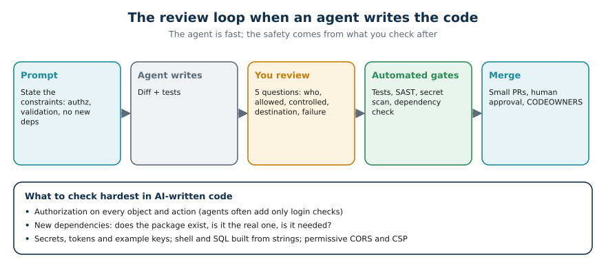

# Chapter 8: Secure Code Review (Human and AI-Written Code)

> **Goal.** After this chapter you can: review a diff with five questions; spot 15 classic vulnerabilities in short snippets; write the tests that keep fixes fixed; and use ASVS Level 1 as a checklist.
>
> **Time:** about 90 minutes. Reading a diff and saying "this is wrong because..." is the skill interviewers test most directly, and, in the agent era, it is the skill your job is turning into.



---

## 1. Five review questions

For every change that touches a request, a query, a render or a dependency:

1. **Who is calling?** Identity from the session or token, not from the request?
2. **Are they allowed?** Checked **per object and per action**, on the server?
3. **What can they control?** Every input (body, query, headers, files, URLs, model output) validated against a strict schema?
4. **Where does it go?** Into a query, shell, path, URL fetch, HTML, redirect or log: parameterized, encoded or allowlisted for that destination?
5. **What if it fails or repeats?** Fails closed, generic errors, limits, safe under concurrency?

Add: **does this add a dependency, a secret, a permission or a third-party script?**

> **AI-agent era.** An agent's diff is often large, tidy and confident, which makes it *easier* to approve without reading. Keep pull requests small, ask the agent to explain what it changed and which inputs reach which sinks, and run the five questions anyway. Agents tend to get the happy path right and skip authorization, limits and failure handling.

---

## 2. Spot the vulnerability (15 snippets)

Cover the answers; about 2 minutes each; aim for 12 of 15.

**1**
```ts
app.get("/api/invoices/:id", requireLogin, async (req, res) => {
  res.json(await db.invoice.findUnique({ where: { id: req.params.id } }));
});
```
**2**
```tsx
function Comment({ html }: { html: string }) { return <div dangerouslySetInnerHTML={{ __html: html }} />; }
```
**3**
```python
cur.execute(f"SELECT * FROM users WHERE email = '{email}' AND active = 1")
```
**4**
```ts
const claims = jwt.decode(token) as any;
if (claims?.role === "admin") return next();
```
**5**
```ts
app.use(cors({ origin: true, credentials: true }));
```
**6**
```ts
const user = await users.findOne({ email: req.body.email, password: req.body.password });
```
**7**
```ts
exec(`ffmpeg -i ${req.body.filename} -vn out.mp3`);
```
**8**
```ts
app.get("/login/done", (req, res) => res.redirect(req.query.next as string));
```
**9**
```ts
app.post("/payments-webhook", express.json(), (req, res) => {
  if (req.body.type === "payment.succeeded") markOrderPaid(req.body.data.orderId);
  res.sendStatus(200);
});
```
**10**
```ts
await db.user.update({ where: { id: req.user.id }, data: req.body });
```
**11**
```yaml
on: pull_request_target
jobs:
  test:
    steps:
      - uses: actions/checkout@v4
        with: { ref: "${{ github.event.pull_request.head.sha }}" }
      - run: npm ci && npm test
        env: { DEPLOY_KEY: "${{ secrets.DEPLOY_KEY }}" }
```
**12**
```ts
"use server";
export async function deleteUser(id: string) { await db.user.delete({ where: { id } }); }
```
**13**
```ts
app.get("/preview", async (req, res) => { const r = await fetch(req.query.url as string); res.send(await r.text()); });
```
**14**
```ts
const token = Math.random().toString(36).slice(2);
await db.passwordReset.create({ data: { userId: user.id, token } });
```
**15**
```ts
app.post("/upload", upload.single("file"), async (req, res) => {
  await fs.writeFile(path.join("/var/www/uploads", req.file.originalname), req.file.buffer);
  res.sendStatus(201);
});
```

<div style="break-before: page"></div>

### Answers

1. **BOLA/IDOR.** Any logged-in user reads any invoice. Scope the query to the owner (`findFirst({ where: { id, ownerId: req.user.id } })`), 404 otherwise.
2. **Stored XSS.** Render text, or sanitize with DOMPurify; add a CSP.
3. **SQL injection.** Use placeholders (style depends on the driver).
4. **Unverified token.** `decode` skips the signature, so anyone can forge `role: admin`. Use `verify` with a pinned algorithm, issuer, audience (Lab 3).
5. **Reflective CORS with credentials.** Any site can read authenticated responses. Use an exact allowlist.
6. **NoSQL operator injection** (and plaintext passwords). Validate types with a schema; compare a password *hash* with a verify function.
7. **Command injection.** Use `execFile("ffmpeg", [...])`, validate the file, prefer a stored file ID.
8. **Open redirect.** Allowlist internal paths or fixed destinations.
9. **Unverified webhook.** Verify an HMAC on the raw body, constant-time compare, timestamp window, idempotent handler (Lab 4).
10. **Mass assignment.** The client can send `isAdmin: true`. Use a strict schema of changeable fields.
11. **Dangerous workflow.** `pull_request_target` has secrets and write access, and this job runs untrusted PR code with them. Use `pull_request`, pin to a SHA, `permissions: contents: read`.
12. **Server Action with no auth.** Server Actions are public HTTP endpoints. Authenticate, authorize this user for this target, validate input inside.
13. **SSRF** returning the raw body. Allowlist hosts, validate the resolved IP (Lab 7), limit redirects, timeouts, size caps.
14. **Predictable, plaintext, non-expiring reset token.** Use `crypto.randomBytes(32)`, store a hash, single use, short expiry.
15. **Path traversal and unsafe upload.** `originalname` is attacker-controlled; use a random name, check real content type, limit size, store outside the web root.

**Score:** 13-15 excellent; 10-12 solid; below 10, re-read Chapters 2-4 and retry in two days.

> **Try this with an agent.** Ask your coding agent: *"Write an endpoint that returns an invoice by ID"* and *"Add a webhook for payment succeeded"*. Then review its output with the five questions. Note which of snippets 1 and 9 it reproduces. That is the fastest way to learn what to check.

---

## 3. Tests that keep fixes fixed

**Authorization tests** give the most security value per line:

```ts
it("requires authentication", async () => expect((await api.get(`/orders/${aliceOrder.id}`)).status).toBe(401));
it("returns 404 for another user's order", async () =>
  expect((await api.get(`/orders/${bobOrder.id}`).set("Cookie", aliceSession)).status).toBe(404));
it("lets the owner read it", async () =>
  expect((await api.get(`/orders/${aliceOrder.id}`).set("Cookie", aliceSession)).status).toBe(200));
```

| Layer | What | Examples |
| --- | --- | --- |
| **Unit tests** | Security helpers: safe-URL checker, path joiner, policy | Lab 7 table |
| **Mass-assignment tests** | PATCH with `isAdmin: true` is ignored or rejected | Lab 1 |
| **SAST** | Dangerous patterns in source | Semgrep, CodeQL |
| **SCA / secret scan** | Vulnerable dependencies; leaked keys | `npm audit`, `osv-scanner`, `gitleaks` |
| **DAST** | Probes the running app | OWASP ZAP |
| **Rate limits, headers** | The Nth request gets 429; expected headers present | Labs 2 and 6 |

> **AI-agent era.** Ask the agent to write the **negative tests** (user B cannot read user A's data; unauthenticated gets 401) *before* the feature, then make them pass. Tests are the cheapest guard against an agent "simplifying" a check away in a later edit. Review test changes as carefully as code changes: an agent that cannot make a test pass may weaken the test.

---

## 4. ASVS as a checklist

The **OWASP Application Security Verification Standard (ASVS) 5.0** (May 2025) is a catalogue of testable security requirements. Use **Level 1** as the baseline for any production app, turn the chapters that match your stack (authentication, sessions, access control, validation, API, configuration) into your pull-request checklist, and automate what you can in CI. *"I'd use ASVS Level 1 as our baseline checklist"* shows maturity.

---

## Check yourself

1. List the five review questions.
2. Which single test gives the most value per line?
3. What is wrong with `jwt.decode(token)` for access control?
4. Why is it risky when an agent is allowed to edit tests?

**Answers** *(cover this until you have tried)*

1. Who is calling; allowed (per object/action); what can they control; where does it go; what if it fails or repeats.
2. An authorization test: B gets 404 for A's resource, unauthenticated gets 401.
3. `decode` does not verify the signature, so any claim can be forged.
4. A failing test might be "fixed" by weakening or deleting it; review test diffs as strictly as code diffs.

---

## Summary

- Five questions: who, allowed, controlled, destination, failure.
- The 15 classics: BOLA, stored XSS, SQLi, `decode`-as-auth, reflective CORS, NoSQL operators, command injection, open redirect, unverified webhook, mass assignment, `pull_request_target`, unprotected server action, SSRF, weak reset token, upload traversal.
- Write authorization tests first; review test diffs too; run SAST, SCA, secret scanning and DAST in CI.
- ASVS 5.0 Level 1 is a ready-made checklist.
