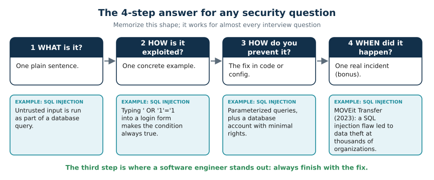

# Chapter 9: Interview Q&A (45 Questions)

> **Goal.** Answer each question out loud in 45-90 seconds, in the shape **threat, control, backup layer, how you would test it**.
>
> **Time:** about 3 hours for two rounds. Round 1: cover the answer, speak, compare, mark green/yellow/red. Round 2 (two days later): only yellow and red.

---

## Landscape and fundamentals

**1. What are the biggest security threats right now?**
Three doors: exploited known vulnerabilities (about 31% of breach starts in Verizon's 2026 report, as reported), stolen or phished credentials (about 13%), and third parties (about 48% of breaches). Ransomware monetizes that access. AI adds scaled phishing and a new attack surface (prompt injection, agents with tool access). Most of it is preventable with fast patching, phishing-resistant MFA, least privilege and vendor hygiene.

**2. What is the CIA triad?**
Confidentiality, integrity, availability. I classify any attack by the leg it breaks: a leak breaks confidentiality, tampering breaks integrity, ransomware or DDoS breaks availability.

**3. Vulnerability vs threat vs risk?**
A vulnerability is a weakness, a threat is something that could use it, risk is likelihood times impact. An easy-to-reach bug that exposes every customer is high risk; a hard-to-reach bug that exposes nothing is low.

**4. What are least privilege and defence in depth?**
Least privilege: each user and service gets only the access it needs, so a compromise is contained (the app's DB user cannot `DROP TABLE`). Defence in depth: overlapping controls so one failure is not fatal: parameterized queries, minimal DB rights, a WAF as a backup, logging. Test: try the action with the lowest-privilege account.

**5. Walk me through how an attacker compromises a system.**
Recon, scanning, gaining access, maintaining access, covering tracks. Today "gaining access" is usually a known flaw, a stolen login or a convincing phone call. Defenders break the chain early. The industry's detailed model is MITRE ATT&CK.

**6. How do you defend against DDoS?**
A CDN or scrubbing service absorbs volume at the edge; per-client rate limits; cache and make expensive endpoints cheap; hide the origin IP; autoscale as a buffer; a runbook. In Cloudflare's first-half-2026 data 96.62% of attacks were under 500 Mbps and 90.60% ended within 10 minutes, so automatic mitigation matters more than manual response.

---

## Web foundations

**7. Where is the trust boundary, and where do you validate?**
The browser is untrusted: anything the client sends can be forged. Client validation is UX. The server validates and authorizes every request, and takes identity from the session, never from request fields. The same rule covers text an AI model reads.

**8. Walk me through the secure request pipeline.**
TLS and HSTS; limits (rate, size); authenticate; authorize per object; validate against a schema; do the work with parameterized queries and least privilege; respond with minimal fields and generic errors; log security events without secrets.

**9. What happens when you type https://bank.com, with a risk per step?**
DNS (spoofing), TCP handshake (floods), TLS (man-in-the-middle, prevented by certificates), HTTP request (session theft, CSRF), server work (injection, broken access control), response and render (XSS if output is not encoded).

**10. What do HttpOnly, Secure and SameSite do, and what are 401 vs 403?**
HttpOnly hides a cookie from scripts (limits XSS theft), Secure sends it only over HTTPS, SameSite limits cross-site sending (limits CSRF). 401 means not authenticated; 403 means authenticated but not allowed; I sometimes return 404 for "not yours" so existence is not revealed.

**11. Same-origin policy, CORS and CSRF: how do they relate?**
The same-origin policy stops a page *reading* other origins' responses, not *sending* requests. CORS lets a server relax that for chosen origins; it is not authentication. CSRF abuses automatic cookie sending; defend with SameSite cookies, tokens or Origin checks. CORS settings do not fix CSRF.

**12. How does XSS happen in a React app, and how do you fix it?**
React escapes `{value}`, so XSS comes from escape hatches: `dangerouslySetInnerHTML`, `innerHTML`, user-supplied `href` (`javascript:` URLs), `eval`. Render text, sanitize with DOMPurify when HTML is required, allowlist URL schemes, and add a CSP as a backup.

**13. What is a CSP and how do you roll it out?**
A header telling the browser which scripts may run. Use a nonce-based policy with `'strict-dynamic'`, `object-src 'none'`, `base-uri 'self'`, `frame-ancestors`. Deploy report-only first, fix violations, then enforce. It limits XSS impact; it does not replace encoding.

---

## Identity and access

**14. What are BOLA and IDOR, and how do you prevent them?**
The same flaw: changing an ID to reach someone else's object because the server checked "logged in" but not "owns this". Scope the query to the owner or tenant (`findFirst({ where: { id, ownerId } })`) and return 404 otherwise. Test: log in as A, request B's resource, expect 404. Unguessable IDs are a bonus, not a control.

**15. BOLA vs BFLA vs mass assignment?**
BOLA: reaching another user's object. BFLA: calling a function you should not, such as an admin endpoint. Mass assignment: setting fields you should not by copying a request body into a model. Fixes: owner-scoped queries, deny-by-default role checks, strict schemas and response DTOs.

**16. Sessions or JWTs?**
For a normal web app, server-side sessions in an HttpOnly cookie: easy to revoke, nothing for scripts to steal. JWTs suit stateless service-to-service calls and must be short-lived. Keep revocation and rotation in mind either way.

**17. How do you verify a JWT correctly?**
Verify the signature (never `decode`), pin the algorithm, check issuer, audience and expiry, use a strong secret or asymmetric keys, keep tokens short-lived, and put no secrets in the payload (it is only encoded).

**18. How should passwords be stored?**
Argon2id with at least 19 MiB memory, 2 iterations, 1 parallelism (OWASP minimum), parameters stored with the hash so you can rehash on login; scrypt (N=2^17, r=8, p=1) as an alternative; bcrypt (work factor 10+, 72-byte limit) for legacy. Add breached-password checks and rate limiting. Better: passkeys.

**19. Explain OAuth authorization code with PKCE.**
The app sends the user to the authorization server with a hashed `code_challenge`; after login it receives a code and redeems it with the original `code_verifier`, so a stolen code is useless. Use exact redirect URIs, a `state` check, minimal scopes, and a maintained library.

**20. What are passkeys and their limits?**
Public-key credentials (WebAuthn/FIDO2): the device signs a server challenge with a private key tied to the real domain, so phishing sites get nothing and a database leak exposes only public keys. Limits: account recovery becomes the weak link, and password fallbacks persist during adoption.

**21. Where does a single-page app keep its login?**
Not in `localStorage` (any XSS reads it). Best: a server-set HttpOnly, SameSite session cookie with CSRF protection, or a backend-for-frontend that keeps OAuth tokens off the browser. And still fix XSS: HttpOnly limits what a foothold is worth, but scripts can use the session while the page is open.

---

## Injection, crypto and backend

**22. How do you prevent SQL injection, including with an ORM?**
Parameterized queries everywhere; ORMs are safe until the raw escape hatch (`$queryRawUnsafe`, string-built `raw()`). Allowlist identifiers like `ORDER BY` columns, use a least-privilege DB user, WAF only as a backup. MOVEit (2023) shows SQL injection can still cause a mass breach.

**23. How do you prevent command injection and path traversal?**
Avoid shells: `execFile` or `subprocess.run([...], shell=False)` with an allowlisted program and validated arguments. For paths, resolve and check the prefix, or store files under random IDs.

**24. How do you defend against SSRF?**
Allowlist hosts where possible; otherwise validate the scheme and the resolved IP against private, loopback and link-local ranges (including the cloud metadata address), connect to the validated address, re-check redirects, add timeouts and size caps, do not return raw responses, use IMDSv2 and least-privilege cloud roles, and restrict egress.

**25. How do you handle file uploads securely?**
Require auth, cap size, check real content against an allowlist, rename to a random ID, store outside the web root or in object storage, serve from a separate domain with `nosniff`, treat SVG and PDF as active content.

**26. How do you build a secure webhook receiver?**
Verify an HMAC over the raw body plus timestamp with a constant-time comparison, reject old timestamps to stop replays, keep the secret in a secrets manager, make the handler idempotent because providers retry, and process in a queue.

**27. Hashing vs encryption vs encoding?**
Hashing is one-way (integrity, passwords). Encryption is reversible with a key (confidentiality). Encoding, like Base64, is reversible by anyone and gives no security.

**28. How does HTTPS work?**
TCP handshake, then TLS: the server sends its certificate and key share, the client validates the chain, both derive session keys, and traffic is encrypted symmetrically. A man-in-the-middle cannot present a valid certificate. Forward secrecy: session keys are temporary, so a later key theft cannot decrypt past traffic.

**29. How do you manage secrets?**
A secrets manager injected at runtime; never in code, Git, images, bundles, logs or prompts; separate per environment; short-lived credentials (OIDC, cloud roles) where possible; secret scanning and push protection; and a rehearsed response: revoke, rotate, check what it touched.

---

## Supply chain, CI and incidents

**30. What is a software supply-chain attack and how do you defend?**
Compromising something you depend on: the Shai-Hulud npm worm (2025), the chalk/debug maintainer phish (2025), the tj-actions tag rewrite (2025), XZ Utils (2024). Defences: lockfiles and `npm ci`, a cooldown on brand-new versions, blocking install scripts where possible, scanning, an SBOM, trusted publishing with short-lived tokens, SHA-pinned Actions, least-privilege CI.

**31. How do you harden a CI/CD pipeline?**
Pin third-party Actions to full commit SHAs, read-only token permissions by default, never put untrusted input inside `run:` (use environment variables), avoid `pull_request_target` with untrusted code, no secrets for forks, OIDC to the cloud, branch protection and required reviews.

**32. A secret was committed to Git. What do you do?**
Revoke or rotate it immediately (deleting the commit is not enough), find what it could access and review provider logs, replace it with a narrower or short-lived credential, then fix the root cause: secret scanning, push protection, a secrets manager.

**33. A critical CVE hits a core dependency. What is your process?**
Find exposure from the lockfile and SBOM, check whether it is in CISA KEV and internet-facing, patch or mitigate, verify with tests, rotate secrets if exploitation is plausible, check logs, communicate. React2Shell (CVE-2025-55182, CVSS 10, KEV on 5 December 2025) is the example of how fast a framework flaw gets exploited.

**34. What is the incident-response process, and why does containment come first?**
Identify, contain, eradicate, recover, lessons learned. Containing first (isolate hosts, revoke credentials and sessions) stops the spread and preserves evidence; wiping first destroys evidence and may tip off the attacker. Change Healthcare (2024) shows one missing control (no MFA on a portal) plus nine days of free movement.

**35. What is "harvest now, decrypt later" and the post-quantum timeline?**
Attackers can record encrypted traffic today and decrypt it once a powerful quantum computer exists. NIST published ML-KEM, ML-DSA and SLH-DSA in August 2024 and its transition plan deprecates RSA/ECC after 2030 and disallows them after 2035. Practical steps: inventory crypto use, stay crypto-agile, prefer TLS 1.3, adopt hybrid post-quantum key exchange as libraries support it.

**36. Design secure login for a single-page app plus an API.**
Passkeys and/or OIDC authorization code with PKCE via a maintained library; the login in an HttpOnly, Secure, SameSite cookie (or a backend-for-frontend); CSRF protection; rate limiting; regenerate the session at login; short sessions with revocation; a hardened recovery flow. Test: login throttling, session fixation, cross-user access.

---

## AI-agent era questions

**37. How do you use AI coding agents safely?**
Three layers. Limit reach: a sandbox, scoped short-lived tokens, no production credentials, no secrets in the environment, approval for risky actions. Limit inputs: repo files, issues, web pages and MCP tools are untrusted and can steer the agent. Check outputs: small PRs, the five review questions, negative tests, and CI gates for dependencies and secrets. Test: a prompt-injection canary in a throwaway repo shows whether the agent obeys text in data.

**38. What is prompt injection, and why is it harder for a coding agent?**
The model cannot reliably separate instructions from data, so text it reads can steer it. Indirect injection (hidden in an issue, README, web page or tool description) is the dangerous kind. A coding agent can run commands and use your tokens, so a successful injection acts with your permissions. No filter is complete, so I contain it: least privilege, a sandbox, approvals, and no secrets in reach.

**39. An agent suggests a package you have never heard of. What do you do?**
Verify it exists and is the real one (publisher, creation date, repository, downloads), ask whether we need it, and install with a lockfile and `--ignore-scripts` behind a release-age cooldown. Models sometimes invent package names that an attacker can register (a USENIX 2025 study measured at least 5.2% for commercial models and 21.7% for open-source models). A human approves every new dependency.

**40. What do you check first in AI-generated code?**
Authorization per object and action (agents often add only a login check), then input validation and the sinks (SQL, shell, HTML, URLs), secrets and crypto (`Math.random`, hard-coded keys), permissive CORS and CSP, and new dependencies. I ask for the negative tests first, then review the test diff too.

**41. How would you design an AI assistant that can look up a customer's orders?**
The backend calls the model; the key never reaches the browser. Tools are narrow read-only functions that authorize against the signed-in user (same BOLA check as the API). Retrieval is filtered by tenant and permissions. Output is validated and sanitized. Add rate limits, budgets, logging and red-team tests. Avoid combining private data, untrusted content and an outbound channel.

**42. What is MCP and what are its main security risks?**
The Model Context Protocol lets an agent call external tools. Risks: tool poisoning (hostile instructions in a tool description, which can change after approval), malicious or over-privileged servers, token pass-through and confused-deputy flaws, SSRF, and local servers that run commands. Mitigations: allow-list and pin servers, read full tool descriptions, show the command before installing, minimal scopes, and sandboxing.

**43. Should an agent be allowed to edit its own configuration, rules files or tests?**
Changes to rules files, MCP config, hooks and permissions change what the agent can do, and tests define "correct". I put them under CODEOWNERS and review them as code. A reported Copilot flaw (CVE-2025-53773) let injected text enable auto-approval by editing workspace settings, and an agent that cannot make a test pass may weaken it.

**44. What did the Nx "s1ngularity" attack teach?**
Malicious npm releases ran a script that used AI command-line tools already on developers' machines, with their approval-bypass flags, to search for secrets and publish them. Lessons: install scripts are code execution, secrets on disk and in the environment are reachable, installed agents are tools an attacker can call, and tokens need narrow scope and short lifetime.

**45. Agents write most of our code. What should a team change?**
Keep PRs small and owned by a human. Write negative authorization tests first. Run SAST, secret scanning and dependency checks in CI. Put agent config under review. Give agents scoped dev credentials only. Train the team on the 15 classic bugs. The skill that matters most is review.

