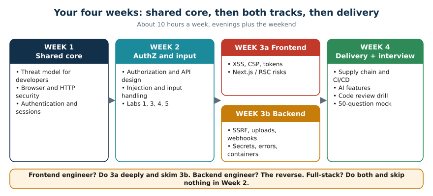

# Secure Coding for Frontend and Backend Engineers

*A 2026 interview edition. For software engineers who build web apps and APIs, and who have one month, about 10 hours a week, and a security-flavoured technical interview ahead.*

> **Goal.** After four weeks you can (1) find and fix the security bugs that actually appear in frontend and backend code, (2) explain *why* each fix works, (3) design login, authorization, file upload and webhook features securely, (4) harden your dependencies and CI pipeline against the supply-chain attacks of 2025-26, and (5) answer security interview questions with code, not buzzwords.
>
> **How this differs from the first book.** The first book (`interview-prep-book/`) teaches *cybersecurity* broadly: scanning, malware, networks, incident response. This one teaches *secure software engineering*: the bugs you can create or prevent in a pull request. It is shorter on attacker tooling and longer on code, frameworks, and review.

---

## 1. Pick your path

| If you mostly work on... | Do this | Skim this |
| --- | --- | --- |
| **Frontend** (React, Next.js, Vue, mobile web) | Chapters 2-5 (shared core), **7 (frontend)**, 9, 10, 11 | Chapter 8 (backend) |
| **Backend** (Node, Python, Java, Go APIs) | Chapters 2-6 (shared core, injection), **8 (backend)**, 9, 10, 11 | Chapter 7 (frontend) |
| **Full-stack** | Everything, in order | Nothing |

Whichever you choose, **do the labs**: reading builds recognition, but running a vulnerable app next to its fixed twin builds the instinct to spot the bug in review.

> **Code language.** Examples are mostly **TypeScript** (Node/Express, React, Next.js) with **Python** equivalents where the idea differs. The *ideas* are language-independent: parameterized queries, per-object authorization and output encoding look the same in Java, Go or C#. Map each snippet to your own stack as you read.

---

## 2. What is in the book

| File | Topic | Track | Time |
| --- | --- | --- | --- |
| [01-plan.md](01-plan.md) | Day-by-day schedule for 28 days | all | - |
| [02-threat-model-for-developers.md](02-threat-model-for-developers.md) | How web apps are attacked in 2026, trust boundaries, the secure request pipeline | all | 1 h |
| [03-browser-and-http-security.md](03-browser-and-http-security.md) | Same-origin policy, cookies, CSRF, CORS, security headers | all | 3 h |
| [04-authentication-and-sessions.md](04-authentication-and-sessions.md) | Passwords, sessions, JWT, OAuth + PKCE, passkeys, token storage | all | 3.5 h |
| [05-authorization-and-api-design.md](05-authorization-and-api-design.md) | BOLA/IDOR, BFLA, mass assignment, multi-tenancy, GraphQL, business logic | all | 2.5 h |
| [06-input-handling-and-injection.md](06-input-handling-and-injection.md) | Validation, SQL/NoSQL/command injection, deserialization, React2Shell | all | 3 h |
| [07-frontend-security.md](07-frontend-security.md) | XSS in React, CSP, token storage, secrets in bundles, Next.js and RSC risks | **FE** | 3.5 h |
| [08-backend-security.md](08-backend-security.md) | SSRF, uploads, webhooks, secrets, errors, databases, containers | **BE** | 3.5 h |
| [09-supply-chain-and-ci-cd.md](09-supply-chain-and-ci-cd.md) | npm and pip hygiene, GitHub Actions hardening, trusted publishing | all | 2 h |
| [10-ai-features-for-developers.md](10-ai-features-for-developers.md) | Prompt injection, tool permissions, safe output handling | all | 1.5 h |
| [11-secure-code-review.md](11-secure-code-review.md) | Review checklist, 15 "spot the vulnerability" snippets, security tests, ASVS | all | 2 h |
| [12-interview-qa.md](12-interview-qa.md) | 50 interview questions with model answers | all | 4 h |
| [13-labs.md](13-labs.md) | 12 hands-on labs (7 are runnable code you can execute now) | all | - |
| [14-cheat-sheets.md](14-cheat-sheets.md) | Copy-paste configs and checklists | all | - |
| [15-sources.md](15-sources.md) | Sources, accuracy notes | all | - |

---

## 3. How every chapter works

1. **Goal box**: what you will be able to do, and who it is for.
2. **The idea in a picture**, then in words.
3. **Vulnerable code, then fixed code** (wherever there is code to show).
4. **A real recent case** (2024-2026), labelled confirmed or reported.
5. **Common mistake** and **interview angle** boxes.
6. **Check yourself** with answers underneath, and a short **summary**.

> **Analogy.** An idea to make it stick.

> **Real case.** A real incident that shows the idea in the wild.

> **Common mistake.** What developers (and AI assistants) get wrong.

> **Interview angle.** How to turn this into a strong answer.

---

## 4. The answer shape for interviews

For any "how would you secure X?" question, answer in this order:

1. **Threat:** what could go wrong, in one sentence.
2. **Control:** the specific fix, ideally with a one-line code or config example.
3. **Layer:** one backup control in case the first fails (defence in depth).
4. **Test:** how you would verify it works (a unit test, a scanner, a code-review rule).

Example, for "How do you prevent IDOR?": *"A user can change an ID to reach another user's data. I scope every query to the current user, for example `findFirst({ where: { id, ownerId: user.id } })`, and return 404 otherwise. As a second layer I add row-level security in the database. And I write a test that logs in as user A and asserts user B's resources return 404."*

---

## 5. Ground rules

1. **Local only.** Run the labs on your own machine. Test only systems you own or have written permission to test, and practice platforms such as PortSwigger's Web Security Academy.
2. **Run the code.** Every lab has a vulnerable version and a fixed version. Break it, then fix it.
3. **Prefer libraries to cleverness.** For crypto, auth, sanitizing and parsing, use a maintained library and keep it updated. Almost every bug in this book is a developer re-implementing something.
4. **Say "reported" when unsure.** Security facts move fast. Confirmed facts get stated plainly; claims from news roundups get a hedge. That habit makes you sound credible.
5. **Patch speed is a feature.** In December 2025 a critical flaw in React Server Components (CVSS 10) was exploited within days. Keeping dependencies current is part of your job, not someone else's.

Start with [02-threat-model-for-developers.md](02-threat-model-for-developers.md), or open the [plan](01-plan.md) to see tonight's session.
