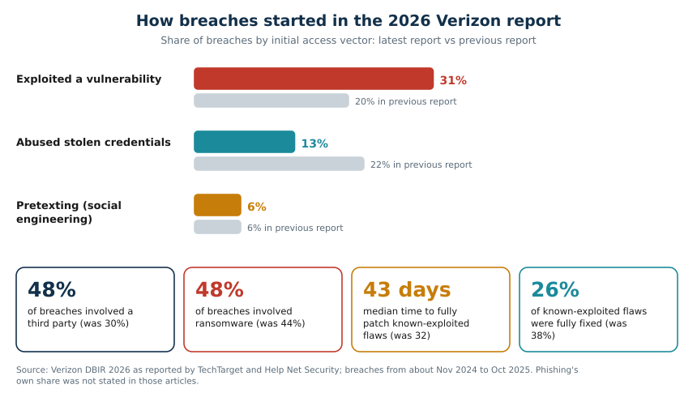
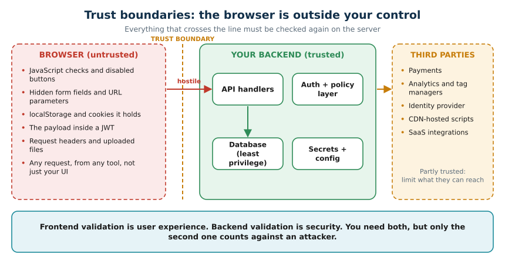
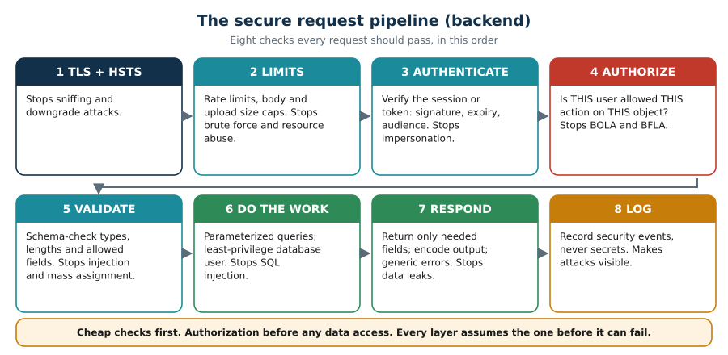
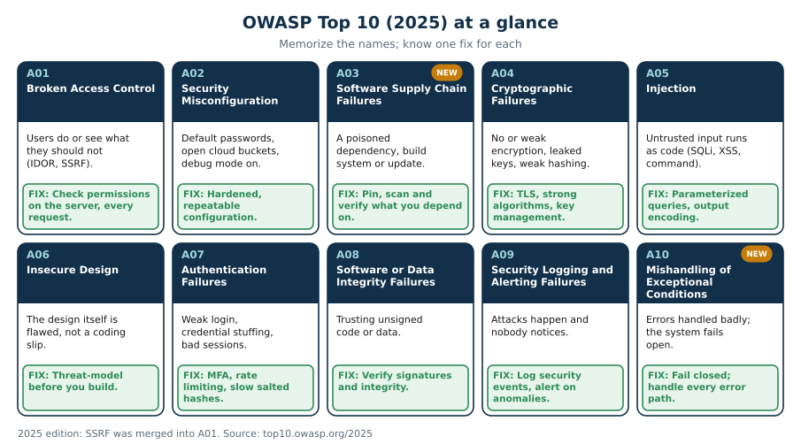
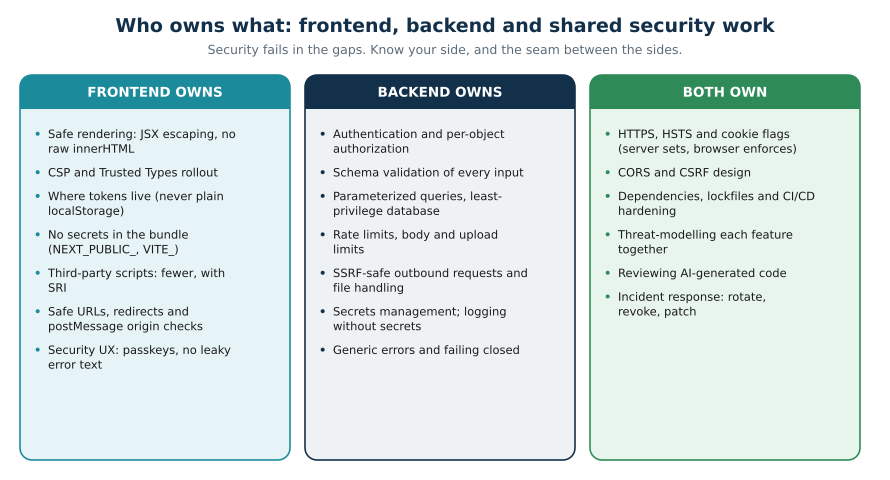

# Chapter 2: A Threat Model for Developers

> **Goal.** After this chapter you can: say how web apps and their teams are attacked in 2026, with numbers; draw the trust boundaries of a web app and say where to validate; recite the eight-step secure request pipeline; map the OWASP Top 10 (2025) to *your* side of the stack; and threat-model a feature in ten minutes.
>
> **Who:** frontend, backend, full-stack. **Time:** about 1 hour.

---

## 1. What attackers actually do

The best yearly evidence is the **Verizon Data Breach Investigations Report**. Its 2026 edition (May 2026), as reported by [TechTarget](https://www.techtarget.com/cybersecurity/news/366643420/Verizon-2026-DBIR-6-key-takeaways-for-CISOs) and [Help Net Security](https://www.helpnetsecurity.com/2026/05/20/verizon-2026-dbir-findings/), says:

- **Exploiting a vulnerability** is now the top way in (about 31%, up from 20%), ahead of stolen credentials (about 13%).
- **Third parties** were involved in about 48% of breaches (up from 30%): vendors, SaaS tokens, **open-source dependencies**.
- Only about 26% of known-exploited flaws were fully fixed, and the median time to fix was 43 days.

**What that means for a developer:** you influence all three. You choose the frameworks and dependencies (exposure to exploitable flaws), you write the login and authorization code (stolen credentials and broken access), and you decide which third-party code runs in your app.

> **Real case: React2Shell (December 2025).** A critical flaw in **React Server Components** (CVE-2025-55182, CVSS 10.0) let an unauthenticated attacker send a crafted request to a Server Function endpoint and run code on the server, because of how React decoded the payload. It affected `react-server-dom-*` versions 19.0 to 19.2.0 and the frameworks that bundled them (Next.js, React Router, Waku and others). **CISA added it to its Known Exploited Vulnerabilities list on 5 December 2025**, and The Register reported about a week later that roughly half of exposed instances were still unpatched. *Lesson:* a framework you chose can become your biggest vulnerability overnight, and patch speed is a security control. (Details: [React's advisory](https://react.dev/blog/2025/12/03/critical-security-vulnerability-in-react-server-components).)

---

## 2. Trust boundaries: the one diagram to remember

A web app has two zones. **Everything in the browser is controlled by the user** (or by an attacker): JavaScript checks, hidden fields, cookies, tokens, request headers, URLs. **Everything on your server is controlled by you.** The line between them is the **trust boundary**.

**Three rules fall out of the picture:**

1. **Validate on the server.** Frontend validation is *user experience* (instant feedback). Backend validation is *security*. Disabling a button, hiding a menu or checking a form in JavaScript protects nothing from someone who sends the request by hand.
2. **Authorize on the server, for every request.** A route guard in React is a convenience; the API must check permissions itself.
3. **Treat third parties as partly trusted.** A tag-manager script, an analytics snippet or a CDN-hosted library runs with your page's powers.

> **Analogy.** A bank teller can be polite and helpful (frontend UX), but the vault door (backend) must check ID every single time, no matter what the teller said.

---

## 3. The secure request pipeline

Every request to your backend should pass the same checks, in the same order. Memorize this; it is the skeleton of most good answers.

| # | Step | Stops | Where you meet it |
| --- | --- | --- | --- |
| 1 | **TLS + HSTS** | Sniffing, downgrade | Chapter 3 |
| 2 | **Limits** (rate, size) | Brute force, resource abuse | Chapters 5 and 8, Lab 6 |
| 3 | **Authenticate** | Impersonation | Chapter 4 |
| 4 | **Authorize** (per object) | BOLA, BFLA | Chapter 5, Lab 1 |
| 5 | **Validate** (schema) | Injection, mass assignment | Chapter 6 |
| 6 | **Do the work** (parameterized, least privilege) | SQL injection | Chapter 6 |
| 7 | **Respond** (minimal fields, encoded, generic errors) | Data leaks, XSS | Chapters 6 and 7 |
| 8 | **Log** (no secrets) | Invisible attacks | Chapter 8 |

---

## 4. The OWASP Top 10 (2025), from a developer's seat

| Risk | You will meet it as | FE | BE | See |
| --- | --- | --- | --- | --- |
| **A01 Broken Access Control** | Missing ownership check; client-only route guards; server actions without auth | ✔ | ✔✔ | Ch. 5, 7 |
| **A02 Security Misconfiguration** | Wide-open CORS, debug mode on, public buckets, missing headers | ✔ | ✔✔ | Ch. 3, 8 |
| **A03 Software Supply Chain Failures** | Poisoned npm or PyPI package, compromised GitHub Action, unpinned dependency | ✔✔ | ✔✔ | Ch. 9 |
| **A04 Cryptographic Failures** | Plain-text secrets, weak hashing, `Math.random()` tokens, no TLS verification | ✔ | ✔✔ | Ch. 4 |
| **A05 Injection** | XSS (FE), SQL/NoSQL/command injection (BE), prompt injection | ✔✔ | ✔✔ | Ch. 6, 7 |
| **A06 Insecure Design** | No rate limit on login; race conditions in checkout; no threat model | ✔ | ✔✔ | Ch. 5 |
| **A07 Authentication Failures** | Weak sessions, JWT mistakes, no MFA, bad reset flow | ✔ | ✔✔ | Ch. 4 |
| **A08 Software or Data Integrity Failures** | Unsigned updates, insecure deserialization, unverified webhooks | ✔ | ✔✔ | Ch. 6, 8 |
| **A09 Security Logging and Alerting Failures** | No audit log; logging secrets | | ✔✔ | Ch. 8 |
| **A10 Mishandling of Exceptional Conditions** | Errors that fail open; stack traces to users | ✔ | ✔✔ | Ch. 8 |

(✔✔ = mostly your side's responsibility.) **What changed in 2025:** two new categories (A03 supply chain, A10 exceptional conditions), and SSRF folded into A01. The **OWASP API Security Top 10 (2023)** adds API-specific names such as **BOLA** (API1); you will meet it in Chapter 5.

---

## 5. Who owns what

Security bugs love the **seams**: the frontend assumes the backend validates, the backend assumes the frontend sanitizes, and nobody does. In your team, make the seam explicit: *"The API validates and authorizes; the UI escapes and handles tokens carefully; both of us own the dependencies."*

---

## 6. Threat-model a feature in ten minutes

**STRIDE** is a six-question checklist. Draw the feature as boxes and arrows (browser, API, database, third party) and ask each question at each arrow.

| Letter | Threat | Question | Typical control |
| --- | --- | --- | --- |
| **S** | Spoofing | Can someone pretend to be someone else? | Strong auth, passkeys, signed webhooks |
| **T** | Tampering | Can data be altered in transit or at rest? | Server-side validation, signatures, integrity checks |
| **R** | Repudiation | Could someone deny they did it? | Audit logs |
| **I** | Information disclosure | Could data leak? | Authorization, encryption, minimal responses |
| **D** | Denial of service | Can it be overwhelmed? | Rate limits, size limits, timeouts |
| **E** | Elevation of privilege | Can a user become an admin or reach others' data? | Per-object checks, least privilege |

**Worked example: "Change my email address".**

| S | T | R | I | D | E |
| --- | --- | --- | --- | --- | --- |
| Attacker with a stolen session changes the email, then resets the password | Request edited to change someone else's email | No record of who changed it | The form reveals whether an email is already registered | Mass email-change requests flood the mailer | A user changes another user's email by editing an ID |
| **Re-authenticate (password or passkey) before the change; confirm via the old and new address** | **Take the user ID from the session, never from the request** | **Audit-log the change with time and IP** | **Same message whether or not the email exists** | **Rate-limit per account** | **Authorize against the session user** |

That table *is* a threat model, and describing one like this in an interview is a strong answer.

---

## 7. Interview angle

> **"How do you think about security when building a feature?"**
> "I start with where the trust boundaries are: anything from the browser is hostile, so the server validates and authorizes every request. I run a quick STRIDE pass on the feature, for example for 'change email': re-authenticate, take the user ID from the session, audit-log it, rate-limit it. Then I make sure the standard pipeline is in place: limits, authentication, per-object authorization, schema validation, parameterized queries, minimal responses, and logging. Finally I check what third-party code and dependencies the feature adds, because supply-chain and framework flaws are among the most exploited things right now, like React2Shell in December 2025."

---

## Check yourself

1. According to Verizon's 2026 report, what is now the most common way breaches start, and what share involved a third party?
2. Why can't frontend validation be relied on for security?
3. Name the eight steps of the secure request pipeline in order.
4. Which OWASP Top 10 (2025) categories are new, and what happened to SSRF?
5. What was React2Shell, and what does it teach about dependencies?
6. Do a STRIDE pass on "upload a profile picture" in one sentence per letter.

**Answers** *(cover this until you have tried)*

1. Exploiting a vulnerability (about 31%); third parties were involved in about 48% of breaches.
2. The user controls the browser and can send any request by hand, so checks there can be bypassed. Server-side validation is the only one that counts against an attacker.
3. TLS + HSTS, limits, authenticate, authorize, validate, do the work (parameterized), respond (minimal and encoded), log.
4. A03 Software Supply Chain Failures and A10 Mishandling of Exceptional Conditions. SSRF was merged into A01 Broken Access Control.
5. A CVSS 10 unauthenticated remote code execution flaw in React Server Components (CVE-2025-55182), exploited within days and added to CISA's KEV list on 5 December 2025. It shows that framework and dependency patching is a security control with a deadline.
6. Spoofing: only logged-in users upload. Tampering: validate type and content on the server. Repudiation: log who uploaded what. Information disclosure: don't expose other users' files or leak metadata. Denial of service: cap size and rate. Elevation: ensure users can only replace their own picture and uploaded content can't execute.

---

## Summary

- Breaches mostly start with exploited known flaws, stolen logins and third parties (Verizon 2026). You influence all three.
- The browser is outside your trust boundary: validate and authorize on the server, every request.
- The secure request pipeline: TLS, limits, authenticate, authorize, validate, parameterized work, minimal responses, logging.
- OWASP Top 10 (2025): know which items are yours; A03 supply chain and A10 exceptional conditions are new.
- STRIDE turns "is this secure?" into a ten-minute habit.
