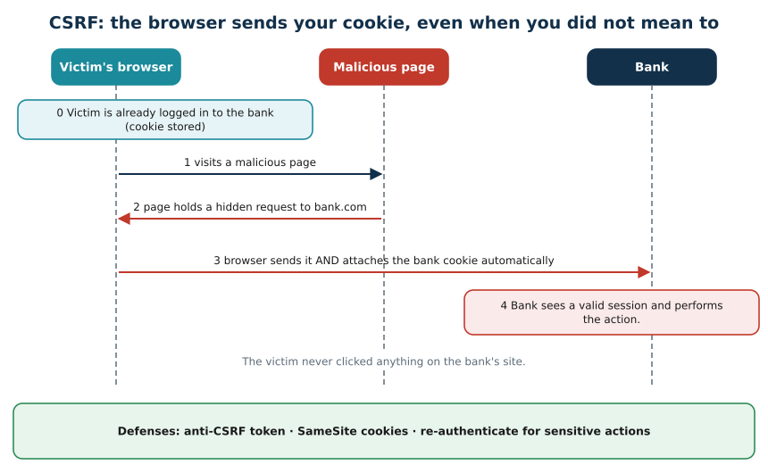
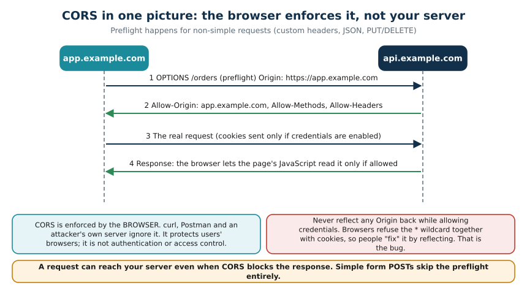

# Chapter 3: The Browser and HTTP Security Model

> **Goal.** After this chapter you can: explain the same-origin policy and what it does and does not block; set cookies securely (and say what each flag defends); explain and prevent CSRF; configure CORS correctly and explain why it is not access control; and apply the essential security headers.
>
> **Who:** frontend and backend (this is the seam between them). **Time:** about 3 hours. **Labs:** [Lab 2](13-labs.md) (XSS + CSP).

---

## 1. Origins and the same-origin policy

An **origin** is `scheme + host + port`, for example `https://app.example.com:443`. Two URLs are *same-origin* only if all three match. `https://app.example.com` and `https://api.example.com` are **different origins** even though they share a domain.

The **same-origin policy (SOP)** is the browser rule that **a page from one origin cannot *read* data from another origin**. That is why a random website can't read your open webmail tab.

| Allowed across origins | Blocked across origins |
| --- | --- |
| Embedding images, scripts, styles, iframes | Reading the response of a `fetch`/XHR to another origin (unless CORS allows it) |
| **Sending** requests (links, form posts, `fetch`) | Reading another origin's DOM or storage |

> **The key subtlety.** SOP restricts *reading*, not *sending*. A malicious page can still make your browser **send** a request to your bank, and the browser will attach your cookie. That is exactly what CSRF abuses (section 3). Cookies and the SOP are governed by *different* rules, and mixing them up is the root of many bugs.

---

## 2. Cookies: the attributes that matter

Cookies are how browsers remember a login. Whoever holds the session cookie *is* that user, so the attributes are your first line of defence.

| Attribute | What it does | Defends against |
| --- | --- | --- |
| **HttpOnly** | JavaScript cannot read the cookie | Cookie theft through XSS |
| **Secure** | Sent only over HTTPS | Sniffing; accidental HTTP use |
| **SameSite=Lax / Strict** | Not sent on most cross-site requests (Lax still allows top-level navigations) | CSRF |
| **Path / Domain** | Where the cookie is sent. Omit `Domain` so it stays on the exact host | Cookie leaking to sibling subdomains |
| **Max-Age / Expires** | Lifetime. Keep session cookies short | Long-lived stolen sessions |
| **`__Host-` name prefix** | Browser enforces `Secure`, `Path=/`, and no `Domain` | Subdomain cookie tossing and overwriting |

**Backend (Express):**

```ts
res.cookie("__Host-sid", sessionId, {
  httpOnly: true,
  secure: true,       // HTTPS only (set app.set("trust proxy", 1) behind a reverse proxy)
  sameSite: "lax",
  path: "/",
  maxAge: 8 * 60 * 60 * 1000,   // 8 hours
});
```

**Backend (Python / FastAPI):**

```python
response.set_cookie("__Host-sid", session_id, httponly=True, secure=True,
                    samesite="lax", path="/", max_age=8 * 3600)
```

> **Common mistake.** Relying on a browser's *default* `SameSite` behaviour. Chrome and Edge treat cookies without a `SameSite` attribute as `Lax`, but other browsers and versions differ. **Always set it explicitly.**

---

## 3. CSRF: your cookie sent without your intent



**The attack.** You are logged in to `bank.com`. You visit a malicious page, which makes your browser send `POST bank.com/transfer`. Because browsers attach cookies automatically, the request arrives **authenticated**. The attacker never sees your cookie; they just borrow it.

**It needs three things:** cookie-based authentication, a state-changing action, and parameters the attacker can predict.

**Defences, strongest layers first:**

1. **`SameSite=Lax` (or `Strict`) cookies.** Blocks the cookie on most cross-site POSTs. This removed much classic CSRF.
2. **A CSRF token** for state-changing requests: a random per-session value that the real page includes and the server verifies. A forged request cannot know it.
3. **Check `Origin` (or `Referer`)** on state-changing requests and reject unexpected origins.
4. **For JSON APIs:** require a custom header such as `X-Requested-With` or a CSRF header. Browsers will not add custom headers on cross-site requests without a CORS preflight that you control.
5. **Never change state on `GET`.** Links and image tags send GETs.
6. **Re-authenticate** for sensitive actions (change email, change password, move money).

```ts
// Express: reject state-changing requests from other origins (a simple Origin check)
const ALLOWED = new Set(["https://app.example.com"]);
app.use((req, res, next) => {
  if (["POST", "PUT", "PATCH", "DELETE"].includes(req.method)) {
    const origin = req.get("origin");
    if (origin && !ALLOWED.has(origin)) return res.sendStatus(403);
  }
  next();
});
```

> **Do you still need CSRF protection if you use a bearer token in an `Authorization` header?** Header-based tokens aren't attached automatically, so classic CSRF doesn't apply. But the moment you put the token in a **cookie**, it does. And token-in-header means JavaScript holds the token, which brings the XSS storage question (Chapter 4 and 7).

> **CSRF vs XSS.** XSS runs the *attacker's code* in your page. CSRF runs no attacker code on your site; it tricks the *browser* into sending a request. An XSS flaw also defeats CSRF tokens, because attacker script on your page can read the token.

---

## 4. CORS: relaxing the same-origin policy



**CORS (Cross-Origin Resource Sharing)** is how a server tells the *browser* "pages from these origins may read my responses". A browser enforces it by sending a **preflight** `OPTIONS` request for non-simple requests (custom headers, JSON bodies, `PUT`/`DELETE`) and checking the reply.

**What CORS is not:** authentication, authorization or CSRF protection. **curl, Postman and an attacker's own server ignore CORS completely.** A request can reach your server even when CORS stops the page from reading the answer.

**Correct configuration (an allowlist):**

```ts
import cors from "cors";

const ALLOWED_ORIGINS = new Set(["https://app.example.com", "https://admin.example.com"]);

app.use(cors({
  origin(origin, callback) {
    // No Origin header = not a browser cross-origin request (curl, server-to-server). Authentication still applies.
    callback(null, !origin || ALLOWED_ORIGINS.has(origin));
  },
  credentials: true,                          // only if you really use cookies across origins
  methods: ["GET", "POST", "PUT", "PATCH", "DELETE"],
  allowedHeaders: ["Content-Type", "Authorization"],
  maxAge: 600,
}));
```

**The classic mistakes:**

| Mistake | Why it is dangerous |
| --- | --- |
| Reflecting any `Origin` back **together with** `Allow-Credentials: true` | Any website can then read your authenticated responses. This is the real-world bug: browsers reject `*` with credentials, so developers "fix" it by reflecting |
| Allowing `null` as an origin | Sandboxed iframes and some local files send `Origin: null` |
| A sloppy regex such as `/example\.com$/` | Matches `evilexample.com`, or `example.com.evil.com` if not anchored properly |
| Using `*` on an endpoint that returns private data | Lets any site read it (when the browser sends no credentials, this is mostly harmless; but don't improvise) |

> **Interview angle.** "What is CORS and why isn't it security?" → *"CORS is the browser's mechanism for letting a server opt out of the same-origin policy for specific origins. It only governs whether a page's JavaScript can read a response. It doesn't stop requests from being sent and it doesn't authenticate anyone, so it can't replace authentication, authorization or CSRF protection."*

---

## 5. Security headers you should send

| Header | Value (starting point) | Defends against |
| --- | --- | --- |
| **Strict-Transport-Security** | `max-age=63072000; includeSubDomains` (add `preload` once sure) | Downgrade to HTTP, SSL stripping |
| **Content-Security-Policy** | See Chapter 7; start in report-only | Limits damage from XSS; clickjacking via `frame-ancestors` |
| **X-Content-Type-Options** | `nosniff` | Browser guessing a file is a script |
| **Referrer-Policy** | `strict-origin-when-cross-origin` | Leaking full URLs (with tokens) to other sites |
| **Permissions-Policy** | `camera=(), microphone=(), geolocation=()` | Unneeded powerful features |
| **Cache-Control** | `no-store` on authenticated or sensitive responses | Sensitive data lingering in caches |

**Express (one line gets most of them):**

```ts
import helmet from "helmet";
app.disable("x-powered-by");
app.use(helmet());   // sets HSTS, nosniff, a default CSP, and more; review the defaults for your app
```

**Next.js (`next.config.js`):**

```js
module.exports = {
  async headers() {
    return [{
      source: "/(.*)",
      headers: [
        { key: "Strict-Transport-Security", value: "max-age=63072000; includeSubDomains" },
        { key: "X-Content-Type-Options", value: "nosniff" },
        { key: "Referrer-Policy", value: "strict-origin-when-cross-origin" },
        { key: "Permissions-Policy", value: "camera=(), microphone=(), geolocation=()" },
      ],
    }];
  },
};
```

> **Note.** `helmet()` is a good baseline, not a finished policy. Its default CSP, for example, allows inline styles. In [Lab 2](13-labs.md) you will see exactly which header it produces.

---

## 6. HTTPS and caching, briefly

- **HTTPS everywhere**, with automated certificate renewal, an HTTP-to-HTTPS redirect, and HSTS. Avoid **mixed content** (an HTTPS page loading HTTP scripts).
- **Behind a reverse proxy or CDN**, tell your framework (`trust proxy`) so it knows the request was HTTPS; otherwise `Secure` cookies and redirects misbehave.
- **Caching:** personalized pages and API responses must not be served from a shared cache to someone else. Use `Cache-Control: no-store` or `private` for anything user-specific, and be careful with CDN rules that ignore cookies or headers.

---

## Check yourself

1. Two URLs differ only in subdomain. Are they same-origin?
2. Does the same-origin policy stop a malicious page from *sending* a request to your bank? What does it stop?
3. What do `HttpOnly`, `Secure`, `SameSite` and the `__Host-` prefix each do?
4. Name three defences against CSRF.
5. Why is reflecting the `Origin` header while allowing credentials dangerous?
6. A teammate says "we have CORS configured, so our API is protected from other sites." What is wrong with that?

**Answers** *(cover this until you have tried)*

1. No. Scheme, host and port must all match.
2. It does not stop sending (and the browser will attach cookies). It stops the malicious page *reading* the response.
3. HttpOnly: scripts can't read it. Secure: HTTPS only. SameSite: limits cross-site sending. `__Host-`: forces Secure, Path=/ and no Domain.
4. Any three of: SameSite cookies, CSRF tokens, Origin/Referer checks, custom headers for JSON APIs, no state changes on GET, re-authentication for sensitive actions.
5. Any website can then make credentialed requests and **read** the responses, which exposes private data. Allowlist exact origins instead.
6. CORS only controls whether a *browser page* can read responses. Attackers use tools that ignore it, and it doesn't authenticate or authorize anyone, so authentication, authorization and CSRF protection are still required.

---

## Summary

- Same-origin policy blocks *reading* across origins, not *sending*. Cookies ride along on sent requests; that is CSRF.
- Cookies: `HttpOnly`, `Secure`, explicit `SameSite`, short life, `__Host-` prefix.
- CSRF: SameSite + token or Origin check; never change state on GET; re-authenticate for sensitive actions.
- CORS: allowlist exact origins; never reflect Origin with credentials; it is not access control.
- Send HSTS, `nosniff`, a Referrer-Policy, a CSP, and `Cache-Control: no-store` for sensitive responses.
