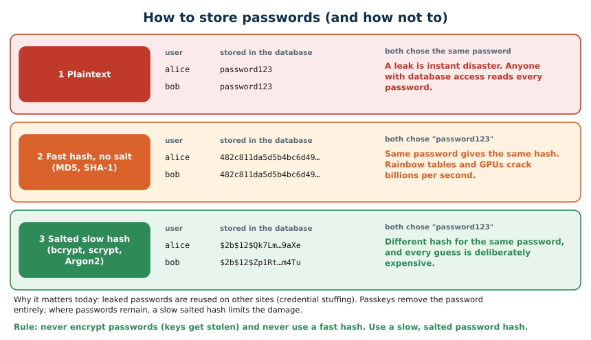
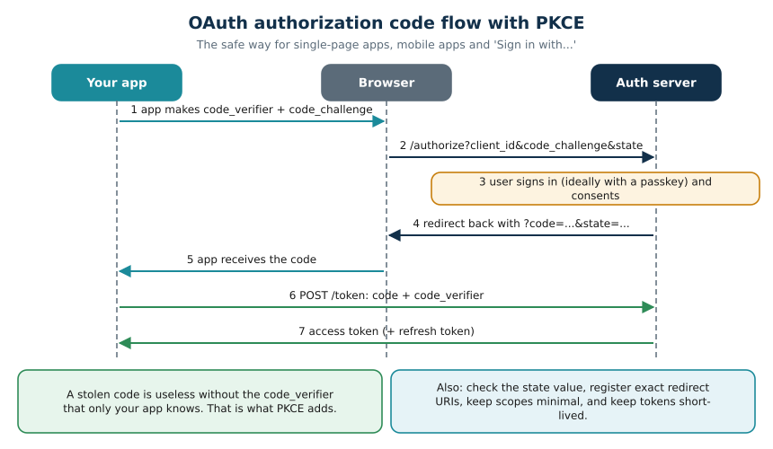
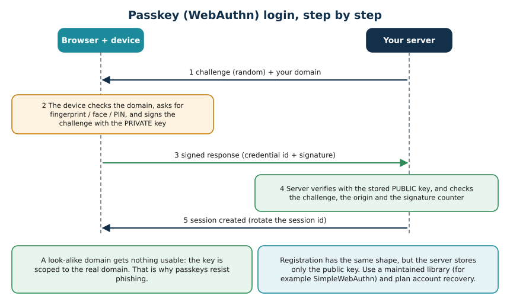
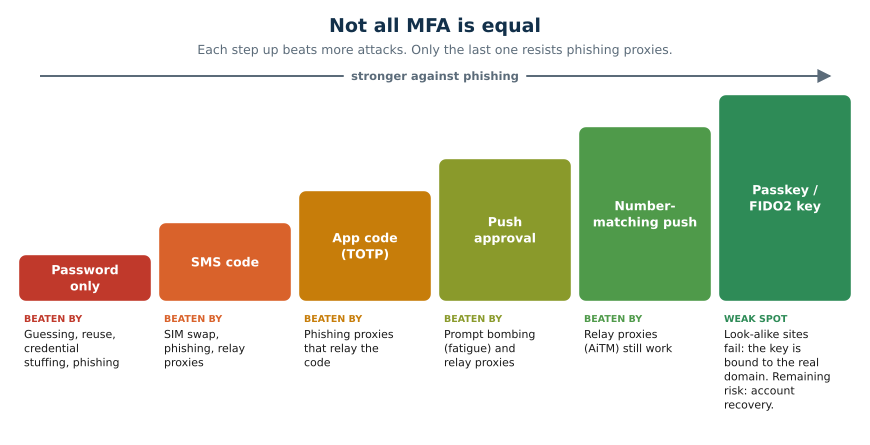
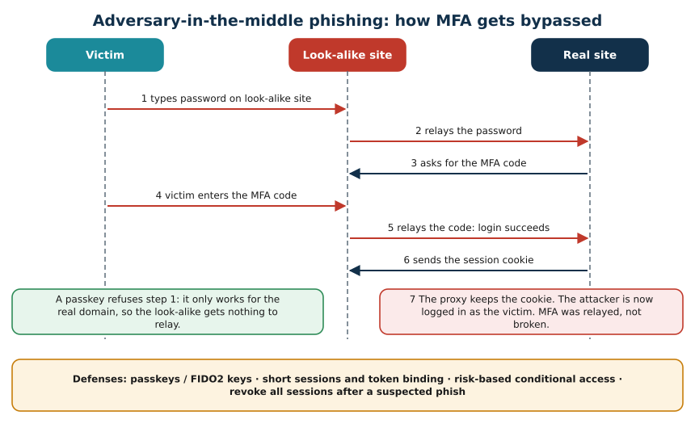
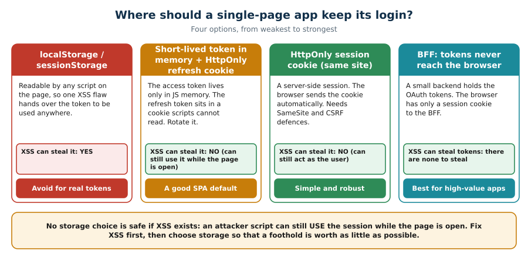
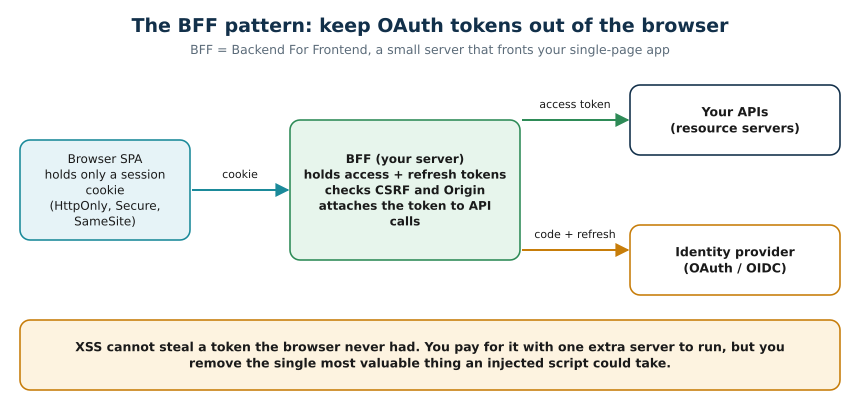

# Chapter 4: Authentication, Sessions and Tokens

> **Goal.** After this chapter you can: choose between sessions, JWTs and OAuth/OIDC and justify it; store passwords to OWASP's current guidance; configure server-side sessions safely; verify a JWT correctly; implement the OAuth authorization-code flow with PKCE; explain how passkeys work and where they fit; decide where a single-page app keeps its login; and design password-reset and recovery flows that attackers cannot go around.
>
> **Who:** frontend and backend. **Time:** about 3.5 hours. **Labs:** [Lab 3](13-labs.md) (JWT), [Lab 5](13-labs.md) (passwords), [Lab 6](13-labs.md) (rate limiting).

---

## 1. The decision map

| Need | Reach for | Why |
| --- | --- | --- |
| A normal web app with its own backend | **Server-side session in an HttpOnly cookie** | Simple, revocable, no token for scripts to steal |
| "Sign in with Google / company SSO" | **OAuth 2.0 + OIDC, authorization code with PKCE** | Don't handle other people's passwords |
| Service-to-service calls, mobile APIs | **Short-lived access tokens** (often JWTs), verified properly | Stateless verification across services |
| Highest assurance for consumers | **Passkeys (WebAuthn)**, with a recovery plan | Phishing-resistant, nothing to steal from your database |
| A SPA that needs OAuth tokens | **BFF pattern** (a small server holds the tokens) | Keeps tokens out of the browser |

> **Rule of thumb.** Use your identity provider or a maintained library for authentication. Almost every authentication bug is a developer re-implementing something that already exists.

---

## 2. Passwords (while you still have them)



**Store them with a slow, salted, purpose-built hash.** OWASP's current guidance ([Password Storage Cheat Sheet](https://cheatsheetseries.owasp.org/cheatsheets/Password_Storage_Cheat_Sheet.html)):

| Algorithm | When | Minimum settings |
| --- | --- | --- |
| **Argon2id** | First choice | `m=19456 KiB (19 MiB), t=2, p=1` (other equal-strength combinations exist, for example `m=46 MiB, t=1`) |
| **scrypt** | If Argon2id is unavailable | `N=2^17, r=8, p=1` |
| **bcrypt** | Legacy systems | Work factor **10 or more**; passwords are limited to **72 bytes** |
| **PBKDF2** | When FIPS-140 compliance is required | HMAC-SHA-256 with **600,000** iterations |

Aim for a single hash to take well under a second on your hardware, and **store the algorithm and parameters with each hash** so you can raise them later and re-hash users when they next log in. (Lab 5 does exactly this.)

```ts
// Node: the maintained `argon2` package
import argon2 from "argon2";

const hash = await argon2.hash(password, { type: argon2.argon2id, memoryCost: 19456, timeCost: 2, parallelism: 1 });
const ok = await argon2.verify(hash, attempt);   // the salt is generated and stored inside the hash string
```

```python
# Python: argon2-cffi
from argon2 import PasswordHasher
ph = PasswordHasher(time_cost=2, memory_cost=19456, parallelism=1)   # memory in KiB
hashed = ph.hash(password)
ph.verify(hashed, attempt)            # raises on mismatch
if ph.check_needs_rehash(hashed):     # upgrade the stored hash after a successful login
    hashed = ph.hash(attempt)
```

**Password rules that match current guidance:** allow long passphrases (at least 64 characters) and paste; check new passwords against **breached-password lists**; don't force composition rules or periodic rotation; show the same error for "unknown user" and "wrong password"; and **rate-limit** attempts per account *and* per IP (Lab 6).

> **Common mistake.** Pre-hashing a password with SHA-256 before bcrypt "to support long passwords". OWASP calls that dangerous (null-byte and "password shucking" problems). Use Argon2id, or enforce bcrypt's 72-byte limit.

---

## 3. Server-side sessions

After login the server creates a **session** (data stored server-side, in Redis or a database) and gives the browser a random **session ID** in a cookie.

```ts
import session from "express-session";
import { RedisStore } from "connect-redis";

app.use(session({
  name: "__Host-sid",
  secret: process.env.SESSION_SECRET!,          // long random value from your secrets manager
  resave: false,
  saveUninitialized: false,
  store: new RedisStore({ client: redis }),
  cookie: { httpOnly: true, secure: true, sameSite: "lax", maxAge: 8 * 3600 * 1000 },
}));

// On login: issue a NEW session id so an attacker-planted one (session fixation) becomes useless
req.session.regenerate((err) => { req.session.userId = user.id; res.sendStatus(204); });
```

**Session rules:**

- **Random and long** (128 bits or more from a cryptographic generator). Never derived from the user.
- **Regenerate the ID on login and on privilege change.** This defeats *session fixation*.
- **Idle timeout and absolute timeout**, and **logout destroys the server-side session** (not just the cookie).
- **Revoke on password change or suspected compromise.** Server-side sessions make this easy; this is their big advantage over long-lived JWTs.

---

## 4. JWTs: powerful, easy to misuse

A **JSON Web Token** is a signed (not encrypted) bundle of claims. Its payload is only **Base64-encoded**, so anyone can read it; never put secrets in it. Use JWTs when you need **stateless verification across services**, and keep them **short-lived**.

**Verify, don't decode.** Lab 3 shows the classic mistake: `jwt.decode()` happily returns the claims of a forged token, while `jwt.verify()` rejects it.

```ts
import { jwtVerify, createRemoteJWKSet } from "jose";

const JWKS = createRemoteJWKSet(new URL("https://idp.example.com/.well-known/jwks.json"));

export async function authenticate(token: string) {
  const { payload } = await jwtVerify(token, JWKS, {
    issuer: "https://idp.example.com/",     // who issued it
    audience: "api://orders",               // was it meant for THIS API?
    algorithms: ["RS256"],                  // pin the algorithm; never trust the token's own header
  });
  return payload;                           // expiry is checked automatically
}
```

| JWT mistake | Why it hurts | Fix |
| --- | --- | --- |
| `decode()` instead of `verify()` | Forged claims accepted | Always verify the signature |
| Not pinning the algorithm | Historic `alg: none` and algorithm-confusion attacks | Pass an explicit `algorithms` list |
| Not checking `iss` and `aud` | A token for another service is accepted | Verify issuer and audience |
| Weak HMAC secret | Guessed offline, then forged | Long random secret, or asymmetric keys |
| Long-lived tokens, no revocation | A stolen token works for days | Short expiry (minutes) plus refresh-token rotation |
| Token in `localStorage` | Any XSS steals it | See section 7 |
| Secrets in the payload | It is readable by anyone | Never |

---

## 5. OAuth 2.0 and OIDC with PKCE

**OAuth 2.0** lets an app act on a user's behalf *without their password*: the user approves **scopes** and the app receives an **access token**. **OpenID Connect (OIDC)** adds *login* ("who is this user?") on top. The recommended flow for browsers and mobile apps is the **authorization code flow with PKCE**.



**What PKCE adds:** your app creates a random `code_verifier` and sends only its hash (`code_challenge`) at the start. To redeem the authorization code it must present the original verifier, so **a stolen code is useless**.

**Rules:**

1. Use **authorization code + PKCE**. Don't use the old implicit flow.
2. Register **exact redirect URIs** (no wildcards) and validate the **`state`** parameter (CSRF protection for the flow).
3. Request **minimal scopes**; keep access tokens **short-lived**; **rotate refresh tokens** and detect reuse.
4. Use a maintained library or your identity provider; don't hand-write the flow.

> **Real case: Salesloft Drift (August 2025).** Attackers obtained OAuth tokens for the Drift integration and used them to pull data out of many customers' Salesforce accounts; Google's threat team said it knew of **700+ potentially impacted organizations**. The tokens were revoked on 20 August. *Lesson:* an integration's token is your data. Give integrations least-privilege scopes, keep an inventory, and be able to revoke fast. ([The Hacker News](https://thehackernews.com/2025/08/salesloft-oauth-breach-via-drift-ai.html))

---

## 6. Passkeys (WebAuthn)

A **passkey** is a login based on public-key cryptography, standardized as **WebAuthn / FIDO2**.



**Why developers should care:** the credential is **scoped to your real domain**, so a phishing site gets nothing usable; your database stores only **public keys**, so a leak gives attackers nothing to replay; and there are no passwords to stuff or spray.

```ts
// Server outline with @simplewebauthn/server (handles the hard cryptography for you)
import { generateAuthenticationOptions, verifyAuthenticationResponse } from "@simplewebauthn/server";

const options = await generateAuthenticationOptions({ rpID: "example.com", userVerification: "preferred" });
// store options.challenge in the session, send options to the browser, which calls navigator.credentials.get()

const result = await verifyAuthenticationResponse({
  response: clientResponse,
  expectedChallenge: sessionChallenge,
  expectedOrigin: "https://example.com",
  expectedRPID: "example.com",
  credential: storedCredential,   // public key + counter from your database
});
if (!result.verified) return res.sendStatus(401);
```



**Honest limits:** **account recovery** becomes the weakest link (attackers go around strong login via a weak reset or help-desk call), so offer recovery codes, a second passkey, and re-authentication for sensitive changes. Adoption is partial, so you will keep passwords and MFA fallbacks for years.



> **Why this matters for your code.** Ordinary MFA codes and push approvals can be *relayed* by phishing proxies, which then steal the session. Passkeys can't be relayed. If you build login, support passkeys, shorten sessions, and make it easy to **revoke all sessions** on suspicion.

---

## 7. Where should a single-page app keep its login?



| Option | Stolen by XSS? | Verdict |
| --- | --- | --- |
| `localStorage` / `sessionStorage` | **Yes**: any script on the page can read it | Avoid for real tokens |
| Access token in **memory** + **HttpOnly refresh cookie** | The long-lived token can't be read; the page can still be used while open | A good SPA default (rotate refresh tokens) |
| **HttpOnly session cookie**, same site | Can't be read; the page can still be used while open | Simple and robust (needs `SameSite` and CSRF defences) |
| **BFF**: tokens held by a small backend | Nothing to steal in the browser | Best for high-value apps |



> **Common mistake.** "We use HttpOnly cookies, so XSS isn't a problem." XSS can still *use* the session while the page is open: it can call your API as the user. HttpOnly limits what a foothold is worth; it does not make XSS harmless. Fix XSS (Chapter 7) *and* pick storage that limits the damage.

---

## 8. Password reset and account recovery

Recovery flows are attackers' favourite way around strong login. Design them carefully:

1. **Same response** whether or not the email exists ("If that address is registered, we sent a link").
2. **Reset token:** random (128 bits+), **stored hashed**, **single-use**, **expires in minutes**, bound to the account.
3. **Send it only to the registered address.** Never to an address in the request.
4. **After a reset:** invalidate all sessions, notify the user, and require re-authentication for sensitive actions.
5. **Rate-limit** reset requests per account and per IP.
6. **Help desk and phone resets** need the same rigor as the web flow: the 2023 MGM and 2025 Marks & Spencer incidents were linked in public reporting to attackers who persuaded help desks to reset access.

```ts
import crypto from "node:crypto";
const token = crypto.randomBytes(32).toString("base64url");              // NOT Math.random()
const stored = crypto.createHash("sha256").update(token).digest("hex");   // store the hash, email the token
```

---

## Check yourself

1. When would you choose a server-side session over a JWT, and why?
2. What are OWASP's minimum Argon2id settings, and what limit does bcrypt have?
3. Name four things you must check when verifying a JWT.
4. What does PKCE protect against?
5. How do passkeys resist phishing, and what is their weak spot?
6. Rank these for storing a SPA login from weakest to strongest: HttpOnly session cookie, localStorage, BFF, in-memory token + HttpOnly refresh cookie.

**Answers** *(cover this until you have tried)*

1. For a normal web app with its own backend: sessions are easy to revoke, there's no token for scripts to steal, and they're simple. JWTs fit stateless cross-service calls and should be short-lived.
2. 19 MiB memory, 2 iterations, 1 parallelism (or an equivalent combination). bcrypt: a work factor of at least 10 and a 72-byte input limit.
3. The signature, the pinned algorithm, expiry, issuer, and audience.
4. Authorization-code interception: a stolen code is useless without the `code_verifier` only your app holds.
5. The credential is bound to the real domain, so a look-alike site can't obtain a valid signature. The weak spot is account recovery.
6. localStorage (weakest), then in-memory token + HttpOnly refresh cookie, then HttpOnly session cookie, then BFF (strongest). The middle two are close; both need XSS fixed.

---

## Summary

- Prefer sessions for classic apps, OIDC for sign-in, passkeys where you can, JWTs only when you need stateless service-to-service verification.
- Passwords: Argon2id (19 MiB, t=2, p=1 minimum), parameters stored with the hash, rehash on login, breached-password checks, rate limits.
- Sessions: random, regenerated at login, short, server-side revocable, with the right cookie flags.
- JWT: verify with pinned algorithm, issuer and audience; short-lived; never trust `decode()`.
- OAuth: code flow + PKCE, exact redirect URIs, minimal scopes. SPAs: keep tokens out of `localStorage`; consider a BFF.
- Recovery is part of authentication: secure the reset flow and the help desk.
