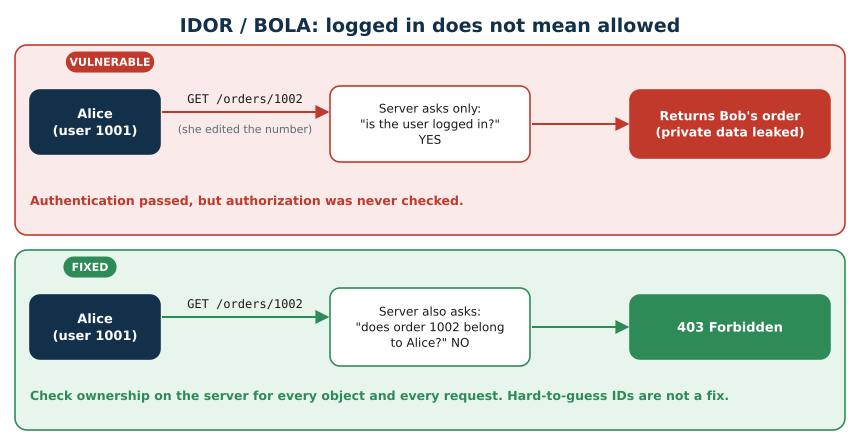

# Chapter 5: Authorization and API Design

> **Goal.** After this chapter you can: explain why broken access control is #1 on OWASP's lists and fix BOLA/IDOR in code; separate object-level, function-level and property-level authorization; prevent mass assignment; isolate tenants in a multi-tenant app; secure a GraphQL API; and spot business-logic flaws such as race conditions.
>
> **Who:** backend first, but frontend engineers must understand it because *the UI hides, the API enforces*. **Time:** about 2.5 hours. **Lab:** [Lab 1](13-labs.md) (BOLA and mass assignment).

---

## 1. Authentication vs authorization

| | Authentication | Authorization |
| --- | --- | --- |
| Question | **Who are you?** | **What may you do?** |
| Failure code | 401 | 403 (or 404 to hide existence) |
| When | At login | **On every request, for every object** |

**Broken Access Control is #1** on the OWASP Top 10 (2025) and **BOLA is #1** on the OWASP API Security Top 10 (2023) because it is easy to forget: one missing check on one endpoint is a breach.

---

## 2. BOLA / IDOR: the most common serious bug



**BOLA** (Broken Object Level Authorization; the older web name is **IDOR**) means a user can reach *another user's object* by changing an identifier. Authentication passed; **authorization was never checked.**

```ts
// VULNERABLE: any logged-in user can read any order
app.get("/orders/:id", requireLogin, async (req, res) => {
  res.json(await db.order.findUnique({ where: { id: req.params.id } }));
});

// FIXED: the query itself is scoped to the current user; 404 hides that the object exists
app.get("/orders/:id", requireLogin, async (req, res) => {
  const order = await db.order.findFirst({ where: { id: req.params.id, ownerId: req.user.id } });
  if (!order) return res.sendStatus(404);
  res.json(order);
});
```

```python
# Python / SQLAlchemy: the same idea
order = session.scalar(select(Order).where(Order.id == order_id, Order.owner_id == current_user.id))
if order is None:
    abort(404)
```

**Why the scoped query is the best pattern:** if you forget a separate `if` check, you get *nothing*, not *everything*. Make "owner-scoped by default" the shape of your data-access layer.

> **Common mistake.** "Our IDs are random UUIDs, so nobody can guess them." Unguessable IDs are a bonus layer, never access control: IDs leak through logs, referrer headers, shared links and screenshots.

---

## 3. The three layers of authorization (API names)

| Level | Question | Example failure | Fix |
| --- | --- | --- | --- |
| **Object** (BOLA, API1) | May this user touch *this object*? | Change `/orders/1002` | Scope every lookup to the owner/tenant |
| **Function** (BFLA, API5) | May this user call *this action*? | A normal user hits `POST /admin/users` | Role/permission middleware; deny by default |
| **Property** (BOPLA, API3) | May this user see or set *this field*? | `isAdmin` settable via PATCH; password hash returned | Allowlist input fields; shape responses |

**Function-level (BFLA):** put authorization in one reusable place and make *deny* the default.

```ts
const requireRole = (...roles: string[]) => (req, res, next) =>
  roles.includes(req.user?.role) ? next() : res.sendStatus(403);

app.post("/admin/users", requireLogin, requireRole("admin"), createUser);   // forgetting this line = BFLA
```

**Property-level and mass assignment:** never copy a request body straight into a database model.

```ts
// VULNERABLE: the client can send {"isAdmin": true} or {"ownerId": 7}
await db.user.update({ where: { id: req.user.id }, data: req.body });

// FIXED: validate with a strict schema that only lists fields the user may change
import { z } from "zod";
const UpdateProfile = z.object({ name: z.string().min(1).max(50), bio: z.string().max(500).optional() }).strict();
await db.user.update({ where: { id: req.user.id }, data: UpdateProfile.parse(req.body) });
```

**Shape responses too.** Don't return ORM entities directly; map to a response object (DTO) that lists exactly the fields to expose. That prevents leaking password hashes, internal flags and other users' data.

---

## 4. Design rules that prevent the whole family

1. **Deny by default.** Access is refused unless a rule explicitly allows it.
2. **Enforce on the server.** Hiding a button or a React route is cosmetic.
3. **Centralize the rules** in one policy layer (middleware, a policy module, or a policy-as-code engine) instead of scattering `if`s.
4. **Take identity from the session, never from the request.** Don't trust a `userId` in the body or URL when you can use `req.user.id`.
5. **Return 404 for "not yours"** when existence itself is sensitive.
6. **Test it.** For every route, write a test that logs in as user A and requests user B's resource (Chapter 11).

---

## 5. Multi-tenant apps (SaaS)

In a SaaS app one bug can expose *every customer*. Defend in layers:

- **Tenant ID comes from the authenticated session or token**, not the request.
- **Every query is tenant-scoped** through a repository or ORM layer that adds `tenant_id` automatically, so a developer can't forget it.
- **Database row-level security** (for example PostgreSQL RLS) as a second layer: even a missing `WHERE` returns no cross-tenant rows.
- **Per-tenant limits** (rate, storage) so one tenant can't starve the others.
- **Tests** that create two tenants and assert isolation on every endpoint.

---

## 6. GraphQL and other flexible APIs

GraphQL has the same BOLA/BFLA risks and a few of its own, because the *client* chooses the query:

| Risk | What happens | Control |
| --- | --- | --- |
| **Missing field/object checks** | Authorization done at the route, not per resolver, so a nested field leaks | Authorize in resolvers and data loaders, per object |
| **Expensive queries** | Deeply nested or aliased queries exhaust the server | Limit depth and complexity; timeouts; persisted queries |
| **Batching abuse** | One request carries hundreds of login attempts or lookups | Limit batch size; rate-limit per operation, not per HTTP request |
| **Introspection and verbose errors** | Hands attackers a map | Consider disabling introspection in production; generic errors |

The same thinking applies to REST endpoints with `?fields=`, `?include=` or free-form filters: the client shapes the query, so the server must authorize and bound it.

---

## 7. Rate limits, resource limits and pagination

**OWASP API4 (Unrestricted Resource Consumption)** covers anything an attacker can repeat or inflate:

- **Rate limit** by user, token and IP (Lab 6), with stricter limits on login, reset, signup, search and expensive endpoints.
- **Cap everything:** request body size, page size (`limit` maximum), file size, query complexity, number of items per batch, request timeouts.
- **Pay attention to cost:** endpoints that call paid APIs (SMS, email, AI models) need budgets, or an attacker turns your bill into the attack.
- **Idempotency keys** on payment-like operations, so a retried request can't double-charge.

---

## 8. Business-logic flaws: where scanners can't help

Authorization isn't only "who"; it's "is this action valid *now*?" These bugs pass every scanner:

| Flaw | Example | Fix |
| --- | --- | --- |
| **Client-trusted values** | Price, quantity or discount sent from the browser | Recompute on the server from authoritative data |
| **Skipped steps** | Calling `POST /checkout/confirm` without paying | Enforce a server-side state machine |
| **Race conditions (TOCTOU)** | Two parallel requests spend the same balance or coupon | Make the check and the update one atomic operation |
| **Abuse of legitimate features** | Bulk coupon guessing, ticket hoarding (OWASP API6) | Rate limits, anomaly detection, friction at scale |

```sql
-- VULNERABLE (check-then-update in application code; two requests can both pass the check):
--   SELECT balance ...; if (balance >= amount) UPDATE ... SET balance = balance - amount

-- FIXED: one atomic statement; check rows affected (0 rows = insufficient funds)
UPDATE accounts SET balance = balance - $1 WHERE id = $2 AND balance >= $1;
```

Use **transactions**, **unique constraints** (one coupon use per user), and `SELECT ... FOR UPDATE` where needed.

---

## 9. API inventory and versioning

OWASP API9 (**Improper Inventory Management**) is the forgotten `/v1/` endpoint or the old test API that still works and isn't patched. Keep an **inventory** (your OpenAPI spec as the source of truth), retire old versions on a schedule, and validate requests against the spec.

---

## Check yourself

1. State the one-line fix for BOLA and why it is safer than a separate `if` check.
2. BOLA vs BFLA vs BOPLA: one sentence each.
3. What is mass assignment and how do you prevent it?
4. Why does a multi-tenant app want row-level security *and* scoped queries?
5. Name two GraphQL-specific risks.
6. How does a race condition let someone spend the same balance twice, and what is the fix?

**Answers** *(cover this until you have tried)*

1. Scope the lookup to the current user or tenant (`WHERE id = ? AND owner_id = ?`) and return 404 otherwise. If you forget a separate check you'd leak everything; with scoping you'd get nothing.
2. BOLA: reaching another user's object. BFLA: calling a function (such as an admin action) you shouldn't. BOPLA: seeing or setting a field you shouldn't.
3. Copying a request body straight into a model so the client can set fields like `isAdmin`. Prevent it with a strict schema allowlist of changeable fields.
4. Two independent layers: if the application code forgets a tenant filter, the database still blocks cross-tenant rows.
5. Any two of: per-resolver authorization gaps, deep or complex queries, batching abuse, introspection and verbose errors.
6. Two requests both pass a "balance is enough" check before either updates. Use one atomic `UPDATE ... WHERE balance >= amount` (or a transaction with locking) and check rows affected.

---

## Summary

- BOLA/IDOR is the classic serious bug. Scope every query to the owner or tenant; deny by default; the UI only hides, the API enforces.
- Three levels: object (BOLA), function (BFLA), property (BOPLA, including mass assignment). Use strict schemas and response DTOs.
- Take identity from the session; centralize policy; test cross-user access on every route.
- Multi-tenant: tenant from the session, scoped repository layer, and database row-level security.
- Cap everything (rate, size, page, cost), and fix business logic with server-side state, atomic updates and constraints.
