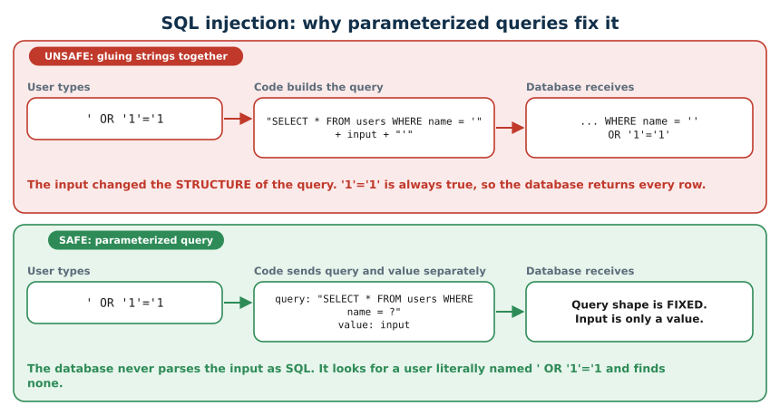

# Chapter 6: Input Handling and Injection

> **Goal.** After this chapter you can: choose between validating, encoding and parameterizing; prevent SQL injection in the ORM you use (including its raw-query escape hatches); recognise NoSQL operator injection, command injection and path traversal; explain why deserialization and request parsing are high-risk (React2Shell); and defend against prototype pollution and ReDoS.
>
> **Who:** backend first; frontend engineers meet the same ideas as XSS and parsing bugs. **Time:** about 3 hours. **Labs:** [Lab 1](13-labs.md), [Lab 6](13-labs.md), [Lab 7](13-labs.md).

---

## 1. One idea behind every injection

> **Injection happens when untrusted data is mixed into a command, query or document, and the interpreter can't tell the data from the instructions.**

The interpreter changes (a database, a shell, a browser, an XML parser, an AI model), but the mistake is identical. The fix is also identical: **keep code and data separate**.

| Tool | Use it to... | Example |
| --- | --- | --- |
| **Validate** (allowlist, schema) | Reject malformed or unexpected input early | `z.string().uuid()`, `pydantic` models |
| **Parameterize** | Keep data out of the *code* of a query or command | Prepared statements, `execFile(cmd, [args])` |
| **Encode** | Keep data out of the *code* of output | HTML escaping, JSON serialization, URL encoding |

**Validation is a first filter; parameterization and encoding are the real fixes.** Never rely on "sanitizing" bad characters out of input (blocklists always miss something).

**Validate with a schema at the boundary**, so types and shapes are guaranteed everywhere after:

```ts
import { z } from "zod";

const CreateOrder = z.object({
  productId: z.string().uuid(),
  quantity: z.number().int().min(1).max(100),     // limit ranges, not just types
  note: z.string().max(500).optional(),
}).strict();                                       // reject unknown fields

app.post("/orders", requireLogin, (req, res) => {
  const parsed = CreateOrder.safeParse(req.body);
  if (!parsed.success) return res.status(400).json({ error: "invalid input" });   // generic message
  // use parsed.data from here on, never req.body
});
```

```python
# Python: pydantic does the same job (FastAPI uses it automatically)
class CreateOrder(BaseModel):
    product_id: UUID
    quantity: conint(ge=1, le=100)
    note: constr(max_length=500) | None = None
    model_config = ConfigDict(extra="forbid")
```

> **Watch the type gotchas.** Query strings and JSON can deliver **arrays or objects** where you expected a string (`?id[]=1`, `{"password": {"$ne": null}}`). A schema that says "string" rejects those; hand-rolled checks often don't.

---

## 2. SQL injection through your ORM



ORMs parameterize by default. **The danger is the raw-query escape hatch** and string-built queries.

```ts
// VULNERABLE: string concatenation (works in ANY driver or ORM raw API)
const rows = await db.$queryRawUnsafe(`SELECT * FROM users WHERE email = '${email}'`);

// SAFE: Prisma's tagged-template $queryRaw turns the interpolation into a bound parameter
const rows = await db.$queryRaw`SELECT * FROM users WHERE email = ${email}`;
```

| Stack | Safe form | Unsafe form (review every use) |
| --- | --- | --- |
| **Prisma** | `` $queryRaw`... ${x}` `` and the query builder | `$queryRawUnsafe(string)` |
| **Sequelize** | `sequelize.query(sql, { replacements / bind })` | String-built SQL passed to `query` |
| **TypeORM** | `query("... WHERE id = $1", [id])`, query builder | Template-literal SQL |
| **Knex** | `.where({ email })`, `raw("?? = ?", [col, val])` | ``raw(`... ${x}`)`` |
| **SQLAlchemy** | `text("... :id")` with bound params | f-strings inside `text()` |
| **Django** | ORM filters, `.raw(sql, [params])` | `.raw(f"...")`, `.extra()` with user input |
| **JDBC / Go `database/sql`** | `PreparedStatement`, `?` placeholders | String concatenation |

**Things parameters can't do:** table names, column names and `ORDER BY` direction. Use an **allowlist**:

```ts
const SORTABLE = { created: "created_at", total: "total_cents" } as const;
const column = SORTABLE[req.query.sort as keyof typeof SORTABLE] ?? "created_at";   // never interpolate raw input
const dir = req.query.dir === "asc" ? "ASC" : "DESC";
```

**Also:** run the app's database user with **least privilege** (no `DROP`, no access to other schemas), keep separate credentials for migrations, and use row-level security where it fits. A scanner or WAF is a backup, never the plan.

> **Real case: MOVEit Transfer (2023).** A SQL injection flaw (CVE-2023-34362) in a popular file-transfer product was exploited as a zero-day to steal data from thousands of organizations (an Emsisoft tally reached about **2,800 organizations** and roughly **96 million people** by August 2024). *Lesson:* SQL injection is an old bug class that can still cause a mass breach, and "the vendor's bug" becomes *your* breach. ([Help Net Security](https://www.helpnetsecurity.com/2023/09/26/moveit-victim-number/))

---

## 3. NoSQL operator injection (a Node classic)

With MongoDB-style queries, an attacker supplies an **object** where you expected a string:

```ts
// VULNERABLE: Express parses {"username":"admin","password":{"$ne":null}} into an object
const user = await users.findOne({ username: req.body.username, password: req.body.password });
// "password: not equal to null" matches any password.
```

**Fix:** validate types (`z.string()` rejects objects), compare password **hashes** with a verify function, and never pass untrusted objects directly into a query. This is why strict schemas (section 1) matter.

---

## 4. Command injection and path traversal

```ts
import { exec, execFile } from "node:child_process";

// VULNERABLE: the string goes through a shell, so "; rm -rf ..." becomes part of the command
exec(`convert ${filename} out.png`);

// SAFE: no shell; arguments are passed as an array and can't be reinterpreted
execFile("convert", [filename, "out.png"]);
```

```python
subprocess.run(["convert", filename, "out.png"], shell=False, check=True)   # not shell=True with user input
```

Better still: use a **library** instead of shelling out. If you must run a command, allowlist the program and validate the arguments.

**Path traversal** (`../../etc/passwd`) happens when user input becomes part of a file path:

```ts
import path from "node:path";
const BASE = path.resolve("/srv/uploads");

function safePath(userName: string) {
  const full = path.resolve(BASE, userName);                       // resolves ../ segments
  if (!full.startsWith(BASE + path.sep)) throw new Error("invalid path");
  return full;
}
// Even better: don't use user-supplied names at all. Store files under random IDs (Chapter 8).
```

Also beware **zip slip**: archive entries named `../../x` that escape the extraction folder. Validate each entry's resolved path the same way.

---

## 5. Deserialization and parsing: the high-risk zone

**Deserialization** turns bytes back into objects. If the format can describe *code or arbitrary object types*, a crafted payload can run code on your server.

| Danger | Safe alternative |
| --- | --- |
| Python `pickle.loads(untrusted)` | JSON and a schema |
| Python `yaml.load(...)` | `yaml.safe_load(...)` |
| Java `ObjectInputStream` on untrusted data | JSON with explicit types; allowlist classes |
| Node `eval`, `new Function`, `vm` with user input; `node-serialize`-style libraries | Never evaluate user data; parse JSON |
| XML parsers with external entities enabled (XXE) | Disable DTDs and external entities |

> **Real case: React2Shell (December 2025).** **CVE-2025-55182 (CVSS 10.0)** was a flaw in how React Server Components **decoded payloads sent to Server Function endpoints**: an unauthenticated attacker could send a crafted HTTP request and run code on the server. It affected `react-server-dom-webpack`, `-parcel` and `-turbopack` versions 19.0 to 19.2.0 and the frameworks that bundled them (including Next.js); fixes shipped as 19.0.1, 19.1.2 and 19.2.1 and matching Next.js releases. The advisory notes an app can be exposed **even if it implements no Server Functions of its own**, if it supports React Server Components. CISA added it to its exploited-vulnerabilities list on 5 December 2025. *Lesson:* **request parsing is attack surface**, even inside a trusted framework, and your defence is fast patching plus not exposing more than you must. ([React advisory](https://react.dev/blog/2025/12/03/critical-security-vulnerability-in-react-server-components))

---

## 6. JavaScript-specific traps

**Prototype pollution.** Merging untrusted JSON into an object can set `__proto__` and change *every* object in the process.

```ts
// VULNERABLE: a naive deep merge of user input
merge({}, JSON.parse('{"__proto__": {"isAdmin": true}}'));
({}).isAdmin   // true: every object now looks like an admin
```

**Defences:** validate input with a strict schema (reject unknown keys, including `__proto__` and `constructor`), use `Object.create(null)` or `Map` for dictionaries keyed by user input, use maintained merge utilities that block these keys, and keep dependencies patched (this class of bug is common in utility libraries).

**ReDoS (regular-expression denial of service).** Some regexes take exponential time on crafted input: `/^(a+)+$/` against a long `aaaa...!` freezes a single-threaded Node process.

**Defences:** cap input length *before* matching, avoid nested quantifiers, use a linear-time engine (for example RE2) for untrusted input, and set timeouts. Treat it as a form of the "limit everything" rule.

---

## 7. Output encoding by context

Encoding must match **where** the data lands, which is why "sanitize on input" fails:

| Context | Correct tool |
| --- | --- |
| HTML body | Framework auto-escaping (JSX, templates with autoescape) |
| HTML attribute | Quote the attribute and escape; never build `on...=` handlers from data |
| JavaScript | Don't put untrusted data in script blocks; pass data as JSON and parse it |
| URL | `encodeURIComponent`, and **allowlist schemes** (`http`, `https`, `mailto`) |
| SQL / shell | Parameters and argument arrays, not escaping |
| JSON API responses | Correct `Content-Type: application/json` and `X-Content-Type-Options: nosniff` |

(Chapter 7 covers the browser side: XSS sinks, DOMPurify, CSP.)

---

## Check yourself

1. State the single idea behind all injection attacks.
2. In Prisma, which raw-query form is safe and which is unsafe?
3. Why can't a parameterized query protect an `ORDER BY` clause, and what do you do instead?
4. How does `{"password": {"$ne": null}}` bypass a MongoDB login, and what stops it?
5. `exec` vs `execFile`: why is one safer?
6. Why was React2Shell dangerous even for apps with no Server Functions of their own, and what is the lesson?

**Answers** *(cover this until you have tried)*

1. Untrusted data mixed into a command or document is interpreted as instructions; the fix is to keep code and data separate.
2. `$queryRaw` with tagged-template interpolation is parameterized and safe; `$queryRawUnsafe` with a built string is unsafe.
3. Parameters can only stand for *values*, not identifiers. Map user choices to an allowlist of known column names and directions.
4. Express parses it into an object, so the query asks for "password not equal to null", which matches anything. A strict schema (`z.string()`) rejects objects, and passwords should be verified by hash comparison.
5. `exec` runs a string through a shell, so input can add commands; `execFile` passes arguments as an array with no shell interpretation.
6. The vulnerable parsing was in React Server Components itself, so any app that supports RSC (even without its own Server Functions) could be exposed. Lesson: request parsing is attack surface; patch frameworks fast.

---

## Summary

- Injection = data treated as code. Validate with strict schemas, parameterize queries and commands, encode output for its context.
- ORMs are safe until you use the raw escape hatch: review every `Unsafe`, `raw` and string-built query; allowlist identifiers.
- NoSQL: validate types so objects can't become operators. Commands: `execFile` / `shell=False`. Paths: resolve and check the prefix, or use random IDs.
- Deserialization and parsing are high risk (`pickle`, unsafe YAML, React2Shell). Patch frameworks quickly.
- JavaScript traps: prototype pollution and ReDoS. Strict schemas and input limits blunt both.
