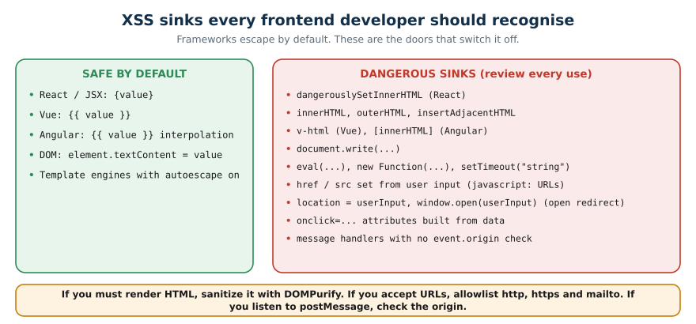
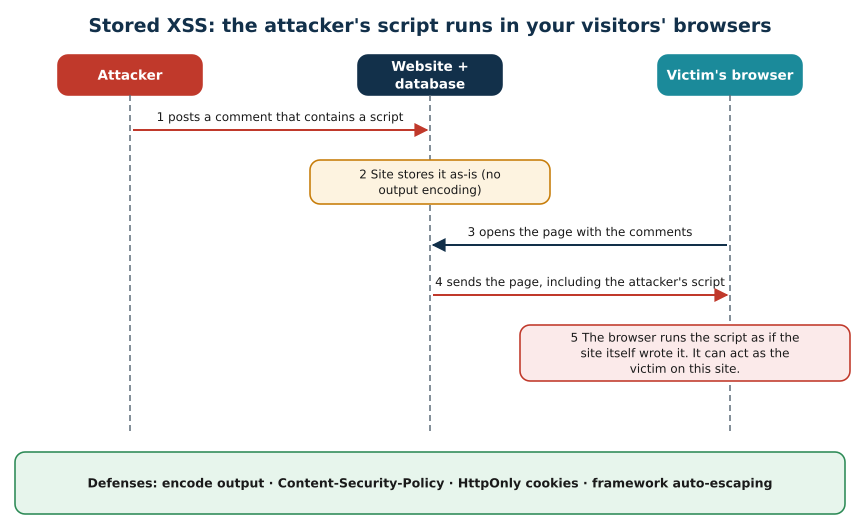
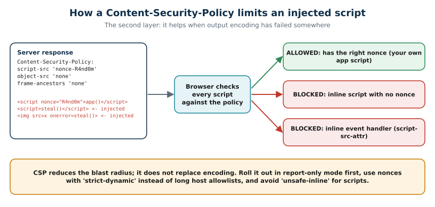
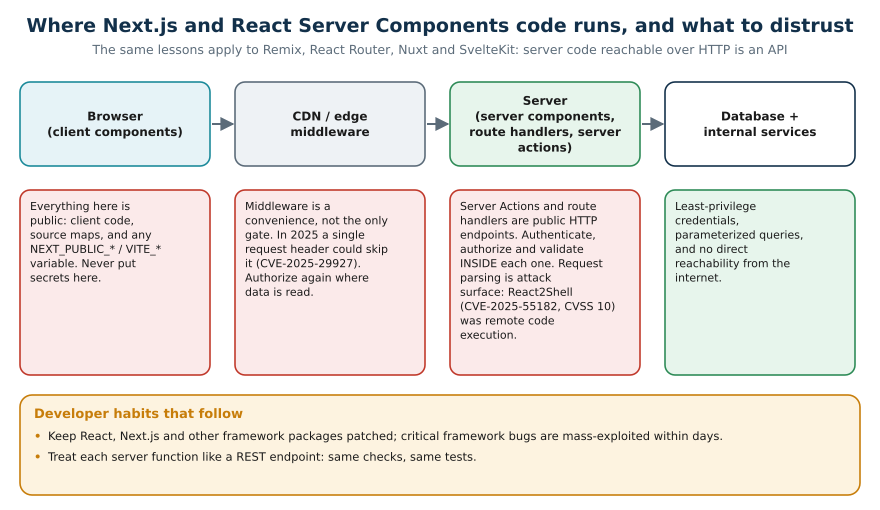

# Chapter 7: Frontend Security

> **Goal.** After this chapter you can: name the XSS sinks in React, Vue and the DOM and fix each; roll out a Content-Security-Policy with nonces (and say what Trusted Types adds); keep secrets and tokens out of the bundle and out of `localStorage`; handle third-party scripts, `postMessage` and redirects safely; and avoid the Next.js and React Server Components mistakes behind the CVE-2025-29927 and React2Shell incidents.
>
> **Who:** frontend (backend engineers should skim). **Time:** about 3.5 hours. **Lab:** [Lab 2](13-labs.md) (XSS and CSP) and the DOM page in it.

---

## 1. XSS in modern frameworks

Frameworks escape output by default, so XSS today is mostly **a developer switching the protection off**.





**The sinks to flag in review**, with fixes:

```tsx
// 1. dangerouslySetInnerHTML (React), v-html (Vue), [innerHTML] (Angular)
<div dangerouslySetInnerHTML={{ __html: comment }} />                  // VULNERABLE if `comment` is user content

import DOMPurify from "dompurify";
<div dangerouslySetInnerHTML={{ __html: DOMPurify.sanitize(comment) }} />   // sanitize with a maintained library
// Best: don't render user HTML. Render text: <p>{comment}</p>
```

```tsx
// 2. URLs from users: javascript: URLs run code when clicked
<a href={profile.website}>site</a>                                    // VULNERABLE: href="javascript:..."

function safeHref(input: string) {
  try {
    const url = new URL(input, window.location.origin);
    return ["http:", "https:", "mailto:"].includes(url.protocol) ? url.toString() : "#";   // allowlist schemes
  } catch { return "#"; }
}
<a href={safeHref(profile.website)} rel="noopener noreferrer">site</a>
```

```ts
// 3. DOM sinks: innerHTML, outerHTML, insertAdjacentHTML, document.write, eval, setTimeout("string")
el.innerHTML = location.hash.slice(1);        // VULNERABLE: DOM XSS (source: URL, sink: innerHTML)
el.textContent = location.hash.slice(1);      // SAFE: treated as text
```

**Rendering Markdown or rich text:** sanitize *after* converting to HTML (`marked` or similar, then DOMPurify), or use a renderer with a sanitizing plugin (`rehype-sanitize`). Never trust the Markdown library to be safe by itself.

> **Common mistake.** Thinking React makes XSS impossible. It escapes `{value}`, but `dangerouslySetInnerHTML`, user-controlled `href`/`src`, and any raw DOM access bypass it. AI-generated code frequently reaches for `innerHTML`; flag it.

---

## 2. Content-Security-Policy (CSP): a second layer



A CSP is a response header that tells the browser **which scripts may run**. If an attacker injects markup despite your encoding, the browser refuses to execute scripts that don't match the policy.

**A strong starting policy (nonce-based):**

```
Content-Security-Policy:
  default-src 'self';
  script-src 'self' 'nonce-{RANDOM_PER_RESPONSE}' 'strict-dynamic';
  style-src 'self' 'unsafe-inline';
  img-src 'self' data: https:;
  connect-src 'self' https://api.example.com;
  object-src 'none';
  base-uri 'self';
  frame-ancestors 'none';
  form-action 'self';
```

| Directive | Why |
| --- | --- |
| `script-src` with a **nonce** (+ `'strict-dynamic'`) | Only scripts carrying your per-response random nonce run; far stronger than long host allowlists |
| `object-src 'none'`, `base-uri 'self'` | Closes classic bypasses |
| `frame-ancestors 'none'` | Stops clickjacking (replaces `X-Frame-Options`) |
| `connect-src` | Limits where injected code can **send data**, which reduces exfiltration |
| **Avoid `'unsafe-inline'` and `'unsafe-eval'` for scripts** | They remove most of the benefit |

**How to roll it out without breaking production:**

1. Deploy as **`Content-Security-Policy-Report-Only`** with a `report-to` endpoint and watch violations for a week.
2. Move inline scripts to files or give them a nonce; remove `eval`.
3. Switch to enforcing mode; keep the report endpoint to catch regressions.

**Trusted Types** goes further: with `require-trusted-types-for 'script'`, the browser refuses to put raw strings into dangerous sinks like `innerHTML`; only values produced by your approved policy (for example DOMPurify configured to return Trusted Types) are accepted. Support is strongest in Chromium-based browsers, so check current compatibility before relying on it for everyone.

> **Honest framing.** CSP reduces the *blast radius* of XSS; it does not replace output encoding. Say both in an interview.

---

## 3. Tokens and storage

The single most common frontend design question: **where does the login live?** The full answer is in Chapter 4; the frontend consequences:

- **Don't store long-lived tokens in `localStorage` or `sessionStorage`.** Any XSS reads them. The OWASP HTML5 guidance is the same: don't keep session identifiers there.
- **Prefer an HttpOnly cookie** (set by the server) and call the API with credentials:

```ts
fetch("/api/orders", { credentials: "include" });          // fetch: send cookies
axios.get("/api/orders", { withCredentials: true });       // axios
```

- With cookie auth you need **CSRF protection** (Chapter 3): send a CSRF token or a custom header the server checks, and rely on `SameSite`.
- **If you must hold an access token in JavaScript,** keep it **in memory only**, short-lived, with the refresh token in an HttpOnly cookie.
- For high-value apps, a **BFF** keeps OAuth tokens out of the browser entirely.

---

## 4. Secrets and configuration in the bundle

**Everything shipped to the browser is public.** That includes minified code, source maps, and any build-time environment variable exposed to the client.

| Framework | Variables exposed to the browser |
| --- | --- |
| Next.js | `NEXT_PUBLIC_*` |
| Vite | `VITE_*` |
| Create React App | `REACT_APP_*` |

- **Never put API secrets, private keys or admin tokens in those variables.** If a third-party service needs a secret, call it from your **server** and expose a narrow endpoint.
- **Public keys are fine** (a publishable payments key, a map key) *only if* the provider enforces restrictions (allowed domains, quotas, rules).
- **Source maps in production** reveal your original code. Don't publish them publicly, or restrict access, and never rely on "nobody will find it".
- Check `.env` files are in `.gitignore`, and run a **secret scanner** in CI (Chapter 9).

---

## 5. Client-side authorization is cosmetic

Hiding an "Admin" menu, redirecting unauthenticated users in a route guard, or disabling a button are **UX features**. They stop honest users from clicking the wrong thing; they stop attackers from nothing. Every action must be authorized again on the server. In code review, if you see *"only admins see this button"* without a matching server check, that is the bug.

---

## 6. Third-party scripts and dependencies

Anything you load runs **with your page's powers**: it can read the DOM, steal tokens in reach, and rewrite forms.

- **Minimize them.** Each tag manager, analytics snippet and widget is a trust decision.
- **Subresource Integrity (SRI)** for scripts from a CDN: the browser checks a hash and refuses a tampered file.

```html
<script src="https://cdn.example.com/lib@1.2.3/lib.min.js"
        integrity="sha384-BASE64HASH..." crossorigin="anonymous"></script>
```

- **Pin versions** (never `@latest` from a CDN) and consider self-hosting.
- **Sandbox untrusted embeds** with `<iframe sandbox>` and a minimal permission set.
- **Limit what injected or third-party code can send** with `connect-src`.
- **npm dependencies are third-party code too**; see Chapter 9 for the 2025 compromises.

---

## 7. Messages, frames and redirects

**`postMessage`:** always check who sent a message and who receives yours.

```ts
window.addEventListener("message", (event) => {
  if (event.origin !== "https://trusted.example.com") return;     // verify the sender
  const data = Schema.safeParse(event.data);                        // validate the shape
  if (!data.success) return;
  // ...
});
iframe.contentWindow?.postMessage(msg, "https://trusted.example.com");   // never "*" for sensitive data
```

**Clickjacking:** set `frame-ancestors 'none'` (or specific origins) so another site can't frame your page and trick users into clicking.

**Open redirects:** `?next=` parameters let attackers send users to a phishing site from *your* domain.

```ts
const ALLOWED_PATHS = /^\/[a-zA-Z0-9\/_-]*$/;                     // internal paths only
const next = ALLOWED_PATHS.test(req.query.next ?? "") ? req.query.next : "/";
```

---

## 8. Caching and storage hygiene

- Don't cache **sensitive API responses** in a service worker or in `localStorage`; clear sensitive state on logout.
- Use the right `autocomplete` values (`current-password`, `new-password`, `one-time-code`) so password managers and passkeys work; it improves security *and* UX.
- Be careful with **error messages and logs in the browser**: don't print tokens or personal data to the console or send them to analytics.

---

## 9. Next.js and React Server Components: what changed



Modern frameworks run **server code that you call from the client**. That code is reachable over HTTP, so treat it as an **API**.

**Rule 1: Server Actions and route handlers are public endpoints.** Authenticate, authorize and validate *inside each one*; never assume "only my UI calls this".

```ts
"use server";
import { z } from "zod";

const Input = z.object({ orderId: z.string().uuid() });

export async function cancelOrder(raw: unknown) {
  const session = await getSession();
  if (!session) throw new Error("unauthenticated");                        // authenticate
  const { orderId } = Input.parse(raw);                                    // validate
  const order = await db.order.findFirst({ where: { id: orderId, ownerId: session.userId } });   // authorize (BOLA)
  if (!order) throw new Error("not found");
  await db.order.update({ where: { id: order.id }, data: { status: "cancelled" } });
}
```

**Rule 2: middleware is a convenience, not the only gate.** In March 2025, **CVE-2025-29927** (CVSS 9.1) showed that a request carrying the internal `x-middleware-subrequest` header could make Next.js **skip middleware entirely**, bypassing authorization checks that lived only there. Fixed in 12.3.5, 13.5.9, 14.2.25 and 15.2.3 (versions 11.x through 15.2.2 were affected, depending on the line). *Lesson:* verify authorization **where the data is read**, in the route handler or data layer, in addition to any middleware.

**Rule 3: keep the framework patched.** **React2Shell (CVE-2025-55182, CVSS 10.0)** was unauthenticated remote code execution from a crafted request to Server Function endpoints, in `react-server-dom-*` 19.0 to 19.2.0 and the frameworks that bundle them (Next.js, React Router, Waku, and others). It was added to CISA's exploited-vulnerabilities list on 5 December 2025. Subscribe to your framework's security advisories and keep an upgrade path warm.

**Rule 4: don't leak server data through props.** Anything you pass from a server component to a client component is **serialized into the page**. Pass only what the client needs, not a whole user record. The `server-only` package makes the build fail if server code is imported into client code.

**Rule 5: watch caching.** Don't statically cache or share a response that contains user-specific data. Use no-store/dynamic rendering for personalized content.

> **The same applies to Remix, React Router, Nuxt, SvelteKit and similar frameworks:** server functions reachable over HTTP are an API, so authorize and validate them.

---

## 10. Frontend pull-request checklist

- [ ] No `dangerouslySetInnerHTML` / `innerHTML` / `v-html` without a sanitizer and a reason
- [ ] User-supplied URLs are scheme-allowlisted; redirects are allowlisted
- [ ] No secrets in `NEXT_PUBLIC_` / `VITE_` / `REACT_APP_` variables
- [ ] Tokens aren't in `localStorage`; cookies are set by the server with the right flags
- [ ] Every sensitive action is authorized by the server, not just hidden in the UI
- [ ] Server Actions / route handlers authenticate, validate and authorize inside
- [ ] Third-party scripts are minimal, pinned and (where possible) SRI-protected
- [ ] `postMessage` handlers check `event.origin`
- [ ] CSP is in report-only or enforcing mode; no `unsafe-inline` for scripts

---

## Check yourself

1. Name five XSS sinks in a React/DOM app and the safe alternative for each.
2. What makes a nonce-based CSP stronger than an allowlist of hosts? What does it not replace?
3. Why is `localStorage` a poor place for a long-lived token, and what is the best frontend-side alternative?
4. Which environment-variable prefixes expose values to the browser in Next.js, Vite and Create React App?
5. What happened in CVE-2025-29927 and what is the lesson for authorization?
6. Why must a Server Action authorize inside its own body?

**Answers** *(cover this until you have tried)*

1. For example: `dangerouslySetInnerHTML`/`innerHTML` (render text or sanitize with DOMPurify), user `href`/`src` (allowlist schemes), `eval`/`setTimeout("string")` (avoid), `document.write` (avoid), `postMessage` handlers (check `event.origin`), open redirects (allowlist paths).
2. Only scripts with the page's per-response random nonce run, so injected scripts without it are blocked, and it doesn't depend on a long list of trusted hosts that may host exploitable code. It does not replace output encoding.
3. Any XSS can read `localStorage`. Best: an HttpOnly cookie set by the server (with CSRF protection), or a BFF that keeps tokens off the browser.
4. `NEXT_PUBLIC_`, `VITE_`, `REACT_APP_`.
5. A crafted `x-middleware-subrequest` header made Next.js skip middleware, bypassing checks that lived only there. Authorize where the data is read, not only in middleware, and patch quickly.
6. Server Actions are public HTTP endpoints; anyone can call them directly, bypassing your UI, so each must authenticate, validate and authorize on its own.

---

## Summary

- XSS today is a developer bypassing escaping: flag `dangerouslySetInnerHTML`, `innerHTML`, user URLs, `eval` and unchecked `postMessage`.
- CSP (nonce + `strict-dynamic`, report-only first) and Trusted Types are second layers, not replacements for encoding.
- Tokens: not in `localStorage`; use server-set HttpOnly cookies with CSRF defences, or a BFF.
- The browser bundle is public: no secrets in `NEXT_PUBLIC_`/`VITE_`/`REACT_APP_`; the UI only hides, the server enforces.
- Next.js/RSC: server functions are public APIs, middleware isn't the only gate (CVE-2025-29927), and framework patches are urgent (React2Shell, CVSS 10).
