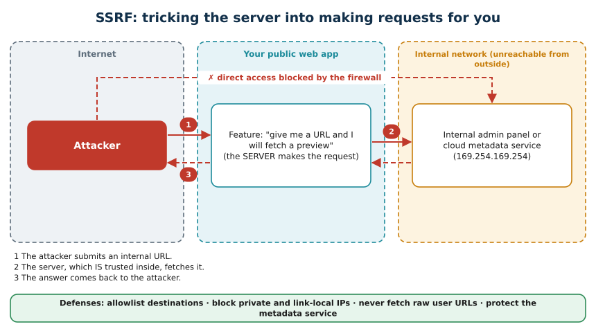
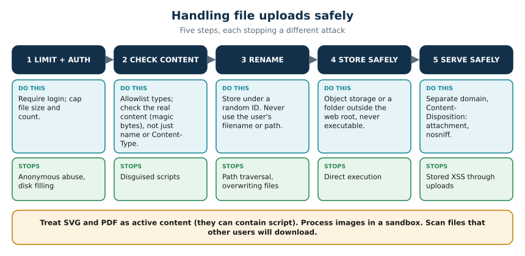
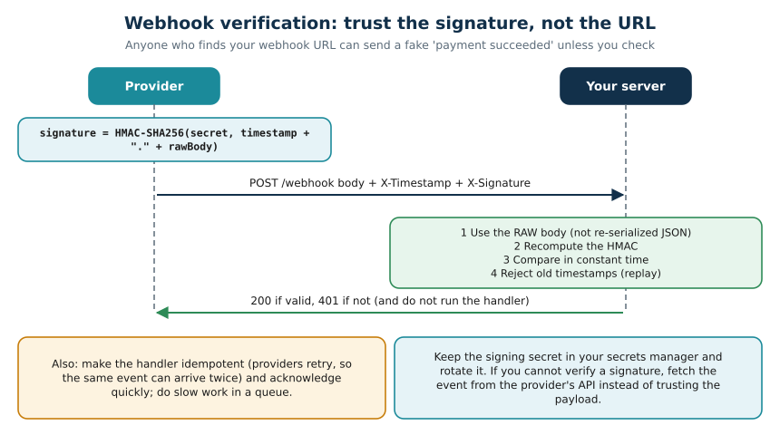
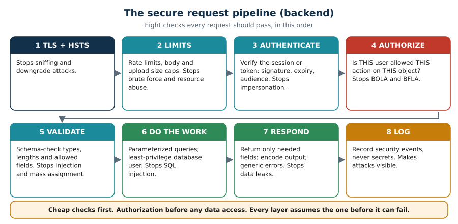

# Chapter 8: Backend Security

> **Goal.** After this chapter you can: start a service with secure framework defaults; write an SSRF-safe URL fetcher; handle file uploads and webhooks safely; manage secrets and fail closed on errors; give the application database user least privilege; and harden a container image and its runtime.
>
> **Who:** backend (frontend engineers should skim). **Time:** about 3.5 hours. **Labs:** [Lab 4](13-labs.md) (webhooks), [Lab 6](13-labs.md) (rate limits), [Lab 7](13-labs.md) (SSRF).

Chapters 3 to 6 covered the shared core (headers, auth, authorization, injection). This chapter covers what is specific to servers.

---

## 1. Secure defaults first

Turn on the framework's protections *before* writing features.

```ts
import express from "express";
import helmet from "helmet";
import { rateLimit } from "express-rate-limit";

const app = express();
app.disable("x-powered-by");                       // don't advertise the stack
app.set("trust proxy", 1);                         // correct client IP and HTTPS detection behind your proxy/CDN
app.use(helmet());                                 // security headers (review the defaults for your app)
app.use(express.json({ limit: "100kb" }));         // cap request bodies
app.use(rateLimit({ windowMs: 60_000, limit: 300, standardHeaders: true, legacyHeaders: false }));
```

| Stack | The first things to switch on or check |
| --- | --- |
| **Express / Fastify** | `helmet`, rate limiting, body limits, schema validation (zod/Ajv), a central error handler |
| **FastAPI** | Pydantic models for every input, dependency-injected authorization, a CORS **allowlist**, no debug mode in production |
| **Django** | `DEBUG=False`, `ALLOWED_HOSTS`, `SECURE_*` and `CSRF_*` settings, avoid `.raw()`/`.extra()` with user data |
| **Spring** | Keep Spring Security's defaults, **don't expose Actuator endpoints publicly**, be careful with polymorphic deserialization |
| **Go** | `database/sql` placeholders, `html/template` (auto-escaping) rather than `text/template` for HTML |

---

## 2. SSRF: when your server makes the request



**Server-Side Request Forgery** happens when your server fetches a **URL the user supplies**: link previews, image import, webhook testers, PDF generators. An attacker supplies an *internal* address, and your server, which sits inside the network, fetches it for them: admin panels, internal services, and the **cloud metadata service** at `169.254.169.254`, which can hand out credentials.

**A defence you can run and test (Lab 7):**

```ts
import net from "node:net";
import dns from "node:dns/promises";

const blocked = new net.BlockList();
blocked.addSubnet("10.0.0.0", 8, "ipv4");        blocked.addSubnet("127.0.0.0", 8, "ipv4");
blocked.addSubnet("169.254.0.0", 16, "ipv4");    blocked.addSubnet("172.16.0.0", 12, "ipv4");
blocked.addSubnet("192.168.0.0", 16, "ipv4");    blocked.addSubnet("::1", 128, "ipv6");
// ...plus the other special ranges listed in the lab

export async function assertSafeUrl(input: string) {
  const url = new URL(input);                     // the parser normalizes tricks like http://2130706433/
  if (!["http:", "https:"].includes(url.protocol)) throw new Error("scheme not allowed");
  const host = url.hostname.replace(/^\[|\]$/g, "");
  const addrs = net.isIP(host) ? [{ address: host, family: net.isIP(host) }] : await dns.lookup(host, { all: true });
  for (const a of addrs) if (blocked.check(a.address, a.family === 6 ? "ipv6" : "ipv4")) throw new Error("blocked address");
  return url;
}
```

**Defence in depth for SSRF:**

1. **Prefer an allowlist of hosts** over a blocklist of bad IPs whenever the feature allows it.
2. **Connect to the address you validated** (don't resolve again) to defeat DNS rebinding; re-validate **every redirect** or disable redirects.
3. **Short timeouts and response-size caps**; never return raw responses or error text to the user.
4. **Cloud:** use the hardened metadata service (AWS IMDSv2 requires a session token) and give the server's role **minimum permissions**.
5. **Network egress rules** so the web tier can't reach internal services it doesn't need.

> **The textbook case** is Capital One (2019), where public reporting describes SSRF reaching cloud credentials. It is the *classic illustration*, not a current trend; what is current is the lesson that **cloud credentials within reach** make SSRF severe. (OWASP merged SSRF into A01 in 2025.)

---

## 3. File uploads



Uploads combine several attacks: oversized files, disguised scripts, path traversal and stored XSS.

```ts
import multer from "multer";
import { fileTypeFromBuffer } from "file-type";
import crypto from "node:crypto";

const upload = multer({ storage: multer.memoryStorage(), limits: { fileSize: 5 * 1024 * 1024, files: 1 } });
const ALLOWED = new Map([["image/png", "png"], ["image/jpeg", "jpg"]]);

app.post("/avatar", requireLogin, upload.single("file"), async (req, res) => {
  if (!req.file) return res.sendStatus(400);
  const detected = await fileTypeFromBuffer(req.file.buffer);          // check the REAL content, not the name or Content-Type
  const ext = detected && ALLOWED.get(detected.mime);
  if (!ext) return res.status(415).json({ error: "unsupported file type" });
  const key = `${crypto.randomUUID()}.${ext}`;                          // random name; never the user's filename
  await objectStore.put(`avatars/${key}`, req.file.buffer, { contentType: detected.mime });   // object storage, outside the web root
  res.json({ url: `https://static.example-cdn.com/avatars/${key}` });   // served from a separate domain
});
```

**Serve safely:** from a **separate domain** (so uploaded content can't read your cookies), with `Content-Disposition: attachment` for downloads and `X-Content-Type-Options: nosniff`. Treat **SVG and PDF as active content** (they can carry script). Process images (resize, re-encode) in a sandboxed worker, which also strips hidden payloads. Scan files other users will download.

---

## 4. Webhooks: trust the signature, not the URL



Anyone who discovers your webhook URL can post a fake "payment succeeded". Providers sign their requests; you must verify.

```ts
import crypto from "node:crypto";

app.post("/webhook", express.raw({ type: "application/json" }), (req, res) => {   // RAW body, not parsed JSON
  const ts = Number(req.get("x-timestamp"));
  const given = Buffer.from(req.get("x-signature") ?? "", "hex");
  const expected = crypto.createHmac("sha256", process.env.WEBHOOK_SECRET!).update(`${ts}.${req.body}`).digest();

  const fresh = Math.abs(Date.now() / 1000 - ts) < 300;                            // reject replays older than 5 minutes
  const valid = given.length === expected.length && crypto.timingSafeEqual(given, expected);   // constant-time compare
  if (!fresh || !valid) return res.sendStatus(401);
  // enqueue the event for processing; make the handler idempotent (providers retry); respond quickly
  res.sendStatus(200);
});
```

Common mistakes: parsing the JSON first (re-serializing changes the bytes, so the signature fails or, worse, developers disable the check); comparing with `===` (timing leak); no timestamp check (replay); storing the secret in the repository.

---

## 5. Secrets and configuration

- **Never in source code, Git history, container images, front-end bundles or logs.**
- Keep secrets in a **secrets manager** (cloud KMS/secret store, Vault) and inject at runtime. `.env` files are for local development only and stay out of Git.
- **Separate secrets per environment and per service**; give each service its own least-privilege credentials.
- Prefer **short-lived credentials** (cloud roles, workload identity, OIDC) over long-lived keys.
- **Scan for leaks** in CI and with pre-commit hooks, and enable your code host's push protection.
- **Assume leaks will happen** and rehearse the response: **revoke, rotate, find what it touched, check logs.** Deleting the commit is not enough.

---

## 6. Errors and logging: fail closed



**OWASP A10 (Mishandling of Exceptional Conditions)** is about what your code does when something goes wrong.

```ts
// FAIL-OPEN (bad): an exception silently leaves the user allowed
let allowed = true;
try { allowed = await policy.check(user, action, resource); } catch { /* ignored */ }

// FAIL-CLOSED (good): any failure means "no"
let allowed = false;
try { allowed = await policy.check(user, action, resource); } catch (err) { log.error({ err }, "policy check failed"); }
if (!allowed) return res.sendStatus(403);
```

**Client-facing errors** should be **generic** (`{"error":"request failed"}`, with a correlation ID); never stack traces, SQL, file paths or "user not found" vs "wrong password". **Logs** should be structured, centralized and tamper-resistant, and should record **security events** (logins, failures, permission denials, password changes, admin actions, unusual access). **Never log** passwords, tokens, full card numbers or secrets, and watch personal data. Alert on a few signals that matter (many failed logins, impossible travel, mass downloads).

---

## 7. The database

- **Least privilege:** the application user can `SELECT/INSERT/UPDATE` the tables it needs, **not** `DROP`, not superuser, not other schemas. Use a **separate account for migrations**.
- **Network isolation:** the database accepts connections only from your app tier, never the public internet. (Exposed databases are a common 2026 breach headline.)
- **Parameterized queries only** (Chapter 6); **row-level security** for multi-tenant data (Chapter 5).
- **Minimize and protect sensitive data:** collect less, encrypt at rest, consider field-level encryption or tokenization for the most sensitive fields, and limit retention.
- **Backups:** encrypted, access-controlled, and restore-tested.

---

## 8. Containers and runtime

A secure Dockerfile for a Node service:

```dockerfile
FROM node:24-slim AS build
WORKDIR /app
COPY package*.json ./
RUN npm ci --ignore-scripts                    # exact lockfile versions; no install-time scripts
COPY . .
RUN npm run build && npm prune --omit=dev

FROM gcr.io/distroless/nodejs24-debian12       # minimal runtime: no shell, no package manager
WORKDIR /app
COPY --from=build /app .
USER nonroot                                    # never run as root
EXPOSE 3000
CMD ["server.js"]
```

| Practice | Why |
| --- | --- |
| **Non-root user**, read-only root filesystem, drop Linux capabilities | A compromise gets less |
| **Minimal base image**, pin by digest | Fewer packages to patch; reproducible builds |
| **No secrets in the image** (`ENV`, `COPY .env`, build args) | Image layers are readable by anyone who can pull the image |
| **Multi-stage builds** | Build tools never reach the runtime image |
| **Scan images and dependencies** in CI | Catches known-vulnerable packages. (Scanners are supply-chain components too: in 2026 the Trivy tool itself was reported among compromised developer tools, so pin and verify them like anything else.) |
| **Resource limits** (CPU, memory) | A runaway request can't take down the node |
| **Kubernetes:** network policies, no privileged pods, secrets from a store | Contain lateral movement |

---

## 9. Cloud basics for backend developers

- **Least-privilege roles per service**; no wildcard (`*`) permissions; no long-lived access keys on laptops or in CI.
- **Private by default:** storage buckets and databases not public; account-level "block public access" switches on.
- **Metadata service:** require the hardened version (IMDSv2 on AWS).
- **Audit logging on** (for example CloudTrail), shipped somewhere an intruder can't edit.
- Cloud incidents are mostly **configuration**: a 2026 roundup reported several exposures of passport and driver's-licence data through publicly accessible servers (reported incidents, not hacks). Review your infrastructure-as-code in pull requests with the same care as application code.

---

## 10. Backend pull-request checklist

- [ ] Every route authenticates and authorizes **per object** (tests exist for cross-user access)
- [ ] Input is validated by a strict schema; only `parsed.data` is used
- [ ] Queries are parameterized; identifiers are allowlisted; the DB user is least-privilege
- [ ] Outbound fetches of user-supplied URLs go through the SSRF-safe helper
- [ ] Uploads: size and type limits, content check, random names, separate-domain serving
- [ ] Webhooks verify signature, timestamp and use constant-time comparison; handlers are idempotent
- [ ] No secrets in code, config committed to Git, images or logs
- [ ] Errors fail closed and return generic messages; security events are logged
- [ ] Rate limits and size caps on expensive or sensitive endpoints

---

## Check yourself

1. What four things should an SSRF-safe fetcher do besides blocking private IPs?
2. List the steps for handling a file upload safely.
3. Why must webhook verification use the raw body and a constant-time comparison?
4. What is the difference between fail-open and fail-closed, and give an example?
5. Why should the application's database user not be a superuser?
6. Name four container hardening practices.

**Answers** *(cover this until you have tried)*

1. Allowlist hosts where possible, connect to the validated address (avoid DNS rebinding), re-check every redirect, use timeouts and size caps, and don't return raw responses; also use IMDSv2 and restrict egress.
2. Require login and cap size; check the real content type; rename to a random ID; store outside the web root (or in object storage); serve from a separate domain with `nosniff` and download disposition; sandbox processing and scan.
3. Re-serialized JSON changes the bytes, so the signature wouldn't match; a normal `===` comparison can leak timing information, while a constant-time comparison does not. Also check the timestamp to stop replays.
4. Fail-open allows access when something breaks; fail-closed denies. Example: a policy-check exception that leaves `allowed = true` is fail-open.
5. If the app is compromised (for example by SQL injection), the attacker gets only what that user can do. A superuser could drop tables or read everything.
6. Any four of: non-root user, minimal or distroless base image pinned by digest, no secrets in the image, multi-stage builds, read-only filesystem and dropped capabilities, image scanning, resource limits.

---

## Summary

- Turn on secure defaults: helmet, rate limits, body caps, a central error handler, schema validation.
- SSRF: validate scheme and resolved IP, prefer allowlists, pin the connection, handle redirects, and use IMDSv2 and least privilege.
- Uploads: limit, check content, random names, separate-domain serving. Webhooks: raw body, HMAC, timestamp, constant-time compare, idempotent handlers.
- Secrets live in a manager, short-lived where possible, and you rehearse rotation. Errors fail closed and are generic; logs capture security events, never secrets.
- The database user is least-privilege and private; containers run non-root with minimal images and no baked-in secrets.
