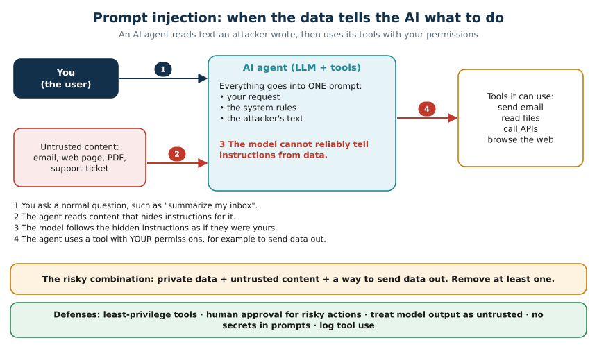
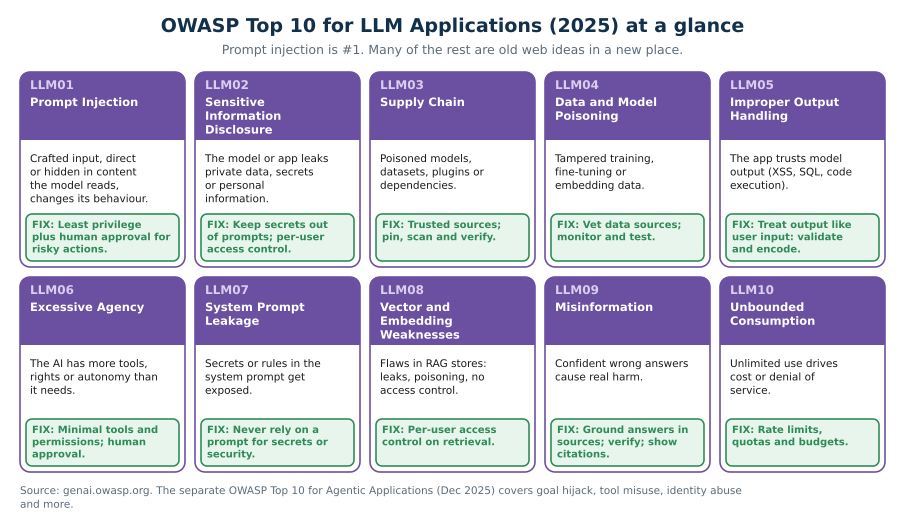

# Chapter 10: Adding AI Features Safely

> **Goal.** After this chapter you can: explain prompt injection and why an LLM can't separate instructions from data; apply least privilege to AI tools; validate and safely render model output; keep API keys and private data out of prompts and browsers; use the OWASP LLM Top 10 as a checklist; and review AI-generated code for the usual flaws.
>
> **Who:** frontend and backend. **Time:** about 1.5 hours. **Why now:** almost every product team is adding AI features, so security questions about them are increasingly common in interviews.

---

## 1. The root problem: no wall between code and data

In a normal program, instructions and data are separate. In an LLM app, **everything is text in one prompt**: your system instructions, the user's request, retrieved documents, web pages, emails and tool results. The model **cannot reliably tell trusted instructions from untrusted data**. That is the cause of the #1 risk in the OWASP Top 10 for LLM Applications: **prompt injection**.



| Type | Where the attacker's text comes from | Why it matters |
| --- | --- | --- |
| **Direct** | The user types it into the chat | Easy to attempt; limited to what that user can already do |
| **Indirect** | Hidden in content the model **reads on the user's behalf** (an email, web page, PDF, ticket, code comment) | The *victim* types nothing malicious; the attacker's text rides in through your data |

> **Real case: EchoLeak (June 2025).** A zero-click prompt-injection flaw in Microsoft 365 Copilot (**CVE-2025-32711, CVSS 9.3**): a crafted **email** could, when Copilot later processed it as context, steer it into leaking confidential data with **no click** from the victim. Microsoft fixed it server-side. ([The Hacker News](https://thehackernews.com/2025/06/zero-click-ai-vulnerability-exposes.html))

> **Real case: Instagram account recovery (2026, reported).** According to reporting by 404 Media and the New York Times, attackers posed as locked-out owners and got **Meta's AI support chatbot** to send reset codes to attacker-controlled emails. (Reported journalism, not a published incident report.) *Lesson:* an AI agent with power over a sensitive action **inherits every weakness of that action**, here weak account-recovery checks.

**The risky combination:** an AI feature becomes dangerous when it has **(1) access to private data, (2) exposure to untrusted content, and (3) a way to send data out** (email, web requests, API calls). **Remove at least one.**

---

## 2. Design rules for AI features

There is no complete fix for prompt injection, so **contain the damage** with ordinary engineering:

1. **The AI acts as the user, never as a super-account.** Tool calls use the *current user's* permissions and your normal authorization checks.
2. **Least privilege for tools.** Expose the minimum set of narrow tools (read one order, not "run any SQL").
3. **Human approval** for consequential or irreversible actions (sending email, spending money, deleting data).
4. **Treat model output as untrusted input**, exactly like user input: validate, encode, authorize.
5. **Keep untrusted content separate**, labelled, and never let it silently change the rules.
6. **No secrets in prompts.** A system prompt is not a safe place for keys or security rules.
7. **Limit cost and abuse:** rate limits, token budgets, per-user quotas, max tool-call depth.
8. **Log and monitor** prompts, tool calls and decisions (carefully, without storing secrets), and **red-team** before launch.

---

## 3. Code patterns

**Validate structured output with a schema, then authorize inside the tool** (the prompt is not a security boundary):

```ts
import { z } from "zod";

const ToolCall = z.object({
  tool: z.enum(["get_order", "search_orders"]),                  // an allowlist of tools, nothing else
  args: z.object({ orderId: z.string().uuid().optional(), query: z.string().max(200).optional() }).strict(),
});

const parsed = ToolCall.safeParse(safeJsonParse(modelText));
if (!parsed.success) return refuse("invalid tool call");           // don't "try your best" with malformed output

// The tool authorizes with the CURRENT USER's rights, not because the model asked nicely
async function get_order({ user, orderId }: { user: User; orderId: string }) {
  const order = await db.order.findFirst({ where: { id: orderId, ownerId: user.id } });   // BOLA protection (Chapter 5)
  if (!order) throw new Error("not found");
  return order;
}
```

**Never execute model output.** No `eval`, no `exec(modelText)`, no building SQL or shell commands from it. If the model suggests a query, run it **only** through a parameterized, allowlisted, read-only path.

**Render model output safely (LLM05, Improper Output Handling).** Model text can contain HTML, script, or Markdown links and images:

```tsx
import DOMPurify from "dompurify";
import { marked } from "marked";

const html = DOMPurify.sanitize(marked.parse(modelMarkdown) as string);     // sanitize AFTER rendering Markdown
<div dangerouslySetInnerHTML={{ __html: html }} />                          // or use a Markdown component with a sanitizer
```

Two extra points: **restrict where images and links can point** (a CSP `img-src`/`connect-src` plus a sanitizer allowlist). Rendering an attacker-chosen image URL that contains data in its query string has been reported as a way to smuggle information out in real prompt-injection exploits. And **never render model output into `innerHTML` unsanitized**.

**RAG (retrieval-augmented generation): authorize retrieval, not just the chat.**

```ts
// Filter by the user's permissions BEFORE anything reaches the model
const chunks = await vectorStore.search(query, { filter: { tenantId: user.tenantId, allowedGroups: user.groups }, limit: 5 });
```

If your vector database returns documents the user couldn't open normally, the model will happily summarize them (OWASP LLM08, Vector and Embedding Weaknesses).

**Keys and the browser:** **never ship an LLM provider API key to the frontend.** Call the model from your backend, which authenticates the user, applies rate limits and budgets, and returns only what the UI needs.

---

## 4. The OWASP Top 10 for LLM Applications (2025)



Memorize it as five groups: **input manipulation** (LLM01 Prompt Injection, LLM07 System Prompt Leakage); **data exposure and integrity** (LLM02 Sensitive Information Disclosure, LLM04 Data and Model Poisoning, LLM08 Vector and Embedding Weaknesses); **output and action** (LLM05 Improper Output Handling, LLM06 Excessive Agency); **supply chain** (LLM03); **reliability and cost** (LLM09 Misinformation, LLM10 Unbounded Consumption).

> **The bridge to what you already know.** Most entries are old principles in a new place: LLM05 is XSS/injection through model output; LLM06 is least privilege; LLM10 is rate limiting; LLM03 is the supply chain; LLM08 is access control on a data store. *"AI security is mostly the old principles applied to a new component"* is a strong thing to say in an interview.

For **AI agents** (systems that plan and act with tools), OWASP's separate **Top 10 for Agentic Applications (for 2026, published 9 December 2025)** adds risks such as **Agent Goal Hijack**, **Tool Misuse and Exploitation**, **Identity and Privilege Abuse**, **Agentic Supply Chain Vulnerabilities** and **Unexpected Code Execution**. The heart of it: give each agent its own limited identity, least-privilege tools, and a human check before consequential actions.

---

## 5. AI-generated code is code from a stranger

AI assistants are fast and often confident about insecure code. Review it like an unfamiliar contributor's pull request:

| Typical problem | What to check |
| --- | --- |
| Missing authorization | Does every route scope queries to the user/tenant? |
| Unsafe sinks | `innerHTML`, `dangerouslySetInnerHTML`, `eval`, string-built SQL |
| Secrets in code | Keys pasted into source or examples |
| Wrong crypto | `Math.random()` for tokens, MD5/SHA-1 passwords, disabled TLS verification |
| Invented or outdated packages | Does the package exist, is it maintained, is the name exactly right? (Attackers have been reported to register names that assistants hallucinate) |
| Over-broad permissions | `cors({ origin: true })`, wildcard IAM, `chmod 777` |

Run the **same scanners and tests** on AI-written code as on human code. Don't paste secrets or customer data into tools your company hasn't approved ("shadow AI" was among the most common insider data risks in Verizon's 2026 report).

---

## 6. Interview angle

> **"What is prompt injection and how do you defend against it?"**
> "An LLM can't reliably separate instructions from data, so text it reads (an email, a web page) can steer it. Indirect injection is the dangerous kind because the victim types nothing malicious. There's no complete filter, so I contain it: the AI acts with the user's permissions, tools are minimal and authorize inside, risky actions need human approval, model output is treated as untrusted and sanitized, no secrets in prompts, and I avoid combining private data, untrusted content and an outbound channel. A real example is EchoLeak in Microsoft 365 Copilot in 2025."

> **"How would you build a chatbot that answers questions about a customer's own orders?"**
> "The backend calls the model; the browser never sees the provider key. The chatbot only has read tools like `get_order`, and each tool authorizes against the signed-in user with the same BOLA check as the normal API. Retrieval is filtered by the user's tenant and permissions. Output is validated and sanitized before display, and I add rate limits, budgets, logging, and red-team tests with injection attempts before launch."

---

## Check yourself

1. Why can't an LLM reliably tell instructions from data?
2. Direct vs indirect prompt injection: which is more dangerous and why?
3. What is "the risky combination", and what do you do about it?
4. Why must an AI tool authorize inside its own handler instead of relying on the prompt?
5. How could a model's Markdown output cause a security problem when rendered?
6. Why should an LLM API key never be in frontend code?

**Answers** *(cover this until you have tried)*

1. System rules, the user's request, retrieved content and tool results are all text in one prompt, with no hard boundary between trusted instructions and untrusted data.
2. Indirect: the attacker's text hides in content the model reads on the user's behalf, so the victim does nothing wrong (EchoLeak is the example).
3. Private data + untrusted content + a way to send data out. Remove at least one of the three.
4. A prompt is advice that injection can override; the tool handler is code that enforces the user's permissions regardless of what the model asks.
5. It can contain script/HTML (XSS) or links and images pointing at attacker URLs that can carry data out. Sanitize after rendering, restrict image and link destinations, and use a CSP.
6. Anyone can read it from the bundle or network traffic and use it at your expense; proxy through your backend with authentication, rate limits and budgets.

---

## Summary

- An LLM mixes instructions and data in one prompt: prompt injection (especially indirect) is #1, and there is no complete fix.
- Contain it: user-permission tools, minimal tools, authorization inside handlers, human approval, untrusted output, no secrets in prompts, break the risky combination.
- Validate model output with schemas, never execute it, sanitize before rendering, authorize retrieval, keep keys on the backend.
- OWASP LLM Top 10 (2025) and the Agentic Top 10 (Dec 2025) are checklists; most items are old principles in a new place.
- Review AI-generated code as you would a stranger's: authorization, unsafe sinks, secrets, crypto, invented packages.
